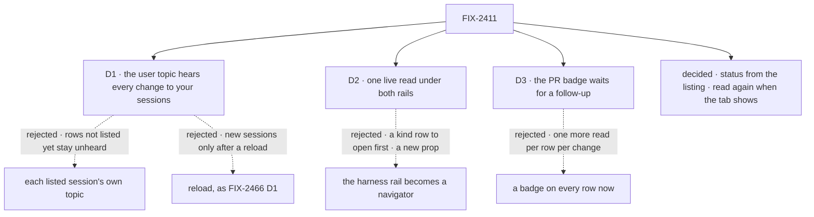

# FIX-2411 · Decisions

[Spec](SPEC.md) · **Decisions**

Three calls are the owner's. The rest follows from the epic's rules (FIX-2369 D2, FIX-2367 ER-2,
ER-3 and ER-5) and from what the bus and the runs listing already do.

## The tree

Solid edges are what you're signing. Dashed edges lost, and the label says why.

## D1 · Your user topic hears every change to your sessions

| | |
|---|---|
| **Instead of** | Subscribing to each listed session's own topic, as the claude-code-style lab does, plus a notice only when a session is created · or a new session joining at reload ([FIX-2466 D1](../FIX-2466/DECISIONS.md#d1)) |
| **Because** | A list has to hear rows it does not list yet, and only a topic it already holds can carry that: the owner's user topic. Treating the owner as one more parent of each session reuses the bus's one rule ("a write publishes `run` on the session's parent"), with no new kind or topic (ER-2). One topic also covers every row, where per-row topics mean a topic per row, re-subscribed each time the list changes. FIX-2466 D1 named its own flip: *"an app lists sessions that other people or processes add"*. This rail lists sessions from other tabs, scripts and `fsdev run` |
| **Locks in** | Every session write and every request write except `items` and state field deltas (`patchField`, `incField`, `pushToArray`, `deleteField`, which a busy turn writes many of and no row shows) also publishes `run` on the owner's user topic. The bus's session identity carries the owner for this. `ChangeKind`'s `run` reads "a session record was written: the topic's own session, a run under it, or, on a user topic, one of that user's sessions". Every list watcher reads the listing again, once per burst, when any of its user's sessions starts, ends or is titled |

![D1: how does a session list hear a change to a session it may not list yet? Chosen: the owner's user topic hears every change to that user's sessions. Instead of: each listed session's own topic plus a notice on create. It comes down to rows not listed yet: per-row topics never hear them. The price is a listing read whenever any of the user's sessions starts or ends a turn. Both use the bus's existing run kind. Locks in run on the user topic for every session and request write. Flips if one user runs so many sessions at once that open rails read constantly](figures/d1-user-topic.svg)

It comes down to rows not listed yet: a session's own topic can't name a session the list hasn't
seen.

**What would change my mind:** one user with tens of sessions running turns at once, so that
open rails read the listing several times a second. Then the user-topic notice narrows to
session create, delete and title, and each row's state rides its own topic.

## D2 · One live read under both rails; the harness rail keeps its own flat drawing

| | |
|---|---|
| **Instead of** | The harness rail drawn by `FlowNavigator` itself |
| **Because** | The navigator draws a flow as a kind row you open, which suits Flow State's many flows and not a harness mode's one flow, whose sessions are the whole rail. Making it open a lone kind by itself is a new prop on a component whose props are an asserted allow-list, or a change to Flow State's Assistant section. The need both rails share is the read: live, with each row's state. That goes in one hook, `useSessionList`, extended from the navigator's own leaf read, and both rails draw from it |
| **Locks in** | `useSessionList` as a public `@flow-state-dev/react` hook. Kitchen Sink keeps two drawings of a session row, its harness list and the navigator's, over one read and one label helper |

It comes down to the navigator's shape: in a harness mode it would add a kind row to open
before any session.

**What would change my mind:** the navigator gaining a flat single-flow view for another
reason (FIX-1494's leaf events point that way). Then the harness rail becomes a navigator too.

## D3 · The pull-request badge waits for a follow-up

| | |
|---|---|
| **Instead of** | A badge on every row now, from each session's observed pull-request record |
| **Because** | The record is a collection inside each session, so a badge per row is one more read per row, again on that row's resource notices. The row's state needs none: it comes with the listing. The badge earns a design of its own (a count on the listing, like the state, or a read per visible row) and nothing in the state marks waits on it |
| **Locks in** | Rows show state, model and recency, with no pull-request badge. [FIX-2553](https://linear.app/fixpoint-labs/issue/FIX-2553), under FIX-2369, owns the badge |

It comes down to reads: the badge costs a read per row; the state costs none past the listing.

**What would change my mind:** a listing option that counts a session's pull requests as it
counts its state. Then the badge comes in with no read per row.

## Decided, not asked

- **The row's state comes from the listing, not from the browser.** `sessions.list({ include:
  "status" })` returns `requestStatus` on each row: the latest request's `RequestStatus`, by
  the runs listing's rule (a live request wins, else the most recent), in at most two
  reads per row on the server, each returning at most one record, under that session's own
  request scope. The rows' scopes differ (flow kind, flow id, organization), so the runs
  listing's batched form doesn't carry over as is; if a page proves slow on a store with no
  index, batching moves there. `include` takes a list, so `"dispatch-runs"` and
  `"status"` combine. Without `"status"` the listing is byte for byte today's. A session with no
  request has no `requestStatus` (`== null` guard, BP-030).
- **What needs you:** `suspended` when the stop waits for a person (a question, or a harness
  turn's tool approval, which suspends the turn), `interrupted` (lost to a restart, with Continue or Discard
  from FIX-2377), `failed` and `incomplete`. `aborted` is a stop you made and is not marked. A
  turn also suspends on a wait for other work (a worker's `sendMessage({ wait: true })`), which
  resumes by itself, so the listing adds `requestWaitsForUser` to a `suspended` row, from that
  request's pending suspensions (`isUserSuspension`), one more read only for suspended rows. A
  row from a server without it reads as waiting on you. The rule lives once, in the exported
  `sessionRowState`, which both rails draw from.
- **The hook reads again when the page becomes visible.** On a host whose bus says it crosses
  processes but runs as two, as Kitchen Sink's SQLite store does under `fsdev run`, no notice
  reaches the rail ([the in-memory bus](../../../packages/engine/src/bus/in-memory-bus.ts) reports
  `crossesProcesses: true`). One read on becoming visible is not a timer and not a watch
  interface (FIX-2369 D2), and it is free while the tab stays in view.
- **The fallback timer is `client.subscribe`'s**, at the pace the host passes, and only where
  push can miss a change (FIX-2428 D3).
- **Rows read through the client the host passes**, as the navigator's reads do today, so a
  host's credentials ride every read and the socket. The navigator's client type gains an
  optional `subscribe`: a host's narrowed client without one (Kitchen Sink's `railSessions`
  passes it through after this change) reads as today, once per opening, so no host breaks.
- **The navigator draws the state mark and the recency itself**, as text with `--fsd-nav-*`
  colours, since the package ships no icon set. A host adds anything else, such as the model,
  through its own drawing (Kitchen Sink's harness list) or `rowTrailing`.
- **Flow State's coordinator rows** are built by the page from each coordinator's conversation
  (`railSessions`), not by the listing. Its adoption reads their state the same way, with
  `include: "status"` on a listing narrowed to those conversations, so they carry marks too.
- **Recency is `updatedAt`**, redrawn on a coarse clock (a minute), not re-read.
- **Two PRs:** the package change (engine, client, react), then Kitchen Sink's adoption, which
  sits in the epic's Kitchen Sink `flow-state/page.tsx` stack 2 after stack 1 merges. The
  package PR gets a changeset (`minor`: a new hook and a listing option).
- **Follow-ups filed with this spec:** [FIX-2552](https://linear.app/fixpoint-labs/issue/FIX-2552), the claude-code-style lab
  adopts the user topic and the listing's state; [FIX-2553](https://linear.app/fixpoint-labs/issue/FIX-2553), the pull-request badge (D3).

## Considered and dropped

| Alternative | Why not |
|---|---|
| A notice only when a session is created, on the user topic, with each row's state on its own topic | Two subscriptions for one list, and the per-row half re-subscribes whenever the list changes |
| Each row's state from the browser, reading its requests (the claude-code-style lab's way) | One read per row per change from the browser; the listing answers for the page in one round trip |
| A new `ChangeKind` such as `session` | ER-2 and FIX-2426's one-publisher rule: `run` already means a session record changed |
| A timer for the `fsdev run` case | ER-3 forbids an always-on poll; reading when the tab shows covers the person who is looking |
| `live` on `useFlow` | It reads the flow list and owns selection and create; a rail would pay for both |

## Analysis

2026-11-04 · watermark `c904dc3c` (FIX-2426, FIX-2428, FIX-2466, FIX-2377 merged) · **Right
approach.** Run by the author in this thread, with no fresh sub-agent; a fresh `analysis` may run
before the gate.

1. **Reuse** — the bus's parent rule, the runs listing's status rule, `useSubscription` and the
   navigator's fenced read. Nothing new below the hook.
2. **Prior art** — FIX-2466's live rows; FIX-2429's board notice on a parent's topic.
3. **Other shapes** — per-row topics, browser-side status, a new kind, a timer, `useFlow`. All
   dropped above.
4. **New factors** — the in-memory bus reports crossing on a two-process SQLite setup; the
   harness rows already carry `state.model` and `state.turns`; the label helper is duplicated.
5. **Necessity** — earns its place: the issue's evidence is two rails that go stale.
6. **Ergonomics** — one hook call replaces a read, a counter and two hand re-reads.
7. **Concerns** — list reads grow with a user's session activity (D1's flip).

## How it got here

- **Draft** — framed as two Kitchen Sink rails that go stale and can't say which run needs you.
  The owner's user topic becomes one more parent on the bus, the listing carries each row's state
  by the runs listing's rule, and the navigator's leaf read becomes one live public hook under
  both rails. The pull-request badge is deferred.
- **Review round 1** — two folds. The user topic skips state field deltas (D1's price, cut at
  the publisher rather than at its flip), because a turn's state writes would wake every open
  rail. A stop on other work is not "needs you", because a worker waiting on another's reply
  suspends too (Codex).

## Notes from review

Recorded for the implementer, not folded into the design.

- *"Have `useSessionList` return rows already carrying `needsYou` (and the shared label helper),
  so the harness list and the navigator draw from the same derived row and cannot disagree."*
  (second look, 3)
- *"Extract the shared selection (live request wins, else most recent) and let the two callers
  differ only in how they collapse the status."* (second look, 4)
- *"one internal `useLiveSessionQuery(...)` shared by `useLeafSessions` and `useSessionList`, and
  keep the public surface as thin as re-exports plus docs."* (Cursor, SPEC.md:112)
- *"the harness adoption PR is where this usually regresses (frame still bumping `reads` while
  also calling the hook). Worth calling out in the Kitchen Sink PR checklist."* (Cursor, SPEC.md:30)
- *"ensure implementers don't add additional per-row reads on top (badge/D3 territory)."*
  (Cursor, DECISIONS.md:31)
- *"export it (or a small shared row chrome component) from `@flow-state-dev/react` so status
  marks and labels can't drift silently."* (Cursor, DECISIONS.md:49)
- *"Consider documenting the exact query params in the spec so `flow-state/page.tsx` doesn't
  invent a third listing pattern."* (Cursor, DECISIONS.md:103)
- *"Suggest running the standalone `analysis` skill before the direction gate."* (Cursor,
  DECISIONS.md:125)

**Open: none.**
