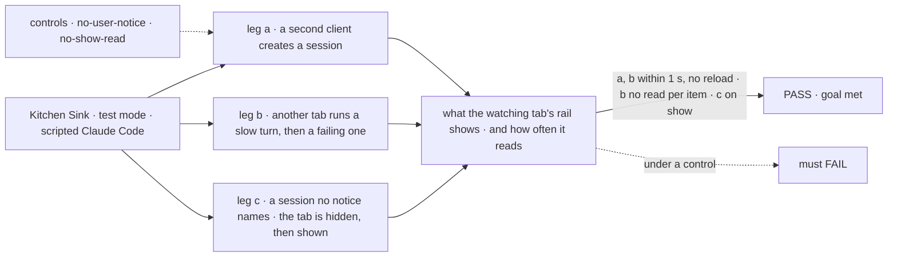
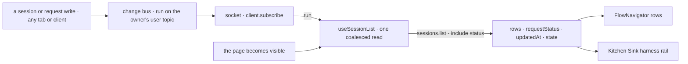

# FIX-2411 · Live session list with per-row status, model and recency (one rail for every mode)

**Spec** · [Decisions](DECISIONS.md)

## Five people, before and after

| Someone who… | Today | After |
|---|---|---|
| **runs several coding sessions in a Kitchen Sink harness mode** | Each row is a title or a cut-down id. A turn that is running, failed, was interrupted by a restart or waits on a tool approval looks the same as one that finished, so you open each session to find the one that needs you | Each row shows its latest turn's state, its model and how long ago it changed, and rows that need you are marked. A row changes within a second of its turn changing |
| **starts a session in another tab, or from a script through the client** | It never shows in this tab's rail until a reload | It shows within a second ([D1](DECISIONS.md#d1)) |
| **starts a session with `fsdev run` against the app's local SQLite store** | It never shows until a reload | It shows when you come back to the tab. On the Postgres bus, which crosses processes, within a second ([decided](DECISIONS.md#decided-not-asked)) |
| **works in Flow State mode** | An open rail section reads its sessions once. The page reads it again by hand after New session and after a title lands | The open section is live the same way and carries the same marks. The page's hand-made re-reads go |
| **builds an app with its own list of sessions** | Writes its own read and its own reasons to read again, as Kitchen Sink and the claude-code-style lab each did | Calls the hook the navigator uses (`useSessionList`) and gets the rows, live, each with its latest turn's state ([D2](DECISIONS.md#d2)) |

A session list that goes stale is how a failed or waiting run gets missed. The push channel
([FIX-2367](../../epics/FIX-2367/SPEC.md)) is merged, so the list can be live with no timer.

## The goal, and how we'll know it's met

**In every Kitchen Sink mode, the session rail shows a session started anywhere on the same server,
and each listed session's latest turn state (running, waiting on you, interrupted, failed, done),
within a second of the change, with no reload and no timer while push is up; a session another
process wrote shows when the tab comes back into view.**

| Is it the right goal? | |
|---|---|
| **The real need** | The issue: *"Sessions started in another tab or with `fsdev run` never appear, and with several detached coding runs you must open each one to see which needs you."* The epic's goal: the workforce apps as a daily driver ([FIX-2369](../../epics/FIX-2369/SPEC.md)) |
| **Smaller, and rejected** | Read the rail again on focus only. A session from another tab shows only after you leave and come back, and a row still can't say whether its turn failed |
| **Bigger, and not this issue's** | A pull-request badge on each row ([D3](DECISIONS.md#d3)). The claude-code-style lab's list hearing new sessions ([FIX-2552](https://linear.app/fixpoint-labs/issue/FIX-2552): its adapter is another stack's hot file). A leaf open and close event on the navigator (FIX-1494) |
| **Not done if** | A row's state comes from the browser reading each session's requests one by one · the rail reads on a timer while the socket is up on a bus that crosses · a streamed reply makes the rail read once per item · the harness rail and the navigator read their sessions through two different code paths · the Flow State page still re-reads the navigator by hand |



The check reads what the rail draws and counts its listing reads, not calls to `publish`.

| How we verify | |
|---|---|
| **Goal check** | A Kitchen Sink browser test for legs a and b (`apps/kitchen-sink/e2e/`, beside `claude-code-mode.spec.ts`), and a `@flow-state-dev/react` test for leg c. Model `n/a`: the scripted Claude Code runs the turns. Run by the implementer at completion; verdict on the implementation PR |
| **Signal** | (a) A session a second client creates is a row in the watching tab's Claude Code rail within 1 s, with no reload. (b) That row reads *running* within 1 s of a `[slow]` turn starting in another tab, and *failed*, marked as needing you, within 1 s of a `[fail]` turn ending. During the slow turn's reply the rail makes no more listing reads than during a two-item reply. (c) A session created while no notice can reach the hook is in its rows within 1 s of the page becoming visible |
| **Input** | Two browser pages on one server in test mode, the second the "other tab". A different valid input: the rail of another user hears nothing and makes no read when this user's session changes |
| **Anti-game** | Assert on the rail's rows and their marks in the page, and on listing requests counted at the network, not on notices published. The failing turn is the scripted harness's real failure path, not a status written by the test |
| **Control that must fail** | `GOAL_CONTROL=no-user-notice` (session and request writes publish nothing on the owner's user topic): legs a and b must FAIL. `GOAL_CONTROL=no-show-read` (the hook ignores the page becoming visible): leg c must FAIL. Today's `main`: legs a and b fail |

## What changes

![What changes. Three layers change and one comes out. The change bus publishes a run notice on the owner's user topic for every session write and every request write except items. The session listing, asked with include status, returns each row's latest request status, in one round trip. In the React package, the navigator's leaf read becomes the public useSessionList hook, live on the user topic and on the page becoming visible, and the navigator draws each row's state mark and how long ago it changed. In Kitchen Sink, the harness rail draws from useSessionList with the model and a needs-you mark, its own read and its reads counter come out, and the Flow State page drops its hand-made re-reads. Left as they are: useFlow's session list, the claude-code-style lab's list, and the pull-request badge, deferred by D3](figures/what-changes.svg)

The bus already says when a session changes; this adds the one topic a list watches, the state a
row needs, and one hook both rails read through.

```diff
 // Kitchen Sink's harness rail: one live read, shared with the navigator
-const [reads, setReads] = useState(0);
-useEffect(() => { client.sessions.list({ flowKind, userId }).then(setRows, setListError) }, [client, flowKind, reads]);
+const { sessions, error, refresh } = useSessionList({ flowKind, client });
+// each row: requestStatus ("in_progress" · "suspended" · "interrupted" · "failed" · …), updatedAt, state.model

 // Flow State page: no more re-reading the navigator by hand
-leaf.refresh();                                   // after New session
-useEffect(() => { assistantLeafRefresh.current?.() }, [sessionTitle]);  // after a title lands
```

**Docs:** update `packages/react/README.md` (a `useSessionList` entry under *Hooks*; the
*FlowNavigator* section says an open leaf is live and draws each row's state),
`packages/client/README.md` (`sessions.list`'s `include: "status"` and the row's
`requestStatus`), `apps/docs/docs/api/client.md` (a `run` notice on the user topic names one of
your sessions changing), `apps/docs/docs/api/react.md` (the hook in the hooks list) and
`apps/docs/docs/workforce/ui.md` (the navigator reads live). No new page: each is one more entry
on a page that already covers its neighbours.



## What stays as it is

- **Every read the rail makes goes through `sessions.list`**, with the same owner, organization
  and tenant scoping. A notice says when to read; the listing says what.
- **The session topic's notices.** A view of one session hears exactly what it hears today.
- **The navigator's props.** No new prop: liveness and the marks come with an open leaf.
- **How a harness session is titled**: from its first prompt, as the session flow already does.
- **`useFlow`'s session list**, read on mount and after its own create.

## What's already here, and the debt

| Already here | What this does with it |
|---|---|
| **The job, "show a person their sessions".** Searched `sessions.list(` and `listWorkerSessions(` across `packages/`, `apps/` and `labs/`: the navigator's leaf read (`useLeafSessions`), `useFlow`, Kitchen Sink's harness frame, Shift Manager's `reads.ts` and the claude-code-style lab's `watchSessions`. No mechanism row names the job. Closest: `useLeafSessions` | **Extends** it into the public, live `useSessionList`, and **removes** the harness frame's copy. This is the second public way to read a session list in react, beside `useFlow` |
| `change-bus` (FIX-2426): a session write publishes `run` on the session and its parent; a request write publishes `request` on its session and `run` on the parent | **Extends** it: the owner's user topic is a parent of every session it owns ([D1](DECISIONS.md#d1)) |
| `push-delivery` (FIX-2428): `client.subscribe`, `useSubscription`, and the fallback timer wherever push can miss a change | **Builds on** it, unchanged |
| The runs listing's status rule (`resolveDispatchRunStatus`, `resolveActiveDispatchRuns`): a live request wins, else the most recent one | **Builds on** its rule for the listing's `include: "status"`, keeping `suspended` and `interrupted` apart because a person acts on each |
| The claude-code-style lab's `watchSessions`: live rows, each on its own session's notices, a running flag from each row's requests | **Leaves alone**: [FIX-2552](https://linear.app/fixpoint-labs/issue/FIX-2552) adopts the user topic and the listing's status |
| [FIX-2466 D1](../FIX-2466/DECISIONS.md#d1): a session opened elsewhere joins that lab's list at reload | **Supersedes** its *Instead of*, by its own flip: this issue's rail lists sessions other tabs and processes add. Its lab keeps its behaviour until the follow-up |
| [FIX-2426's publish table](../FIX-2426/SPEC.md) and the `run` kind in `ChangeKind` | **Amends** them: a `run` notice on a user topic means one of that user's sessions changed |
| [FIX-2369 D2](../../epics/FIX-2369/DECISIONS.md#d2): this issue consumes `client.subscribe` and adds no client watch interface | **Kept.** The page becoming visible is one more reason to read, not a watch interface or a timer |

| Adds | Existing piece considered | Why it doesn't fit / how composed |
|---|---|---|
| `useSessionList` (react) | `push-delivery` · `useSubscription`; `useLeafSessions`; `useFlow` | Composed: `useLeafSessions`'s fenced read, made live with `useSubscription` on the user topic, and exported. `useFlow` also creates and selects sessions and reads the flow list; a list hook inside it would read the flow list per rail |
| `run` on the owner's user topic | `change-bus` · the `run` notice on a parent | Extends the one publisher: the owner is one more parent. No new kind, no new topic |
| `include: "status"` and `requestStatus` on the listing | The runs listing's status rule | Extends `include`, already a list, with the rule the runs listing uses |
| The navigator's state mark and recency | `rowTrailing` | A trailing slot shows only on hover or focus; a state you scan for has to show always, so the navigator draws it |

| The debt | |
|---|---|
| **Removes** | The harness frame's own listing read and its `reads` counter; the Flow State page's two hand-made re-reads of the navigator; the second copy of the session label helper (`ENGINE_ID` and `sessionLabel`, today in the navigator and in the harness list) |
| **Adds** | A second public way to list sessions in react, beside `useFlow` (permanent by design: `useFlow` is a lifecycle hook, and its list could build on this later). Every list watcher reads the listing again when any of its user's sessions starts or ends a turn: one coalesced read, accepted now ([D1](DECISIONS.md#d1)) |
| **Leaves** | The claude-code-style lab's list, still blind to new sessions ([FIX-2552](https://linear.app/fixpoint-labs/issue/FIX-2552)). The pull-request badge ([D3](DECISIONS.md#d3), [FIX-2553](https://linear.app/fixpoint-labs/issue/FIX-2553)). On a store whose bus says it crosses processes but runs as two (SQLite with `fsdev run`), a change shows when the tab comes back into view |

**Net: down.** One read and its counter, two hand re-reads and a duplicated helper go; one hook
comes in, extended from the navigator's own.

## Sign off

**[The goal](#the-goal-and-how-well-know-its-met):** every Kitchen Sink rail live within a second
for sessions started anywhere on the server and for each row's turn state. If wrong: a rail that
updates for new sessions but still can't say which run needs you.

**[The debt](#whats-already-here-and-the-debt): down**, one read, two hand re-reads and a
duplicated helper out, one hook in. If wrong: two list hooks drift apart in react.

1. **[D1](DECISIONS.md#d1) · Your user topic hears every change to your sessions.** The one to
   weigh: it reverses FIX-2466 D1. If wrong: a user with many busy sessions makes every open
   rail read often.
2. **[D2](DECISIONS.md#d2) · One live read under both rails; the harness rail keeps its own flat
   drawing.** If wrong: two drawings of one row drift.
3. **[D3](DECISIONS.md#d3) · The pull-request badge waits for a follow-up.** If wrong: a merged
   or open PR still means opening the session.

**Open: none.**

Feature · engine, client, react, Kitchen Sink · medium: one publisher, one listing option, one
hook, two rails · epic FIX-2369
