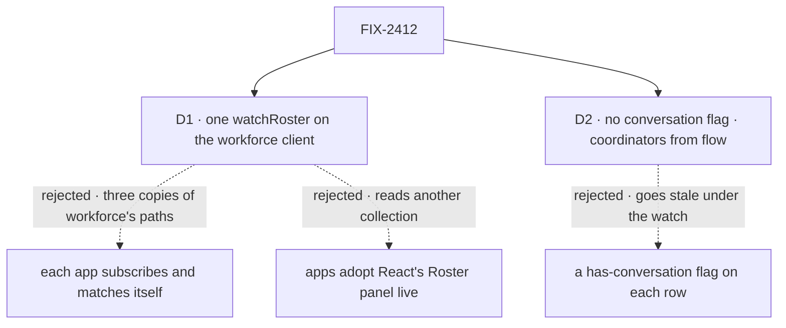

# FIX-2412 · Decisions

[Spec](SPEC.md) · **Decisions**

What was considered, what was chosen, why, and what each choice locks in. Two decisions are the
sign-off surface. Everything else here is context for them.

## The tree

Solid edges are what you're signing. Dashed edges lost, and the label says why.

## D1 · The roster watch is one method on the workforce client, `watchRoster`, built on `client.subscribe`

| | |
|---|---|
| **Instead of** | Each app calling `client.subscribe` and matching the roster's paths itself, as [FIX-2466](../FIX-2466/SPEC.md) does for views only one app has · or the apps adopting React's `Roster` panel with `live` ([FIX-1506](../FIX-1506/SPEC.md)) |
| **Because** | Three apps read the same roster, from two collections whose storage paths only workforce knows. Per app, that knowledge is copied three times, which the epic's ER-3 forbids. The panel reads one other collection (`roster`), not the standard workers, draws its own rows, and `react` may not learn what a worker is (epic ER-1). Workforce composing `client.subscribe` is what FIX-2369 D2 asks: no client watch interface, no poll of its own (tenet 2: refine the piece that owns the noun) |
| **Locks in** | `watchRoster(onRoster, { onError })` is public on `@flow-state-dev/workforce/browser`, returning a stop function, and the source client must offer `subscribe`. Every app that shows the roster uses it; a second roster watch is a review finding. Its coalescer and path match are a copy until [FIX-2551](https://linear.app/fixpoint-labs/issue/FIX-2551) lifts one into the client |

It comes down to who knows the roster's paths: per app, workforce's storage layout is copied three times.

**What would change my mind:** the roster becoming one collection with nothing workforce-specific
to match. Then a generic live hook watches it, and the method is not needed.

## D2 · The roster gets no existing-conversation flag; coordinators come from each worker's flow

| | |
|---|---|
| **Instead of** | The issue's ask: a coordinator marker and a flag on each roster row saying whether the user already has a conversation with that worker |
| **Because** | Coordinators are already on the roster: a coordinator is a worker whose flow is the coordinator flow, and each row carries its flow, so Kitchen Sink filters on it. The flag would go stale under the watch: a first conversation opens a session, and a new session publishes nothing on the user's topic ([FIX-2466 D1](../FIX-2466/DECISIONS.md#d1)). Re-checking it would add a session listing per worker flow to every re-read. No app shows the flag; `listWorkerSessions` and `findWorkerSession` already answer it per worker |
| **Locks in** | A roster row says who a worker is, never what the user has done with it. Kitchen Sink's rail still opens each coordinator's conversation as it lists it, as today |

It comes down to staying true: a flag the watch can't keep live is wrong exactly when it matters.

**What would change my mind:** [FIX-2411](https://linear.app/fixpoint-labs/issue/FIX-2411)
or a later issue publishing a notice when a user's session is created, and an app that wants
to show "you've talked to this one". Then the flag can be live, and it is one more field.

## Decided, not asked

- **The watch hears the user topic only.** Both worker collections are user scope; the
  standard workers are a projection with no writes. It reads again on a connect, a reconnect, a
  `resync`, a timer tick, and a `resource` notice whose path is under either collection's
  prefix or names no path (a row only its owner reads publishes bare). A false yes costs a read.
- **Reads coalesce, and `onRoster` fires only when the roster changed.** One read in flight and
  one queued. An unrelated bare notice reads and draws nothing.
- **The fallback pace is the watch's, not an option.** Three seconds, as React's live panels
  use. It runs only where push can miss a change (FIX-2428 D3).
- **One watch per Shift Manager connection**, shared by Roster, TEAMS, a project's lead picker,
  worker settings and DELEGATES, as `useRoster` shares one read today. It stops following
  `readAt`.
- **Kitchen Sink's rail reads the roster at each listing.** When the listing re-runs is
  FIX-2411's. The rail and FIX-2411 meet in `lib/rail-sessions.ts`; whichever lands second
  rebases.
- **The Teammates adapter's verb becomes a watch.** `LabAdapter.listWorkers` becomes a watch
  on the same rows, and the test fake follows. FIX-2406's scenario matrix doesn't cover the
  roster, so its contract tests don't move.
- **Release note:** `@flow-state-dev/workforce` gets a `minor` changeset for the new method.

## Considered and dropped

| Alternative | Why not |
|---|---|
| Re-read the roster after every turn the app sees end | The docs' advice today. It misses another tab, another device and a worker's own turn, which is the need |
| A roster notice of its own (a new kind, or a topic narrowed to "the roster") | Topics come only from session, user and org, optionally one resource (FIX-2367 ER-2). The existing user-scope publish already names the row |
| Wait for FIX-2551 and build the watch on it | Holds three apps on an issue not yet specced. The copy is small, and FIX-2551 names it |

## Settled

- **Every roster read in the three apps is listed** — **CONFIRMED** by
  [`poc/roster-reads/`](poc/roster-reads/): 286 files, 13 sites; 9 move, 1 is removed, 3 stay
  one-shot. The planted control exits 1. The premise held; nothing changed.
- **The roster already carries coordinators** — **CONFIRMED** by reading the code: `support.help`
  declares `flow: coordinator`, a standard row carries its flow, and KS's `isCoordinatorFlow`
  already tests it. D2 rests on this.

## Analysis

2026-11-04 · watermark 2026-10-31 (issue filed) · **Right approach, with one cut.**

Run in the authoring context, not by a fresh sub-agent: this session had no way to dispatch one.
The coordinator may re-run it before the gate.

1. **Reuse** — one Adds row: `watchRoster` composes `client.subscribe`, the roster read and
   FIX-1506's publish. Extend, not new. The coalescer is a copy, filed as FIX-2551. See
   [Builds on / Adds](SPEC.md#whats-already-here-and-the-debt).
2. **Prior art** — subscribe to a change and re-fetch, with a deduped read, is the shape of
   Firestore's `onSnapshot` and TanStack Query's invalidate-on-event: the event says when, the
   query says what. Matches FIX-2367 D2.
3. **Other shapes** — per-app subscriptions (FIX-2466's shape) and the React panel. Both lose
   on D1's row.
4. **New factors** — FIX-2428 Done (the delivery child the epic waited on), FIX-1506 Done,
   FIX-2466 specced with no roster view, FIX-2526 filed (names, no collision), FIX-2534's open
   PR adds an unrelated `subscriptions` module to workforce.
5. **Necessity** — earns its place: three apps show a stale roster today.
6. **Ergonomics** — an app writes one line in an effect; the stop function is the cleanup.
7. **Concerns** — D2 cuts part of the issue's text. Surfaced on the sign-off, not folded quietly.

| Finding | Objective | Changes the approach? | Disposition |
|---|---|---|---|
| The conversation flag can't stay live under the watch | 5, 7 | Yes, scope | Folded as D2 |
| Coalescer and path match are a third copy | 1 | No | Recorded; FIX-2551 filed |

## How it got here

- **Draft** — framed as three apps reading the roster once and one hand-kept coordinator list;
  one watch on the workforce client over `client.subscribe` and FIX-1506's user-scope notices;
  the conversation flag cut because nothing would keep it live.

**Open: none.**
