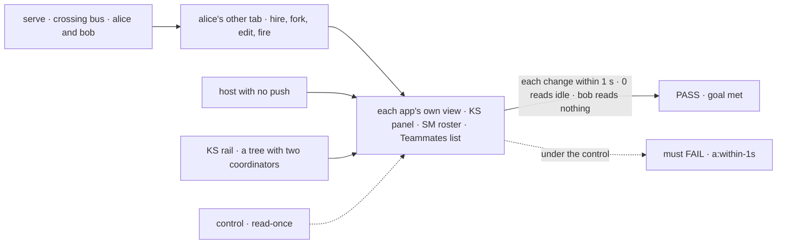
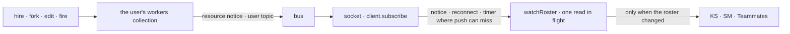

# FIX-2412 · Live roster read from workforce/browser

**Spec** · [Decisions](DECISIONS.md)

## Six people, before and after

| Someone who… | Today | After |
|---|---|---|
| **has Kitchen Sink open while a worker is hired, forked or fired** (in another tab, or by a worker's turn) | The Workers panel keeps its first read. A reload shows the change; Retry shows only after a failure | The panel shows it within a few seconds: Kitchen Sink has no push, so it reads on `client.subscribe`'s one fallback timer. Within a second on a host with push |
| **uses Shift Manager when Shift Coordinator hires a worker** | Roster and TEAMS show it at the next snapshot read; the DELEGATES picker never does, until the screen remounts | Roster, TEAMS, a project's lead picker and the DELEGATES picker follow the roster on their own |
| **works in the Teammates lab while a worker is edited or fired elsewhere** | The list keeps the old worker until a reload. Only a hire or fire made in this tab reads again | The list follows the roster. The lab's own re-read after its hire and fire goes |
| **adds a second coordinator `WORKER.md` to Kitchen Sink's tree** | The rail lists `support.help` only, and a test fails until someone edits a list in the app | The rail lists every worker on the coordinator flow, read off the roster. Nothing to edit |
| **opens a worker they have never talked to** | Talk finds or starts the conversation | The same. The roster says nothing about conversations ([D2](DECISIONS.md#d2)) |
| **runs any of these on a host with no push** | Each view reads once | Each reads at the fallback pace, through the client's one timer, never its own ([FIX-2367 ER-5](../../epics/FIX-2367/DECISIONS.md#who-owns-what)) |

The roster is what a person picks a worker from in all three apps. A list that is wrong until
a reload makes a hire look like it failed.

## The goal, and how we'll know it's met

**When a worker is hired, forked, edited or fired, from any tab or by any worker's turn, the
roster in Kitchen Sink, Shift Manager and the Teammates lab shows it without a reload or a
Retry, and Kitchen Sink's rail lists the coordinators the roster names, with no list kept by
hand.**

| Is it the right goal? | |
|---|---|
| **The real need** | The issue: a worker hired, fired or forked *"doesn't appear until a reload or a manual Retry"*, and KS *"can't learn its coordinators from the roster, so lib/workforce-shell.ts hard-codes them"*. The epic: the four apps are a daily driver ([FIX-2369](../../epics/FIX-2369/SPEC.md)) |
| **Smaller, and rejected** | "The workforce client offers a roster watch." Hittable with every app still reading once. Or: one app adopts it. ER-3 of the epic says the adopting change deletes each app's copy |
| **Bigger, and not this issue's** | Shift Manager's whole screen following changes: worker statuses, slots and the snapshot's own read of the roster ([FIX-2409](https://linear.app/fixpoint-labs/issue/FIX-2409)). The rail's session list staying live ([FIX-2411](https://linear.app/fixpoint-labs/issue/FIX-2411)). Display names for a user's own workers ([FIX-2526](https://linear.app/fixpoint-labs/issue/FIX-2526)) |
| **Not done if** | The watch exists and one app still reads once · a view shows a hire only because its own tab made it · the views keep a timer of their own with the socket up · `SHELL_COORDINATORS` or another hand list survives under a new name · the check drives the watch directly instead of each app's own view |



The check reads what each app's own view shows, and counts its reads at the fetcher. The
dashed path is the same run with the watch reading once.

| How we verify | |
|---|---|
| **Goal check** | `goals/realtime/roster-follows-hires/` · model `n/a` (the roster flow's actions write) · run by the implementer at completion · verdict on the implementation PR |
| **Signal** | `a:within-1s`: Kitchen Sink's `TeamPanel`, Shift Manager's roster hook under its real `LabProvider`, and the Teammates adapter each show a hire, a fork, an edited description and a fire less than 1000 ms after the action's request completes. `a:quiet`: each makes 0 roster reads over a 10 s idle window from its first `crosses: true` frame. `b:other-user`: bob's views make 0 roster reads and never show alice's worker. `c:no-push`: on a host with no push, each shows the hire within the fallback pace plus 1 s. `d:rail`: on a tree with two coordinators, the rail lists exactly the two |
| **Input** | `serve()` on a bound port with Kitchen Sink's workforce tree, on the crossing double (`goals/lib/crossing-bus.mts`); real WebSocket clients. A different valid input: the hire made by a worker's turn with no stream, not the client's `hire`. It must pass too |
| **Anti-game** | Assert on what each app's code renders or hands back, and on reads counted at its fetcher. Not on `publish` calls, frames sent, or a `watchRoster` called outside the apps |
| **Control that must fail** | `GOAL_CONTROL=read-once` (the watch reads at start and ignores notices and the timer): `a:within-1s` and `c:no-push` must FAIL. `GOAL_CONTROL=hand-list` (the rail lists `["support.help"]`): `d:rail` must FAIL. Today's `main` fails `a:within-1s` |

## What changes


Each row is one app's roster view. Left, a read that happens once; right, the same view on the
workforce client's one watch.

```diff
 // Kitchen Sink: the Workers panel
-useEffect(() => { workforce.roster().then(setWorkers, setError); }, [workforce, attempt]);
+useEffect(() => workforce.watchRoster(setWorkers, { onError: setError }), [workforce]);

 // Kitchen Sink: the rail's coordinators
-SHELL_COORDINATORS.map((worker) => workforce.ensureWorkerSession({ worker }))
+(await workforce.roster()).filter((w) => isCoordinatorFlow(w.flow)).map((w) => workforce.ensureWorkerSession({ worker: w.id }))
```

**Docs:** update `apps/docs/docs/workforce/durable-hire.md` → *After a hire, refresh the
roster* to keep the roster current with `watchRoster`, and the roster line in
`apps/docs/docs/workforce/ui.md`. Update the `createWorkforceClient` row and roster example in
`packages/workforce/README.md`, *Roster* in `packages/shift-manager/README.md` (the worker list
refreshes on its own; statuses are FIX-2409's), and the Teammates README's read table. No new page.



A write to the user's own workers already publishes on the user's topic (FIX-1506). The watch
reads again on a notice under its two collections' paths, or on a bare one, which may be.

## What stays as it is

- **`roster()`** and every other workforce client method. The watch reads through `roster()`.
- **Standard workers** come from files. A server restart reconnects the socket, and the watch
  reads again then. No new publisher.
- **React's `Roster` panel** and its `live` prop (FIX-1506).
- **Shift Manager's snapshot**, its own roster read included. FIX-2409 refreshes it.

## What's already here, and the debt

| Already here | What this does with it |
|---|---|
| **The job, "tell a view what it shows changed".** Mechanisms `push-delivery` (`client.subscribe`) and `change-bus`. Searched `.roster()`, `subscribe(` and `watch[A-Z]` across the workforce, orchestration and harness-manager sources: nothing watches the roster today. Closest: React's `Roster` panel `live`. This is the first roster watch, and the fourth reader that turns a resource notice into a coalesced read | **Builds on** `client.subscribe`. **Leaves alone** the panel: it reads one other collection (`roster`), not the standard workers, and no app renders it ([D1](DECISIONS.md#d1)) |
| `createWorkforceClient`, `roster()`, `WorkforceClientSource` | **Extends.** One method; the source adds `subscribe` |
| FIX-1506's publish of a user-scope row on the user topic | **Builds on.** Nothing new is published |
| Kitchen Sink's `SHELL_COORDINATORS`, its rule (the header: "a browser cannot read" the tree), and its test case | **Superseded and removed.** The roster carries each worker's flow |
| [FIX-2369 D2 and ER-4](../../epics/FIX-2369/DECISIONS.md#d2), [FIX-2367 ER-3 and ER-5](../../epics/FIX-2367/DECISIONS.md#who-owns-what) | **Kept.** No client watch interface, no poll of its own. No `live: true` hook watches the roster's two collections, so ER-5's one way per scope holds |
| [FIX-2466](../FIX-2466/SPEC.md): `useMessages`, `useProjectRead`, `TaskProvider`, `watchTalk` | **No overlap.** None is a roster read |
| [Checker](poc/roster-reads/): 13 roster reads in the three apps | **9 move, 1 removed, 3 stay** ([settled](DECISIONS.md#settled)) |

| Adds | Existing piece considered | Why it doesn't fit / how composed |
|---|---|---|
| `WorkforceClient.watchRoster` | `push-delivery` · `client.subscribe`; react · `liveScopeDriver`; Teammates · `onNotice` | Composed on `client.subscribe`. The two react-internal pieces can't be imported, and only workforce knows its paths ([D1](DECISIONS.md#d1)) |

| The debt | |
|---|---|
| **Removes** | `SHELL_COORDINATORS` and its test case; KS's one-shot read and Retry; SM's per-snapshot roster read in `useRoster` and DELEGATES' own read; Teammates' `listWorkers` and its re-reads after hire and fire |
| **Adds** | A third copy of the coalescer and the path match, in workforce. Accepted: the shared one is react-internal. Paid by [FIX-2551](https://linear.app/fixpoint-labs/issue/FIX-2551) |
| **Leaves** | Shift Manager reads the roster twice per screen, in the snapshot and in the watch; the snapshot's is FIX-2409's |

**Net: down.** One hand list, a Retry and four one-shot reads go; one method comes in, with
its coalescer copy owned by FIX-2551.

## Sign off

**[The goal](#the-goal-and-how-well-know-its-met), at that size:** all three apps follow
hires, forks, edits and fires, and the rail derives its coordinators. If wrong: a watch no app
uses, or one app still showing a hire only after a reload.

**[The debt](#whats-already-here-and-the-debt), net down:** the hand list and four one-shot
reads go; one method and a coalescer copy come in. If wrong: a third copy that drifts before
FIX-2551 lands.

1. **[D1](DECISIONS.md#d1) · The roster watch is one method on the workforce client,
   `watchRoster`, built on `client.subscribe`.** If wrong: a public method we keep, beside a
   shared helper that would have done.
2. **[D2](DECISIONS.md#d2) · The roster gets no existing-conversation flag; coordinators come
   from each worker's flow.** If wrong: an app that needs the flag reads conversations per
   worker.

**Open: none.** D2 is the one to weigh: it cuts part of what the issue asked. The reasoning
and what lost are in [DECISIONS.md](DECISIONS.md).

Feature · `workforce` + Kitchen Sink, Shift Manager, Teammates lab · medium · epic FIX-2369
