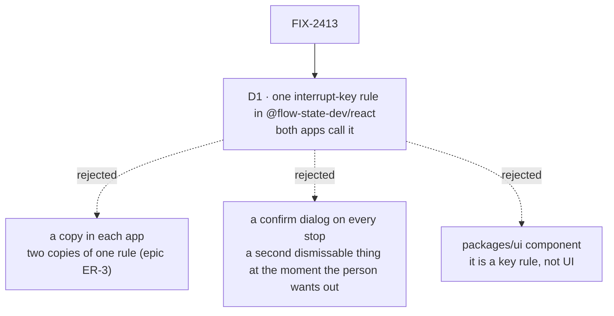

# FIX-2413 · Decisions

[Spec](SPEC.md) · **Decisions**

One decision is the sign-off surface. The rest was decided without asking and is recorded so
nobody re-derives it.

## The tree

Solid edges are what you're signing. Dashed edges lost, and the label says why.

## D1 · One interrupt-key rule, in `@flow-state-dev/react`, that both apps call

| | |
|---|---|
| **Instead of** | Writing the double-press timer and the text-field rule into `TaskFrame.tsx` and the lab's thread view separately; or a `packages/ui` registry component |
| **Because** | Two apps show the same need, and the epic's ER-3 sends a need two apps show to the package. `isSendKey` already set the precedent: the one send shortcut every box shares lives in `react` as a pure check, and both labs import it. The interrupt rule is the same kind of thing: a key rule with no markup, so the UI registry (D4's home for shared UI) is the wrong place. It names no workforce noun, so ER-1 holds |
| **Locks in** | A new public export pair, `createInterruptKeys` and `useInterruptKeys`, with a changeset. The window defaults to 1,500 ms and is an option |

**What would change my mind:** a third app that wants a different stop gesture (a long-press, a
confirm). Then the shape is a pattern each app picks, and this export narrows to the parts they
share.

## Decided, not asked

- **1.5 s window.** The issue's number. Long enough for a deliberate second press, short enough
  that two unrelated dismisses a few seconds apart do not add up to a stop.
- **Text fields spend Esc.** In a textarea, input or contenteditable, Esc belongs to the field
  (IME, browser undo of autocomplete, blur). It resets any arming rather than counting. Cmd/Ctrl+.
  works there, since nobody types it by accident.
- **A dismissed Esc is spent.** An Esc whose default was prevented never arms. Dismissers that
  can share a press with the gesture prevent the default: Jump to, and the lab's `Sheet`, which
  moves its listener to the capture phase so it runs before React's handlers see the key.
- **Time source for *run stopped at*.** The request record's `completedAtMs`, read with the
  status the screen already polls. It is the run's word, as the rest of this screen is. No time
  when the record has none, rather than the browser's clock.
- **The lab keeps its interrupted entry.** *Interrupted. Background tasks keep running.* already
  says what happened, in the thread, where the lab reports a turn's end. The time line is Shift
  Manager's, where a run is a task with a status line.
- **Hint wording.** *esc esc to interrupt* at rest, *press Esc again to interrupt* when armed;
  the button title *Stop this run (Esc Esc or ⌘.)*, with Ctrl off a Mac. Lower case matches the
  existing activity line.
- **No confirm step in `requestInterrupt`.** The issue's evidence names its lack; the double
  press is that confirm, at the key, where the accident happens. The button stays one click.
- **FIX-2340 goes second.** The seams table lists it before 2413, but it is in Backlog and the
  `Sheet` change here is two lines it will carry when it lifts the sheet.

## Considered and dropped

| Alternative | Why not |
|---|---|
| Undo after a stop | A stop aborts the harness run; there is nothing to resume into. Preventing the accident is the only fix |
| Remove the key entirely, button only | Loses the keyboard stop people rely on in long runs. The issue keeps a key |
| Disable the gesture while any dialog is open | Needs each app to track every overlay. Spending the dismissing Esc is local to the dismisser |
