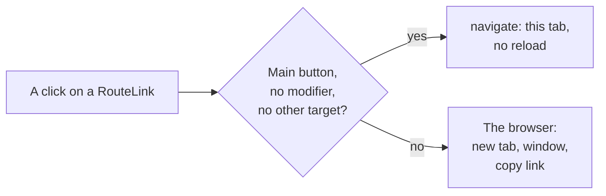

# FIX-2414 · Shift Manager routes are real links

**Spec** · [Decisions](DECISIONS.md)

## Who feels it, before and after

| Someone who… | Today | After |
|---|---|---|
| **watches several runs side by side** (Cmd- or middle-clicks a task, a project or a sidebar entry) | Nothing opens: the click goes to the screen in this tab, or does nothing | The screen opens in a new tab; this tab stays where it was |
| **copies a link to a task to send it** | No link to copy (right-click shows no *Copy link*) | *Copy link* gives the task's address, which opens the same view |
| **moves through Tasks with the keyboard** | Rows can't be reached: no focus, no role | Tab reaches each row's title; Enter opens the task |
| **clicks a row anywhere** | Opens the task | Still opens the task |
| **uses a tab, a toggle or Inbox's list** (group by, a team, an Inbox item) | Changes the view in place | Unchanged: these change what this screen shows, they are not places to open |

## The goal, and how we'll know it's met

**Every control in Shift Manager that takes the user to another address is a real link to
that address: a plain click goes there in this tab with no reload, and a click the browser owns
(a modifier key, the middle button) is left to the browser.**

- **Smaller, and rejected:** fix only Tasks rows. The sidebar, Jump to, board cards and the
  *open in Inbox* lines have the same gap, and a later button would bring it back.
- **Bigger, and not this issue's:** keyboard-first navigation (FIX-2401, wave 0, merges after
  this) and selection kept in the URL for the labs and Kitchen Sink (FIX-2400).

A click either goes through `navigate` or reaches the browser untouched; there is no third path.

**The check:** `packages/shift-manager/test/static.test.ts` → *goes to an address through a real
link* lists every `navigate(` call left in the app, each with why it is not a link, and fails on
any other, including a hand-made `<a href={pathFor(…)}>`. `test/route-link.test.tsx` and the
Tasks test in `test/roster-screen.test.tsx` click with each modifier. **Controls that must
fail:** a RouteLink that handles every click; a Tasks row that takes a click on its link; a
back button put back as `<button onClick={() => navigate(…)}>`.

## What changes

- One component, `RouteLink`, in `packages/shift-manager/src/components/`: an `<a href={pathFor(to)}>`
  that calls `navigate` on a plain click and leaves other clicks to the browser.
- Every link-like control uses it: the sidebar (entries, the collapsed rail, projects,
  workstreams, teams), Tasks row titles, the task panels and board cards, Jump to's results,
  every *open in Inbox* line, the Roster's settings and held-task chips, a task's linked rows,
  the Messages links, and back links. Inbox's one hand-made link moves onto it; it stopped
  modified clicks too.
- A Tasks row stays clickable as a whole, but leaves a click on its link, and a modified
  click, alone.
- **Docs:** none. Shift Manager is a private app; a link behaving as a link needs no guide.

## What's already here, and the debt

| Piece | Verdict |
|---|---|
| `pathFor` / `parseRoute` / `navigate` in `src/lib/routes.ts` | **Builds on**, unchanged. Every route already has an address |
| Inbox's held-task `<a href>` | **Replaced** by `RouteLink` |
| `navigate(` calls kept: tabs, the group-by and team toggles, Inbox's list, Jump to's Enter key, the Tasks row's own click | **Kept, listed** in the static check with why each is not a link |
| Kitchen Sink and the labs | **Not touched.** Labs import no code from each other; FIX-2400 owns their URLs |

**Net:** one small component added, one hand-made link removed, no second router. No debt added.
