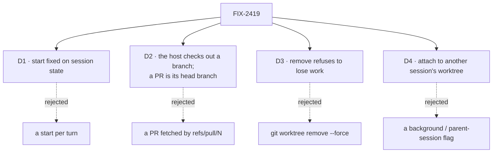

# FIX-2419 · Decisions

[Spec](SPEC.md) · **Decisions**

The epic settled where this lives (harness-manager and the workspace host), that removal is one
path shared with FIX-1768 (ER-5), and the stack (2385 → 2386 → 2419 → 2388). What is left is
where the choice is held, how the host honours each kind of start, what removal refuses, and
how two sessions share one worktree (D4, an amendment Jake asked for on the spec PR).

## D1 · The start is chosen at create and fixed, like the model

| | Fixed at create (chosen) | Chosen per turn |
|---|---|---|
| What a turn means | Continues the same branch every time | Could jump branches mid-conversation |
| How the page sends it | One more field beside `model` | A field on every turn |
| What the framework already enforces | `.readonly()` and `createCheck`, as for `model` | Nothing |

- **Because:** a session is one conversation on one branch. The first turn cuts or checks out
  the branch, and every later turn is handed it back; a start read on turn five would be
  ignored, which is worse than not offering it.
- **Shape:** exactly one of `{ base: string }` (cut a new branch from this ref, fetched first
  when it names a remote's branch), `{ branch: string }` (work on this existing branch), or
  `{ pullRequest: number }` (work on its head branch). Absent is the host's default, so stored
  sessions parse (BP-030). `createCheck` refuses a malformed one.
- **The workspace returns the branch.** A PR's branch is known only after asking GitHub, so the
  provision result names it and FIX-2386's record keeps it. The turn-end check reads the record,
  falling back to `HarnessSessionWorkspace.branch` for a session recorded before it.
- **One seam with FIX-2386 and FIX-2420.** `provision(place, request)` takes a request object,
  `{ start?, onSetup? }`, and returns a path or `{ path, baseCommit?, branch?, setup? }`.
  Whichever of the three merges first defines the shape and the others add their field, so
  there is one provision call, not three.
- **Locks in:** `start` on session state, and a `start` field on `provision`'s request.

## D2 · The host checks out an existing branch; a PR is its head branch

- **`PlaceRequest.existing`** says the request's `branch` is one to work on, not cut. The host
  already hands back a branch that exists (`provisionWorktree`), so the only new step is making
  the local branch from the remote's when it is absent: after a fetch of that one branch, under
  the pinned-fetch rules for a listed repository, set to track it. Neither local nor remote has
  it: refused, `no-such-branch`. The flag is what keeps a mistyped new-branch name from quietly
  tracking some remote branch: without it the host still cuts afresh.
- **A listed repository's branch is the person's own.** A run on it commits to it, which is what
  they asked for. Git refuses a branch checked out in another worktree, the person's own checkout
  included; the refusal names it.
- **The base is the tip at checkout**, so `git log base..branch` is the run's own work.
- **A PR is resolved to its head branch with `gh`** (`pullRequestHead`, beside the host's other
  `gh` read), not fetched as `refs/pull/N/head`. A detached copy of the head could not be pushed
  back to the PR, and the PR loop exists to push back. A fork's PR is refused: its branch is not
  on `origin`, and pushing to a fork is FIX-1768's question. A fork is the PR's head repository
  differing from its base repository, as GitHub reports them. The harness-manager resolves the PR
  to `{ branch }` before `provision`, so neither `PlaceRequest` nor the host knows about PRs; the
  session keeps `{ pullRequest }` in `start` because the app shows which PR the session is on.
- **A remote branch as a base** (`origin/main`) is fetched before the cut, by the code that
  fetches an upstream today, from the pinned URL. **A failed fetch is refused**
  (`remote-unreadable`), and so is an existing branch the repository lacks whose fetch fails
  (`no-such-branch`). The tracking ref on disk is shared with every run's worktree, and a run
  can move it; the host already refuses to cut an upstream base from it for that reason. A
  person offline picks the local branch instead.
- **Locks in:** one request flag and one `gh` read. The board manager can pass `existing` when
  the PR loop needs it, with no new host code.

## D3 · Removal refuses to lose work, and the branch is a separate, forceable step

| Step | Refused when | Forceable |
|---|---|---|
| Remove the worktree | Uncommitted or untracked changes; a provision of the place in flight; a run working in it (`in-use`) | No |
| Delete the branch | It holds commits no other branch or remote-tracking ref holds | Yes, `force` |

- **Because:** uncommitted changes exist only in that directory, and a person in a menu can
  commit them first. A branch's commits are recoverable from the reflog for a while and the person
  can see the count before forcing; FIX-1768's "nothing unpushed is deleted" is the same rule,
  without the force.
- **Active-run exclusion is part of the removal contract, not of one caller.** A turn holds the
  worktree's `<dir>.lock` from provision to turn end, the lease a board run already takes on its
  checkout; `remove` takes it without waiting and refuses `in-use` if it can't. So the CLI or
  FIX-1768's cleanup can't take a clean worktree from under a running harness. The session
  action's `reject` concurrency stays as the fast path. A lock left by a dead process is never
  treated as stale by `remove`; the person deletes the file.
- **One path** (ER-5): `WorkspaceHost.remove`. The session action, `fsdev worktrees`, FIX-1768
  after a merge and FIX-2252 on staleness all call it. Nothing else runs `git worktree remove`.
- **`list` asks git, not the directory tree**: `git worktree list` in each clone under the root
  and each listed repository, kept to worktrees strictly inside the root. A directory git does
  not know is not the host's to list.
- **After removal** the record says `removed`, and the next turn provisions again: from the kept
  branch if there is one, else afresh from the start. No refusal: a person who removed the
  worktree and then types is asking for it back.
- **Locks in:** two host methods and one session action.

## D4 · A session can attach to another session's worktree, and that is the only way to share one

Asked for by Jake on the spec PR. Today each session gets its own worktree, keyed on its place,
and `start: { branch }` can't reach another session's tree because git refuses a branch checked
out elsewhere.

| | Attached session | Owner session |
|---|---|---|
| Worktree and branch | The owner's, as they stand; makes neither | Its own, made on its first turn |
| A turn | Holds the worktree's in-use lock, so it waits out the owner's turn | The same lock, so it waits out an attached turn |
| Changing the branch | Not allowed: a turn that ends on another branch is recorded failed | Its own call |
| `removeWorktree` | Refused | Allowed, under D3's rules |

- **Shape:** `start: { worktreeOf: sessionId }`, a fourth arm of D1's union, fixed at create.
  The default is unchanged: no `start` is a fresh `git worktree add` from the app's repository
  on a branch of its own; clones only when the repository isn't local.
- **Found by place, in the caller's tenant.** The owner's place is this session's flow kind and
  tenant with the owner's id, never the caller's word for a tenant, so another tenant's session
  is never found. `createCheck` refuses (404) a session naming itself or a worktree that isn't
  there; a turn refuses the same if it has gone since (removed, or never provisioned).
- **Ownership.** The workspace record gains `owner` (a session id; `null` on older records,
  which are the session's own). The session action refuses removal from an attached session.
  The host's `remove` is keyed by place, which is the owner's, so nothing else can name an
  attached session's "own" worktree; `fsdev worktrees --remove` is a person at a terminal and
  stays under D3's in-use and lose-work rules.
- **No branch changes, detected rather than prevented.** Git can't stop a harness running
  `git checkout`; the flow reads the branch when the turn takes the lock and again before it
  lets go, and a change fails the turn with the two branch names. Nothing is switched back,
  since that could lose work.
- **One way (ER-4).** No separate background or parent-session flag. FIX-2361's follow-up runs
  resolve to their root run's place through this same form, naming the root, not an attached
  session (an attached session has no worktree of its own to attach to).
- **Locks in:** a fourth `start` form and `owner` on the workspace record.

## Decided, not asked

- **E1 · Names are the implementer's** (`start`, `existing`, `removeWorktree`,
  `pullRequestHead`, `fsdev worktrees`), as long as the host has one `remove` and one `list`.
- **E2 · Removal leaves held packs alone.** Held work belongs to the run record; dropping it is
  FIX-1768's, with its overlay.
- **E3 · The CLI lives in `fsdev`**, the framework's terminal command, taking the host root. An
  app prints its root (Kitchen Sink derives it from the repository) so a person can pass it.
- **E4 · The package slice touches no app file.** Kitchen Sink, Shift Manager and the labs adopt
  in the stacks the epic's build order names.

## Notes from review

Round 1 (Codex, Cursor, a second-look pass), folded where it changed the approach:

- **Active-run exclusion** moved into `remove` itself (D3), from Codex.
- **The sign-off line** no longer offers a force for uncommitted changes; that is a non-goal.
- **ER-5's "one path" covers removing a finished run's worktree.** The provision rollback and
  `branchAside` stay as they are: they undo a failed provision or move a branch aside, and route
  through nothing.
- **The unique-commits guard reads the last fetch.** A stale `origin/<branch>` can let a delete
  through that a fresh fetch would refuse; the commits stay in the reflog. Noted, not fetched.
- **`list` runs one `git status` per worktree.** Fine for the tens a person has; an opt-in flag if
  a disk full of them makes it slow.
- **Kept as specced:** the three-way `start` (above, D2), the `removed` flag (the app's Worktree
  menu reads it to show the worktree is gone; the next turn re-provisions from the kept branch),
  the CLI and branch delete in this slice (ER-5 wants one removal path from the start), and the
  goal check, which proves at the HTTP seam what unit tests cannot: a mid-turn removal refused.
