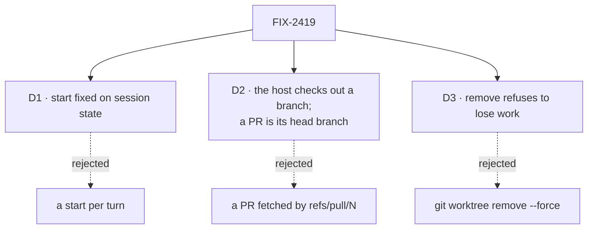

# FIX-2419 · Decisions

[Spec](SPEC.md) · **Decisions**

The epic settled where this lives (harness-manager and the workspace host), that removal is one
path shared with FIX-1768 (ER-5), and the stack (2385 → 2386 → 2419 → 2388). What is left is
where the choice is held, how the host honours each kind of start, and what removal refuses.

## D1 · The start is chosen at create and fixed, like the model

| | Fixed at create (chosen) | Chosen per turn |
|---|---|---|
| What a turn means | Continues the same branch every time | Could jump branches mid-conversation |
| How the page sends it | One more field beside `model` | A field on every turn |
| What the framework already enforces | `.readonly()` and `createCheck`, as for `model` | Nothing |

- **Because:** a session is one conversation on one branch. The first turn cuts or checks out
  the branch, and every later turn is handed it back; a start read on turn five would be
  ignored, which is worse than not offering it.
- **Shape:** exactly one of `{ base: string }` (cut a new branch from this ref, fetched first
  when it names a remote's branch), `{ branch: string }` (work on this existing branch), or
  `{ pullRequest: number }` (work on its head branch). Absent is the host's default, so stored
  sessions parse (BP-030). `createCheck` refuses a malformed one.
- **The workspace returns the branch.** A PR's branch is known only after asking GitHub, so the
  provision result names it and FIX-2386's record keeps it. The turn-end check reads the record,
  falling back to `HarnessSessionWorkspace.branch` for a session recorded before it.
- **Locks in:** `start` on session state, and a second argument to `provision`.

## D2 · The host checks out an existing branch; a PR is its head branch

- **`PlaceRequest.existing`** says the request's `branch` is one to work on, not cut. The host
  already hands back a branch that exists (`provisionWorktree`), so the only new step is making
  the local branch from the remote's when it is absent: after a fetch of that one branch, under
  the pinned-fetch rules for a listed repository, set to track it. Neither local nor remote has
  it: refused, `no-such-branch`.
- **A listed repository's branch is the person's own.** A run on it commits to it, which is what
  they asked for. Git refuses a branch checked out in another worktree, the person's own checkout
  included; the refusal names it.
- **The base is the tip at checkout**, so `git log base..branch` is the run's own work.
- **A PR is resolved to its head branch with `gh`** (`pullRequestHead`, beside the host's other
  `gh` read), not fetched as `refs/pull/N/head`. A detached copy of the head could not be pushed
  back to the PR, and the PR loop exists to push back. A fork's PR is refused: its branch is not
  on `origin`, and pushing to a fork is FIX-1768's question.
- **A remote branch as a base** (`origin/main`) is fetched before the cut, by the code that
  fetches an upstream today, from the pinned URL. A failed fetch warns and cuts from the copy on
  disk, as an upstream does: refusing would stop offline work for a freshness the person can
  see on the branch.
- **Locks in:** one request flag and one `gh` read. The board manager can pass `existing` when
  the PR loop needs it, with no new host code.

## D3 · Removal refuses to lose work, and the branch is a separate, forceable step

| Step | Refused when | Forceable |
|---|---|---|
| Remove the worktree | Uncommitted or untracked changes; a provision of the place in flight; a turn running (the session action) | No |
| Delete the branch | It holds commits no other branch or remote-tracking ref holds | Yes, `force` |

- **Because:** uncommitted changes exist only in that directory, and a person in a menu can
  commit them first. A branch's commits are recoverable from the reflog for a while and the person
  can see the count before forcing; FIX-1768's "nothing unpushed is deleted" is the same rule,
  without the force.
- **One path** (ER-5): `WorkspaceHost.remove`. The session action, `fsdev worktrees`, FIX-1768
  after a merge and FIX-2252 on staleness all call it. Nothing else runs `git worktree remove`.
- **`list` asks git, not the directory tree**: `git worktree list` in each clone under the root
  and each listed repository, kept to worktrees strictly inside the root. A directory git does
  not know is not the host's to list.
- **After removal** the record says `removed`, and the next turn provisions again: from the kept
  branch if there is one, else afresh from the start. No refusal: a person who removed the
  worktree and then types is asking for it back.
- **Locks in:** two host methods and one session action.

## Decided, not asked

- **E1 · Names are the implementer's** (`start`, `existing`, `removeWorktree`,
  `pullRequestHead`, `fsdev worktrees`), as long as the host has one `remove` and one `list`.
- **E2 · Removal leaves held packs alone.** Held work belongs to the run record; dropping it is
  FIX-1768's, with its overlay.
- **E3 · The CLI lives in `fsdev`**, the framework's terminal command, taking the host root. An
  app prints its root (Kitchen Sink derives it from the repository) so a person can pass it.
- **E4 · The package slice touches no app file.** Kitchen Sink, Shift Manager and the labs adopt
  in the stacks the epic's build order names.

## Notes from review

None yet.
