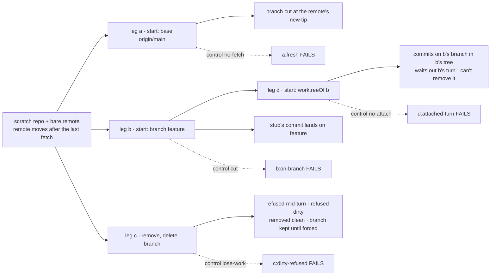
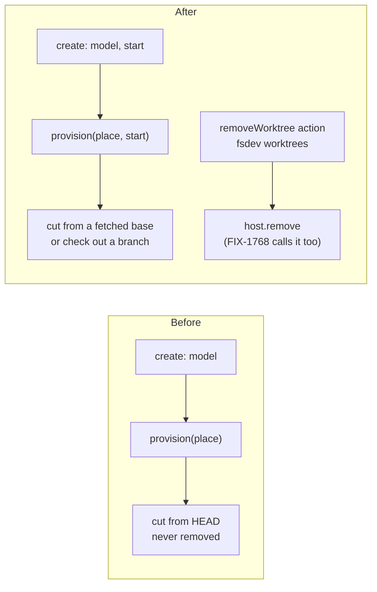

# FIX-2419 · Choose where a coding run starts, and clean up its worktree

**Spec** · [Decisions](DECISIONS.md)

## Who feels it, before and after

| Someone who… | Today | After |
|---|---|---|
| **starts a Kitchen Sink harness session** while their checkout is on a stale feature branch | The session is cut from that branch's `HEAD`. Picking a model is the only choice | Picks *latest `origin/main`*, a named branch, or a pull request. The session records the pick, like the model |
| **wants an agent to fix review comments on PR #812** | Can't. Every session cuts a new branch | Picks the pull request. The session works **on its head branch**, so its commits land where the PR will see them once pushed |
| **is done with a session** | Its worktree and branch stay under `~/.local/state/…` forever. No screen lists them | Opens the session's Worktree menu: the path, *Remove worktree*, *Delete branch*. Refused while a turn runs, and refused when it would lose work |
| **follows up on an earlier session's work** (a review fix, FIX-2361's follow-up run) | A new session gets a worktree of its own; asking for the earlier session's branch is refused, since git won't check a branch out twice | Attaches the new session to the earlier one's worktree (`start: { worktreeOf }`): same tree, same branch, never at the same time, and only the earlier session removes it |
| **has a disk full of old worktrees** | `git worktree list` in each repository, by hand | `fsdev worktrees <root>` lists every worktree a host holds, with its branch and whether it has uncommitted changes, and removes one by path |
| **builds the next consumer of cleanup** (FIX-1768 after a merge, FIX-2252 on staleness) | Would write a removal of its own | Calls the host's one `remove` |

## The goal, and how we'll know it's met

**A person chooses where a coding session starts (fresh from the remote, an existing branch, a
pull request's branch, or another session's worktree), and can see and remove what a session left
on disk without losing work.**

- **Smaller, and rejected:** a fetch before Kitchen Sink cuts from `HEAD`. It fixes the stale
  base for one app and leaves the PR loop and the pile of worktrees.
- **Bigger, and not this issue's:** pushing, opening a PR, and removing after merge (FIX-1768,
  which calls this issue's `remove`); deciding when a worktree is stale (FIX-2252); a board
  task starting on a PR's branch (the run source gains the same option when the PR-feedback
  loop needs it; nothing in the manager changes here); the setup hook after checkout (FIX-2420).
- **Not done if:** a session asked for `origin/main` is cut from a copy fetched before the
  remote moved; a session on an existing branch commits to a new one; or a removal deletes
  uncommitted changes or a commit no other branch holds, without the person forcing it.

**How we verify.**

- **Goal check (new), `goals/harness-manager/session-worktree-lifecycle`**, model-free. A
  `harnessSessionFlow` served over HTTP, its workspace the workspace package's local host over a
  scratch repository whose `origin` is a bare repository on disk. The harness is a stub that
  commits one file per turn and, when told, waits on a gate. Leg **a**: the remote's `main`
  moves after the repository's last fetch; a session created with `start: { base: "origin/main" }`
  is cut at the remote's new tip, read with `git merge-base`. Leg **b**: a session created with
  `start: { branch: "feature" }` works in a worktree on `feature`, and the stub's commit is on
  `feature` in the repository. Leg **c**: `removeWorktree` is refused while a gated turn runs;
  refused with an untracked file in the worktree; with a clean tree it removes the worktree
  (`git worktree list` no longer shows it, the branch is still there); `deleteBranch` is refused
  while the branch holds the stub's commit and no other ref does, and `force` deletes it.
  `fsdev worktrees` lists the worktree before removal and not after. Leg **d**: a session created
  with `start: { worktreeOf }` naming one with no worktree is refused (404); one attached to b's
  session commits onto b's branch in b's worktree and cuts no branch, records b as the owner,
  can't remove the worktree, and a turn sent while b's turn is held commits nothing until b's
  turn ends.
- **Controls that must fail:** `GOAL_CONTROL=no-fetch` cuts from the tracking ref without
  fetching; leg a fails **`a:fresh`**. `GOAL_CONTROL=cut` ignores `branch` and cuts a new one;
  leg b fails **`b:on-branch`**. `GOAL_CONTROL=lose-work` skips the uncommitted-work check; leg c
  fails **`c:dirty-refused`**. `GOAL_CONTROL=no-attach` asks for b's branch (`{ branch }`)
  instead of attaching; leg d fails **`d:attached-turn`**, **`d:on-owner-branch`**,
  **`d:recorded`** and **`d:waits-for-owner`**. Each control reddens only its own legs (`cut` also reddens
  `b:recorded`, which reads the same branch).
- **Unit:** the host's `list`, `remove` and existing-branch checkout over cloned remotes and
  listed repositories; a fork PR refused by `pullRequestHead` (a stub `gh` on `PATH`); a create
  whose `start` is malformed refused; `start` fixed after create; attaching refused at create for
  a missing worktree, itself, or another tenant's session; an attached turn holds the owner's
  lock, can't remove, and is recorded failed when it leaves the worktree on another branch.

## What changes

The session gains one choice, fixed at birth; the host gains a way to work on a branch that
already exists, and one way to list and remove what it made.

- **A session's start is chosen at create and fixed** ([D1](DECISIONS.md#d1)): `start` on
  harness session state, `{ base } | { branch } | { pullRequest } | { worktreeOf }`, read-only
  like `model`.
  Absent means the host's default, so every stored session reads as it did.
- **The workspace gets the start** ([D1](DECISIONS.md#d1)): `HarnessSessionWorkspace.provision`
  takes it as `start` on its request object (the seam FIX-2386 and FIX-2420 share:
  `provision(place, { start?, onSetup? })` returning a path or `{ path, baseCommit?, branch?,
  setup? }`, each issue adding its own field), and returns the branch it gave the session. The
  turn-end pull-request check reads that recorded branch, since a PR session's branch is not one
  the host could name in advance.
- **The host checks out an existing branch** ([D2](DECISIONS.md#d2)): `PlaceRequest.existing`.
  The run works on the branch as it stands, never cut. Absent locally, it is made from the
  remote's branch of that name after a fetch, tracking it. Its base is the tip it was checked
  out at, so FIX-2386's count is the run's own commits.
- **A remote branch as a base is fetched first** ([D2](DECISIONS.md#d2)): a base naming a
  pinned remote's branch (`origin/main`) in a listed repository is fetched under the same pinned
  rules as an upstream today, then cut. A failed fetch is refused: the tracking ref on disk is
  shared with every run, which can move it.
- **A PR is its head branch** ([D2](DECISIONS.md#d2)): `pullRequestHead` in the workspace's
  GitHub module asks `gh` for the head branch; a PR from a fork is refused by name.
- **One removal path** ([D3](DECISIONS.md#d3), epic ER-5): `WorkspaceHost.list()` and
  `WorkspaceHost.remove()`. Removal refuses uncommitted or untracked changes, a place being
  provisioned, and a worktree a run is working in (`in-use`: a turn holds `<dir>.lock` from
  provision to turn end, the same lease a board run takes, so every caller is refused, not only
  the session action); deleting the branch refuses commits no other branch or remote ref holds, unless
  forced. The session flow's `removeWorktree` action calls it through an optional
  `HarnessSessionWorkspace.remove`, refused while a turn runs (`concurrency: "reject"`), and marks
  the session's record removed. `fsdev worktrees <root>` lists and removes from a terminal.
- **A session can attach to another's worktree** ([D4](DECISIONS.md#d4)): `start: { worktreeOf:
  sessionId }` works in the owner session's worktree on its branch, making neither. Every turn of
  owner and attached sessions holds the same in-use lock, the record carries `owner`, only the
  owner removes, and an attached turn that moves the branch is recorded failed. It is the one
  way to share a worktree (ER-4).
- **Apps adopt later, in their stacks**: Kitchen Sink's create form and Worktree menu
  (`harness-frame.tsx`, `harness-worktree.ts`), Shift Manager and the two labs.
- **Docs:** workspace and harness-manager READMEs; the `fsdev` CLI page.

## What stays as it is

How a new branch is named and where places live; cutting with no start (the host's default:
`HEAD` and its upstream for a listed repository, the default branch for a clone); "existing
work is never discarded" (a checkout on disk is handed back, never reset); `release`, which
still keeps the directory; the board manager's run source and its `baseRef`.

## What's already here, and the debt

| Piece | What this does with it |
|---|---|
| `RepoRunSource.baseRef`, `localBase`, the pinned upstream fetch | **Extended**: a base that names a pinned remote's branch is fetched by the same code |
| `provisionWorktree`'s hand-back of a branch that exists | **Reused** for `existing`: only creating the local branch from the remote is new |
| `HarnessSessionWorkspace`, `model`'s read-only create field and `createCheck` | **Extended** with `start` the same way |
| FIX-2386's `workspace` record on session state | **Extended** with `removed`; its branch becomes what the turn-end check reads |
| `./branch-pull-requests`, the host's only `gh` caller | **Extended** with `pullRequestHead` |
| Core's `reject` concurrency | **Reused**: a `turn` occupies the session, so `removeWorktree` is refused while one runs |
| The board's per-checkout run lock (`lockPathFor`) | **Reused** as the in-use lock: `occupyWorktree` takes the same `<dir>.lock`, so `remove` refuses a worktree a turn or a board run holds |
| Held work, `checkpoint`, `release` | **Kept**. Removal does not drop held packs; FIX-1768 owns that with its overlay |

**Adds:** one session field and action, two host methods and one request flag, one `gh` read,
one `fsdev` command. **Removes:** nothing. **Debt:** a session whose worktree was removed
provisions again on its next turn, from its kept branch or afresh from its start; the record
says it was removed, and the person reading it decides. Kept files under a removed place's
`project/` stay on disk (they are rebuilt from the collection) until FIX-2252 decides staleness.
**Net:** medium, mostly in the host.

## Sign off

**Approve by merging.** The goal, and the debt above. The call to weigh is
[D3](DECISIONS.md#d3): removal never discards uncommitted changes and never takes a worktree a
run is working in; only deleting the branch can be forced. Forcing past uncommitted changes is a
non-goal. *If wrong:* that force is one more flag on the same `remove`; nothing else moves.

Feature · `workspace`, `harness-manager`, `fsdev` · medium · package slice in 1 PR stacked on
FIX-2386; app adoption in the epic's Kitchen Sink, Shift Manager and lab stacks · epic FIX-2369
