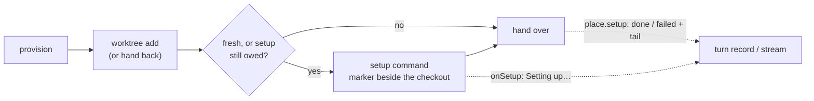

# FIX-2420 · A setup hook after checkout warms a fresh worktree

**Spec** · [Decisions](DECISIONS.md)

## Who feels it, before and after

| Someone who… | Today | After (once their app turns it on) |
|---|---|---|
| **starts a coding session or task on this monorepo** (Kitchen Sink, Shift Manager, the Claude Code-style lab, the Teammates lab) | The worktree has no `node_modules`. The agent spends its first turn installing, or `pnpm test` and `fsdev run` fail outright | The host has run the operator's setup command (`pnpm install --frozen-lockfile --prefer-offline`) before the agent starts. The first turn waits for it |
| **watches that first turn** | Sees nothing until the agent speaks | Sees "Setting up the worktree…" while it runs |
| **hits a setup that fails** (a lockfile out of date, the network down) | Finds out from a failed test, turns later | Sees "Setup failed:" and the last lines of the output. The agent still gets the worktree and can fix what broke; the next turn tries the setup again |
| **opens a later turn, or a retry, in the same worktree** | — | Nothing runs again once a setup has succeeded there |
| **runs a host that sets no setup command** | — | Unaffected: nothing runs, nothing new is recorded |
| **writes FIX-2387's typecheck-and-tests check** | Its checks can't run without dependencies | They can, in any app that turns setup on |

## The goal, and how we'll know it's met

**A coding run that starts in a fresh worktree starts with the operator's setup already done
there, and the person can see it running and see why it failed.**

- **Smaller, and rejected:** tell the agent in its instructions to install first. Every run
  spends model turns on it, and a check that runs before the agent (FIX-2387) still finds no
  dependencies.
- **Bigger, and not this issue's:** keeping long-lived processes beside a worktree, such as a
  preview server (FIX-2251), and choosing a run's starting point (FIX-2419).
- **Not done if:** a host with a setup command hands a fresh checkout to a run before the
  command has finished; a failed setup is silent; or a host without one behaves any differently.

Setup is the last step of a provision, under the same lock and the same budget. Its outcome
rides on the place the host hands back.

**How we verify.** Unit checks over real git, each with a control that must fail:

- **Workspace (`test/setup.spec.ts`)**: a fresh checkout runs the command in the checkout,
  after `onSetup` is told; a hand-back doesn't run it again; a failure hands the checkout over
  with the tail and runs again next time, and never after a success; a tree made again for an
  existing branch runs it; a cloned remote's checkout runs it; the provision budget stops it
  and says so; a host with no setup runs nothing. *Control:* never treating a checkout as fresh
  fails 7 of 8.
- **Session flow (`test/session-flow.spec.ts`)**: the turn record says `running` while the host
  runs it, then `done`, or `failed` with the tail; a later turn records none. *Control:*
  dropping the record fails 2.
- **Task-board runs (`test/workspace-host.spec.ts`)**: through a real board and host, a failing
  setup runs once in the checkout the harness is then handed, the run still completes, and
  "Setup failed: …" is kept on the stream. *Control:* not saying it fails the check.
- **End to end:** FIX-2425's closure, leg a, once an app turns setup on.

All of these were run against a prototype of the build. The controls failed as stated.

## What changes

- **`@flow-state-dev/workspace`**: `localWorkspaceHost({ setup: { command, env? } })`
  ([D1](DECISIONS.md#d1)). It runs once in each repository checkout a provision makes, and again
  on every later provision until it exits 0 ([D3](DECISIONS.md#d3)), inside the provision's one
  budget ([D4](DECISIONS.md#d4)). `PlaceRequest.onSetup` is told before it starts;
  `WorkspacePlace.setup` says `done`, or `failed` with the tail ([D2](DECISIONS.md#d2)).
- **`@flow-state-dev/harness-manager`, session flow**: `HarnessSessionWorkspace.provision`'s
  second argument is one request object, and this adds `onSetup` to it; FIX-2419's `start` is
  another field of the same object, not a third argument. Its result is FIX-2386's object
  (`{ path, baseCommit? }`, or a bare path), and this adds `setup?` to it
  ([E2](DECISIONS.md#decided-not-asked)). The turn record gains `setup: { state, tail } | null`.
  A host that returns a bare path records nothing, so Kitchen Sink's current wiring is
  unchanged. This is the one hunk in `session-flow.ts`'s turn
  record region the epic's build order names.
- **`@flow-state-dev/harness-manager`, task-board runs**: `WorkspaceConfig.setup` is passed to
  the host. A run says "Setting up the worktree…" (live) while setup runs, and keeps
  "Setup failed: <tail>" on the stream.
- **Docs:** the workspace README's checkout section (and its line "run any setup the checkout
  needs as part of the run"), the harness-manager README, and the harness-manager docs page.

## What stays as it is

The repository's own git hooks stay off on every git call (`NO_HOOKS`). No app turns setup on in
this change: wave 1 touches no app file. Kitchen Sink's turn notice wording is the app's. Files
places (no repository) run nothing. Core and the engine are untouched.

## What's already here, and the debt

| Piece | What this does with it |
|---|---|
| Workspace `provisionWorktree`'s `prepare`, which runs before the checkout | **Extended** with an after-checkout phase, in the host rather than in `worktree.ts`, so a tree rebuilt from held work is covered too |
| `repo.created`, set by every `worktree add` and never by a hand-back | **Reused** as "this provision made the tree". Its doc says "whether this call cut the branch", which is narrower than what it does; corrected in the same change |
| The provisioning marker beside a checkout | **Reused** as the pattern: a setup marker beside it says a setup is still owed |
| FIX-2386's `provision` result `{ path, baseCommit }` and FIX-2419's `start` argument (both in spec review) | **Extended**: one field each, `setup` on the result and `onSetup` on the request object. Whichever of the three merges first defines the object; the others add a field |
| `PlaceRequest.progress` (`lost`, `restoring`) | **Considered, not widened**: its one caller writes the value as a place state. `onSetup` sits beside it |
| `exec.ts`'s `run`, the one place the package spawns | **Reused**, by line, keeping the last lines |
| Workspace README: "run any setup the checkout needs as part of the run" | **Amended**: the host can now do it |
| Kitchen Sink's `provisionSessionWorktree`, the labs' and Shift Manager's `localWorkspaceHost` calls | **Unchanged**. Each turns setup on with one option, in its own stack |

**Adds:** one host option, one place field, one request callback, one turn-record field.
**Removes:** nothing. **Debt:** an option no app sets until its stack turns it on, and a turn
field no page reads until Kitchen Sink words a notice for it. **Net:** small.

## Sign off

**Approve by merging.** The one call that is hard to reverse is **what a failed setup does**
([D2](DECISIONS.md#d2)): the run goes on in the worktree with the failure shown, and the setup
is tried again on the next turn. *If wrong:* a caller that must not run without setup refuses on
`place.setup.status === "failed"` itself, so a stricter rule is one line in that caller, and the
host keeps its shape.

Feature · `workspace`, `harness-manager` · small · 1 PR · epic FIX-2369, wave 1 · FIX-2387
merges after it
