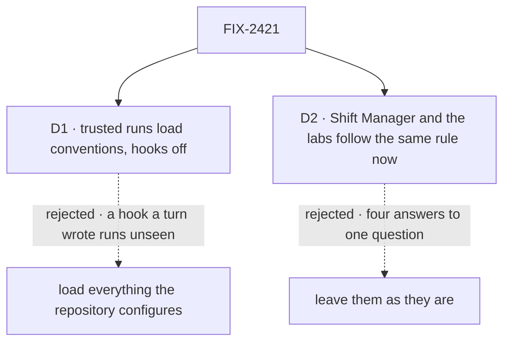

# FIX-2421 · Decisions

[Spec](SPEC.md) · **Decisions**

Two decisions are the sign-off surface. D1 is the hook-risk call the epic left to this spec's
gate ([FIX-2369 → Decided](../../epics/FIX-2369/DECISIONS.md#decided-recorded-so-no-child-reopens-them)).

## The tree

Solid edges are what you are signing. Dashed edges lost, and the label says why.

## D1 · A trusted run loads the repository's conventions with its hooks off

| | |
|---|---|
| **Instead of** | Loading everything the repository configures, hooks included, as the issue sketched (`settingSources: ["project"]` alone) |
| **Because** | A hook runs by itself on the next turn and shows in no transcript; a turn can write one into `.claude/settings.json`. Under FIX-1930's boundary, hooks still run in the harness's own process, outside it. This repository's hooks are terminal tooling: a model-run docs audit on every commit, helpers with one machine's paths |
| **Locks in** | A trusted Claude Code run never runs a project hook, with no switch for it here. A trusted Cursor run loads no project settings until its SDK can keep hooks out (1.0.40 can't) |

It comes down to a hook a turn wrote: loading everything runs it next turn, with no record.

**What would change my mind:** if you want the repository's hooks to police unattended runs,
the commit docs audit above all. Then trusted means everything, and Cursor loads its rules too.

**What being wrong costs:** low. It is one option on each host, and the header names it.

## D2 · Shift Manager and the labs follow the same rule now

| | |
|---|---|
| **Instead of** | Leaving them as they are, and filing it |
| **Because** | They already load the repository's settings, hooks on, with no setting. Shift Manager's coder and the Claude Code-style lab also load the operator's personal settings, which Teammates keeps out because an output style showed in its runs. The closure sweep wants one answer per need |
| **Locks in** | Shift Manager's fsd coder and the two labs keep loading conventions, hooks off, personal settings out, with no setting: each runs only in a checkout its operator named. Kitchen Sink, which can run shared, is the one opt-in host |

It comes down to one rule for what a run here loads: leaving them makes four.

**What would change my mind:** a Shift Manager or lab run that depends on a repository hook, or
on your personal Claude Code settings, today.

**What being wrong costs:** low. One option per host, reverted in a line.

## Decided, not asked

- **Two PRs, both this issue's.** The wave-1 package slice, from `main`, touches no app file:
  the claude-code settings layer, the `CURSOR_PASS` export, their READMEs and docs pages. The app
  PR (Kitchen Sink's settings, three modes and header; Shift Manager's fsd coder; two labs;
  deleting both `CURSOR_PASS` copies, ER-3) starts after it merges. The epic's build order has
  no row for it; the coordinator owns that table (ER-8). Proposed: fifth on Kitchen Sink's
  `harness-session.tsx` stack (2410 → 2386 → 2384 → 2398 → 2421), other files in merge order.
- **No policy type in a package.** Only a host knows whether it trusts a repository, and each
  harness reads trust as different options. A shared type needs core (ER-1 forbids) or three copies.
- **No codex package change.** Codex reads `AGENTS.md` either way; trusted, Kitchen Sink skips
  its MCP-off overrides.
- **No helper for the key list.** `harnessEnv({ pass: [...X_PASS, ...names] })` already does it,
  and Kitchen Sink is its one reader: Shift Manager keeps the key out of the run by design.
- **Trust is read once, from the server's environment,** by the workspace setting's reader.
  No request, session input or session state sets it (BP-031). Off on Vercel.
- **The header reports what the harness loaded,** not the setting.
- **The settings layer merges** with `mcpTools`' connector switch. Its shape (the SDK's settings
  verbatim, or one switch) and the setting names are the implementer's.
- **A named key is visible to the model** and can land in a log or a commit. The README says so
  beside the setting.

## Considered and dropped

| Alternative | Why not |
|---|---|
| `settingSources: ["project"]` and nothing else (the issue's sketch) | Runs the repository's hooks. The POC's second arm |
| A shared `TrustedRepoPolicy` type the three packages take | No home outside core, and nothing to normalise: each harness's options differ |
| Point the run at `CLAUDE.md` through its prompt (FIX-1915's suggestion) | Loads no skills, and every host writes the line again |
| Linear only through FIX-2388's relay, no named keys | Leaves `gh`, `git push` and any CLI with no relay without a credential on a headless host |

## Settled

- **A Claude Code run can load `CLAUDE.md` and skills with project hooks off** — **CONFIRMED**
  by [`poc/project-settings-hooks/run.sh`](poc/project-settings-hooks/run.sh), on Claude Code
  2.1.316 (the Agent SDK 0.3.234 passes `settingSources` and `settings` as these flags). In a
  fresh repository with a code word in `CLAUDE.md`, one skill, and a hook writing a marker:

  | Arm | Code word | Skill | Hook ran |
  |---|---|---|---|
  | `settingSources []`, Kitchen Sink today | none | no | no |
  | `["project"]`, the issue's sketch | yes | yes | **yes** |
  | `["project"]` + `disableAllHooks`, D1 | yes | yes | no |
  | the same, with a plain system prompt | yes | yes | no |
  | unset, plain system prompt, Shift Manager today | yes | yes | **yes** |

  The second arm is the control. A first run let the model `Read` `CLAUDE.md`; now no tools.
- **The spec's host facts** — **CONFIRMED** by
  [`poc/project-settings-hooks/facts.mjs`](poc/project-settings-hooks/facts.mjs): seven hosts
  build harness blocks, each classified; two `CURSOR_PASS` copies outside the cursor package,
  none inside it. `FACTS_PLANT=1` plants an unclassified host and the check fails.
- **Cursor's SDK 1.0.40 loads no source when `settingSources` is unset**, and has no hook switch
  (its published types and source).

## Analysis

2026-10-31 · watermark 2026-10-31 (issue filed) · **Right approach, with changes.** Run in the
authoring context: this session could not dispatch a fresh analyst. The coordinator may re-run it.

1. **Reuse** — two Adds: the settings layer extends the internal forward; `CURSOR_PASS` is a
   move. See [Builds on / Adds](SPEC.md#whats-already-here-and-the-debt).
2. **Prior art** — the Agent SDK's own docs: `settingSources` omitted loads every source,
   `project` is required for `CLAUDE.md`, and `disableAllHooks` is a settings key.
3. **Other shapes** — a shared policy type; dropped above.
4. **New factors** — FIX-2388's relay (Linear for Shift Manager), FIX-2391's readiness (may
   carry the header's data), FIX-2433 filed here.
5. **Necessity** — the outcome earns it; the package half is smaller than the issue sketched.
6. **Ergonomics** — two operator settings; a host adds one option and one import.
7. **Concerns** — Cursor stays unloaded under D1.

| Finding | Changes the approach? | Disposition |
|---|---|---|
| `["project"]` alone runs hooks (POC) | Yes | Folded: D1 |
| The cursor package has no pass list | Yes | Folded: lifted |
| Shift Manager already loads every source, hooks and personal settings included | Yes | Folded: D2 |
| A shared policy type | Yes | Dropped |

## How it got here

- **Draft** — framed as the repository's conventions in a trusted Kitchen Sink session, with
  hooks off. Builds on the pass lists and `settingSources`; a POC showed the issue's sketch runs
  hooks, and that Claude Code can load conventions without them.
