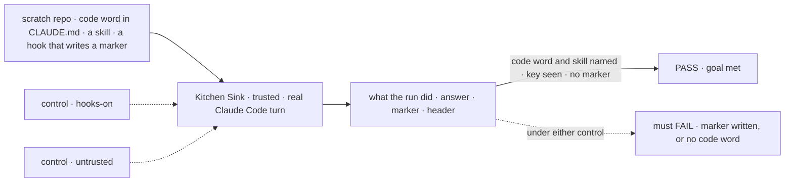
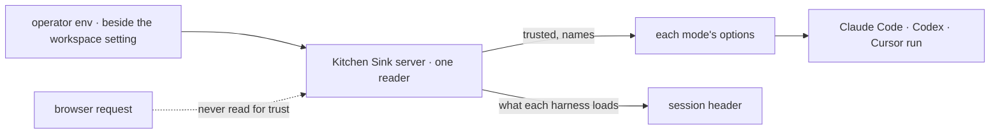

# FIX-2421 · Operator "trusted repository" policy: load project settings, MCP servers and named keys into harness runs

**Spec** · [Decisions](DECISIONS.md)

## Six people, before and after

| Someone who… | Today | After |
|---|---|---|
| **points Kitchen Sink at flow-state-dev and turns the trusted setting on** | Claude Code, Codex and Cursor sessions see no `CLAUDE.md`, no skills, no Linear: worse than the CLI in a terminal | Claude Code follows `CLAUDE.md` and the skills. Codex keeps the operator's MCP servers. Every harness gets the keys the operator named |
| **leaves it off**, or runs a shared Kitchen Sink | Nothing from the repository loads | The same. The header says *Repo conventions: not loaded* |
| **works on a repository with hooks**, or has a turn write one | Shift Manager and the labs run it on the next turn, unseen | A trusted run never runs a repository hook ([D1](DECISIONS.md#d1)). The header says *loaded, hooks off* |
| **opens a trusted Cursor session** | Nothing loads | Still no project settings: Cursor's SDK can't load them without their hooks. The header says so. Named keys pass |
| **sends `trusted: true` from a browser** | n/a | Nothing changes. Only the server's setting decides (BP-031) |
| **codes through Shift Manager's fsd coder or a lab** | Repository settings load with hooks on; two of them also load the operator's personal Claude Code settings | Conventions still load, hooks off, personal settings out ([D2](DECISIONS.md#d2)). Shift Manager's Linear stays FIX-2388's relay |

## The goal, and how we'll know it's met

**An operator who marks Kitchen Sink's repository as trusted gets coding sessions that follow
its conventions and can use the keys they named, sees on each session whether that happened,
and never has the repository's hooks run; with the setting off, nothing changes.**

| Is it the right goal? | |
|---|---|
| **The real need** | A session on flow-state-dev "doesn't see CLAUDE.md, the skills library or Linear, which makes it a worse agent than the CLI in a terminal" (the issue); the epic's real FSD change in each app |
| **Smaller, and rejected** | "The packages can load project settings." True after the wave-1 slice alone, while every Kitchen Sink session still loads nothing |
| **Bigger, and not this issue's** | A real boundary (FIX-1930). Project MCP for Codex and Cursor (FIX-1986). Base instructions (FIX-2212) |
| **Not done if** | The options say `project` but the run never shows it read `CLAUDE.md` · the header says *loaded* where nothing loaded · a project hook runs · a request body turns trust on |



The check reads what the run did, never the options the server built.

| How we verify | |
|---|---|
| **Goal check** | `goals/kitchen-sink-harness/a-trusted-session-follows-the-repo/` · real model · the implementer, at the app PR · verdict there. The package PR re-runs [`poc/project-settings-hooks/run.sh`](poc/project-settings-hooks/run.sh) through the block, control included |
| **Signal** | Claude Code mode: the turn names the code word with no tool call, lists the skill, prints a named key; after two turns no marker file exists; the header reads *loaded, hooks off*. Codex mode lists the operator's MCP server. Cursor's header reads *not loaded*. `trusted: true` in a request to an untrusted server changes none of it |
| **Input** | A repository the check writes, with a fresh code word per run; another hook event must pass too |
| **Anti-game** | Ask for the code word before any tool runs, so a `Read` can't pass it. Never assert on `settingSources` or the stub |
| **Control that must fail** | `GOAL_CONTROL=hooks-on` FAILS on *no marker*. `GOAL_CONTROL=untrusted`, and today's `main`, FAIL on *names the code word*. Both shown before the PASS |

## What changes


Read across a row: only the right column moves. The top band splits the package slice from the
app PR.

**What an operator types** (names are proposals):

```diff
  KITCHEN_SINK_HARNESS_WORKSPACE=/Users/me/code/flow-state-dev
+ KITCHEN_SINK_HARNESS_TRUSTED=1
+ KITCHEN_SINK_HARNESS_PASS=LINEAR_API_KEY,GH_TOKEN
```

**What a host writes, with the package slice:**

```diff
  claudeCodeAgent({
    cwd,
-   settingSources: [],
-   env: harnessEnv({ pass: CLAUDE_CODE_PASS }),
+   settingSources: ["project"],
+   settings: { disableAllHooks: true },        // new: a settings layer above the project's
+   env: harnessEnv({ pass: [...CLAUDE_CODE_PASS, ...operatorNames] }),
  });

- const CURSOR_PASS = ["PATH", "HOME", /* … */];  // a copy in each host
+ import { CURSOR_PASS } from "@flow-state-dev/cursor";
```

**Docs:** update the `settingSources` paragraphs of `packages/claude-code/README.md` and
`apps/docs/docs/tools/claude-code-sdk.md` → *Configuring the run* (conventions with hooks off);
add `CURSOR_PASS` to `packages/cursor/README.md` and `apps/docs/docs/tools/cursor.md`. The app
PR adds both settings to `apps/kitchen-sink/README.md`'s env table and Claude Code mode
section. No new page.



Trust enters once, from the server's environment; each mode turns it into its harness's options.

## What stays as it is

- **The untrusted path**, the default wherever it is today.
- **Core and engine.** `harnessEnv` is unchanged; no policy type enters core (epic ER-1).
- **The codex package.** Keeping MCP servers on is Kitchen Sink not turning them off.
- **FIX-2388's relay**, which keeps a Linear key on the server, and FIX-1930's boundary.

## What's already here, and the debt

| Already here | What this does with it |
|---|---|
| Ways a run gets a service's credential (`coding-harness`): the pass list (`harnessEnv`, `CLAUDE_CODE_PASS`, `CODEX_PASS`), and the relay (`projectMcpTools`, key on the server) | **Builds on the pass list**, the closest: a named key is a name on it ("a host that needs more passes its own list"). No third way. Searched `harnessEnv`, `_PASS`, `mcpTools`, `LINEAR_API_KEY`, `GH_TOKEN` in `packages/`, `apps/`, `labs/` |
| claude-code `settingSources` | **Builds on:** `project` loads `CLAUDE.md` and skills |
| claude-code's internal `settings` forward, set only by `mcpTools` | **Extends:** host-settable; `mcpTools`' connector switch still applies |
| Cursor's `agent.local.settingSources` | **Leaves alone** ([D1](DECISIONS.md#d1)) |
| Kitchen Sink `readHarnessWorkspace`, the workspace setting's one reader | **Extends:** it reads the two new settings |
| Kitchen Sink `codexClientOptions`, every MCP server off | **Kept** untrusted; skipped trusted |
| `CURSOR_PASS` in Kitchen Sink, and its Teammates copy | **Superseded** by the package export; the app PR deletes both |
| [FIX-1915 → Decided, not asked](../FIX-1915/DECISIONS.md#decided-not-asked): "The run doesn't read the repository's Claude Code settings" | **Amended** for a trusted repository. Its reason, a hook outside the sandbox, D1 keeps; the sandbox itself is gone (Kitchen Sink confines no run) |
| [FIX-1905 → D3](../FIX-1905/DECISIONS.md#d3): project servers for Claude Code only | **Kept.** FIX-1986 owns Codex and Cursor |
| [FIX-2369 → Analysis](../../epics/FIX-2369/DECISIONS.md#analysis), "trusted-repo policy (2421)" | **Amended:** cursor had no pass list to extend, so one is lifted; codex doesn't change |

| Adds | Existing piece considered | Why it doesn't fit, or how this is composed from it |
|---|---|---|
| A settings layer a host hands a Claude Code run | `coding-harness` · `settingSources`, which can't keep one source's hooks out; the internal `settings` forward | Extends that forward. The SDK's `settings` sits above the project's ([Settled](DECISIONS.md#settled)) |
| `CURSOR_PASS` in cursor | `CLAUDE_CODE_PASS`, `CODEX_PASS`; the two app copies | Reuse: a move, beside its siblings |

| The debt | |
|---|---|
| **Removes** | Two `CURSOR_PASS` copies. The operator's personal settings in two hosts' runs ([D2](DECISIONS.md#d2)) |
| **Adds** | One claude-code option. Two Kitchen Sink settings, permanent by design. Trusted Cursor loads no project settings until its SDK can keep hooks out: upstream, nothing to file |
| **Leaves** | The Claude Code-style lab passes no `env` (FIX-2433, filed here). FIX-1930, FIX-1986, FIX-2212 |

**Net: flat.** Two copies go; one option and two settings arrive.

## Sign off

**[The goal](#the-goal-and-how-well-know-its-met), at that size:** conventions and named keys in
a trusted Kitchen Sink session, read off what the run did, hooks never run. If wrong: options
that say `project` while the session still can't see the repository.

**[The debt](#whats-already-here-and-the-debt), net flat:** two copies go, one option and two
settings arrive. If wrong: the settings forward grows into a second config surface.

1. **[D1](DECISIONS.md#d1) · A trusted run loads the repository's conventions with its hooks
   off.** If wrong: the repository's commit and stop hooks don't police unattended runs.
   **The one to weigh.**
2. **[D2](DECISIONS.md#d2) · Shift Manager and the labs follow the same rule now.** If wrong: a
   hook a Shift Manager run relies on stops.

**Open: none.** Reasoning, what lost, and the engineering calls: [DECISIONS.md](DECISIONS.md).

Feature · wave-1 package slice: `claude-code`, `cursor` · then one app PR: Kitchen Sink, Shift
Manager, two labs · small: one option, one export, two settings, one header line · epic FIX-2369
