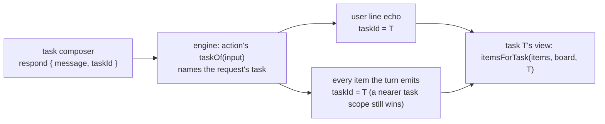

# FIX-2422 · Door turns sent from a task carry the task id

**Spec** · [Decisions](DECISIONS.md)

## Who feels it, before and after

| Someone who… | Today | After |
|---|---|---|
| **writes to a worker from a task's composer in Shift Manager**, then reloads (every `--dev` save) or opens another task and comes back | Their line and the worker's reply vanish from the task's Session tab, though the session still holds both | Both stay: the task's view finds them by the task id stamped on them |
| **writes to a worker whose session holds several tasks** | The line shows under the task it was sent from only until the page forgets it sent it | It shows under that task, and only that task, for good |
| **steers an open task from its composer** | The line shows until reload | The line keeps its place in the task's view; the steer itself is unchanged |
| **talks to a worker outside any task** (a workstream, a conversation) | Unaffected | Unaffected: a line that names no task is stamped with nothing |
| **builds an app or a custom worker flow on Workforce** | No way to say which task a line is for | The built-in doors take an optional `taskId`; a custom door opts in with two exports |

## The goal, and how we'll know it's met

**A line sent into a worker's session from a task, and everything the worker writes in answer,
are stored stamped with that task's id, so any reader of the session finds them by the stamp.**

- **Smaller, and rejected:** keep Shift Manager's list of the requests its composer sent, in
  `sessionStorage` per task (the issue's "until then"). It survives a reload in one tab only, and
  every other app has to keep its own copy. The real fix is a few lines in the door.
- **Bigger, and not this issue's:** routing a line by the task it names (a steer still picks the
  session's open task from server state), and live session reads (FIX-2374).
- **Not done if:** a line sent from a task, read back from the store with no app memory, carries
  no `taskId`; or a line that names no task comes back stamped.

**How we verify.**

- **Package, `packages/workforce/test/door-task-stamp.test.ts` (new).** A turn on the built-in
  `agent` door with `{ message, taskId }`, read back from the store: the user's line and the
  reply both carry the task id. The same turn without `taskId` stamps nothing.
- **Control that must fail:** the door without `taskOf`. Prototyped: the first case fails (the
  messages come back with no `taskId`), the second passes.
- **Engine, a unit test beside `runAction`'s:** an action with `taskOf` stamps its echo and a
  block's emitted item; an inner scope marked with another task keeps its own mark, and one
  cleared with `_markTaskScope(null)` falls back to the request's task; a resumed request
  (replay) still stamps what it emits; an action with no `taskOf` stamps nothing.
- **Shift Manager (PR 2):** the FIX-2009 tests in `packages/shift-manager/test/task-screen.test.tsx`
  gain a remount: send a line, unmount the task screen, mount it again, and the line and
  `Heard: …` are still in the Session tab. Control: the composer sends no `taskId`, and the
  remounted Session shows neither.

## What changes

- **Engine and core, one action option** ([D1](DECISIONS.md#d1)). `ActionCore.taskOf?: (input) =>
  string | undefined`. When it returns an id, `runAction` stamps it on the `userMessage` echo and
  hands it to the execution context as the request's task, so every item the request emits
  carries it unless a nearer scope marks another task with `_markTaskScope`. Trace items stay
  unstamped, as they are under `_markTaskScope` today.
- **Workforce, the doors** ([D2](DECISIONS.md#d2)). `worker-door.ts` exports `doorTaskId` (an
  optional, non-empty string for the door's input) and `doorTaskOf`. The built-in doors (the
  `agent` flow, the coordinator flow, the error reporter) take `{ message, taskId? }` and declare
  `taskOf: doorTaskOf`. The worker inventory row says whether a worker's door takes a task
  (`doorTakesTask`, `false` on rows written before it), so an app sends the id only to a door
  that keeps it: a strict door refuses a key it doesn't declare.
- **Shift Manager (PR 2, wave 2).** The task composer sends `taskId` to a door that takes one; the
  Session tab keeps only `itemsForTask`, and the `sent` list, `noteSent` and the `sent` argument
  to `taskItems` are deleted (ER-3: the adopting PR deletes the app's copy).
- **Docs:** `packages/workforce/README.md` and `apps/docs/docs/workforce/messaging-workers.md`
  say a door takes an optional task id; `apps/docs/docs/fundamentals/actions.md` documents
  `taskOf` beside `userMessage`; `apps/docs/docs/streaming/items.md` and
  `docs/architecture/items.md` name it as a second source of `taskId`, and say it is a label a
  reader must not decide by unchecked.

## What stays as it is

How a steer picks its task (server state, FIX-2086); the door contract the hire checks (`respond`,
`userMessage`, `{ message }`); `itemsForTask` and the other attribution helpers; how a task-board
worker marks its scope; sessions, routing and admission.

## What's already here, and the debt

| Piece | What this does with it |
|---|---|
| `OutputItem.taskId` and `ctx._markTaskScope` (FIX-658) | **Extends:** a second way to set the same stamp, at the request instead of a scope. No new item field |
| `itemsForTask` in `@flow-state-dev/contracts` | **Reused** as is. It already keeps only stamps of tasks the session's `task-change` items name |
| The `userMessage` echo in `runAction` | **Extends:** the echo carries the stamp |
| `worker-door.ts`, the one definition of a door | **Extends** with the task id's schema and `taskOf` |
| Shift Manager's `sent` list and `taskItems(…, sent)` (FIX-2009) | **Removed** in PR 2 |
| The worker inventory row | **Extends** with `doorTakesTask`, defaulted for old rows (BP-030) |

**Adds:** one action option, two door exports, one inventory field. **Removes:** Shift Manager's
in-memory list of sent requests. **Debt:** a custom worker flow's door stamps nothing until it
opts in. **Net:** small, and smaller than the app copy it replaces.

## Sign off

**Approve by merging.** One open call, **[D1](DECISIONS.md#d1)**, is yours: the stamp is set at
the request by a new action option in core (recommended), rather than kept out of L1. A generic
caller tag, asked for in review, is weighed there and rejected: the task's view reads
`item.taskId`, so a tag elsewhere splits one fact across two fields. *If wrong:* the option is one
field and a few lines in `runAction`; moving the stamp into Workforce later means doors mark
their own scope and the line's echo goes unstamped again.

Feature · `core`, `engine`, `workforce`, `shift-manager` · small · 2 PRs: the package slice
(wave 1, from `main`), then Shift Manager's adoption (wave 2, the root of the `task.tsx` stack)
