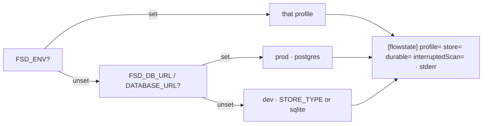

# FIX-2424 · Kitchen Sink's config tells the truth

**Spec** · [Decisions](DECISIONS.md)

## Who feels it, before and after

| Someone who… | Today | After |
|---|---|---|
| **reads `fsdev.config.ts` to learn how a host picks its store** | Reads that dev is in-memory and that `FSD_ENV` alone picks the profile. Neither is true: dev is SQLite, and a database URL picks `prod` | Reads what the code does, including that the debug and interrupted-scan gates follow the database URL, not the profile |
| **runs Kitchen Sink locally with a stray `FSD_DB_URL` and no `FSD_ENV`** | Is silently on Postgres, with no interrupted-run scan and the DevTool's debug endpoints closed. Nothing says so | Sees `[flowstate] profile=prod store=postgres durable=true interruptedScan=false` on stderr at start |
| **sets `FSD_ENV=dev` but also has a stray URL** (the mixed state, D1) | Is on SQLite, but the scan is skipped and debug endpoints are closed, because those follow the URL. Nothing says so | Sees `profile=dev store=sqlite … interruptedScan=false`: the profile and the gates disagree, visibly |
| **sets `FSD_ENV` to a profile that isn't declared** | The server starts, then fails on the first request | The start fails, naming the declared profiles |
| **reads the README's mode list** | Is told Codex is "not built yet" | Gets a link to the Codex mode section |
| **reads the app's file layout** | Finds the shipped config importing from `test/` | Finds the test-mode model resolver in `lib/`, beside the script it plays |

## The goal, and how we'll know it's met

**Kitchen Sink's config comments match its code, and the store it resolved is visible at
start.**

- **Smaller, and rejected:** fix only the comments. A stray `FSD_DB_URL` stays invisible, which
  is the incident this issue was filed for.
- **Bigger, and not this issue's:** make the debug and interrupted-scan gates follow the
  resolved profile instead of the database URL, or log the store kind from the engine for every
  host. Both change behaviour beyond this app (D1, D2).
- **Not done if:** the start line is missing, goes to stdout (it would corrupt `fsdev run`'s
  NDJSON), or names a store the wiring didn't build.

**How we verify.**

- **Unit check, `apps/kitchen-sink/test/config-startup-line.test.ts`:** imports the real
  `fsdev.config.ts` under each case and reads stderr: no env (`dev`, `sqlite`, scan on),
  `STORE_TYPE=memory`, a database URL (`prod`, `postgres`, scan off), and the stray-URL case
  `FSD_ENV=dev` plus a database URL (`dev`, `sqlite`, scan **off**). Also asserts nothing of it
  reaches stdout, and that an undeclared `FSD_ENV` fails the import. Cases run serially and
  never call `ready()` or `getRuntime()`, so no store opens. Each pays a full config import,
  as `named-org.test.ts` does; a pure helper is the fallback only if CI shows it slow.
- **Control that must fail:** remove the log line, or have it read `STORE_TYPE` instead of the
  value the wiring uses. The check goes red; the PR shows it red once.
- **By hand:** `fsdev run` under the same cases, stderr and stdout captured separately.

## What changes

- `apps/kitchen-sink/fsdev.config.ts`: header and inline comments rewritten to the code; one
  `devStore` value chooses the dev store and feeds the log; the start line, on stderr.
- `apps/kitchen-sink/test/mock-flowstate.ts` moves to `lib/test-model-resolver.ts`; its test
  importer, the `vi.mock` path in `named-org.test.ts`, and the comments in
  `lib/e2e-mock-script.ts` follow. `@flow-state-dev/testing` is already a runtime dependency.
- `apps/kitchen-sink/README.md`: the Codex line links its mode section.
- The move and the README line are the issue's own asks, from the same review finding, so they
  ride the same PR.

## What's already here, and the debt

- The engine already logs `[flowstate] active profile: "…"`, lazily, when the runtime first
  builds. It names no store and no gates, and fires on the first request, not at start. Both
  lines stay; for Kitchen Sink the app's line is the one that names the store and gates.
- **Debt left in place:** the gates key off the database URL while the profile keys off
  `FSD_ENV` first, so `FSD_ENV=dev` with a URL set is a mixed state. This spec makes it visible,
  not consistent (D1).
- **Docs drift, not this issue's:** `apps/docs` deployment and end-to-end testing guides still
  describe an in-memory dev default and an older resolver location. Noted for a docs pass.
