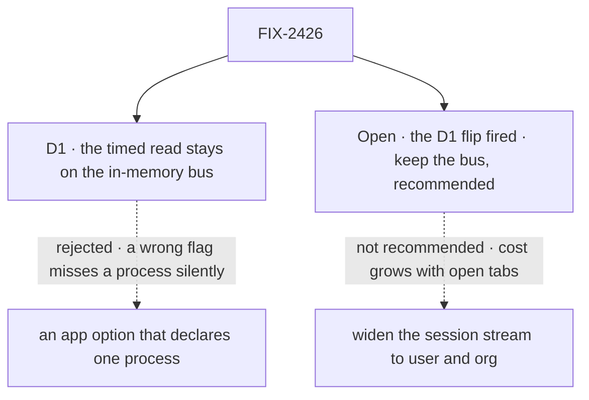

# FIX-2426 · Decisions

[Spec](SPEC.md) · **Decisions**

What was considered, what was chosen, why, and what each choice locks in. One decision and one
open fork are the sign-off surface. The epic already decided the shape (D5, D6, ER-1 to ER-6);
nothing here reopens it.

## The tree

Solid edges are what you're signing. Dashed edges lost, and the label says why.

## D1 · The timed read turns off only on a bus that says it crosses processes; the in-memory bus keeps it

| | |
|---|---|
| **Instead of** | An app option that declares "this app runs on one process," which would let the in-memory bus turn the timer off too |
| **Because** | The engine can't tell whether another process writes the same store. A BullMQ worker added later, or a second web process, is reached today by the timed read; with a wrong flag it is never reached, and nothing says so. The epic's D6 keeps the timer on the in-memory bus for this reason, and the in-memory bus is all this issue ships |
| **Locks in** | A bus adapter declares whether it crosses processes, and only that turns the timer off. Single-process apps on the in-memory or SQLite stores keep paying 4 queries a second per idle tab until a crossing bus backs them. They get the instant wake now |

It comes down to a second process the app forgot: the timer still reaches it, a wrong flag never does.

**What would change my mind:** a way for the engine to know it is the only writer. Then the
in-memory bus turns the timer off too, with no option.

## Decided, not asked

- **Public names (ER-1, ER-2).** `ChangeNotice` is `{ topic, kind }`, never rows. A topic is
  structured: `{ scope: "session" | "user" | "org", id, tenantId?, resource? }`; adapters derive
  channel names from it. Not `Notice`: `task-notice` owns that word. The slot is `bus`, with
  `publish` and `subscribe`.
- **Topics carry the tenant**, so no subscriber hears another tenant's session (BP-035).
- **This issue's kinds are `items`, `request` and `run`.** Later children add theirs at the one
  definition.
- **The convergence point is `resolveStores`** (tenet 5): `createFlowState` via
  `resolveProfileStores`, the router, and BullMQ workers' `rt.stores` all pass through it. Wrapped:
  request `set`, `delete`, `deleteIfStatus`, `setFieldsIfStatus`, `persistItems`; session `set`,
  `delete`. Not `persistEvents`, which feeds the request stream. **The wrap is idempotent**:
  `createFlowState`'s stores pass through `resolveStores` twice today. A public entry taking a raw
  registry (a hand-built `createWorker`, a direct `runAction`) wraps too or is documented as
  silent: with a crossing bus, a silent writer is a missed view.
- **A notice goes out only once its write can be read**: after the awaited write, and for the
  buffered `persistItems`, after its batch lands. Earlier, the woken read finds nothing and
  nothing wakes it again.
- **A run's writes publish its parent's topic too**: the parent's view lists it in `session.runs`.
- **A failed publish never fails the write** (ER-6).
- **The stream coalesces**: at most one read in flight and one waiting.
- **A bus that reconnects tells its subscribers to read once**, the server's form of ER-6's read on
  reconnect.
- **`bus` resolves as epic D5 says**: the profile's `bus`, else the primary when it declares it,
  else in memory. A `bus` adapter that doesn't declare the slot fails at `ready()`.

## Considered and dropped

| Alternative | Why not |
|---|---|
| A publish at each write site | A dozen call sites, and a new writer forgets one. The epic chose `resolveStores` |
| The timer and the wake, always both | The in-memory bus does this. On a crossing bus it keeps the cost D6 removes |
| A slower fallback (5 s) once a bus exists | Changes latency on exactly the hosts that can't cross, with no measured need |
| String topics (`"session:abc"`) | Every adapter and every subscriber parses them, and the tenant is easy to drop |
| Publishing from `flow_events` (FIX-569) | Keyed by one request; a session view needs the session's topic |

## Open

### The D1 flip fired: keep the bus, or widen the session stream?

It comes down to a hundred idle tabs: widened, about 1,200 queries a second doing nothing.

| | |
|---|---|
| **In plain terms** | The epic chose a bus over widening the session stream, unless the stream's per-second reads proved cheap at our own apps' view counts. Measured: an idle open view makes the database answer 4 queries a second. The labs and Shift Manager run one to five views, under 1% of a 10-connection pool, so the flip fires as written |
| **The trade-off** | Keep the bus: three channel issues (this one, the Postgres bus, the socket) before a browser sees push, and an idle tab costs nothing. Widen: about two issues, but every open tab costs the database whether or not anything changes, growing with users rather than activity. At 100 tabs over three scopes, about 1,200 queries a second, 10–15% of the pool. Widening also reopens the epic's signed goal, "without a store read per viewer per second" |
| **My recommendation** | **Keep the bus.** The flip measured our labs, but the framework's target is the apps built on it, and 100 open tabs is a small one. The threshold set here: widen only if the widened read stays under 10% of the primary pool at the deployment's concurrent open views. Measured, that line is crossed near 70–100 views, sooner on a networked Postgres |
| **What would change my mind** | The realtime set is only for our own apps for the next release, with no app past about 50 concurrent tabs in view. Then widening is cheaper today |
| **If I'm wrong** | Kept wrongly: about one issue more than today's scale needed. Flipped wrongly: an app at a few hundred tabs spends a quarter of its pool reading nothing, and we build the bus later and undo the widening |

## Settled

- **An idle view costs at least four reads a second (epic D1)** — **CONFIRMED**, exactly 4.00
  statements per view per second at 1, 10, 50 and 100 views, by
  [`poc/stream-read-cost/`](poc/stream-read-cost/): the real router over the Postgres stores on
  PGlite, every statement counted. With one request and two runs open: 5.6 to 6.9. Database time:
  3 to 8 ms per view per second; 100 idle views hold 3–4% of a 10-connection pool for one scope.
  Control `FIX2426_CONTROL=no-viewers` reports 0. One of three full-grid runs failed one case on
  the runs-frame assertion, not the counts; two reruns passed. PGlite is in process, so these
  times are a floor for a networked Postgres. The premise held; the threshold it sets is the open
  fork above.

## Analysis

2026-11-01 · watermark 2026-10-31 (epic approved) · **Right approach, one open fork.** Run
inline by the author, with no fresh analyst in this dispatch: weaker than the skill asks.

1. **Reuse** — each Adds row extends a slot, a function or a loop
   ([Builds on / Adds](SPEC.md#whats-already-here-and-the-debt)).
2. **Prior art** — the usual `LISTEN`/`NOTIFY` pattern: the notice says something changed, the
   listener queries. FIX-2286 D3 says the same.
3. **Other shapes** — widening the session stream, now the open fork.
4. **New factors** — none since the epic's approval.
5. **Necessity** — rests on the open fork.
6. **Ergonomics** — nothing new for app code; adapter authors learn one contract.
7. **Concerns** — "notice" collides with `task-notice`; folded as `ChangeNotice`.

## How it got here

- **Draft** — framed as the epic's seam and the stream's wake; `resolveStores` as the one publish
  point; the D1 measurement built first, which fired the flip and made it the open fork.

**Open: the D1 flip.**
