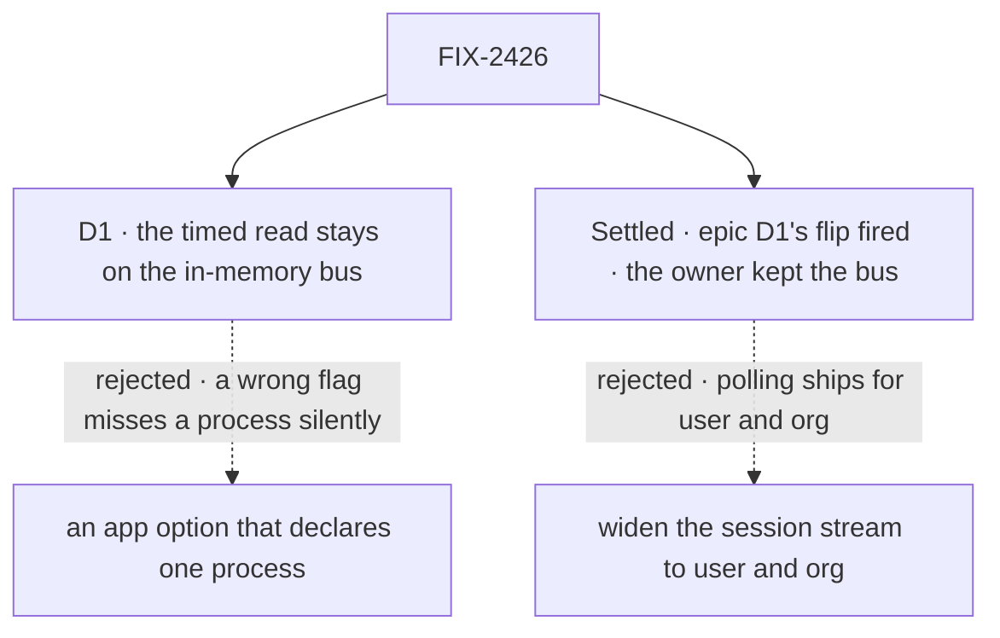

# FIX-2426 · Decisions

[Spec](SPEC.md) · **Decisions**

What was considered, what was chosen, why, and what each choice locks in. One decision is the
sign-off surface. The epic already decided the shape (epic D1, D5, D6, ER-1 to ER-6); nothing
here reopens it.

## The tree

Solid edges are what you're signing. Dashed edges lost, and the label says why.

## D1 · The timed read turns off only on a bus that says it crosses processes; the in-memory bus keeps it

| | |
|---|---|
| **Instead of** | An app option that declares "this app runs on one process," which would let the in-memory bus turn the timer off too |
| **Because** | The engine can't tell whether another process writes the same store. A BullMQ worker added later, or a second web process, is reached today by the timed read; with a wrong flag it is never reached, and nothing says so. Epic D6 keeps the timer on the in-memory bus for this reason, and the in-memory bus is all this issue ships |
| **Locks in** | A bus adapter reports whether it crosses processes *right now*, and only that turns the timer off. The value may change at runtime (the Postgres bus's does when it stops hearing its own ping), and each change is delivered as an event. Single-process apps on the in-memory or SQLite stores keep paying 4 queries a second per idle tab until a crossing bus backs them. They get the instant wake now |

It comes down to a second process the app forgot: the timer still reaches it, a wrong flag never does.

**What would change my mind:** a way for the engine to know it is the only writer. Then the
in-memory bus turns the timer off too, with no option.

## Decided, not asked

- **Names.** `ChangeNotice` is `{ topic, kind, origin? }`; not `Notice`, which `task-notice` owns. The
  slot is `bus`, with `publish` and `subscribe`. This issue's kinds are `items`, `request` and
  `run`; FIX-2429 adds a *board change*, not a "task notice".
- **Two topic shapes, both owned here.** A bus topic is `{ scope, id, tenantId, resource? }`,
  `tenantId` required, so no subscriber hears another tenant (BP-035); adapters derive channel
  names from it. A wire topic names no user, org or tenant id: `topic.session(id)`, `topic.user()`
  and `topic.org()`, each with an optional `resource`, in `@flow-state-dev/contracts` for client
  and engine. FIX-2428's mint fills the rest from the caller.
- **`origin?: { requestId }` names the request that made the change** (FIX-1506 D2, so the
  writer's view skips the notice it already has from its own stream). An id says who wrote, not
  what changed, so ER-1 and epic D2 hold: the notice still carries no rows, and any read the id
  prompts is checked by its route. Optional; a write no request made sends none. Adapters and
  delivery carry it through unchanged.
- **Who hears a resource-narrowed notice:** subscribers of that resource's topic, and subscribers
  of its scope's un-narrowed topic, each receiving the narrowed topic. A narrowed subscriber hears
  only its resource. Same rule on the bus and the wire.
- **The session stream filters by kind**: it subscribes its session's topic and wakes only on
  `items`, `request` and `run`. State, resource and board notices on that topic never wake it,
  so it is not a second way to watch a board or a resource.
- **Lineage-shared session resources publish the writing session's topic only** (FIX-1506). ER-2
  has no lineage topic, and no consumer needs one today: the one live lineage-shared collection,
  a task board's ledger, also publishes the conversation's topic (FIX-2429). Who it affects: a
  view of another session in the lineage watching any other lineage-shared resource, which sees
  the change at its next read. A consumer that needs more raises it at the epic's topic seam.
- **One wrapper, applied at every entry** (tenet 5): `resolveStores`, `runAction`, BullMQ's
  `createFlowJobProcessor` (so `createFlowWorker`), and `fsdev run` and `chat`, which write the
  session and settle requests beside `runAction`. Every write method on the request and session
  stores is wrapped: `set`, `delete`, `patchField`, `incField`, `pushToArray`, `deleteField`, and
  request `deleteIfStatus`, `setFieldsIfStatus`, `persistItems`. Not `persistEvents`, which feeds
  the request stream. **The wrap is idempotent**, since stores pass several entries.
- **A notice goes out only once its write can be read**: after the awaited write, and for the
  buffered `persistItems`, after its batch lands. A publisher may fold one topic's notices within
  a tick into one.
- **The wake reads at most once per `intervalMs`.** A notice after a quiet interval reads at once;
  later ones fold into one read at the interval's end. `persistItems` runs on every streaming
  update, and the stream sends only finished items, so uncapped a viewer reads back to back
  through a reply. Capping at the stream keeps the wrapper free of each item's last status.
- **A run's writes publish its parent's topic too**: the parent's view lists it in `session.runs`.
- **`crossesProcesses` can change, and the contract is its transition event.** The bus emits
  each change (`onCrossingChange`); the stream keeps a cached boolean. A change to not crossing
  is itself the wake: waiting streams resume the timed read within one interval. Polling the
  value on each wait is an equivalent implementation. The ping and stale rule are FIX-2427's.
- **A bus that reconnects tells its subscribers to read once.**
- **A `bus` adapter that doesn't declare the slot fails at `ready()`.**

## Considered and dropped

| Alternative | Why not |
|---|---|
| A publish at each write site | A dozen call sites, and a new writer forgets one. The epic chose one wrapper |
| The timer and the wake, always both | The in-memory bus does this. On a crossing bus it keeps the cost D6 removes |
| No publish for an in-progress `persistItems` | The wrapper would hold each item's last status to tell; the cap bounds the reads anyway |
| A raw registry documented as silent | With a crossing bus, a silent writer is a view that never updates |
| A slower fallback (5 s) once a bus exists | Changes latency on exactly the hosts that can't cross, with no measured need |
| String topics (`"session:abc"`) | Every adapter and every subscriber parses them, and the tenant is easy to drop |
| Publishing from `flow_events` (FIX-569) | Keyed by one request; a session view needs the session's topic |

## Settled

- **Epic D1's flip fired, and the owner kept the bus** ([epic D1](../../epics/FIX-2367/DECISIONS.md#d1),
  [#4445](https://github.com/fixpoint-labs/flow-state-dev/pull/4445)). As first written, it fired
  at the labs' one to five views. Widening would ship polling for user and org changes, which
  FIX-1506 rules out, and leave FIX-380 without its seam. Epic D1 and D6 now flip under 100 store
  queries a second at 100 idle views.
- **An idle view costs at least four reads a second (epic D1)** — **CONFIRMED**, exactly 4.00
  statements per view per second at 1, 10, 50 and 100 views, by
  [`poc/stream-read-cost/`](poc/stream-read-cost/): the real router over the Postgres stores on
  PGlite, every statement counted. With one request and two runs open: 5.6 to 6.9. Control
  `FIX2426_CONTROL=no-viewers` reports 0. One of three full-grid runs failed one case on the
  runs-frame assertion, not the counts; two reruns passed. **Pool occupancy is not established**:
  PGlite runs every query behind one lock, so its timings include waits (Codex on #4445). They are
  dropped, and with them the earlier pool shares and view-count crossover.

## Analysis

2026-11-01 · watermark 2026-10-31 (epic approved) · **Right approach.** Run inline by the author,
with no fresh analyst in this dispatch: weaker than the skill asks.

1. **Reuse** — each Adds row extends a slot, a function or a loop
   ([Builds on / Adds](SPEC.md#whats-already-here-and-the-debt)).
2. **Prior art** — the usual `LISTEN`/`NOTIFY` pattern: the notice says something changed, the
   listener queries. FIX-2286 D3 says the same.
3. **Other shapes** — widening the session stream, which the owner rejected (epic D1).
4. **New factors** — none since the epic's approval.
5. **Necessity** — earns its place with the bus kept (epic D1).
6. **Ergonomics** — nothing new for app code; adapter authors learn one contract.
7. **Concerns** — "notice" collides with `task-notice`; folded as `ChangeNotice`.

## How it got here

- **Draft** — framed as the epic's seam and the stream's wake; `resolveStores` as the one publish
  point; the epic D1 measurement built first, which fired the flip and made it the open fork.
- **Amended (Nov 1)** — the owner kept the bus. The wrap covers raw-registry entries and every
  write method; the wake is capped; bus and wire topics split; `crossesProcesses` may change,
  as a transition event (for FIX-2427); pool timings dropped.
- **Seams from FIX-1506 (#4478)** — `origin` on the notice; a scope subscriber hears its
  narrowed notices, the session stream filters by kind; lineage-shared resources a stated limit.

**Open: none.**
