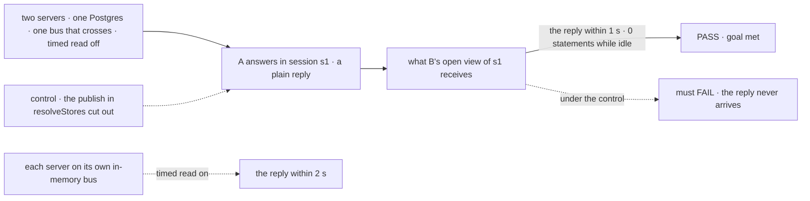

# FIX-2426 · The bus: a change publishes a notice, and the session stream wakes on it

**Spec** · [Decisions](DECISIONS.md)

## Five people, before and after

| Someone who… | Today | After |
|---|---|---|
| **leaves a session open in a tab and walks away** | That tab costs the database 4 queries a second while it stays open ([measured](DECISIONS.md#settled)) | Nothing until the session changes, on a bus that crosses processes. On the in-memory bus, as today ([D1](DECISIONS.md#d1)) |
| **watches a conversation someone else is answering** | Sees the reply at the next once-a-second read | Sees it as soon as it is saved: the write wakes the view |
| **runs two processes on the in-memory bus, or serverless** | Gets the reply within about a second | The same: the timed read stays as the fallback |
| **builds a later child of the epic** | Has no seam to publish to or listen on | One bus, one notice shape, one stores slot to back |
| **runs Postgres and declares no `bus`** | n/a | No change here. Once the Postgres bus ships, the primary backs `bus` with no config change ([epic D5](../../epics/FIX-2367/DECISIONS.md#d5)) |

## The goal, and how we'll know it's met

**A change saved in a session reaches every open view of that session as soon as it is saved,
and a view of a session where nothing changes costs the database nothing, wherever a bus
carries the change; where none can, views keep today's one-second read and miss nothing.**

| Is it the right goal? | |
|---|---|
| **The real need** | Epic D6 and ER-3, the bus wakes the session stream, and closure leg d, a plain reply reaching another process with the timed read off ([FIX-2367](../../epics/FIX-2367/SPEC.md#the-goal-and-how-well-know-its-met)) |
| **Smaller, and rejected** | "A bus exists, with `publish`, `subscribe` and an in-memory adapter." It ships a seam nobody listens on, and the stream still reads each second |
| **Bigger, and not this issue's** | Crossing processes (FIX-2427), push to the browser (delivery), resource and state notices (FIX-1506) |
| **Not done if** | With the timer off, a view misses a plain reply that wrote no resource or state · a notice goes out before its write can be read, so the woken read finds nothing and nothing wakes it again · the in-memory bus turns the timer off · an idle view still reads with a bus that crosses processes · a write path that skips `resolveStores` goes unpublished with the timer off |



The check reads what B's stream delivers and what the database is asked, not whether
`publish` was called. The dashed fallback path must pass too; the control must fail.

| How we verify | |
|---|---|
| **Goal check** | `goals/session-stream/wakes-on-a-change/` · model `n/a` · run by the implementer at completion · verdict in the implementation PR |
| **Signal** | (1) B's view receives A's reply within 1 s with the timed read off. (2) Over a 10 s idle window, B's open view makes 0 database statements, counted at the executor. (3) With each server on its own in-memory bus, the reply arrives within 2 s |
| **Input** | Two registries over one Postgres (PGlite), sharing one bus adapter written to the public contract that says it crosses processes. A reply that writes only items and a status; a background run starting must pass too |
| **Anti-game** | Not `publish` calls, not a mocked store: both pass while B's view stays empty. One registry is not two servers |
| **Control that must fail** | `GOAL_CONTROL=no-publish` must FAIL signal (1). Today's `main` must FAIL signal (2): the [POC](DECISIONS.md#settled) measures 4 statements a second |

## What changes


Same route, same events, same client. What changes is what makes a view read.

**What a later child writes against.** Illustrative: `bus`, `publish`, `subscribe` and
`ChangeNotice` are fixed ([decided, not asked](DECISIONS.md#decided-not-asked)); the rest is the
implementer's.

```diff
  // a publisher (FIX-1506, the task board)
+ await stores.bus.publish({ topic: { scope: "org", id: orgId, tenantId }, kind: "state" });

  // a listener (the session stream here; delivery next)
+ const stop = stores.bus.subscribe({ scope: "session", id: sessionId, tenantId }, () => readAgain());

  // an adapter (the Postgres bus, Ably)
+ { publish, subscribe, crossesProcesses: true }   // declared in `capabilities: ["primary", "bus"]`
```

**Docs:** update `persistence/overview.md` (*Store adapters*: the `bus` slot and when a view
stops reading each second; *Custom stores*: a *Bus* subsection beside *Live tail*), the session
stream section of `api/client.md`, and the engine README. No new page: the realtime guide is the
delivery child's.

## What stays as it is

- The route, its events, `since` and resume, and `useSession({ live })`, as clients see them.
- The read itself: what it asks for, its floor and margin, its same-session checks.
- Pings and the 15-minute close, on their own timers. They aren't reads.
- Request streams, `subscribeToEvents` and `StreamBridge`: keyed by one request, untouched.

## What's already here, and the debt

| Already here | What this does with it |
|---|---|
| What already says "something changed": `streaming` · `subscribeToEvents`; `bullmq` · `StreamBridge`; `onResourceChanged`; the task substrate's `onChange` | **Leaves alone.** Each is keyed by one request or one process (searched `subscribe`, `publish`, `notify`, `onChange`, `listen` in `packages/`). **This is the fifth, and the first keyed by a scope** |
| `task-notice` · `recordEnding`: a task's ending, owed to its session | **Leaves alone.** A different job, which owns the word: the type here is `ChangeNotice` |
| `store` · `resolveStores`, which every registry passes through | **Extends.** Wraps the request and session stores' writes to publish |
| `CapabilitySlotMap`, `resolve-slots.ts` | **Extends** with `bus`, defaulting to the primary when it declares it |
| The session stream's loop (`session-stream-routes.ts`) | **Extends.** Its wait becomes: a notice, or the timer where the bus can't cross |
| [Epic D5](../../epics/FIX-2367/DECISIONS.md#d5), [D6](../../epics/FIX-2367/DECISIONS.md#d6), [ER-1, ER-2, ER-3, ER-6](../../epics/FIX-2367/DECISIONS.md#who-owns-what) | **Kept**, and built here. D1's flip threshold is set here, and [fired](DECISIONS.md#open) |
| [FIX-2286 D3](../FIX-2286/DECISIONS.md#d3): the push says when, a read says what | **Kept** |

| Adds | Existing piece considered | Why it doesn't fit / how composed |
|---|---|---|
| The bus contract and in-memory adapter | `streaming` · `subscribeToEvents`; `bullmq` · `StreamBridge` | Both end with one request; a topic outlives every request (epic D5) |
| The `bus` slot | `store` · the `primary` slot | Extends the slot map; the primary backs it when it can |
| One publish point | A publish at each write site | Composed: one wrapper in `resolveStores`, not a dozen call sites |
| The stream's wake | The stream's timer | Extends it: the same read, woken |

| The debt | |
|---|---|
| **Removes** | Nothing yet. The per-second read goes where a bus crosses processes, and none ships here: the Postgres bus (FIX-2427) collects it |
| **Adds** | A fifth change signal, permanent by design: the epic's channel. A write wrapper on two stores |
| **Leaves** | The timed read on the in-memory bus ([D1](DECISIONS.md#d1)). Per-request `subscribeToEvents` and `StreamBridge`, by epic D5 |

**Net: up**, by one channel and a wrapper, with nothing removed until the Postgres bus lands.

## Sign off

**[The goal](#the-goal-and-how-well-know-its-met):** idle views free and writes reaching views at
once, wherever a bus crosses; nothing missed where it can't. If wrong: a seam with no listener.

**[The debt](#whats-already-here-and-the-debt): up**, one channel and a wrapper, paid back only
when FIX-2427 ships. If wrong: a fifth change signal nobody else adopts.

1. **[D1](DECISIONS.md#d1) · The timed read turns off only on a bus that says it crosses
   processes; the in-memory bus keeps it.** If wrong: single-process apps pay 4 queries a second
   per idle tab that they never needed to.

**Open: [the D1 flip fired](DECISIONS.md#open).** The measurement says an idle view is cheap at
our own apps' tab counts. Keep the bus (recommended), or widen the session stream instead. This is
the one to weigh: it decides whether this issue ships.

Feature · `engine` · medium: one slot, one contract, one wrapper, one route's wait · epic FIX-2367
