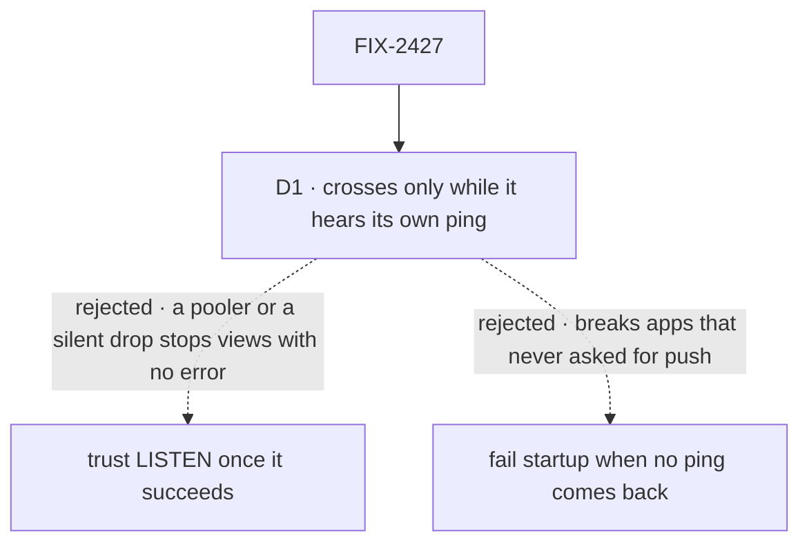

# FIX-2427 · Decisions

[Spec](SPEC.md) · **Decisions**

What was considered, what was chosen, why, and what each choice locks in. One decision is the
sign-off surface. The epic decided the shape (D5, ER-1, ER-6) and FIX-2426 the contract, including
a `crossesProcesses` that changes at runtime and reaches the stream as an event
([FIX-2426 → Decided, not asked](../FIX-2426/DECISIONS.md#decided-not-asked)); nothing here
reopens either.

## The tree

Solid edges are what you're signing. Dashed edges lost, and the label says why.

## D1 · The Postgres bus says it crosses processes only while it hears its own ping; otherwise views keep the once-a-second read

| | |
|---|---|
| **Instead of** | Saying it crosses as soon as `LISTEN` succeeds, and staying stale until a reconnect · failing startup when no ping comes back |
| **Because** | Saying "crosses" turns the session stream's timed read off ([FIX-2426 D1](../FIX-2426/DECISIONS.md#d1)), so a wrong "yes" is a view that stops updating with no error. Two ordinary cases give one: a transaction-mode pooler (PgBouncer, Supabase's and Neon's pooled endpoints) accepts `LISTEN` and delivers nothing, and a connection a load balancer drops goes quiet without an error. A ping sent the way a notice travels, and heard on the listener, is the only thing that proves the path. Failing startup instead would break every Postgres app behind a pooler that never asked for push, which epic D5 already ruled out |
| **Locks in** | The ping drives FIX-2426's crossing event: each change of the answer goes out on `onCrossingChange`, and a change to "does not cross" wakes the views already waiting, which go back to the timed read (the stream's side is FIX-2426's). One ping per process every 2 s while its listener is open. A view can be late by up to about 5 s after a silent drop; it misses nothing, since the timed read catches up |

It comes down to a pooler or a silent drop: trusting `LISTEN`, other processes stop updating unseen.

**What would change my mind:** every deployment we support holding a direct connection that
never drops silently. Then a successful `LISTEN` is proof enough, and the ping is waste.

## Decided, not asked

**Inherited from FIX-2426, not restated here:** publish after the write lands, and a failed
publish never fails the write (ER-6) · the bus topic, `tenantId` required, so tenants stay apart
by topic · folding one topic's notices within a tick · a reconnect tells subscribers to read once
· the stream's cached answer and its wake on `onCrossingChange`. What follows is only what the
Postgres adapter adds.

- **One channel, filtered in process** (the epic's "set" row). The channel is the bus's own, not
  `flow_events`. The payload is the notice (topic and kind, ER-1), a process id, and nothing
  else. A topic per channel would be a `LISTEN` per topic on the shared connection.
- **The publisher's own views hear it at once, in process.** Its notices come back over
  `LISTEN` too and are dropped by process id, so a same-process view wakes once, and still wakes
  while the listener is down.
- **`pg_notify` on the stores' own pool**, outside any transaction.
- **A payload too big for `NOTIFY` (8,000 bytes) drops its `resource` narrowing** and goes out as
  the bare scope: a wider wake, never a lost one.
- **The ping and the stale rule** (FIX-2426 leaves both here). A ping goes out every 2 s on the bus
  channel. The bus says it does not cross once a ping has gone 3 s unheard, and says it crosses
  again on the next ping it hears. A silent drop is seen within 5 s, and the stream's next
  interval takes the view to the read. The implementer may tune both numbers while the goal's
  bounds hold.
- **One listening connection per process, opened by its first subscriber.** Publishing needs no
  `LISTEN`, so a process with no open view (a BullMQ worker, `fsdev run`, a migration) holds no
  listener, no ping and no warning. Until its first ping is heard the bus says it does not cross,
  so a process's first view starts on the timed read and switches within one ping: the same path
  every reconnect takes. The connection comes from the tail pool, leaving it nine for request
  tails by default. `close()` stops the ping and releases the connection before the pool ends.
- **No tail pool, no crossing.** The `{ pool }` shape without `liveTailPool` and the `{ executor }`
  shape (PGlite) get the bus in process with `crossesProcesses` false, the rule `flow_events`
  already follows. `vercelPostgresStores` passes `liveTailPool: null` and declares no `bus`.
- **One listen-with-reconnect, shared with request tails.** `subscribeViaListen`'s checkout,
  `LISTEN`, capped backoff and reconnect become one internal helper in `store-postgres` that both
  use. Each keeps its own end: a request tail gives up after its budget, the bus never does, since
  a bus that stops is a process whose views stop. If the two turn out too different to share, the
  implementation PR says why.
- **The warning is one line, once per process,** when the first ping never comes back, naming the
  likely cause (a transaction pooler) and the fix (a direct connection string for the tail pool).
  No new option: `liveTailPool` already chooses the connection.

## Considered and dropped

| Alternative | Why not |
|---|---|
| Ride `flow_events` | Keyed by one request, written only by `persistEvents`; a view needs the session topic. FIX-2426 dropped it for the same reason |
| A connection per subscriber, as `flow_events` does | Ten open views would take the whole tail pool. The epic chose one per process |
| A tick inside the bus while it is down | A second timer beside the stream's own; the crossing event reuses the stream's |
| TCP keepalive as the health check | Proves the socket, not that a notice comes back through a pooler |
| Opening the listener when the stores resolve | Every worker-only and short-lived process would hold a connection and a ping it never uses, only so the answer is known before a view opens; the first view's switch within one ping costs less |
| A second copy of `subscribeViaListen`'s reconnect | The backoff and error handling would drift between the two |
| A Redis bus on BullMQ's connection | Not this issue's. The epic left it as a possible follow-up, for BullMQ hosts whose stores are not Postgres |

## Open

None.

## Settled

- **No POC built.** No premise here needs running code before review. `LISTEN`/`NOTIFY` across
  processes is the pattern `flow_events` ships today. The pooler's behaviour is the one thing
  not checked here, and D1 doesn't depend on it: if a pooler delivers, the ping comes back; if it
  doesn't, the ping says so. The goal check proves both paths against a real Postgres.
- **No counted facts to check.** The one number carried, 4 statements a second per idle view, is
  FIX-2426's, measured by its [POC](../FIX-2426/poc/stream-read-cost/).

## Notes from review

Recorded verbatim for the implementer; not folded into the design.

- jhoffner, [#4476](https://github.com/fixpoint-labs/flow-state-dev/pull/4476#issuecomment-6563654865):
  "The auto-created tail pool uses the same connection string as the main pool. A team behind a
  transaction pooler gets the warning but has no config path other than passing their own
  `liveTailPool`. The warning text should say exactly that, since there is no new option (the
  spec's own choice)."
- jhoffner, same comment: "The `resource`-narrowing drop above 8,000 bytes means a wider wake.
  Say whether it's logged once, so a repeated oversized payload is visible."
- jhoffner, same comment: "If it stays eager, say that timers must be `unref`'d and that
  `close()` must resolve before pool `end()`." (The listener is now lazy; the `close()` ordering
  stays in *Decided, not asked*.)
- cursor[bot], [SPEC.md](https://github.com/fixpoint-labs/flow-state-dev/pull/4476#discussion_r4437274984):
  "NOTIFY commit lock + per-write `pg_notify` is the real throughput ceiling (shared with
  `flow_events`). Optional spec nudge: treat **merge identical notices in one tick** as the
  recommended default, not merely permitted — cheap win under burst without changing the goal."
- cursor[bot], review summary: "process-id filter on self-echo might be droppable if FIX-2426
  coalescing tolerates an extra wake"
- cursor[bot], review summary: "Mirror **BullMQ `StreamBridge` thickness** (thin factory module),
  not its interface."

## Analysis

2026-11-01 · watermark 2026-11-01 (FIX-2426 amended, #4477) · **Right approach.** Run inline by the
author: this dispatch has no sub-agent tool, so no fresh analyst ran. Weaker than the skill asks.

1. **Reuse** — every Adds row composes the tail pool, the `LISTEN` helper shared with request
   tails, or FIX-2426's crossing event and the stream's own timer
   ([Builds on / Adds](SPEC.md#whats-already-here-and-the-debt)). Re-checked inline after round 1
   moved two rows: the reconnect is now extended, not copied, and nothing is new that the stream
   already has.
2. **Prior art** — the Notifier Pattern that `flow_events` uses; heartbeat-checked `LISTEN` is
   the usual guard against PgBouncer's transaction mode, which does not support it.
3. **Other shapes** — a Redis bus; left to the epic's not-filed follow-up.
4. **New factors** — FIX-2426 amended on Nov 1 (#4477): the bus is kept, `tenantId` is required,
   and `crossesProcesses` is a transition event that wakes waiting views. This spec builds on all
   three instead of changing the contract.
5. **Necessity** — the epic's leg a can't pass without it.
6. **Ergonomics** — nothing for app code; one warning a team may read.
7. **Concerns** — `NOTIFY`'s commit lock under heavy write load, recorded as debt.

## How it got here

- **Draft** — framed as the epic's second bus adapter, built from the `flow_events` pattern on the
  tail pool; the pooler and the silent drop made "when it says it crosses" the one decision.
- **Review round 1 (Nov 1)** — a view already waiting when the listener drops had nothing to wake
  it (Codex, jhoffner). FIX-2426's amendment (#4477) closed that in the contract, so this issue
  drives the crossing event and no longer changes the stream. The ping (2 s) and stale rule (3 s)
  are pinned; the listener opens on the first subscriber, not at resolve; the reconnect is shared
  with request tails, not copied.
