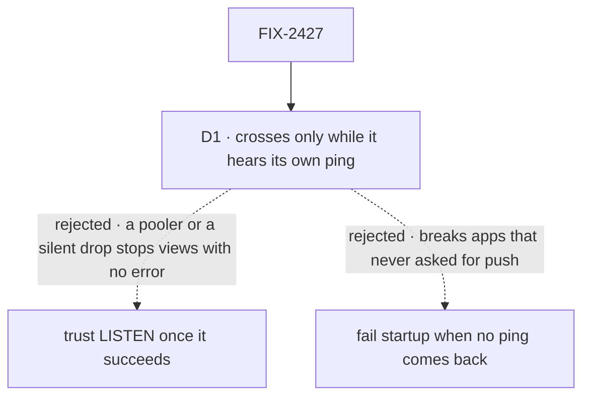

# FIX-2427 · Decisions

[Spec](SPEC.md) · **Decisions**

What was considered, what was chosen, why, and what each choice locks in. One decision is the
sign-off surface. The epic decided the shape (D5, ER-1, ER-6) and FIX-2426 the contract; nothing
here reopens either.

## The tree

Solid edges are what you're signing. Dashed edges lost, and the label says why.

## D1 · The Postgres bus says it crosses processes only while it hears its own ping; otherwise views keep the once-a-second read

| | |
|---|---|
| **Instead of** | Saying it crosses as soon as `LISTEN` succeeds, and staying stale until a reconnect · failing startup when no ping comes back |
| **Because** | Saying "crosses" turns the session stream's timed read off ([FIX-2426 D1](../FIX-2426/DECISIONS.md#d1)), so a wrong "yes" is a view that stops updating with no error. Two ordinary cases give one: a transaction-mode pooler (PgBouncer, Supabase's and Neon's pooled endpoints) accepts `LISTEN` and delivers nothing, and a connection a load balancer drops goes quiet without an error. A ping sent the way a notice travels, and heard on the listener, is the only thing that proves the path. Failing startup instead would break every Postgres app behind a pooler that never asked for push, which epic D5 already ruled out |
| **Locks in** | `crossesProcesses` is live, not fixed at startup, and the session stream reads it on every wait, so its own timer is the one fallback. One ping per process every few seconds. A view can be late by up to about 5 s after a silent drop; it misses nothing, since the timed read catches up |

It comes down to a pooler or a silent drop: trusting `LISTEN`, other processes stop updating unseen.

**What would change my mind:** every deployment we support holding a direct connection that
never drops silently. Then a successful `LISTEN` is proof enough, and the ping is waste.

## Decided, not asked

- **One channel, filtered in process** (the epic's "set" row). The channel is the bus's own, not
  `flow_events`. The payload is the notice (topic and kind, ER-1), a process id, and nothing
  else. A topic per channel would be a `LISTEN` per topic on the shared connection.
- **Tenants stay apart by topic.** A process delivers a notice only to subscribers of the same
  structured topic, `tenantId` included (FIX-2426).
- **The publisher's own views hear it at once, in process.** Its notices come back over
  `LISTEN` too and are dropped by process id, so a same-process view wakes once, and still wakes
  while the listener is down.
- **Publish after the write lands** (FIX-2426's rule) with `pg_notify` on the stores' own pool,
  outside any transaction. A failed publish never fails the write (ER-6). The implementer may
  merge identical notices in one tick; never delay one past its write.
- **A payload too big for `NOTIFY` (8,000 bytes) drops its `resource` narrowing** and goes out as
  the bare scope: a wider wake, never a lost one.
- **One listening connection per process, opened when the stores resolve**, worker-only
  processes included, so `crossesProcesses` is known before a view opens. From the tail pool,
  leaving it nine for request tails by default. `close()` releases it.
- **No tail pool, no crossing.** The `{ pool }` shape without `liveTailPool` and the `{ executor }`
  shape (PGlite) get the bus in process with `crossesProcesses` false, the rule `flow_events`
  already follows. `vercelPostgresStores` passes `liveTailPool: null` and declares no `bus`.
- **The listener reconnects forever**, with capped backoff. On reconnect, once a ping is heard,
  every subscriber reads once (FIX-2426's rule), then the bus says it crosses again.
- **The warning is one line, once per process,** when the first ping never comes back, naming the
  likely cause (a transaction pooler) and the fix (a direct connection string for the tail pool).
  No new option: `liveTailPool` already chooses the connection.
- **The stream's change is one line**: read `crossesProcesses` on each wait, not once. If FIX-2426
  ships it read once, this issue changes it.

## Considered and dropped

| Alternative | Why not |
|---|---|
| Ride `flow_events` | Keyed by one request, written only by `persistEvents`; a view needs the session topic. FIX-2426 dropped it for the same reason |
| A connection per subscriber, as `flow_events` does | Ten open views would take the whole tail pool. The epic chose one per process |
| A tick inside the bus while it is down | A second timer beside the stream's own; the live flag reuses the stream's |
| TCP keepalive as the health check | Proves the socket, not that a notice comes back through a pooler |
| A Redis bus on BullMQ's connection | Not this issue's. The epic left it as a possible follow-up, for BullMQ hosts whose stores are not Postgres |

## Open

None.

## Settled

- **No POC built.** No premise here needs running code before review. `LISTEN`/`NOTIFY` across
  processes is the pattern `flow_events` ships today. The pooler's behaviour is the one thing
  not checked here, and D1 doesn't depend on it: if a pooler delivers, the ping comes back; if it
  doesn't, the ping says so. The goal check proves both paths against a real Postgres.
- **No counted facts to check.** The one number carried, 4 statements a second per idle view, is
  FIX-2426's, measured by its [POC](../FIX-2426/poc/stream-read-cost/).

## Analysis

2026-11-01 · watermark 2026-11-01 (FIX-2426 merged) · **Right approach.** Run inline by the
author: this dispatch has no sub-agent tool, so no fresh analyst ran. Weaker than the skill asks.

1. **Reuse** — every Adds row composes the tail pool, the `LISTEN` pattern or the stream's own
   timer ([Builds on / Adds](SPEC.md#whats-already-here-and-the-debt)). One fold: a tick inside
   the bus was drafted, then replaced by the live flag, which reuses the stream's timer.
2. **Prior art** — the Notifier Pattern that `flow_events` uses; heartbeat-checked `LISTEN` is
   the usual guard against PgBouncer's transaction mode, which does not support it.
3. **Other shapes** — a Redis bus; left to the epic's not-filed follow-up.
4. **New factors** — FIX-2426 merged on Nov 1 with the bus kept.
5. **Necessity** — the epic's leg a can't pass without it.
6. **Ergonomics** — nothing for app code; one warning a team may read.
7. **Concerns** — `NOTIFY`'s commit lock under heavy write load, recorded as debt.

## How it got here

- **Draft** — framed as the epic's second bus adapter, built from the `flow_events` pattern on the
  tail pool; the pooler and the silent drop made "when it says it crosses" the one decision.
