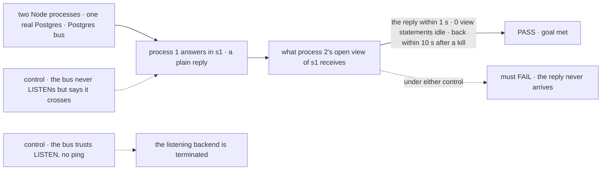
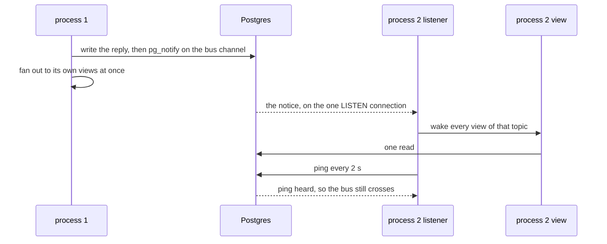

# FIX-2427 · The Postgres bus: a change on one process reaches viewers on another

**Spec** · [Decisions](DECISIONS.md)

## Five people, before and after

| Someone who… | Today | After |
|---|---|---|
| **runs a web process and BullMQ workers over one Postgres** | A reply a worker writes reaches the web process's open view at the next once-a-second read | Reaches it as soon as it is saved, with no config change ([epic D5](../../epics/FIX-2367/DECISIONS.md#d5)) |
| **leaves a session open in a tab on a scaled-out Node host** | That tab costs the database 4 statements a second ([FIX-2426's measurement](../FIX-2426/DECISIONS.md#settled)) | Nothing while the session is idle |
| **connects through a pooler that drops `LISTEN`, or passes `liveTailPool: null`** | The once-a-second read | The same read, and one warning at startup that says why ([D1](DECISIONS.md#d1)) |
| **loses the listening connection while the app runs** | n/a | Views go back to the once-a-second read within about 5 s, then to push once it reconnects. Nothing is missed |
| **deploys to Vercel** | Polls | The same. The Vercel adapter turns `LISTEN` off already ([epic D3](../../epics/FIX-2367/DECISIONS.md#d3)) |

## The goal, and how we'll know it's met

**On two or more processes over one Postgres, a change saved on any process reaches every open
view of it on the others within a second, and a view where nothing changes costs the database
nothing; whenever Postgres can't carry the notices, views keep today's one-second read and miss
nothing.**

| Is it the right goal? | |
|---|---|
| **The real need** | The epic's leg a, "a viewer on another process misses a change" is *not done*, and its control: the in-memory bus on two processes must fail ([FIX-2367](../../epics/FIX-2367/SPEC.md#the-goal-and-how-well-know-its-met)). FIX-2426 left the per-second read for this issue to remove |
| **Smaller, and rejected** | "A bus on `LISTEN`/`NOTIFY` that delivers a notice." It turns the timed read off on trust, and behind a pooler the views on other processes stop updating with no error |
| **Bigger, and not this issue's** | Push to the browser (FIX-2428), user, org and task-board notices (FIX-1506, FIX-2429), a Redis bus on BullMQ's connection (not filed), serverless push (FIX-380) |
| **Not done if** | A view on another process misses a change · a pooler that drops notices turns the timed read off · a dropped listening connection leaves views stale past about 10 s · a worker-only process's writes don't reach a web process · one process hears another tenant's topic as its own · a view already waiting when the listener drops stays parked · a process with no open view holds a listening connection · `close()` leaves the listening connection open |



The check reads what process 2's stream delivers and what process 2 asks the database, not
whether `pg_notify` ran. Each control breaks one half of the claim; each must fail.

| How we verify | |
|---|---|
| **Goal check** | `goals/session-stream/wakes-across-processes/` · model `n/a` · run by the implementer at completion · verdict in the implementation PR |
| **Signal** | (1) Process 2's view receives process 1's reply within 1 s. (2) Over a 10 s idle window, process 2's view makes 0 statements; the bus's own pings are counted apart, at most one per 2 s per process with two views open. (3) With process 2's view idle and waiting, the listening backend is terminated with `pg_terminate_backend`; one reply from process 1, with no write after it, reaches the view within 10 s, and once the listener is back the next reply within 1 s. (4) With `liveTailPool: null` on both, the reply arrives within 2 s |
| **Input** | Two processes (`child_process.fork`), each `createFlowState` with `postgresStores`, over one Postgres the script starts (`initdb`, `pg_ctl`) or `FSD_DB_URL`. A reply that writes only items and a status; a run started from process 1 must pass too |
| **Anti-game** | Not `pg_notify` calls or a mocked pool: both pass while process 2 stays empty. One process with two registries is not two processes, and PGlite can't `LISTEN` across them |
| **Control that must fail** | `GOAL_CONTROL=no-listen` must FAIL signal (1). `GOAL_CONTROL=trust-listen` must FAIL signal (3). Today's `main` must FAIL signal (2) |

## What changes


Same stores, same route, same client. What changes is that a notice crosses Postgres.

**What a team writes.** Nothing. The adapter declares the slot, so the primary backs it
(epic D5). Illustrative of the adapter side only:

```diff
  export function postgresStores(options) {
    return {
-     capabilities: ["primary"],
+     capabilities: ["primary", "bus"],
      resolve() { /* the registry now carries `bus`: { publish, subscribe, crossesProcesses } */ },
    };
  }
```

**Docs:** update `packages/store-postgres/README.md` (a *Cross-process notices* section beside
*Cross-process live tail*: the one listening connection, the ping, the pooler warning,
`liveTailPool: null`), `persistence/overview.md` → *Postgres* (one paragraph: views on another
process wake on a change), and the engine README's `bus` line. No new page: the realtime guide's
host table is the delivery child's (FIX-2428), and this issue gives it the Postgres row's facts.



## What stays as it is

- The bus contract, the notice shape, `resolveStores`' publish, the stream's wake and its answer to `onCrossingChange`: FIX-2426's. No engine change here.
- `flow_events`, request-stream tails and their one connection each from the tail pool.
- The `{ pool }` and `{ executor }` shapes' rule: no tail pool unless one is passed, so no crossing.
- `vercelPostgresStores` and Neon's pooled endpoint, with `LISTEN` off.

## What's already here, and the debt

| Already here | What this does with it |
|---|---|
| The job, "carry a change signal across processes": `store-postgres` · `flow_events` `LISTEN` (FIX-569), keyed by one request; `bullmq` · `StreamBridge` on Redis, keyed by one request; the session stream's timed read, polling (searched `LISTEN`, `pg_notify`, `subscribe`, `publish`, `crossesProcesses` in `packages/`) | **Leaves alone.** This is not another way: it is the second adapter of [FIX-2426's bus](../FIX-2426/SPEC.md#what-changes), the one the epic named. The closest entry, `flow_events`, is the pattern it copies |
| `store-postgres` · `liveTailPool`, auto-created for the connection-string shape, `max` 10 | **Builds on.** The bus holds one connection from it per process |
| `store-postgres` · `subscribeViaListen`'s checkout, `LISTEN`, backoff and reconnect | **Extends.** Pulled out into one internal helper the bus and request tails both use. Each keeps its own end: a tail gives up after its budget, the bus never does |
| FIX-2426's `crossesProcesses`, its `onCrossingChange` event, and the stream's timed fallback | **Builds on.** The ping decides when the event fires ([D1](DECISIONS.md#d1)); the stream's side is FIX-2426's |
| [Epic D5](../../epics/FIX-2367/DECISIONS.md#d5), [ER-1, ER-6](../../epics/FIX-2367/DECISIONS.md#who-owns-what); [FIX-2426 D1](../FIX-2426/DECISIONS.md#d1) | **Kept**, and built here. FIX-2426 D1 said only a bus that crosses turns the timer off; this decides when the Postgres bus says it does |

| Adds | Existing piece considered | Why it doesn't fit / how composed |
|---|---|---|
| The Postgres bus | `flow_events` and `subscribeViaListen` | Composed from them: the same tail pool and the shared listen helper, a second channel, one connection per process with an open view instead of one per subscriber. `flow_events` is keyed by request; a view needs a session topic (FIX-2426's dropped list) |
| The ping | `pg`'s TCP keepalive; the `LISTEN` succeeding | Neither proves a notice comes back: a pooler accepts `LISTEN` and delivers nothing ([D1](DECISIONS.md#d1)) |
| The stale rule that fires `onCrossingChange` | FIX-2426's crossing event and the stream's timed read | Composed: the event and the timer are FIX-2426's; this issue decides only when the answer changes |

| The debt | |
|---|---|
| **Removes** | The once-a-second read per open view on every Postgres host with a tail pool, the cost FIX-2426 left for this issue |
| **Adds** | One held connection and one ping every 2 s per process with an open view, permanent by design. One `pg_notify` per published write, sharing `NOTIFY`'s commit-lock ceiling with `flow_events` |
| **Leaves** | Request-stream tails still take one tail connection each; they could ride the bus's connection, cheap now that both share the listen helper (not filed: no measured pressure). The Redis bus for BullMQ without Postgres, not filed, as the epic says |

**Net: down.** It removes the per-view read across Postgres hosts, for a per-process connection
and ping.

## Sign off

**[The goal](#the-goal-and-how-well-know-its-met):** across processes within a second, idle views
free, and nothing missed when Postgres can't carry it. If wrong: an epic leg that passes on a
direct connection and fails behind the pooler most teams run.

**[The debt](#whats-already-here-and-the-debt): down**, a per-view read removed for a per-process
connection and ping. If wrong: `NOTIFY`'s lock becomes the write ceiling before a Redis bus exists.

1. **[D1](DECISIONS.md#d1) · The Postgres bus says it crosses processes only while it hears its
   own ping come back; otherwise views keep the once-a-second read.** If wrong: a ping per process
   for a failure no deployment of ours has.

**Open: none.**

Feature · `store-postgres` only · medium: one adapter, a shared listen helper, a goal check
· blocked by FIX-2426's implementation · epic FIX-2367
