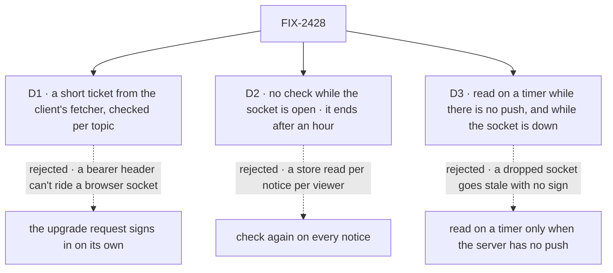

# FIX-2428 · Decisions

[Spec](SPEC.md) · **Decisions**

Three calls shape this issue. D1 is the one to weigh. Everything else here is context for them.
The epic's D2, D4 and D5 and its rules ER-4, ER-5 and ER-7 are kept, not reopened.

## The tree

Solid edges are what you are signing. Dashed edges lost, and the label says why.

## D1 · The socket proves who it is with a short ticket, minted through the client's own fetcher and checked per topic

| | |
|---|---|
| **Instead of** | The upgrade request signing in on its own, through the app's principal resolver, as every other route does |
| **Because** | A browser can't add a header to a WebSocket. Only cookies ride the upgrade, and Shift Manager and the DevTool sign in with a bearer header their client's fetcher adds. The client can't read that header back out of the fetcher, so the client can't move it onto the socket either. A `POST /users/:userId/stream` with the topics goes through that fetcher like any call. The server checks each topic with its scope's route check on that real request (ER-4), and answers with a ticket that names the caller and the granted topics and expires in 30 s. The socket accepts topics only from a ticket. A reconnect mints again, so the check runs on every connect (FIX-1620). FIX-380 answers the same call with its Ably token for the same topics |
| **Locks in** | One extra request per connect and per added topic. The public route `POST /users/:userId/stream` and its answer shape, which FIX-380 shares. A signing secret: one random key per process by default, and `pushSecret` (or `FSD_PUSH_SECRET`) shared by every process behind one address. Without it a connect that lands on another process is refused, and the hook reads on its timer until a retry lands (D3) |

It comes down to the bearer header: on its own, the upgrade can't carry it, so Shift Manager polls.

**What would change my mind:** every app we serve to a browser signs in with cookies. Then the
upgrade signs in on its own, and the mint and the secret go.

## D2 · An open socket is not checked again; the server ends it after an hour

| | |
|---|---|
| **Instead of** | Checking the caller's access again before each notice is sent |
| **Because** | A check per notice is a store read per notice per viewer, the cost the epic chose the bus to avoid ([D1](../../epics/FIX-2367/DECISIONS.md#d1)). A notice carries no rows (epic D2), so what a revoked user keeps is the moment of a change, never its content, and every read they make is checked as always. The hour cap bounds that, because the reconnect mints again and the mint checks again |
| **Locks in** | Revoked access stops notices at the next connect, at most an hour later. Every client reconnects at least hourly, which the at-most-once rule already makes harmless (ER-6: a connect reads once) |

It comes down to the cost of a notice: a check before each one is a store read per viewer.

**What would change my mind:** a notice that carries data, or a scope whose bare timing of
change is itself confidential. Then a check per notice is the price.

## D3 · The hook reads on a timer while the server has no push, and while the socket is down

| | |
|---|---|
| **Instead of** | Reading on a timer only when `GET /capabilities` says there is no push |
| **Because** | A socket on a host with push still drops: a proxy's idle timeout, a deploy, a laptop that sleeps, a ticket that lands on another process. With the timer tied to capabilities alone, the screen goes stale with no sign of it. So `client.subscribe` reads on its timer from the first failed reconnect, the pace `followSession` already treats as lapsed, until the socket is back. Each connect and reconnect calls `onChange` once. The timer lives in `client.subscribe`, not in each hook, so every consumer gets one fallback (ER-5) |
| **Locks in** | `pollIntervalMs` on `client.subscribe` and `useSubscription`, a public name. A screen on a push host still costs a read per interval while its socket is down |

It comes down to a socket that drops: without the timer, the screen stops changing with no sign.

## Decided, not asked

- **Push is on whenever `serve()` is the host**, `fsdev dev` and `fsdev serve` included, with
  `push: false` to turn it off. `createServerApp` alone (Lambda, Bun, Deno) reports `push: null`.
  The epic's goal is an app that writes no push code, so on is the default.
- **The convergence point is the mint.** Every topic in a socket's subscription set came from a
  ticket the mint signed, on the first connect, on a topic added to an open socket, and on a
  reconnect. No socket message that names a topic is ever accepted on its own. FIX-380's token
  goes through the same mint (ER-4).
- **User and org topics name no id on the wire.** The mint fills them from the caller's identity
  (BP-031), so no one can name another user's or organization's scope. A session topic names
  its session and passes the check `session_stream` uses. A topic narrowed to one resource
  passes its scope's check.
- **`GET /capabilities` answers `{ userStream, push }`**, with `push` either
  `{ transport: "websocket" }` or `null`. A client that gets no `push` field, from an older
  server, treats it as `null` (BP-030). `userStream` is true when this host serves the socket.
- **The ticket travels in the first socket message, not the URL**, so a proxy's access log never
  holds it. A socket with no valid ticket within five seconds is closed.
- **One socket per client** (epic D4), shared by every `client.subscribe` call on it, with topics
  counted so the last `close()` on a topic unsubscribes it and the last handle closes the socket.
- **A refused topic is tried again at the poll pace**, not stopped for good, so access given back
  recovers with no remount (FIX-1620).
- **The socket session lives in the engine; `serve()` only takes the upgrade and moves frames**
  (epic D5), so a later host reuses the check. The `ws` library handles frames in
  `@flow-state-dev/node`.
- **`client.stream()` goes with no replacement under its name.** The server never served it and
  it carried rows. Changesets for the client (minor: a removal) and for react and node.
- **`docs/mechanisms/mechanisms.yaml` gains a `push-delivery` row** (adapters: node; FIX-380 adds
  Ably), with the bus row FIX-2426 adds as what it is built on.

## Considered and dropped

| Alternative | Why not |
|---|---|
| The bearer token in the WebSocket subprotocol header | The client can't read a credential out of an opaque fetcher, and an app's resolver may read a header we don't know |
| The ticket in the socket URL | Access logs and proxies keep URLs |
| Tickets stored once and used once | Needs a store every process shares. A signed 30-second ticket needs only a shared secret, and only with several processes |
| An SSE stream per topic | Epic [D4](../../epics/FIX-2367/DECISIONS.md#d4) |
| A timer in each hook (FIX-1506's, the board's) | Several fallbacks with several paces; ER-5 wants one path |
| Keeping `client.stream()` beside `client.subscribe` | Two ways to watch a user's scope, one of which never worked and carries rows |

## Settled

No POC was built. The one premise the design rests on, that `serve()` can take an upgrade
beside the Hono app, is read from the code: `serve()` holds the `node:http` server, which emits
`upgrade` for any request with one. The spec rests on no counted facts, so it ships no checker.

## Analysis

2026-11-01 · watermark 2026-10-31 (epic approved) · **Right approach.** Run by the author, in
this dispatch, with no fresh sub-agent: this worker could not dispatch one. The coordinator may
run a fresh `analysis` before the gate.

1. **Reuse** — every Adds row extends or composes an existing piece; `client.subscribe` replaces
   `openUserStream` on the same route ([Builds on / Adds](SPEC.md#whats-already-here-and-the-debt)).
2. **Prior art** — Pusher's and Ably's channel auth, and Phoenix's socket token, all mint a
   short credential through an authenticated HTTP call and check it at connect. D1 follows them.
3. **Other shapes** — cookie-only sign-in, the credential in the subprotocol; both in
   *Considered and dropped*.
4. **New factors** — FIX-2426 has no spec yet. This spec uses only the epic's ER-1 and ER-2 shape
   and names the topic constructors as FIX-2426's.
5. **Necessity** — earns its place: it is the epic's one client path, and the epic's own apps
   need the bearer-header case.
6. **Ergonomics** — one hook with the read the screen already has; one option, the interval.
7. **Concerns** — the debt line is up. It sits inside the epic's accepted channel. Recorded.

## How it got here

- **Draft** — the socket on the user-stream route under `serve()`, a per-topic ticket from a
  mint through the client's fetcher, `client.subscribe` with the timer inside it, and
  `useSubscription` over the coalesced read. `client.stream()` removed.

**Open: none.**
