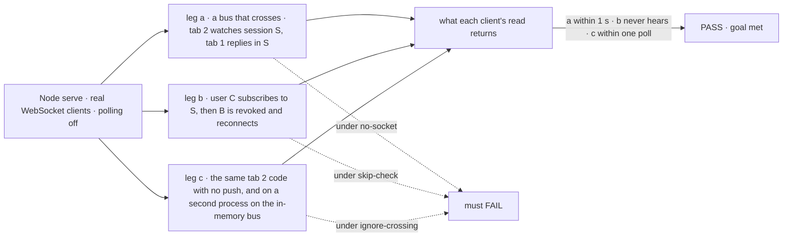
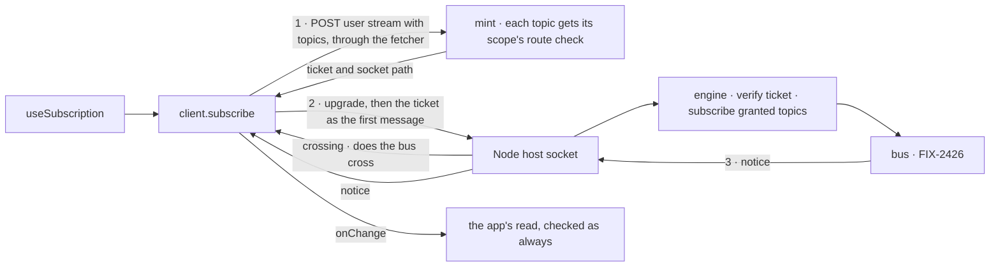

# FIX-2428 · WebSocket delivery: a screen hears a change as it happens, without polling

**Spec** · [Decisions](DECISIONS.md)

## Six people, before and after

| Someone who… | Today | After |
|---|---|---|
| **builds a screen on the Node host that others change** | Writes a timer that reads every few seconds, or the screen goes stale. `client.stream()` exists, and the server answers it 501 | Calls one hook with the topics and the read. The read runs within a second of a change, and, on a bus that crosses processes, not between changes. On the default in-memory bus, even a single-process `serve()` also reads on the timer between notices, because that bus never reports crossing ([D3](DECISIONS.md#d3)) |
| **deploys the same screen to Vercel or Next** | The same timer | The same hook, no code change. It reads on a timer, because the server says it has no push |
| **subscribes to a session they may not read** | n/a | Refused before the socket hears anything, and again on every reconnect |
| **loses access while their tab stays open** | n/a | Their reads are refused at once. The socket can still say "something changed", never what, until it reconnects, at most an hour later ([D2](DECISIONS.md#d2)) |
| **runs Shift Manager, signed in with a bearer token** | Polls every 3 s | The hook works with no extra setup: the socket's proof of identity comes through the client's own fetcher ([D1](DECISIONS.md#d1)) |
| **has a tab whose socket drops** (laptop sleep, a deploy), or lands on a process whose bus can't hear the others | n/a | Reads on a timer while the socket is down or its bus can't cross processes, then reads once when push covers it again ([D3](DECISIONS.md#d3)) |

The epic ([FIX-2367](../../epics/FIX-2367/SPEC.md)) gives this issue the wire and the one client
path. The bus ([FIX-2426](https://linear.app/fixpoint-labs/issue/FIX-2426)) says *when* a scope
changed; this issue carries that to a browser, and the read the browser already makes says
*what* (epic [D2](../../epics/FIX-2367/DECISIONS.md#d2)).

## The goal, and how we'll know it's met

**On the Node host, a screen built on the framework's hook reads a change someone else made
within a second; a caller who may not read that scope never hears of it, on the first connect
or any reconnect; and wherever push can miss a change (no push, the socket down, or its bus
doesn't cross processes), the same hook keeps the screen current on a timer, with no change to
the app's code.**

| Is it the right goal? | |
|---|---|
| **The real need** | The epic's goal: "an app gets that by using the framework's hooks, not by writing push code", with every subscribe "checked on the server at every connect and reconnect" (ER-4) |
| **Smaller, and rejected** | A socket that only works with cookie sign-in. Shift Manager and the DevTool send a bearer header, which a browser socket can't carry, so the epic's own apps would keep polling |
| **Bigger, and not this issue's** | Notices for user and org state (FIX-1506), task boards (FIX-2429), across processes (the Postgres bus), on serverless (FIX-380), all four together (FIX-2368) |
| **Not done if** | A notice arrives but the screen shows nothing new · a refused topic is heard after a reconnect · the hook on a host with no push never reads again · a host with push reads on the timer while the socket is up and its bus crosses processes · a socket whose bus can't cross processes stops the timer · the guide implies push on Vercel |



The check reads what each client's read returns after it hears a change, not whether a notice
was sent.

| How we verify | |
|---|---|
| **Goal check** | `goals/realtime/websocket-delivery/`, model `n/a` (a handler action writes the reply). The implementer runs it at completion; the verdict goes on the implementation PR. Needs FIX-2426 merged: its session-topic publish is the change heard |
| **Signal** | Leg a: tab 2's read shows tab 1's reply within 1 s, and tab 2 makes no read between changes over 10 s, a window that starts at tab 2's first `crosses: true` frame (on the Postgres bus that waits for its first ping). Leg b: C's subscribe is refused and C's handler never runs; after B's token is revoked and the socket drops, B's reconnect is refused and B hears nothing more. Leg c: tab 2's read shows the reply within one poll interval plus 1 s, both with no push and with tab 2's socket on a second process on the in-memory bus |
| **Input** | A two-action handler flow on `serve()`. Legs a and b run on a bus that says it crosses: FIX-2426's one test-only double, `goals/lib/crossing-bus.mts` ([FIX-2426](../FIX-2426/DECISIONS.md#decided-not-asked)), or the Postgres bus once FIX-2427 merges. These legs certify push, not the default host: on the in-memory bus the timer stays on, which leg c and [D3](DECISIONS.md#d3) cover. A different valid input: two sessions, with tab 2 watching only one; a reply in the other must not run its read |
| **Anti-game** | Assert on read results, not on calls to `publish` or on frames sent. Real WebSocket clients against a bound port, not an in-process fetch |
| **Control that must fail** | `GOAL_CONTROL=no-socket` (capabilities says push, the upgrade is never served): leg a's 1 s signal must FAIL. `GOAL_CONTROL=skip-check` (the mint grants every topic): leg b's "C never hears" must FAIL. `GOAL_CONTROL=ignore-crossing` (the client treats every open socket as covering): leg c's second-process signal must FAIL. Today's `main`: all three legs FAIL |

## What changes


Three packages gain one piece each, and the old user-stream reader that was never served goes.

```diff
 // a screen showing a flow read of a session (its own items stay on useSession({ live }))
 const refresh = () => fsd.flow(flow).read("listTasks_tasks", {}, { sessionId }).then(show);
-useEffect(() => {
-  const timer = setInterval(refresh, 3000);
-  return () => clearInterval(timer);
-}, [refresh]);
+useSubscription([topic.session(sessionId)], refresh, { pollIntervalMs: 3000 }); // topic: FIX-2426

 // outside React
-fsd.stream({ onResourceChanged }); // the server answered 501
+const sub = fsd.subscribe([topic.session(sessionId), topic.org()], {
+  onChange: () => void reload(), // a notice, a connect, or a poll
+  pollIntervalMs: 3000,          // while there is no push, the socket is down, or its bus doesn't cross (D3)
+});
+sub.close();

 // two or more processes behind one address
 await serve(flowstate, {
   host,
+  pushSecret: process.env.FSD_PUSH_SECRET,
 });
```

**Docs:** create the realtime guide `apps/docs/guides/realtime.md` (the push says when, a read
says what; the hook; which host gets push; and that on the default in-memory bus, one process
included, every hook still reads on its timer between notices until a bus that crosses backs it), in `sidebarsGuides.ts` after
`projects-on-org-scope`; update `client/overview.md`, `client/react.md`, `api/client.md`
(`subscribe` added, `fsd.stream` removed), `api/react.md`, and `server/setup.md`'s route table;
update the client, react and node READMEs. FIX-380 adds the Ably row to the guide.



A topic reaches a socket only through the mint, so the socket itself never decides access.

## What stays as it is

- **SSE request and item streams**, and the session stream with `useSession({ live })` (ER-7),
  still the one way to follow a session's own items (ER-5).
- **Every read route**, which a notice triggers and never replaces.
- **The user-stream route's guard.** The path's user must be the caller, as on every user route.
- **Serverless hosts and `createServerApp`**: no socket, `push: null`, the hook reads on its timer.

## What's already here, and the debt

| Already here | What this does with it |
|---|---|
| **The job, "tell a screen that something changed".** Searched `mechanisms.yaml` (no row; `streaming` is the item log), and `stream`, `subscribe`, `notify`, `watch`, `poll`, `setInterval` across `packages/`. Closest: `sessions.stream` with `followSession` | **Builds on.** The session stream stays for one session's items; this is the second way, for any topic, which the epic's debt line already counts |
| `client.stream()` with `openUserStream` and `UserSSECallbacks` (Phase 1): an SSE user stream that carried changed rows, never served (the route answers 501) | **Removes.** It contradicts epic D2 (no rows on the push). Its only callers are its own tests |
| `GET /users/:userId/stream`, routed as a user route in `routeSubject` | **Extends.** GET with an upgrade serves the socket; a POST beside it mints. The guard stays |
| `routeSubject` and the route guard (`route-auth.ts`): the session check `session_stream` uses, and the user check | **Builds on.** The mint runs each topic through the check its scope's route uses, on the real request (ER-4) |
| `GET /capabilities` (`{ userStream: false }`) and `FlowCapabilities` | **Extends** with `push`, which FIX-380 also reports |
| `serve()`'s `node:http` server under `@hono/node-server` | **Extends** with an upgrade handler. Only `serve()` gets it |
| `followSession`, `coalescedReads`, `ReadDriver` (`react/src/internal/`) | **Extends.** `useSubscription` reads through `coalescedReads`, so a burst of notices is one read |
| `constantTimeStringEqual` (`transports/auth/constant-time.ts`), shared by the webhook verifiers | **Builds on** for the ticket's signature check |
| Epic [D4](../../epics/FIX-2367/DECISIONS.md#d4), [D5](../../epics/FIX-2367/DECISIONS.md#d5), [ER-4, ER-5, ER-7](../../epics/FIX-2367/DECISIONS.md#who-owns-what) | **Kept.** ER-4's "trusted identity" is met by the mint's real request ([D1](DECISIONS.md#d1)) |
| [FIX-2286 D3](../FIX-2286/DECISIONS.md#d3), the push says when and a read says what | **Kept** |
| [FIX-1620](https://linear.app/fixpoint-labs/issue/FIX-1620): a refused live view never recovers without a remount | **Kept as a lesson.** A refused topic is tried again at the poll pace, so restored access recovers |

| Adds | Existing piece considered | Why it doesn't fit, or how this is composed from it |
|---|---|---|
| The mint (`POST /users/:userId/stream`) | `client` · `sessions.stream`; the user-stream route | Composed: it is the user-stream route with a second method, and each topic check is an existing route check |
| The engine's socket session (ticket check, subscription set) | `streaming` · the SSE encoders; `StreamBridge` | A socket takes topics in after it opens; both are one fixed stream. Lives in the engine so a later host reuses it (epic D5) |
| The upgrade handler in `serve()` | `host` · `serve()` | Extends it; the `ws` library handles frames |
| `client.subscribe` | `client` · `openUserStream` | Replaces it, on the same route |
| `useSubscription` | `react` · `followSession`, `coalescedReads` | Another driver over the same coalesced read |

| The debt | |
|---|---|
| **Removes** | `client.stream()`, `openUserStream`, its callback and handle types and its docs section; the 501 answer; `UserStreamEvent` and the user-only event types it unions, in `@flow-state-dev/contracts` (only `client.stream()` used them) |
| **Adds** | A second wire beside SSE (the epic's accepted channel). A `pushSecret` option, needed only for several processes behind one address. The timer inside `client.subscribe`, permanent by design (ER-5). The hour cap on a socket ([D2](DECISIONS.md#d2)) |
| **Leaves** | The labs' and Shift Manager's polls, and `BoardList`'s `liveBoardDriver` on the session stream (FIX-2429 moves both onto `client.subscribe`). The resource and state hooks (FIX-1506). The session stream beside the socket (epic, Leaves) |

**Net: up**, by a socket path and one secret, inside the epic's one push channel; it removes a
public method that never worked.

## Sign off

**[The goal](#the-goal-and-how-well-know-its-met):** checked on the server with the real request,
and the same hook on every host. If wrong: a socket the epic's own bearer-token apps can't use.

**[The debt](#whats-already-here-and-the-debt): up**, by the socket path and `pushSecret`; removes
`client.stream()`. If wrong: a second wire only two apps use.

1. **[D1](DECISIONS.md#d1) · The socket proves who it is with a short ticket from the client's
   own fetcher, checked per topic.** If wrong: an extra request on every connect, and a secret
   to share, for a case cookies would have covered. **The one to weigh.**
2. **[D2](DECISIONS.md#d2) · An open socket is not checked again; it ends after an hour.** If
   wrong: a revoked user hears "changed" with no data for up to an hour.
3. **[D3](DECISIONS.md#d3) · The hook reads on a timer wherever push can miss a change: no push,
   the socket down, or a bus that can't cross processes.** If wrong: a read per interval on a
   one-process app on the in-memory bus, the cost FIX-2426 D1 already accepts for the session stream.

**Open: none.**

Feature · client, react, engine, node · large · epic FIX-2367
