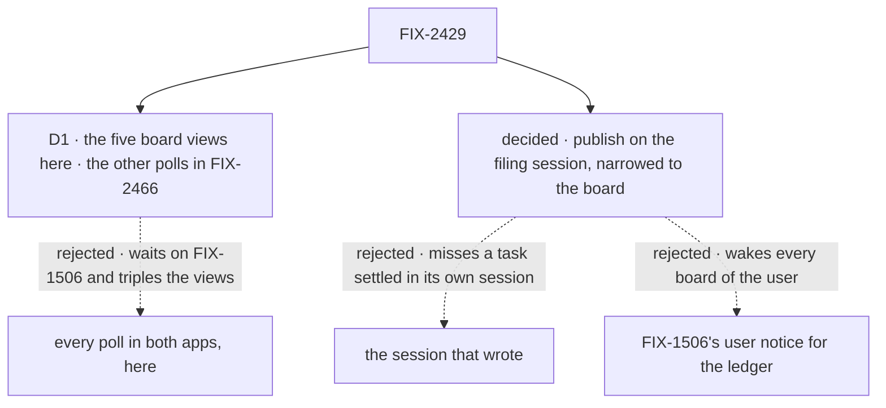

# FIX-2429 · Decisions

[Spec](SPEC.md) · **Decisions**

One call shapes this issue's size. Everything else here follows from the epic's seam, "the task
board's topic", and is recorded so nobody re-derives it. The epic's D2 and D5 and its rules
ER-1 to ER-6 are kept, not reopened.

## The tree

Solid edges are what you're signing. Dashed edges lost, and the label says why.

## D1 · The five board views move here; the apps' other polls move in FIX-2466, which joins the epic and blocks its closure

| | |
|---|---|
| **Instead of** | Every timer in Shift Manager and the two labs moving here: the message log, a worker's conversation and a project's entries (5 s), the Teammates lab's requests, worker talk, activity and context-window reads (1.5 s), and the claude-code-style lab's other four |
| **Because** | Those views read session items, requests or resources, not a board. Their notices come from FIX-2426 and from FIX-1506, which is still in review, so this issue would wait on FIX-1506 and grow from five views to about sixteen across three apps (the claude-code-style lab has four more timers). The board views need only the bus and delivery. The epic's *not done if* ("a lab or Shift Manager still polls") still holds at closure, because FIX-2466 blocks it. The board views include two the issue didn't name, the claude-code-style lab's task list and a live `BoardList`, because they read the same board: leaving them would keep a timer or a stale list on this issue's own job |
| **Locks in** | One more child in the epic's set, filed now as [FIX-2466](https://linear.app/fixpoint-labs/issue/FIX-2466); the coordinator adds it to the set and makes it block FIX-2368 on approval. Between this issue and FIX-2466, Shift Manager and the Teammates lab still poll for messages, requests and projects |

It comes down to what it waits on: the board views need only the bus and delivery; the rest
also need FIX-1506.

**What would change my mind:** FIX-1506 merging before this issue is built. Then the other
polls fold in here, and FIX-2466 closes as a duplicate.

## Decided, not asked

- **The topic is the filing session's, narrowed to the board.** A board notice goes on
  `{ scope: "session", id: <the row's filer>, resource: <the board id> }` with kind `board` and
  the request that made it as `origin` (FIX-2426's shapes). The filer is `Task.filer.sessionId`,
  server-written (BP-031); a row with no filer (a board that hands nothing out, or a row filed
  before FIX-2078) uses the ledger's declared `legacyFiler` where it has one, and otherwise the
  running session. For the conversation board the board id is `tasks`, the `collectionId` its
  `task-change` items already carry, so a view names the topic from what it already holds.
- **Narrowed, so a view hears only its board.** A view of the conversation's whole topic would
  hear every `items` notice of a streaming reply and read the board each time. The session
  stream, subscribed to the whole topic, ignores `board` by kind (FIX-2426).
- **The convergence point is the `onChange` adapter in `getOrCreateTaskCollection`** (tenet 5).
  Both backings call it after every committed write, and it is the one place a change already
  leaves the backing. Every board writer passes it: a board's drain, the task tools and actions,
  a task session's claim gate and settle, `payBoardDebts`, the delivery's settle, a run linking
  itself. The implementer confirms no ledger writer bypasses the backings; one that does is
  routed through them or named in the PR.
- **One notice per change, every change kind**, including progress notes and run links. Views
  read through `coalescedReads`, so a burst is one read.
- **The engine's seam fills the tenant** from the running request and publishes to that run's
  `stores.bus`, wherever the run executes: `resolveStores`, `runAction`, BullMQ's job processor.
  A context with no seam (a unit test's mock) publishes nothing. Not a public `ctx.publish`: ER-2
  says no child invents a topic, and a public call would let app code invent one.
- **Views ignore `origin`.** FIX-1506's skip is for a view that already holds the change from
  its own stream; no board view reads its rows from a stream.
- **Each view's fallback pace is today's**: Shift Manager 3 s, the Teammates lab 1.5 s, the
  claude-code-style lab 2 s, `BoardList` its default. On a host with push a view reads on a
  notice, on connect and on reconnect only. On a host with none, it reads at that pace whether
  or not a task is open, where Shift Manager stops today with none open; Shift Manager always
  runs on `serve()`, which has push, so no deployment we run pays it.
- **Shift Manager's 30 s after-a-move window goes.** It kept reading so the coordinator turn a
  task's ending woke would show; that turn's own board changes now publish.
- **`BoardList`'s `live` takes a client with `subscribe`** in place of `sessions.stream`. A host
  that passes the whole client changes nothing; a hand-built slice changes one field. React
  changeset (minor), with orchestration (minor) and engine (minor).
- **A ledger write sends two notices**: this board notice and FIX-1506's user notice for the
  ledger. Different audiences (a board view; a resource hook on the user scope), so neither
  replaces the other.

## Considered and dropped

| Alternative | Why not |
|---|---|
| Views subscribe FIX-1506's user notice for the ledger, and no board publisher | Every board view of the user reads on any conversation's change; a board on request or sequencer state isn't a resource and publishes nothing; and the epic's seam already names the conversation's session topic |
| Publish on the session that wrote | A task settles in its own task session, so the conversation's view would never hear it. This is the `running-session` control |
| Partition to session, through the ledger's `partitionBy` | Only workforce knows how a partition maps back to a session; `Task.filer` is already the answer, written by orchestration |
| The whole session topic, with views filtering by kind | Every view needs the notice's kind on the client, and each still wakes on every streaming chunk until it filters |
| Gate the subscription on an open task, as Shift Manager's timers do | Misses a task filed by another session, or by the turn an ending woke, while none is open |
| A publish at each board write site | A dozen writers, and the next one forgets |

## Settled

- **The board views are five** — **CONFIRMED** by
  [`poc/board-views/`](poc/board-views/): 1,646 source files scanned, 8 read a board, every one
  classified, 5 of them views that move. Control `FIX2429_CONTROL=plant` exits 1 on an
  unclassified reader.
- **A run's link already names the conversation.** `run_linked` is written in the run's session,
  and the row's `filer` is the conversation, so the board notice reaches the conversation's view.
  Read from the code (`change-event.ts`, `Task.filer`); the goal check's leg a asserts it.

## Analysis

2026-11-01 · watermark 2026-11-01 (FIX-2426 and FIX-2428 approved) · **Right approach.** Run by
the author in this dispatch, with no fresh sub-agent: this worker could not dispatch one. The
coordinator may run a fresh `analysis` before the gate.

1. **Reuse** — each Adds row composes an existing piece: the `onChange` adapter, the seam
   pattern, `client.subscribe` ([Builds on / Adds](SPEC.md#whats-already-here-and-the-debt)).
   The closest reuse candidate, FIX-1506's user notice, is dropped with reasons.
2. **Prior art** — Phoenix and Rails channels: a server broadcasts "changed" on a topic per
   view, and the client fetches. The same split as FIX-2286 D3.
3. **Other shapes** — no publisher at all (the user notice); the whole topic with kind filters.
   Both dropped.
4. **New factors** — the claude-code-style lab's 2 s board poll, which the issue missed. Folded
   into scope (D1).
5. **Necessity** — earns its place: it is the epic's goal 1, and without a board publisher a
   task settled in its own session reaches no screen.
6. **Ergonomics** — a board author writes nothing; an app view swaps a timer for one call.
7. **Concerns** — on a host with push and a bus that can't cross processes, a task settled on
   another process reaches no view until it reconnects: the socket is up, so `client.subscribe`
   doesn't poll. Every `client.subscribe` consumer shares it; raised to the coordinator for
   FIX-2428's delivery seam. Recorded, not solved here.

## How it got here

- **Draft** — framed as the epic's board publisher and the apps' board polls. Publish from the
  `onChange` adapter on the filing session's topic, narrowed to the board; five views move,
  three named by the issue and two found by the checker. The other polls split out (D1).

**Open: none.**
