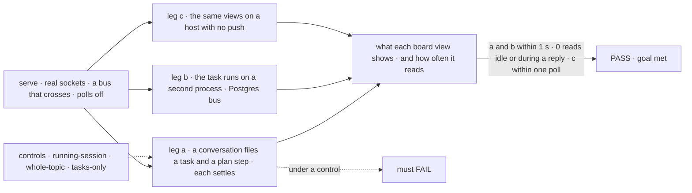
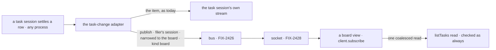

# FIX-2429 · Task board changes reach open screens as notices, and the board polls go off

**Spec** · [Decisions](DECISIONS.md)

## Five people, before and after

| Someone who… | Today | After |
|---|---|---|
| **watches a conversation's tasks in Shift Manager** | The panel and the board card each read the board every 3 s while a task is open, and for 30 s after one moves | The board shows a task that settles within a second, from any session on any process. On the Postgres bus it reads nothing between changes; on its SQLite store, whose bus doesn't cross, it reads every 3 s while a task is open, as today, and not at all with none open ([decided](DECISIONS.md#decided-not-asked)) |
| **watches a task start in the Teammates lab** | A running row shows its run only after the lab reads the board every 1.5 s, because the run links itself in its own session | The run's link arrives as a board change; no timer |
| **keeps the claude-code-style lab open** | Its task list reads the board every 2 s, all day, open task or not | Reads when the board changes |
| **puts a live `BoardList` on a page** | Hears a task filed in the session it follows, never one that settles in a task session (the docs say so) | Hears both. Its `client` needs `subscribe` instead of `sessions.stream` |
| **runs the same views on a host with no push** (Vercel, Next) | Polls | Polls at today's pace, through the one fallback in `client.subscribe` ([epic ER-5](../../epics/FIX-2367/DECISIONS.md#who-owns-what)) |

The epic ([FIX-2367](../../epics/FIX-2367/SPEC.md)) gives this issue the task-board publisher and
the board polls. The bus ([FIX-2426](../FIX-2426/SPEC.md)) carries a notice; delivery
([FIX-2428](../FIX-2428/SPEC.md)) brings it to the browser; the board's own read, `listTasks`
([FIX-2286 D3](../FIX-2286/DECISIONS.md#d3)), says what changed.

## The goal, and how we'll know it's met

**On a long-lived host, a change to a conversation's task board, written by any session on any
process, shows on every open view of that board within a second, and a view reads nothing
between changes; wherever push can miss a change ([epic ER-5](../../epics/FIX-2367/DECISIONS.md#who-owns-what)),
the same views keep a timer and miss nothing.**

| Is it the right goal? | |
|---|---|
| **The real need** | The issue: *"A task-board change publishes a notice on the conversation's session topic, from whichever process settles the task"*, and the two apps *"make no read between notices"* (closure leg b, [FIX-2367](../../epics/FIX-2367/SPEC.md#the-goal-and-how-well-know-its-met)) |
| **Smaller, and rejected** | The publish alone, with the apps left polling: a notice no view hears. Or only the two views the issue names: the claude-code-style lab and `BoardList` read the same board and would keep a timer or stay stale |
| **Bigger, and not this issue's** | The apps' other polls, on messages, requests and projects ([FIX-2466](https://linear.app/fixpoint-labs/issue/FIX-2466), [D1](DECISIONS.md#d1)). Board columns read as a resource collection (FIX-1506) |
| **Not done if** | A task that settles in its task session never reaches the conversation's view · a run's link still needs a timer · a view reads while the conversation streams a reply that changes no task · a view of the `listTasks_tasks` read misses a plan step's change · a view hears another conversation's board · the session stream wakes on a board notice · a view on a host with no push never reads again · any of the five views keeps a timer while its socket is up on a bus that crosses |



The check reads what each view shows and counts its reads, not calls to `publish`.

| How we verify | |
|---|---|
| **Goal check** | `goals/task-board/a-settled-task-reaches-the-board/` · model `n/a` (handler workers settle the task) · run by the implementer at completion · verdict on the implementation PR. Needs FIX-2426 and FIX-2428 merged; leg b needs FIX-2427 |
| **Signal** | (a) The Teammates lab adapter's `watchTasks` and a live `BoardList` on the conversation show the task `completed`, and its run's link, within 1 s of each write; the adapter's view shows the worker's plan step settle within 1 s too. Over a 10 s window with a task open and a reply streaming in the conversation, each makes 0 board reads. (b) As (a), the task settled on a second process; the 10 s window starts at each view's first `crosses: true` frame, which on the Postgres bus waits for its first ping. (c) Within the poll interval plus 1 s |
| **Input** | A conversation flow with a handler delegate and a planning worker, on `serve()`, on a bus that says it crosses: FIX-2426's one test-only crossing double (`goals/lib/crossing-bus.mts`, [FIX-2426](../FIX-2426/DECISIONS.md#decided-not-asked)), and the Postgres bus in leg b. **PASS legs use a bus that reports crossing; default in-memory host behavior (timer on) is [FIX-2428 D3](../FIX-2428/DECISIONS.md#d3) / leg c.** A different valid input: two conversations of one user; a task settling on one must not read the other's board |
| **Anti-game** | Assert on rows shown and reads counted, not on `publish` calls or frames sent. Real WebSocket clients on a bound port; two registries for leg b, not two clients of one |
| **Control that must fail** | `GOAL_CONTROL=running-session` (publish on the session that wrote, not the one that filed): leg a's 1 s signal must FAIL. `GOAL_CONTROL=whole-topic` (views subscribe the conversation's whole topic): leg a's 0-reads signal must FAIL. `GOAL_CONTROL=tasks-only` (views of the merged read subscribe `tasks` alone): leg a's plan-step signal must FAIL. Today's `main`: leg a's 0-reads signal FAILS |

## What changes


One publisher where every board change already passes; five views that listen instead of poll.

```diff
 // a screen that shows a conversation's board (Shift Manager, the labs)
 const refresh = () => readConversationTasks(client, flow, conversationId).then(show);
-useEffect(() => {
-  const timer = setTimeout(refresh, TASKS_POLL_MS); // while a task is open
-  return () => clearTimeout(timer);
-}, [refresh, polls]);
+useSubscription(
+  [topic.session(conversationId, { resource: "tasks" }), topic.session(conversationId, { resource: "plan" })],
+  refresh, // listTasks_tasks merges the tasks and plan ledgers, so its views hear both
+  { pollIntervalMs: 3000 },
+);

 // a live BoardList now hears tasks that settle in their own sessions
 <BoardList sessionId={conversationId} boardRef="tasks" client={fsd} live />
-// client: { resources, sessions: { stream } }
+// client: { resources, subscribe }
```

A board's author writes nothing: every board `getOrCreateTaskCollection` builds publishes.

**Docs:** update `orchestration/task-substrate.md` (*task-change items*: a change also publishes
a board notice on the filing session's topic, narrowed to the board), `workforce/ui.md` (*A
board as a list*: `live` hears tasks that settle in other sessions; remove the paragraph saying
it doesn't; its `client` takes `subscribe`), `api/react.md` (`BoardList`'s `client`), and add a
*Task boards* section to the realtime guide FIX-2428 creates. Update the react and orchestration
READMEs. No new page.



## What stays as it is

- **The `task-change` item**, on the stream of the session that made the change, and every
  consumer of it (`<TaskPlan />`, the DevTool).
- **The `listTasks` read** ([FIX-2286](../FIX-2286/SPEC.md)) and its session check. A notice
  triggers it; it never replaces it.
- **The session stream.** It hears a board notice on its topic and ignores it, by kind
  ([FIX-2426](../FIX-2426/DECISIONS.md#decided-not-asked)).
- **`BoardColumns` and the roster**, which read the ledger as a resource collection. FIX-1506
  gives them `live`.
- **Every other poll** in Shift Manager and the labs ([D1](DECISIONS.md#d1)).

## What's already here, and the debt

| Already here | What this does with it |
|---|---|
| **The job, "tell a screen a task board changed".** Searched `mechanisms.yaml` (no row; FIX-2426 adds the bus), and `task-change`, `onChange`, `listTasks`, `poll`, `setTimeout`, `liveBoardDriver` across `packages/` and `labs/`. Found: the `task-change` item on the writing session's stream; `BoardList`'s `liveBoardDriver`, which follows it; four timers ([checked](DECISIONS.md#settled)); and, in review, FIX-1506's resource notice for a ledger write. Closest: the `task-change` item | **Builds on** it: the notice goes out from the same adapter. This is a publisher on the epic's one channel, not a new way |
| `getOrCreateTaskCollection`'s `onChange` adapter (`orchestration`), which turns every backing's change into the `task-change` item; both backings call it after each write | **Extends.** The one place that adds the publish (tenet 5) |
| `Task.filer` (FIX-2078): the session that filed the row, server-written, where its ending is delivered | **Builds on.** It names the conversation whose board the row is on |
| Core's symbol seams on the block context (`DISPATCH_SEAM`, `REQUEST_END_SEAM`), installed by the engine, read by orchestration | **Builds on.** One more, which hands a publish to the run's bus |
| FIX-1506 (in review): a ledger write publishes the user's topic, narrowed to the ledger | **Leaves alone.** It wakes every board of that user, and a board on request or sequencer state isn't a resource ([dropped](DECISIONS.md#considered-and-dropped)) |
| The four timers and `liveBoardDriver` ([checker](poc/board-views/)) | **Removes** them; each view reads on a board notice |
| [Epic](../../epics/FIX-2367/DECISIONS.md#coordination-seams) seam "the task board's topic", ER-2, ER-3, ER-5; FIX-2426's topics and kinds; FIX-2428's `client.subscribe` and `useSubscription` | **Kept**, and built on. FIX-2428's *Leaves* row hands this issue the polls and `liveBoardDriver` |
| [FIX-2286 D3](../FIX-2286/DECISIONS.md#d3): the push says when, a read says what | **Kept**. Its *what would change my mind* fired: the push landed, and reads serve the notice, the first load and the fallback |

| Adds | Existing piece considered | Why it doesn't fit / how composed |
|---|---|---|
| The board publish | `orchestration` · the `onChange` adapter | Composed: a second line beside the emit, in the one place every change passes |
| A publish seam on the block context | `core` · `DISPATCH_SEAM`; `engine` · FIX-1506's run-seam publishes | Same pattern as the dispatch seam; the engine fills the tenant and calls the run's `stores.bus`. FIX-1506's publishes sit inside the engine, where orchestration can't reach |
| The views' subscriptions | `react` · `useSubscription`; `client` · `client.subscribe` | Composed: each view calls them with the board's topic |

| The debt | |
|---|---|
| **Removes** | Shift Manager's two 3 s board timers and their 30 s after-a-move window; the Teammates lab's 1.5 s read while a run is unlinked; the claude-code-style lab's 2 s poll; `liveBoardDriver`'s follow of the session stream and its duplicate filter; the docs caveat that a live `BoardList` misses other sessions |
| **Adds** | One publish beside the `task-change` emit, and one seam that reaches the bus, both permanent by design (the epic's channel). A ledger write sends two notices, the board's and FIX-1506's user one, to different audiences |
| **Leaves** | The apps' other polls ([FIX-2466](https://linear.app/fixpoint-labs/issue/FIX-2466), [D1](DECISIONS.md#d1)). A board with no filer, written from several sessions, reaches only the writing session's view, as today |

**Net: down.** Four timers and a stream follow go; one publish and one seam come.

## Sign off

**[The goal](#the-goal-and-how-well-know-its-met):** every board view, from any session on any
process, with no read between changes. If wrong: a board that updates only when its own
conversation writes.

**[The debt](#whats-already-here-and-the-debt): down**, four timers and a stream follow out, one
publish and one seam in. If wrong: a second notice per ledger write nobody needed.

1. **[D1](DECISIONS.md#d1) · The board views move here; the apps' other polls move in
   FIX-2466, which joins the epic and blocks its closure.** If wrong: Shift Manager still polls
   messages and projects until FIX-2466 ships.

**Open: none.**

Feature · orchestration, engine, react, shift-manager, labs · medium: one publisher, one seam,
five views · epic FIX-2367
