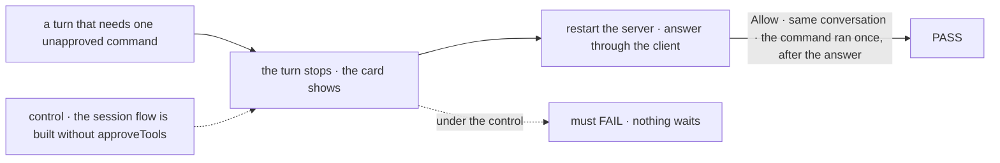

# FIX-2432 · Kitchen Sink's harness sessions wait on you for a tool approval

**Spec** · [Decisions](DECISIONS.md)

## Who feels it, before and after

| Someone who… | Today | After |
|---|---|---|
| **runs a Claude Code session in Kitchen Sink** | The run has every tool, unasked (`bypassPermissions`). Nothing it does waits on them | A call that isn't pre-allowed stops the turn. The conversation shows the approval card, naming the tool, the command or file, and the folder, and the turn reads *Waiting on you*, not *running* |
| **answers it** | n/a | Allow: the same conversation goes on and the call runs. Deny: it goes on, told it may not. Allow for this run: that call does not ask again in this turn |
| **answers after `fsdev dev` restarted** | n/a | The card is still there. The answer resumes the conversation that asked |
| **runs a Codex or Cursor session** | Their own sandbox settings apply | Unchanged. Neither SDK we wrap offers a per-call question (FIX-2389) |
| **builds a session flow without approvals** | Today's behaviour | Today's behaviour, byte for byte |

## The goal, and how we'll know it's met

**In Kitchen Sink's Claude Code mode, a turn stops at each tool call that isn't already allowed,
the conversation shows it waiting on the person, and their Allow, Deny or Allow for this run
reaches the same conversation, also after a server restart. No call runs that nobody allowed.**

| Is it the right goal? | |
|---|---|
| **The real need** | FIX-2389 makes an approval a wait for runs the harness manager drives. Kitchen Sink's harness modes run the harness directly in `harnessSessionFlow`, so it doesn't reach them, and Kitchen Sink stays the one app on blanket access |
| **Smaller, and rejected** | Kitchen Sink pre-allows less, with no approvals: runs are only refused their tools (FIX-2389, *Considered and dropped*) |
| **Bigger, and not this issue's** | Approvals for Codex and Cursor (no per-call question in their SDKs). A boundary commands cannot cross (FIX-1930) |
| **Not done if** | Kitchen Sink builds its own approval path or card · the call ran before the answer · the answer resumes a fresh conversation · the restart leg never ran |



| How we verify | |
|---|---|
| **Goal check** | `goals/kitchen-sink-harness/claude-code-waits-for-approval/`, beside the other harness-session goals, on the scripted Claude Code in test mode, the durable store, and the client's answer route |
| **Signal** | `a:waits` the turn's request is suspended on one `approval` stop naming the tool, the command and the folder, and the conversation holds its suspension item. `c:same-conversation` after a restart and Allow, the turn resumes the conversation that asked. `b:ran-after` the command ran once, after the answer. `d:never-ran` after Deny it never ran, and the turn ended |
| **Anti-game** | Answer through the client's answer route, never a store write. What ran comes from the scripted harness's own record. Leg c restarts the server |
| **Control that must fail** | `KITCHEN_SINK_GOAL_CONTROL=no-approval` (the mode leaves `approveTools` off): must FAIL `a:waits`. Today's `main` fails `a:waits` |

## What changes

**`harnessSessionFlow` takes `approveTools`.** It is the manager's FIX-2389 option, on the session
flow, composed from FIX-2389's public approval pieces the way the manager composes them
([D1](DECISIONS.md#d1)). A held call stops the turn's harness step; the turn waits on the same
`suspendForUser({ kind: "approval" })` stop, then resumes the conversation it confirmed with the grant.

**One wiring rule.** The flow hands `onToolApproval` among the feeds only when `approveTools` is
on; with it off the feed is absent, as on the manager (FIX-2389 D2). A mode that opts in passes the
feed and leaves `bypassPermissions`. What it pre-allows (`allowedTools`) stays the host's.

**Kitchen Sink's Claude Code mode opts in.**

```diff
  claudeCodeAgent({
    cwd: feeds.cwd, resume: feeds.resume, onSession: feeds.onSession, model: feeds.model,
+   onToolApproval: feeds.onToolApproval,
-   permissionMode: "bypassPermissions",
+   permissionMode: "default",
+   allowedTools: ["Read", "Glob", "Grep"],
```

No new UI: the harness page already draws a suspension item with the registry `approval` card's
copy and `useApproval`. The turn's notice reads a suspended request as *Waiting on you*.

**What lands, and when.** Two PRs, per the epic's D3. (1) The package slice: `approveTools` on
`harnessSessionFlow`, after FIX-2389's slice merges, in `session-flow.ts`'s *turn record, turn
end, feeds* region after 2398. (2) Kitchen Sink's adoption (the mode and the goal), from `main`
once (1) merges. Where they sit is the
[build order](../../epics/FIX-2369/DECISIONS.md#coordination-seams)'s to say; the coordinator adds the row.

**Docs:** `apps/docs/docs/orchestration/harness-manager.md` → the session flow's section gets
`approveTools`, pointing at FIX-2389's *Approving a run's tool calls*. The harness-manager README
lists the option.

## What stays as it is

- **Core, engine, client, react.** `suspendForUser`, the answer route and `useApproval` already
  carry it. FIX-2389 makes the only change there.
- **The turn record.** An approval is the turn's request suspension, not a field on the record.
- **Codex and Cursor modes.** They ignore the feed, as FIX-2389 decided.

## What's already here, and the debt

| Already here | What this does with it |
|---|---|
| FIX-2389's public approval pieces | **Composes**, in the session flow's turn |
| `suspendForUser` and Kitchen Sink's durable host | **Builds on.** The turn waits as a durable stop |
| The steer's resume of the confirmed conversation (`binding.confirmed`) | **Reuses.** The resumed step continues the same conversation |
| Kitchen Sink's suspension renderer and `approval` card (registry copy) | **Reuses**, unchanged but for FIX-2389's registry change |

| The debt | |
|---|---|
| **Removes** | Kitchen Sink's last `bypassPermissions` harness session |
| **Adds** | One option on the session flow. Each approval restarts the harness and resumes the conversation (FIX-2389 D1) |
| **Leaves** | Codex's and Cursor's run-wide sandboxes (FIX-2421, FIX-1930) |

**Net: down, small.** One option, composed from pieces FIX-2389 ships.

## Sign off

**[The goal](#the-goal-and-how-well-know-its-met):** Kitchen Sink's Claude Code turns wait on
the person for an unapproved call, and resume the same conversation after a restart. If wrong:
Kitchen Sink stays the one app where a run has every tool unasked.

1. **[D1](DECISIONS.md#d1) · The session flow composes FIX-2389's approval pieces.** If wrong: a
   second approval path, which the epic's ER-4 forbids.

Feature · harness-manager, kitchen-sink · small · epic FIX-2369, after FIX-2389's slice and 2398
