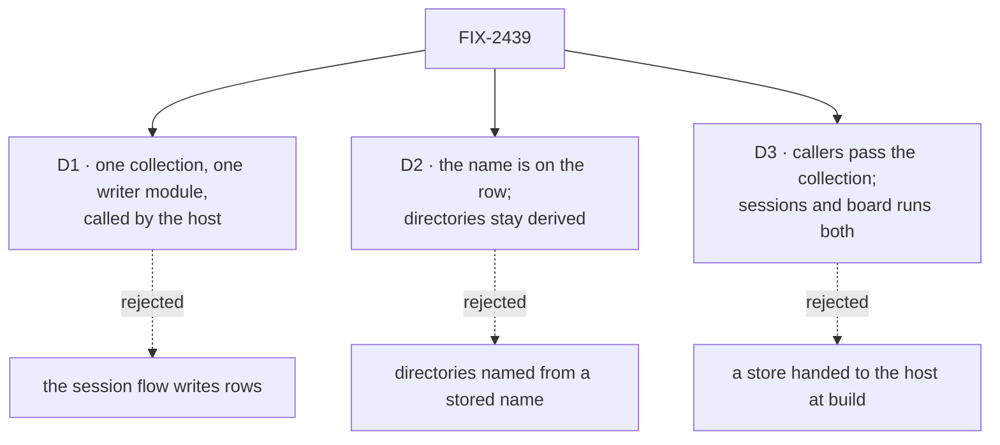

# FIX-2439 · Decisions

[Spec](SPEC.md) · **Decisions**

Some of this was settled before this spec:

- Jake (on #4369): `state.workspace` is a pointer to this row from day one, and the order is
  2419 → 2439 → 2386, with FIX-2386 in the same landing window.
- The issue: a user-scoped, `llmReadable` collection owned by the workspace package, which the
  host writes.
- Epic ER-5: one provisioning path and one removal path.

These decisions cover the rest: where the writes go, what "name" means, and who passes the
collection.

## D1 · One collection, written only by `./worktrees`, called by the host

| | The host calls one writer module (chosen) | The session flow writes rows | The host keeps a store of its own |
|---|---|---|---|
| Who reads git for the row | The host, which made the worktree | harness-manager, from what `provision` returned | The host |
| A board run's row | Same code | A second writer in the manager | Same code |
| Readable by agents and pages | Yes, it is a resource collection | Yes | Needs a read path of its own |
| User scoping | The caller's context resolves the collection | Same | The host would have to model users |

- **Because:** the host is the only part that sees every change to a worktree: it cuts the
  worktree, hands it back, removes it, and can read its checkout. A writer anywhere else
  describes the worktree secondhand. FIX-2386's Codex finding showed the cost: a count taken in
  one place next to a branch taken in another can describe different work.
- **The host's four call sites:** provision (`provisioning` → `ready`, or kept as it was for a
  handed-back place), `attach`, `recordCheckout`, and remove (`removed`).
  `recordBranchPullRequests` is the fifth writer. It lives in the same package and adds pull
  requests to the row through the same module.
- **`recordCheckout` reads branch and count in one pass.** It runs `git symbolic-ref` and
  `rev-list --count HEAD --not <baseCommit>` in the worktree, then writes both with
  `lastTurnAt` in one upsert. If there is no `baseCommit`, or git can't count, `commits` is `null`
  (unknown, never 0). If the directory is gone, the row becomes `lost`.
- **The key** is the host id followed by the place segments, each escaped with core's
  `planKeySegment`. This is injective because a segment can't hold the separator. The host
  derives it from a place, so no caller looks it up. Hosts that share a root share an id, and so
  share keys, which is correct because they share the directories.
- **Rows are never deleted here.** A removed row keeps saying where the work was (FIX-2386 D1).
  FIX-2252's sweeper decides when a row goes.
- **Locks in:** `worktreesCollection` and its row schema as a public export of
  `@flow-state-dev/workspace`, and the rule that only that package writes rows.

## D2 · The name lives on the row; directories stay where they are

The issue asks for the place's last directory segment to be `<task slug ≤32>-<short id hex>`,
stored on the row and read back. This spec stores that name on the row. It does **not** rename
directories.

| | Name on the row (chosen) | Directory named from the stored name |
|---|---|---|
| `locate` (synchronous; used by `createCheck`'s attach check and the board's derived path) | Unchanged | Has to read the store, so it becomes async and needs a context |
| The board's "the path is derived from the durable task" rule (`harness-manager/src/workspace.ts`) | Kept | Broken: the row becomes a second source the path depends on |
| Existing worktrees on disk | Untouched | Move, or two layouts live side by side |
| What a person sees | The name, in the chip and in `fsdev` once it reads rows | The same name, plus in `ls` |
| FIX-2344's long paths | Still patched by its symlink | Shorter |

- **Because:** the person-facing win, a readable name for each worktree, comes from the row
  either way. The directory rename costs a store read in three synchronous places and reverses
  a rule the board's retry logic depends on. FIX-2344 is already fixed for the failure it caused.
- **The name:** a slug of `PlaceRequest.worktrees.label` (a task title or a session title),
  lower-case `a-z0-9-`, at most 32 characters, then `-` and the first 6 hex characters of
  sha256(key). With no label, the slug is the last place segment, cut to the same length. It is
  written on the row's first write and never recomputed, so a retitled session keeps its name.
- **What would change my mind:** a need to `cd` into worktrees by name, or a filesystem limit
  the symlink doesn't cover. Then a follow-up names directories from `row.name`. The name
  already exists and never changes, so that follow-up adds a read and moves nothing in this
  issue.
- **Locks in:** `name` on the row, written once.

## D3 · The caller passes the collection; sessions and board runs both write rows

- **Because:** a user-scoped collection resolves per request context. A host is built once per
  process and has no user, so the collection has to come from the request that has one. This is
  how kept files reach the host today (`answer.files`), and how `recordBranchPullRequests` gets
  its collection (`ctx.resources`).
- **The session flow** declares `worktrees: worktreesCollection` in its flow-level `resources`,
  so every block's context resolves it. It passes the collection through `HarnessSessionWorkspace`:
  - on `provision`'s request, with `owner: { kind: "session", id }` and the session's title as
    `label`;
  - on the new optional `attach(place, ownerPlace, request)` and `recordCheckout(place, request)`;
  - on `remove`.

  An adapter that doesn't implement the new methods still works, and its sessions simply have no
  row. The goal check's adapter and the README's example are thin wrappers over the host.
- **The turn-end order:** check that an attached turn kept its branch (FIX-2419), call
  `recordCheckout`, release the in-use lock, then check for pull requests with the row. The
  snapshot is taken before the owner's next turn can move the checkout.
- **The board manager** passes the collection on its one `host.provision` call, with
  `owner: { kind: "run", id: runId }` and the task's title as the label. It calls
  `recordCheckout` when a run settles. Its own record and output fields stay. FIX-2386 D2 moves
  them onto the row later.
- **Locks in:** `worktrees` as a request field and not a host option, and the adapter's two
  optional methods.

## Decided, not asked

- **E1 · Names are fixed:** `worktreesCollection`, `WORKTREES` (the pattern prefix),
  `worktreeRowSchema`, `WorkspaceHost.attach`, `WorkspaceHost.recordCheckout`, and
  `state.workspace.worktree` for the key. FIX-2386 agreed to these on its thread.
- **E2 · Not `ownerPrivate`.** That option refuses a browser read, and the chip needs one. User
  scope already keeps one user's rows from another.
- **E3 · The `owner` is the session or the run, not the user.** The user is the scope.
- **E4 · `pullRequests` on the row is a summary** (`url`, `number`, `state`, `title`), added once
  per pull request. The session's `observed-pull-requests` rows stay the full record.
- **E5 · No new tool.** Agents read rows through core's resource tools, which FIX-2436 limited to
  `llmReadable` collections without secret fields. The row has no secret fields: the remote is
  stored redacted.
- **E6 · The package slice touches no app file.** Kitchen Sink, Shift Manager and the labs adopt
  in their stacks.
