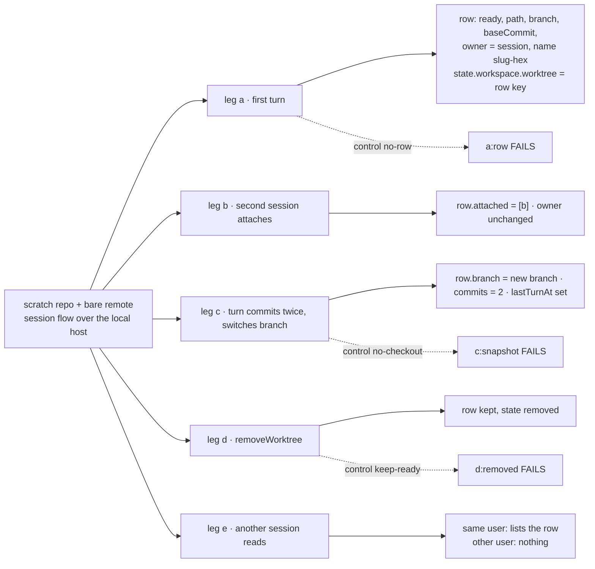
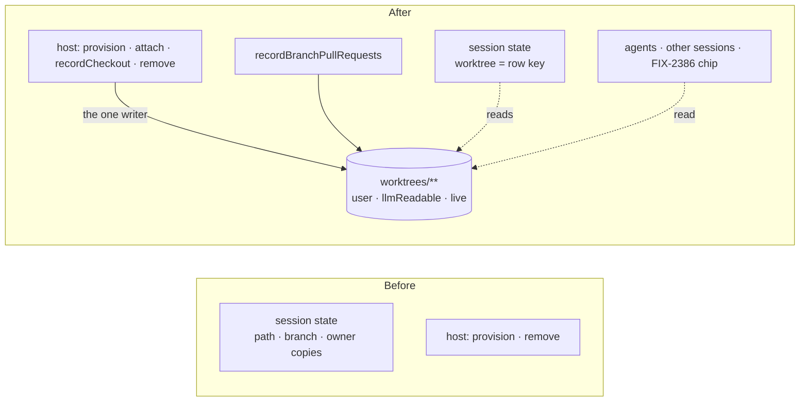

# FIX-2439 · One shared list of worktrees

**Spec** · [Decisions](DECISIONS.md)

## Who feels it, before and after

| Someone who… | Today | After |
|---|---|---|
| **opens a coding session's chip** (FIX-2386) | Nothing to read: the session holds copies of a path and a branch, and nothing else | The chip reads one worktree row: its name, branch, state, commit count, pull requests, and "attached to …" when this session isn't the owner |
| **asks an agent "what else is in flight?"** | The agent can't see other sessions' or runs' worktrees | The agent reads the user's `worktrees` rows with the resource tools, because the collection is `llmReadable` |
| **starts a follow-up session on earlier work** (FIX-2419 D4, FIX-2361) | Has to know the earlier session's id | Picks a worktree from the list. The row names its owner and every session attached to it |
| **removes a worktree** | The directory goes away and nothing records that it existed | The row stays, marked `removed`, so a chip still says where the work was |
| **builds staleness cleanup** (FIX-2252) | Would walk git in every repository | Reconciles against the rows: a row says `ready` and the directory is gone, so it is `lost` |

## The goal, and how we'll know it's met

**Every worktree the workspace host makes has one row in a user-scoped `worktrees` collection.
The host writes the row, every session and agent of that user can read it, and it describes the
worktree as it is now, not as it was when the worktree was made.**

- **Smaller, and rejected:** keeping copies of the path and branch on session state (FIX-2386's
  first draft). Jake ruled this out on #4369: `state.workspace` is a pointer from day one.
- **Bigger, and not this issue's:** naming worktree *directories* after the row's name (see
  [D2](DECISIONS.md#d2), the one call to weigh); the board run record reading its place fields
  from the row (FIX-2386 D2); sweeping stale rows (FIX-2252); Kitchen Sink's own
  `provisionSessionWorktree` moving onto the host (its adoption stack).
- **Not done if:** a row says `ready` for a worktree that was removed; a row's branch or count
  describes a checkout state from before the latest turn; one user reads another user's rows;
  or anything other than the workspace package writes a row.

**How we verify.**

- **Goal check (new): `goals/workspace/worktrees-resource`**. It is model-free. It uses the same
  set-up as FIX-2419's `session-worktree-lifecycle`: a `harnessSessionFlow` served over HTTP, a
  workspace from the local host over a scratch repository with a bare `origin`, and a stub harness
  that commits. It reads the rows through the flow's HTTP resource route, the way a page reads
  them.
  - Leg **a**: after the first turn, there is one row with `state: "ready"`, the session's path,
    the branch, `baseCommit` equal to `git merge-base`, `owner: { kind: "session", id }`, and a
    `name` matching `<slug>-<hex>`. The session's `state.workspace.worktree` is that row's key.
  - Leg **b**: a second session created with `start: { worktreeOf }` runs a turn. The row lists
    it once in `attached`, with its own `lastTurnAt`, and the owner is unchanged.
  - Leg **c**: a turn commits twice and then switches to a new branch. The row's `branch` is the
    new branch, `commits` is 2, and `lastTurnAt` is from that turn.
  - Leg **d**: after `removeWorktree`, the row is still there with `state: "removed"`.
  - Leg **e**: a new session of the same user lists the row. A session of another user lists
    nothing, and so does a session of the same user in another organization. An agent reads the same rows with core's resource tools, which serve `llmReadable`
    collections (FIX-2436). The check doesn't drive a model.
- **Controls that must fail.** Each one reddens only its own legs. `no-row` reddens every leg that
  reads a row, because each of them depends on the first write.
  - `GOAL_CONTROL=no-row` provisions without the collection, so leg a fails **`a:row`**.
  - `GOAL_CONTROL=no-checkout` skips `recordCheckout`, so leg c fails **`c:snapshot`**, and leg b
    fails **`b:attached`**, whose `lastTurnAt` comes from the same read.
  - `GOAL_CONTROL=keep-ready` removes with git directly, not through the host, so leg d fails
    **`d:removed`**.
  - `GOAL_CONTROL=one-org` makes the principal resolver drop the organization, so leg e fails
    **`e:other-org`**.
- **Unit tests:**
  - The host writes `provisioning` before `git worktree add` and `ready` after it. A provision
    that fails leaves the row `provisioning`, never `ready`.
  - A handed-back place keeps its `name` and `baseCommit`.
  - `recordCheckout` gives `commits: null` when the row has no `baseCommit`, and marks the row
    `lost` when the directory is gone.
  - Attaching twice lists the session once.
  - `recordBranchPullRequests` with a row adds each pull request to the row once.
  - The host with no collection writes nothing and behaves as it did before.
  - The session flow marks `worktrees` read-only to the model's resource tools.

## What changes

The workspace package gains one collection and the module that writes it. The host calls that
module at each point where it changes a worktree.

- **The collection** ([D1](DECISIONS.md#d1)): `worktreesCollection` in `@flow-state-dev/workspace`,
  pattern `worktrees/**`, `scope: "user"`, lazy, `llmReadable`, and live client read with no
  client write. Each row has these fields:
  - `key` and `name`
  - `path`, `branch`, `repo` (the remote, redacted), `baseCommit`
  - `owner: { kind: "session" | "run", id }` and `attached: { kind, id, lastTurnAt }[]`
  - `state`: `provisioning | ready | removed | lost`
  - `commits: number | null`, `lastTurnAt`
  - `pullRequests: { url, number, state, title }[]`

  Every field is nullable or has a default, so a row from an older or newer shape still parses
  (BP-023, BP-030).
- **One writer, the module `./worktrees`** ([D1](DECISIONS.md#d1), ER-5). Only it writes rows.
  The host calls it:
  - `PlaceRequest.worktrees: { collection, owner, label? }`: provision writes `provisioning`,
    then `ready`.
  - `WorkspaceHost.attach(target, { worktrees, by })`: adds the session or run to `attached` and
    returns the row's key.
  - `WorkspaceHost.recordCheckout(target, { worktrees, by })`: reads HEAD's branch and the count
    past `baseCommit` in one git pass, writes them with `lastTurnAt` in one upsert, and returns
    what it read.
  - `RemoveOptions.worktrees`: removal writes `removed`.

  `recordBranchPullRequests` gains `worktree: { collection, key }` and adds what it found to the
  row.
- **The row's key** ([D1](DECISIONS.md#d1)): the host id, then the place segments, each escaped.
  It is opaque to readers. The host can derive it from the place, so attach and the turn-end
  write need no lookup.
- **The row's name** ([D2](DECISIONS.md#d2)): `<slug of label, ≤32>-<6 hex of the key's hash>`.
  It is written on the first provision and never recomputed. The directory layout doesn't change.
- **The session flow passes the collection and stores the key** ([D3](DECISIONS.md#d3)). The flow
  declares `worktrees` at flow level. The `HarnessSessionWorkspace` adapter gets these:
  - `provision`'s request takes `worktrees`, and its result can name `worktree`.
  - Optional `attach` and `recordCheckout`.
  - `remove` is passed `worktrees`.

  The turn-end handler calls `recordCheckout` while the turn still holds the in-use lock, then
  checks for pull requests with the row. FIX-2419's `state.workspace` record gains only
  `worktree: string | null`. FIX-2386 removes the copies next to it.
- **The board manager writes rows too** ([D3](DECISIONS.md#d3)). It passes the collection on its
  `host.provision` call, with `owner: { kind: "run" }`, and calls `recordCheckout` when a run
  settles. Board runs are most of the work in flight, so a list without them would fail the
  goal.
- **Docs:** the workspace README (the collection and the three host additions), the
  harness-manager README (the adapter's new fields), and the workforce projects page's worktree
  paragraph.

## What stays as it is

- Where places live, and how a branch is named.
- `locate`, which stays synchronous and derived, so `createCheck`'s attach check doesn't change.
- `list` and `fsdev worktrees`, which read git, not rows.
- Held work, `checkpoint`, and `release`.
- The run record's own fields (FIX-2386 D2 reads them from the row later).
- A host built with no collection, which behaves exactly as it does now.

## What's already here, and the debt

| Piece | What this does with it |
|---|---|
| FIX-2419's `remove`, `occupyWorktree` in-use lock, and attach | **Extended**: each writes the row. The in-use lock already serializes the owner's and attached turns, so their row writes don't race |
| `recordBranchPullRequests`, the host's only `gh` caller | **Extended** with an optional row to add to. Session rows still go through core's `writePullRequests` |
| `observedPullRequestsCollection` (core) | **Copied in shape**: a collection in the package that owns its noun, written by one module and read live by the page |
| `readRunCommits` (harness-manager) | **Not reused for sessions**: the host counts past the row's `baseCommit` itself, so the branch and the count come from one read. The board's settle count stays as it is |
| FIX-2419's `state.workspace` record (path, branch, removed, owner) | **Extended** with `worktree`. Removing the copies is FIX-2386's job, so the shape has one owner |
| Core's resource tools (FIX-2436: `llmReadable` only, no secret fields) | **Reused** as the agent's read path. No new tool |

**Adds:** one collection and its writer module, two host methods, three request fields, one
`recordBranchPullRequests` option, one session-record field, and one goal check. **Removes:**
nothing. **Debt:** Kitchen Sink sessions get no row until Kitchen Sink provisions through the host
(its adoption stack, already owed by FIX-2419). Rows are never deleted: a `removed` row stays
until FIX-2252's sweeper decides. A row can say `ready` for a directory someone deleted by hand or
removed with `fsdev worktrees --remove`, until the next `recordCheckout` marks it `lost` or the
sweep reconciles it. Core's resource tools ignore `llmWritable` on update and delete, so the
session flow's visibility rule is the gate until FIX-2441. Directory paths stay long until
FIX-2442. **Net:** medium, mostly in the workspace package.

## Sign off

**Approve by merging.** You are signing off on the goal and the debt above. The call to weigh is
[D2](DECISIONS.md#d2). The issue asked for worktree *directories* named `<slug>-<hex>`. This spec
puts that name on the row and leaves the directories where they are, because `locate`, the
attach check and the board's derived checkout path all compute the directory from identity. A
stored directory name would make each of them read the store first. *If wrong:* the directory
rename is a follow-up that reads the row's `name`, which this issue already writes and never
recomputes. Nothing here has to move.

Feature · `workspace`, `harness-manager` · medium · one PR stacked on FIX-2419's implementation
(claude/project-thread-gdd6x2). FIX-2386 consumes the row in the same window. App adoption
happens in the epic's stacks. Epic FIX-2369 (build order 2385 → 2419 → 2439 → 2386 → 2388) ·
parent FIX-2440
