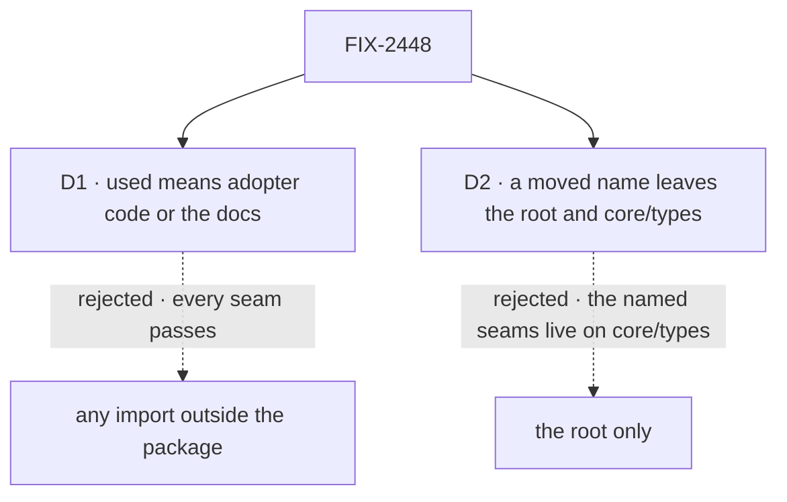

# FIX-2448 · Decisions

[Spec](SPEC.md) · **Decisions**

What was considered, what was chosen, and what each choice locks in. Two decisions are the
sign-off. The epic's D2 (two kinds of hidden surface) and its Q1 (how adopters meet a moved name)
sit above both and are not reopened here.

## The tree

Solid edges are what you're signing. Dashed edges lost, and the label says why.

## D1 · A root name counts as used when adopter code imports it or the docs name it; an import from another FSD package does not

| | |
|---|---|
| **Instead of** | Reading ER-1's "outside consumer" as any import from outside the package, sibling packages included |
| **Because** | 58 of core's root names are imported only by our own packages, and 18 more, `RequestHost`'s, pass today only because the README section this issue moves names them. If a sibling's import counts, every seam passes and the check can't hold the epic's fence: a name our packages share belongs on `/internal` ([epic D2](../../epics/FIX-2447/DECISIONS.md#d2)). Tenet 2: the root is the adopter's surface, not our wiring |
| **Locks in** | From the check's first PR, a name only our packages use lives on `/internal` or earns a README line, in every published package. A type an adopter meets only through a covered function's signature counts as used through it, so config and option types need no line of their own. Adopter code is `apps/` (not `apps/docs` or `apps/devtool`), `examples/` and `labs/`; the docs are the package's README and `apps/docs` |

It comes down to a seam only our packages import: counting siblings, it passes forever.

**What would change my mind:** a large class of public names that adapter authors need and no
app imports, such as store adapter interfaces, with no README to put them in. Then they want a
named public subpath, which the epic already gives engine (`engine/host`), not a looser check.

## D2 · A moved name leaves every public core entry, `core/types` included

| | |
|---|---|
| **Instead of** | Moving names off the root only, which is the issue's literal scope |
| **Because** | The seams the issue names, `REQUEST_END_SEAM`, `REQUEST_SPEND_SEAM` and `REQUEST_RESUME_SEAM`, are on `core/types`, not the root, and so are 30 harness types. Of the moving files' names on `core/types`, 57 are not on the root at all. Leaving a second public copy is a second home per name, which BP-034 would then re-export forever |
| **Locks in** | An adopter who imports a harness type from `core/types` changes that import too, through ER-3 / Q1's answer, the same as a root import. `core/types` stays the general type barrel and stops carrying harness and runtime vocabulary. `core/harness` is the one home for the harness contract, the plan record and the pull-request record, and it is isomorphic, since browser code reads the plan keys from it as it does from `core/types` today |

It comes down to the named seams: moving the root only leaves them all where they are.

**What would change my mind:** `core/types` documented as a one-for-one type mirror of the root
that adopters are told to use. It isn't: 163 of its 442 names are not on the root.

## Decided, not asked

- **The first PR is the export check**, a ratchet over every published root, before any name
  moves (the epic's sequencing). It refuses a failing name the base ref doesn't have, comparing
  head against base as `scripts/check-new-dead-code.mjs` does, so there is no baseline file for
  a diff to edit. Its plants run in CI the way `scripts/mechanisms.test.mjs` runs the mechanism
  checks' plants.
- **One walker.** The check reads names through `packageExports` and imports through one census
  that also refuses an adopter `/internal` import. Not an ESLint `no-restricted-imports` entry:
  that would be a second reader of the same imports. FIX-2449's collision check reads the same
  walker, which is the convergence point for "what is a root name".
- **Reach is the compiler's.** "Met through a covered signature" is computed on the emitted
  declaration, not on source text. The spec's census approximates it on source, so its counts
  are an upper bound on what fails.
- **Each of the 107 flagged names gets one of three rulings**: a README line if an adopter
  needs it, `core/internal` if only our packages do, deletion if nobody does. The implementer
  rules name by name; `census.mjs core --files` is the list.
- **Deleted, not moved:** `dispatchWaitResultSchema` and `DispatchWaitResult`, imported nowhere;
  `planConversationPrefix` and `findOpenedPullRequests`, whose only reference anywhere is their
  own docs line. Their removal follows ER-3 / Q1's answer, since 0.4.0 carries them.
  `utility.historySummary` **stays**: the Teammates lab and the generator-context page use it.
- **`BlockContext`'s public type loses `requestHost` and the five symbol slots.** They move to
  an internal context type in `core/internal` that the engine builds and the readers
  (`requireRequestHost`, `onRequestEnded`, `reportHarnessSpend`, `publishBoardChange`,
  `requestResumeOf`, `dispatchThroughSeam`) read through. `reportHarnessSpend` is called by a
  harness, so it is exported from `core/harness` and reads the seam inside.
- **`core/items/internal` folds into `core/internal`** (ER-2), so core has one hidden entry.
  Kitchen Sink's two imports of it move to public names; where none exists, the name goes public
  on `core/items` with a README line, rather than the app being excused. Goals are ours and may
  import `/internal`.
- **The benchmark types stay on the root** until FIX-2460 moves them to `testing/benchmark`; they
  are the only failing core names this issue leaves.
- **A deprecated alias passes the check** only if Q1 lands on aliases, and only while it names
  its new home and a removal version (D3's shape). It is the check's one exemption.
- **One changeset** for core naming each moved name's new home, and one per importer package
  whose own surface changes (ER-7).

## Considered and dropped

| Alternative | Why not |
|---|---|
| A committed baseline of today's failing names, shrink-only | A list the diff can edit, which the epic's anti-game forbids. Comparing against the base ref needs no list |
| A new package for the harness vocabulary | A version and a publish to keep in step for one contract. If harness types should leave core, FIX-2458 is where that is argued |
| `stripInternal` on core's `.d.ts` | The epic's D2 rejects it: sibling packages compile against the published declarations |
| Checking every public subpath, not only roots | ER-1 is about roots. `core/types` is named in the debt's *Leaves* |
| Moving only the issue's named list, no check | The smaller goal, rejected in `SPEC.md` |

## Settled

- **The counted facts — CONFIRMED** by [`poc/export-census/census.mjs`](poc/export-census/census.mjs)
  on `origin/main` d6a38c09. Core's root is 563 names; the split is 55 harness, 54 internal,
  4 deleted, 6 benchmark, 107 for the check, 337 passing (`--split`, which throws unless every
  name lands in one place). Across all 28 published roots, 1,030 names fail today, 457 of them
  in the eleven roots no child owns. `--control` plants an app import, a sibling-only import and
  an adopter `/internal` import, and the census moves or names each.
- **The issue's 549 reads as 563.** The review counted at `a19e2824` by its own method; the census counts every name `packageExports` resolves on the root today, re-exports from contracts included.

## Analysis

Not run on this spec alone: it is a spec-set member, and the epic-agent runs `analysis` and
`reuse-review` over the whole set.

## How it got here

- **Draft** — framed as the root every adopter imports plus a ratchet that keeps every root from
  regrowing; the review's moves kept, three corrected by the census (`historySummary` stays,
  two deletes have docs lines, the named seams sit on `core/types`); built on `packageExports`,
  FIX-2162's census and Fallow's base compare.

**Open: none.**
