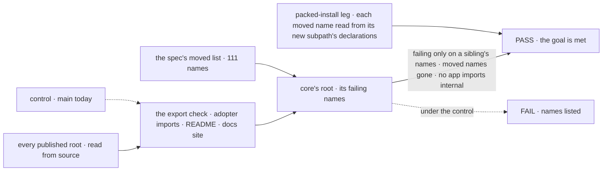
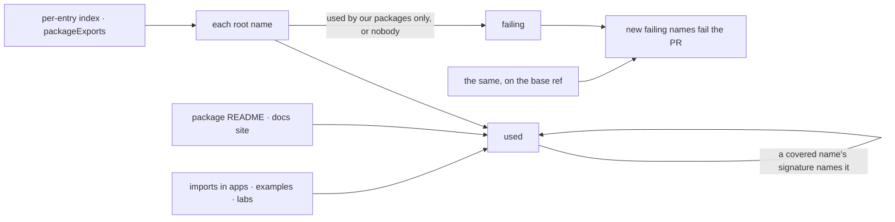

# FIX-2448 · Split core's root: move the harness/PR vertical to `core/harness` and framework seams to `core/internal`

**Spec** · [Decisions](DECISIONS.md)

## Six people, before and after

| Someone who… | Today | After |
|---|---|---|
| **autocompletes `@flow-state-dev/core` to write a flow** | 563 names. 55 are coding-harness and pull-request vocabulary, 54 are runtime seams: `RequestHost`'s eight verbs, wait gates, engine handshakes | The names an app author uses or the docs teach. No harness name, no seam |
| **builds a flow around a coding agent** | Harness names are split across the root and `core/types`, half of each | One documented subpath, `core/harness`, for the harness contract, the plan record and the pull-request record |
| **hovers `ctx` in a handler** | `BlockContext` lists `requestHost` and five symbol-keyed slots marked "not part of the public API" | Neither. A framework package reads them off an internal context type |
| **adds an export to any published root** | Nothing stops it. Core went from 480 to 549 names in two weeks | CI refuses a new root name that no app, example or docs page uses or names. A name only our packages use goes to `/internal` |
| **imports an `/internal` path from an app** | Works. Kitchen Sink does it twice | CI refuses the import of any package's `/internal` and names it |
| **maintains engine, orchestration, workforce or a harness package** | Reaches the runtime through core's root and `core/types` | The same seams, imported from `core/internal` |

## The goal, and how we'll know it's met

**An adopter who autocompletes core's root sees only names an app author uses or the docs teach,
and no published package root, core's or any other, can gain a name that no app uses and no docs
page names.**

This issue owns core's cell of the epic's *Surface* row (FIX-2460's six benchmark types also
contribute; the last to land flips it) and the export check over every published root. Cleaning
any other root is its owner's.

| Is it the right goal? | |
|---|---|
| **The real need** | The epic's *Surface* row, for the root every adopter imports ([FIX-2447](../../epics/FIX-2447/SPEC.md#the-goal-and-how-well-know-its-met)), and the issue's "orchestration vocabulary they never opted into" |
| **Smaller, and rejected** | "The issue's list moves." It clears the 111 names the review named, leaves the 107 more the check finds, and nothing stops the next window adding 70 again |
| **Bigger, and not this issue's** | Every published root clean. The epic's *Surface* row is narrowed to the roots the set owns: engine, client, react, testing, orchestration, patterns, the harness packages and the stores are their own children's cells. The eleven roots with no owner (workforce's wider root, memory, contracts, harness-manager, fsdev, workspace, tools, bullmq, mcp, scheduled, voice-openai; 457 failing names today) can't grow under this issue's ratchet and go to follow-up issues |
| **Not done if** | The export check is not the first PR to merge, or not a required check, while core's root is emptied · core's root still fails the check on a name outside the six benchmark types · a moved name still resolves from the root or `core/types`, other than as ER-3 / Q1's answer allows · a name only our packages or a goal import counts as used · any root gains a failing name and CI stays green · an app or a docs page imports any package's `/internal` path, by `import`, `import type`, `import()` or `require` · a flagged name stays on the root through a README line nobody reviewed · `core/harness` or `core/internal` is missing from the installed tarball · core's tarball ships a compiled test file · `BlockContext` still shows `requestHost` or a symbol slot |



The check reads who imports each name, never the diff's own lists. The control is today's tree,
which must fail on both the check and the moved list.

| How we verify | |
|---|---|
| **Goal check** | `goals/core/root-is-for-app-authors/check.mjs`, promoted from [`poc/export-census/`](poc/export-census/census.mjs) · model `n/a` · run by the implementer at completion · verdict in the implementation PR. Its import census is not a second copy: FIX-2162's caller census (`goals/client/does-every-job-with-one-client/check.mjs`) is extended into the one census module, which the export check, this check, and FIX-2449's, FIX-2459's and FIX-2463's checks all read. The tarball half is an assertion in FIX-2564's packed-install leg, on `run.mjs`'s `packAll` / `npmInstall`, not a second pack and install here. It flips core's *Surface* cell, when it is the last of its two contributors to land (FIX-2460's benchmark move is the other), and the `/internal`-refusal cell to `expect: pass`; the row's outcome is derived from its cells |
| **Signal** | `check.mjs --after`, against the frozen list [`poc/export-census/moved.tsv`](poc/export-census/moved.tsv): core's root fails the export check on no name but the six `benchmark` rows, which FIX-2460 moves · no file under `apps/` (not `apps/devtool`), `examples/` or `labs/` imports any `@flow-state-dev/*/internal` path in any form: core's, engine's, orchestration's, react's, contracts' and client's today, and any later one by the same match · `--after` prints every flagged name that stays on the root through a README line added since d6a38c09, for the PR's reviewer. **The packed-install leg** reads the **installed** core tarball through the TypeScript compiler from its `.d.ts` (most moved names are types, which a runtime import can't see): none of the 111 moved names is on the root or `core/types`, each `harness` row is on `core/harness`, each `internal` row on `core/internal`, each `unexport` row on no public entry, `BlockContext` has neither `requestHost` nor a symbol-keyed member, and the tarball holds no compiled test file. The export check gates every PR against the merge base with `main` and runs over every published root and only roots: `core/harness` and `core/internal` are subpaths |
| **Input** | Today's tree. A different valid input: a new root name with one Kitchen Sink import passes; the same name imported only by engine fails |
| **Anti-game** | The allow-list is the README, the docs site and adopter code, never a list the same diff writes. `docs/architecture/` is ours and counts for nothing. The check reads the merge base through `mechanism-exports.mjs`'s `gitReader`, as the PR classifier reads its base, so there is no baseline file to edit and no copied checkout. The moved list and the six benchmark names are frozen here, not in the implementation. A README line or Kitchen Sink import added only to clear a name is the hollow pass: `--after` lists those for review, and a README dump is one of the plants |
| **Control that must fail** | Today's `main` must FAIL `--after` on *core fails on no unowned name*: 132 names, the 107 flagged plus 25 moved names that already fail, beside 4 benchmark ones (the census prints 134: its source-text reach misses two `typeof` names the compiler's reach clears); and on *moved names gone*: 111. `--control` plants a consumer-less core root name, a sibling-only engine root name, a goal-only core root name, an app `import type` of `core/internal` and an app `import()` of `engine/internal`, a README line listing bare names, and a moved name re-added to the root; each must be named. On the first PR, one CI run with a planted engine root name shows the gate red |

## What changes


Position is audience: above the fence is what an adopter may import, and the fence is
[epic D2](../../epics/FIX-2447/DECISIONS.md#d2). Behind it, across the set: core, engine,
orchestration, react and contracts each get an `/internal`, beside client's existing one. The PR
that creates `core/internal` ships the fix that hides it from import completions, if one exists;
if none does, D2's closure spot-check stands as a recorded finding.

**What a harness package writes:**

```diff
- import { recordPullRequests, harnessEnv, formatRunDuration } from "@flow-state-dev/core";
- import type { HarnessBlock, HarnessRunInput } from "@flow-state-dev/core/types";
+ import { recordPullRequests, harnessEnv, formatRunDuration } from "@flow-state-dev/core/harness";
+ import type { HarnessBlock, HarnessRunInput } from "@flow-state-dev/core/harness";
```

**What a framework package writes:**

```diff
- import { requireRequestHost, parkOnWait } from "@flow-state-dev/core";
- import { onRequestEnded, REQUEST_END_SEAM } from "@flow-state-dev/core/types";
- import { resolveBlockValueInternal } from "@flow-state-dev/core/items/internal";
+ import { requestHostOf, parkOnWait, onRequestEnded, resolveBlockValueInternal } from "@flow-state-dev/core/internal";
- const host = ctx.requestHost;
+ const host = requestHostOf(ctx); // undefined on a hand-built context, as today
```

How an adopter on 0.4.0 meets each old path follows ER-3 / Q1's answer.

**Docs:** create *What each package root is for* (`apps/docs/docs/api/package-roots.md`, first
in *API Reference*): a row for every published root with its job and its public subpaths, and why
`/internal` is not for apps. Core's row is complete here. Each child edits the row of the root it
changes: FIX-2449 engine and client, FIX-2452 the stores, FIX-2454 contracts, FIX-2455
react's `/internal`, FIX-2456 react, FIX-2458 the harness packages, FIX-2459 orchestration and
patterns, FIX-2460 testing. Update
`packages/core/README.md`: the harness section becomes a `core/harness` section, and every
framework-facing passage moves to `docs/architecture/internal-execution-seams.md` (the epic's
ER-1 reading, which every package's owner applies to its own README): `ctx.requestHost`,
the dispatcher's *substrate exports*, and the request-spend seams. Update the import lines in
`apps/docs/docs/tools/` (`coding-agents`, `claude-code-sdk`, `codex`, `cursor`) and
`orchestration/harness-manager.md`. A test that builds a dispatcher's context by hand gets its
seam from `@flow-state-dev/testing`'s context helper, not `core/internal`.

## How the check sees a name



A type an adopter meets only through a covered function's signature counts as used. A sibling
package's import never does ([D1](DECISIONS.md#d1)).

## What stays as it is

- The 339 root names that pass; core's other public subpaths, minus the moved names.
- Blocks, resources and Workforce's copied app flows, which ER-1 doesn't count.

## What's already here, and the debt

| Already here | What this does with it |
|---|---|
| What already gates a public surface: `packageExports` and `gitReader` (`scripts/mechanism-exports.mjs`), the mechanism anchor check and PR classifier, Fallow's `check-new-dead-code.mjs`, `validate-package-boundaries.mjs`. Searched `exports`, `surface`, `baseline`, `internal` in `scripts/` and `eslint.config.mjs` | **Extends** `packageExports`, which merges a package's entries first-wins, into a per-entry index (once, in the first PR; FIX-2449 reads it too), and **reuses** the classifier's base/head read for the ratchet. None asks who outside the framework uses a name; this is the first |
| FIX-2162's caller census (`goals/client/does-every-job-with-one-client/check.mjs`) | **Extended** into the one import census: totality, plants, every import form |
| The packed-install job (`scripts/packed-install/run.mjs`) | **Gets** the tarball assertions as a leg, through FIX-2564 |
| Core's build `tsconfig.json`, whose `src/**/*` include compiles four test files under `src/` into `dist` | **Excludes** them, so the tarball ships none |
| `client/./internal`; core's `./items/internal`, a re-export of contracts' | **Reuses** the first's kind; **folds** the second into `core/internal`, core's one hidden entry (ER-2) |
| `core/types`, which carries 57 harness names and 66 seam names, 57 of them not on the root | **Amended**: they leave for the two subpaths ([D2](DECISIONS.md#d2)) |
| The issue's "unexport `utility.historySummary`" | **Dropped**: Teammates and a docs page now use it |
| [FIX-2447 D2 and ER-1 to ER-3](../../epics/FIX-2447/DECISIONS.md#who-owns-what) | **Kept**. D1 here reads ER-1's "outside consumer" |

| Adds | Existing piece considered | Why that doesn't fit, or how it is composed |
|---|---|---|
| The export check, every published root, gating PRs | `packageExports`; `gitReader`; Fallow's ratchet; FIX-2162's census | Composed: the per-entry index for names, the one import census, the base read through `gitReader`, Fallow's rule that a PR answers for what it newly fails. Not Fallow itself: its graph is workspace dead code, and a seam engine imports is not dead |
| `requestHostOf(ctx)` and an internal context type, in `core/internal` | `requireRequestHost`, which throws; 52 `ctx.requestHost?.` reads | The non-throwing twin of the existing reader; the 52 optional reads keep their meaning. Not a second way: `requireRequestHost` is built on it |
| `core/harness`, a documented public subpath | Core's exports map; `core/types` | Extends the map. `core/types` can't hold it: it is the general type barrel |
| `core/internal` | `client/./internal`; `core/items/internal` | The same kind; replaces `items/internal` rather than sitting beside it |
| One docs page | `api/core.md`; `ecosystem/overview.md` | Neither lists roots; a table per root, which the siblings extend |

| The debt | |
|---|---|
| **Removes** | 111 names from core's root (55 moved to `core/harness`, 54 to `core/internal` with `WAIT_DEADLINE_ENTRY` among them, 2 unexported), the same files' names from `core/types`, `requestHost` and five symbol slots from the public `BlockContext`, the `core/items/internal` entry, the README's runtime-seam section, and the four compiled test files in core's tarball. The check rules on 107 more |
| **Adds** | Two subpaths and one check, each permanent by design. Under Q1's alias option, a deprecated alias per moved name until the removal minor Q1 names |
| **Leaves** | The eleven unowned roots, 457 failing names today, held by the ratchet for follow-up issues outside the epic · `core/types`, a 442-name barrel the check doesn't read · 14 `_`-prefixed internal members on `BlockContext` · the task-dispatch vocabulary on core's root, which the README documents, for FIX-2459 to weigh under its D2 rule |

**Net: down.** Core's root loses 111 names now and more as the check rules; two entries and
one check are added.

## Sign off

**[The goal](#the-goal-and-how-well-know-its-met):** core's root clean by the check and every
published root ratcheted; other roots are cleaned by their own owners. If wrong: we move the names the review saw, and the root grows back.

**[The debt](#whats-already-here-and-the-debt), net down:** 111 names leave the root, two
subpaths and a check arrive. If wrong: two more entries to keep, for names nobody used.

1. [D1](DECISIONS.md#d1) · A name counts as used only by adopter code or the docs; our own
   packages' and goals' imports don't. If wrong: seams pass the check, or public types need a README line
   each.
2. [D2](DECISIONS.md#d2) · A moved name leaves every public core entry, `core/types` included.
   If wrong: one more breaking path for adopters, for a barrel they might not autocomplete.

**Open: none of mine.** D1 is the one to weigh. How the moves reach adopters is the epic's
[Q1](../../epics/FIX-2447/DECISIONS.md#q1).

Improvement · `core` (moves), `scripts/` (the check), importers in engine, orchestration, workforce, claude-code, codex, cursor, harness-manager, shift-manager, devtool, testing, workspace, the two stores, integration-tests, three labs, Kitchen Sink and about 22 goals · large · epic [FIX-2447](../../epics/FIX-2447/SPEC.md)
