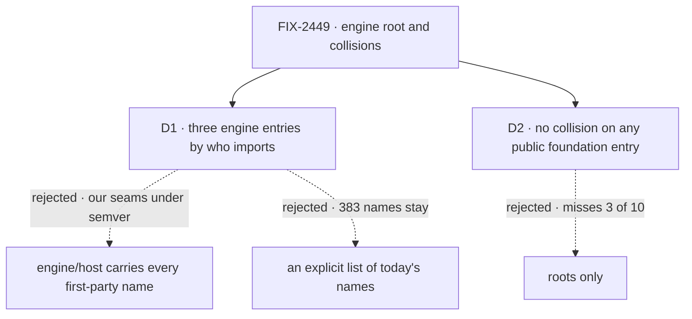

# FIX-2449 · Decisions

[Spec](SPEC.md) · **Decisions**

## The tree

## D1 · Engine gets three entries, split by who imports a name

| | |
|---|---|
| **Instead of** | One public `engine/host` that carries every name a first-party package imports, the `unstable_` resource helpers and `runRead` included. Or the issue's smaller reading: the `export *` lines written out as today's 383 names |
| **Because** | The census sorts the 168 names a file or docs page outside engine imports by reader: 36 by apps, examples and docs pages, 124 by host and store adapters, 8 only by our library packages (`runRead`, `createInMemoryLeaseBackend`). Four `unstable_` resource helpers sit in the adapter group, but only `mcp` reads them, for its own projection; the fifth is core's `isCollectionConfig` and goes with the other re-exports. A public subpath is documented and semver-covered ([epic D2](../../epics/FIX-2447/DECISIONS.md#d2)), so putting the third group on `host` promises adopters seams that reached the root unreviewed, through `export *`. The other 215 nobody imports |
| **Locks in** | Three entries and their names: the root for app authors, `@flow-state-dev/engine/host` for what any host or store adapter author needs, `@flow-state-dev/engine/internal` for what only our packages read, the `unstable_` helpers included. Store contracts live on `host`, not a fourth entry. `host` carries the type closure of its contracts: a type its functions take or return (`ResponseEmitter`, through `DispatchHandle`) is on it even when nobody imports it by name. A docs page counts as a reader: an app-author page keeps a name on the root, an adapter-author page puts it on `host`. A name moves from `internal` to `host` only with a README entry. Engine is a third package with an `/internal`, beside core and orchestration: the epic's Adds count rises by one |

It comes down to the seams only our packages read: on `host` they become a promise to adopters.

## D2 · No name collides on any public foundation entry; the side off the app author's path renames

| | |
|---|---|
| **Instead of** | The issue's scope: roots only, with its three named pairs fixed by hand |
| **Because** | Roots only finds seven. Every public entry finds ten: `ExpectedVersion` (contracts/helpers and engine), `RetryPolicy` (`core/types` and `core/models`, two different types) and `executeBlock` (`core/blocks/sequencer` and engine). An adopter who imports `core/types` and `core/models` sees two `RetryPolicy`s as surely as one who imports two roots |
| **Locks in** | The rule, in FIX-2448's export check: no two public entries of `contracts`, `core`, `engine`, `client`, `react` or `testing` export one name from different declaring files. `/internal` and repo-test entries don't count. One meaning declared twice is declared once and re-exported, in contracts for a wire shape. Two meanings: the side an app author doesn't import renames. The six public names in [SPEC.md → What changes](SPEC.md#what-changes), on 0.4.0 adopters per ER-3 and Q1's answer |

It comes down to `RetryPolicy`: a roots-only check can't see two in core.

## Decided, not asked

- **The convergence point for "one name, one meaning"** is the collision assertion in FIX-2448's
  export check, over `packageExports`. Every writer passes it: hand-written barrels, a subpath
  that points at a whole module (`core/blocks/sequencer` today), a type alias of a shared type,
  and a deprecated alias. Under Q1's alias answer it accepts a colliding name only while that
  name is a `@deprecated` alias naming its replacement, and fails it at the removal minor.
- **Which side renames:** the one an app author doesn't import. Engine's `DispatchHandle`,
  `isRetryableError` and `StreamEvent` are adapter-side; core's `SessionView` is a peer read,
  React's is `useSession`'s; core/models' `RetryPolicy` configures fallback, the block's is in
  every flow.
- **`FlowDispatchHandle` → `RunnerHandle`** finishes the runner rename beside `FlowRunner`, so
  `engine/host` doesn't carry two `*DispatchHandle`s. Not a collision; the issue asked for it.
- **Markers and react's import proof** are deleted, with no new home and no outside consumer. The
  proof becomes a type test in react. Each package's own `index.test.ts` drops its marker line.
- **Engine re-exports no core or contracts name.** The 26 go, `unstable_isCollectionConfig` among them; the README already says import them from core. Engine reads contracts types through core, as today: no new dependency.
- **A collision whose engine side has no reader** (`isRetryableError`, the child-session pair) is resolved by unexporting it. Its new name in SPEC.md binds only if a reader keeps it.
- **Removed names reach 0.4.0 adopters per ER-3 and Q1's answer**, like moved ones. Under the alias answer that is about 200 deprecated names on engine's root until the removal minor.
- **Seams.** `engine/src/index.ts`: this issue writes the list; FIX-2452 moves store constructors
  under it. `react/src/index.ts`: this issue removes the markers, the proof and `FlowCardinality`'s
  copy; FIX-2450, 2455 and 2456 remove their own names. Core: this issue renames `SessionView` and
  `core/models`' `RetryPolicy` and narrows `core/blocks/sequencer`, on FIX-2448's split.
- **The first-party adapters** (`next`, `vercel`, `node`, `bullmq`, `mcp`, `scheduled`,
  `fsdev`, both stores) and the library packages (`orchestration`, `workforce`, `harness-manager`, `shift-manager`, `testing`, `integration-tests`, `memory`) move their imports to `engine/host` or `engine/internal`.

## Considered and dropped

| Option | Why it lost |
|---|---|
| Write today's 383 names out explicitly | Meets "no `export *`" and changes nothing an adopter sees |
| Keep the `unstable_` prefix for sibling seams | A prefix still autocompletes on the root and promises nothing; epic D2 already names the kind |
| A fourth entry, `engine/stores`, for store adapter authors | One audience, adapter authors; one page is simpler. Store packages already import host-side names too |
| Rename core's `DispatchHandle` instead | Core's is the one a dispatcher block's author types |

## Settled

- **The factual base.** [`poc/root-census/census.mjs`](poc/root-census/census.mjs) re-derives
  the counts from source at `d6a38c09`: engine root 383; collisions 7 on roots and 10 on every
  public entry. Its negative control, `--plant`, put one name on react's and client's roots and the
  count rose from 7 to 8. [`consumers.mjs`](poc/root-census/consumers.mjs) splits the 168 names a file
  or docs page outside engine imports: 36 app, example or docs, 124 host or store, 8 library-only,
  and 215 nobody. Validation found the first count left out the docs site; it now reads it. Outputs are beside them (`out-*.txt`). The premise held: the issue undercounted
  collisions by seven.

**Open: none.**

## Analysis

Not run per spec: as a spec-set member, this spec's analysis and `reuse-review` run over the
whole FIX-2447 set, by the epic's agent.

## How it got here

- **Draft** — engine's root and the foundation's collisions, framed by who imports a name;
  three engine entries over `packageExports` and FIX-2448's export check; a census that found ten
  collisions where the issue named three.
- **Validation (Step 5)** — the reader census now counts the docs site (215 unread, not 223); `engine/host` carries its contracts' type closure; a collision with no reader on the engine side is unexported, not renamed; the goal check names what keeps adapter imports off the root.
