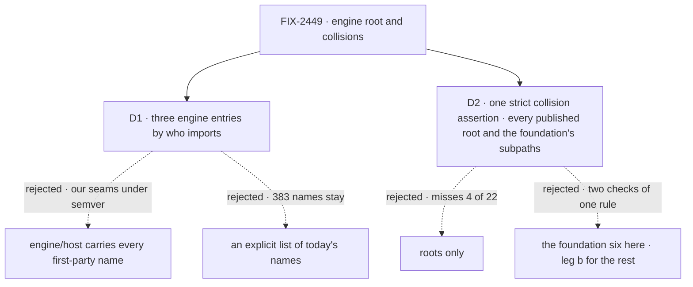

# FIX-2449 · Decisions

[Spec](SPEC.md) · **Decisions**

## The tree

## D1 · Engine gets three entries, split by who imports a name

> **Amended (Nov 10).** The root's type closure sits on `engine/host` too: the options and result
> types of root functions (`CreateFlowStateOptions`, `FlowApiRouter`) are on `host`, not the root,
> so the root stays at what apps import. `StoresConfig` is the exception and stays on the root:
> an app writes it for `createFlowState({ stores })`, and the engine README names it. `InboundTransportAdapter` is on `host` too: its
> one docs page, `advanced/inbound-transports.md`, is for adapter authors. EM rulings on
> [#4882](https://github.com/fixpoint-labs/flow-state-dev/pull/4882); the engine changeset names
> `StoresConfig`'s home.

| | |
|---|---|
| **Instead of** | One public `engine/host` that carries every name a first-party package imports, the `unstable_` resource helpers and `runRead` included. Or the issue's smaller reading: the `export *` lines written out as today's 383 names |
| **Because** | The census sorts the 168 names a file or docs page outside engine imports by reader: 37 by adopter code (apps, examples, labs) and docs pages, 124 by host and store adapters, 7 only by our library packages (`runRead`, `createInMemoryLeaseBackend`). Four `unstable_` resource helpers sit in the adapter group, but only `mcp` reads them, for its own projection; the fifth is core's `isCollectionConfig` and goes with the other re-exports. A public subpath is documented and semver-covered ([epic D2](../../epics/FIX-2447/DECISIONS.md#d2)), so putting the third group on `host` promises adopters seams that reached the root unreviewed, through `export *`. The other 215 nobody imports |
| **Locks in** | Three entries and their names: the root for app authors, `@flow-state-dev/engine/host` for what any host or store adapter author needs, `@flow-state-dev/engine/internal` for what only our packages read, the `unstable_` helpers included. Store contracts live on `host`, not a fourth entry, and `host`'s reader set holds FIX-2452's twenty store names, which its own PR moves there after this one. `host` carries the type closure of its contracts: a type its functions take or return (`ResponseEmitter`, through `DispatchHandle`) is on it even when nobody imports it by name. A docs page counts as a reader: an app-author page keeps a name on the root, an adapter-author page puts it on `host`. A name moves from `internal` to `host` only with a README entry. `engine/internal` is a plain published subpath with no completions fix (epic D2, settled) |

It comes down to the seams only our packages read: on `host` they become a promise to adopters.

## D2 · One strict collision assertion over every published root and the foundation's subpaths

| | |
|---|---|
| **Instead of** | The issue's scope: roots only, with its three named pairs fixed by hand. Or the six foundation packages here, with leg b checking the other roots on installed tarballs |
| **Because** | Every published root finds 18. Adding the six packages' public subpaths finds 22: `ExpectedVersion` and `camelToKebab` on `contracts/helpers`, `RetryPolicy` on `core/types` and `core/models` (two different types), and `executeBlock` on `core/blocks/sequencer`. An adopter who imports `core/types` and `core/models` sees two `RetryPolicy`s as surely as one who imports two roots. Source shows every collision an installed tarball would, so a second check of the same rule only adds a place for the two to disagree |
| **Locks in** | One assertion in FIX-2448's export check, over its per-entry index: no two entries in scope export one name from different declaring files. In scope: every published root, and every public entry of `contracts`, `core`, `engine`, `client`, `react` and `testing`; `/internal` and repo-test entries don't count. The manifest cell expects zero; on a PR it admits nothing the merge base lacks until the last contributor lands. One meaning declared twice is declared once and re-exported, in contracts for a wire shape. Two meanings: the side an app author doesn't import renames. This issue resolves twelve: the ten inside the six, engine's `FlowApiRouter` and react's `RosterWorker`. The owner of the other root resolves the rest: the harnesses' eight (FIX-2458), `initializeSchema` (FIX-2452), orchestration's `camelToKebab` (FIX-2459) |

It comes down to `RetryPolicy`: a roots-only check can't see two in core.

## Decided, not asked

- **From the epic, cited, not restated:** [ER-1](../../epics/FIX-2447/DECISIONS.md#who-owns-what), [ER-3](../../epics/FIX-2447/DECISIONS.md#who-owns-what), [ER-4](../../epics/FIX-2447/DECISIONS.md#who-owns-what), [ER-7](../../epics/FIX-2447/DECISIONS.md#who-owns-what) · **cells owned** in [FIX-2564's grid](../FIX-2564/SPEC.md#what-changes): `surface.root.engine` (with FIX-2452), `surface.root.client`, `surface.root.react` (with FIX-2450, 2455, 2456), `surface.collisions` (with FIX-2452, 2458, 2459).
- **The convergence point for "one name, one meaning"** is the collision assertion in FIX-2448's
  export check, over its per-entry index of `packageExports`. Every writer passes it: hand-written
  barrels, a subpath that points at a whole module (`core/blocks/sequencer` today) and a type
  alias of a shared type. It accepts no `@deprecated` alias: Q1 was answered break, so a renamed
  name leaves its old export in the same change.
- **Which side renames:** the one an app author doesn't import. Engine's `DispatchHandle`,
  `isRetryableError` and `StreamEvent` are adapter-side; core's `SessionView` is a peer read,
  React's is `useSession`'s; core/models' `RetryPolicy` configures fallback, the block's is in
  every flow.
- **`FlowDispatchHandle` → `RunnerHandle`** finishes the runner rename beside `FlowRunner`, so
  `engine/host` doesn't carry two `*DispatchHandle`s. Not a collision; the issue asked for it.
- **Markers and react's import proof** are deleted, with no new home and no outside consumer. The
  proof becomes a type test in react. Each package's own `index.test.ts` drops its marker line.
- **Engine re-exports no core or contracts name.** The 26 go, `unstable_isCollectionConfig` among them; the README already says import them from core. Engine reads contracts types through core, as today: no new dependency.
- **A collision whose side has no reader** (engine's `isRetryableError`, the child-session pair, react's `RosterWorker`) is resolved by unexporting it. Its new name in SPEC.md binds only if a reader keeps it.
- **Vercel's `FlowApiRouter`** is a hand copy of engine's router shape, so it re-exports engine's from `engine/host`. Vercel already depends on engine.
- **Client's root** keeps `CollectionItemHandle`, now in its README: React's collection hooks return it. FIX-2448's census, which stops at a package edge, counts it sibling-only.
- **Seams** are [the epic's](../../epics/FIX-2447/DECISIONS.md#coordination-seams). This issue's share: engine's list; on react's root the
  markers, the proof, `RosterWorker` and `FlowCardinality`'s copy; on core, `SessionView`,
  `core/models`' `RetryPolicy` and `core/blocks/sequencer`.
- **The first-party adapters** (`next`, `vercel`, `node`, `bullmq`, `mcp`, `scheduled`,
  `fsdev`, both stores) and the library packages (`orchestration`, `workforce`, `harness-manager`, `shift-manager`, `testing`, `integration-tests`, `memory`) move their imports to `engine/host` or `engine/internal`.

## Considered and dropped

| Option | Why it lost |
|---|---|
| Write today's 383 names out explicitly | Meets "no `export *`" and changes nothing an adopter sees |
| Keep the `unstable_` prefix for sibling seams | A prefix still autocompletes on the root and promises nothing; epic D2 already names the kind |
| A fourth entry, `engine/stores`, for store adapter authors | One audience, adapter authors; one page is simpler. Store packages already import host-side names too |
| Rename core's `DispatchHandle` instead | Core's is the one a dispatcher block's author types |
| Every public entry of every published package | 27 today; the five more are subpath names in patterns and workforce, outside the set. ER-1's ratchet holds them |

## Settled

- **The factual base.** [`poc/root-census/census.mjs`](poc/root-census/census.mjs) re-derives
  the counts from source at `d6a38c09`: engine root 383; collisions 7 on the six roots, 10 on the
  six's public entries, 18 on every published root, and 22 in the assertion's scope (`--all
  --public`). Its negative control, `--plant`, put one name on react's and client's roots and the
  count rose by one in each scope (7 to 8, 22 to 23). [`consumers.mjs`](poc/root-census/consumers.mjs)
  splits the 168 names a file or docs page outside engine imports: 37 adopter code or docs, 124
  host or store, 7 library-only, and 215 nobody. FIX-2448's census finds client's root failing on
  3. Outputs are beside them (`out-*.txt`). The premise held: the issue undercounted collisions.

**Open: none.**

## Analysis

Not run per spec: as a spec-set member, this spec's analysis and `reuse-review` run over the
whole FIX-2447 set, by the epic's agent.

## How it got here

- **Owner amendment (Nov 6)** — [epic Q1 answered, break](../../epics/FIX-2447/DECISIONS.md#q1), and [epic D4, no
  backward-compat code](../../epics/FIX-2447/DECISIONS.md#d4) ([owner's comment](https://github.com/fixpoint-labs/flow-state-dev/pull/4836#issuecomment-6689198303)). The collision assertion's `@deprecated`-alias acceptance is removed, and so
  is the note on about 200 deprecated names on engine's root. Moves and renames land with no alias.
- **Draft** — engine's root and the foundation's collisions, framed by who imports a name;
  three engine entries over `packageExports` and FIX-2448's export check; a census that found ten
  collisions where the issue named three.
- **Validation (Step 5)** — the reader census now counts the docs site (215 unread, not 223); `engine/host` carries its contracts' type closure; a collision with no reader on the engine side is unexported, not renamed; the goal check names what keeps adapter imports off the root.
- **Spec-set review round 1 (Nov 5)** — the completions fix dropped (epic D2 settled that none
  works); seams and ER rules cited from the epic, cells from FIX-2564's grid.
- **Set review (Nov 5)** — the collision assertion runs strict over every published root plus the foundation's subpaths and is the one collisions cell (leg b drops its copy; 22 found, twelve this issue's); client's root joins the goal; checks read FIX-2448's census module and per-entry index; consumers follow ER-1 (labs count, devtool doesn't: 37/124/7); `engine/internal` ships its completions fix; engine's and client's rows on the package-roots page; FIX-2452's store names sit in `engine/host`'s reader set.
