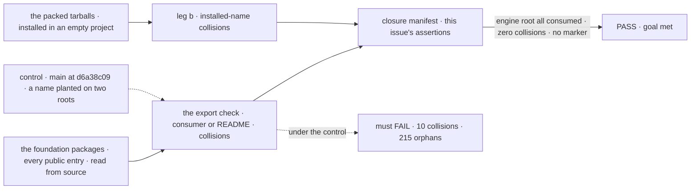

# FIX-2449 · Curate engine's root and remove same-name collisions and scaffolding exports across foundation roots

**Spec** · [Decisions](DECISIONS.md)

## Six people, before and after

| Someone who… | Today | After |
|---|---|---|
| **autocompletes `@flow-state-dev/engine` in an app** | 383 names: lease planners, `BoundedQueue`, 26 of core's and contracts' names again. Apps, examples and docs show 36 | Only what an app needs, each in the README |
| **writes a host or store adapter** | Hunts the same 383 names. Some carry an `unstable_` prefix | Imports `engine/host`: documented, semver-covered |
| **imports `DispatchHandle` from core and from engine** | Two different types, one name | Engine's is `InboundDispatchHandle` |
| **calls `isRetryableError`** | Core's takes an error; engine's also a policy | Engine's leaves the root; if a reader keeps it, it is `isRetryableUnder` |
| **autocompletes `react`, `client` or `testing`** | `reactPackageMarker`, `coreItemImportProof`, two more markers | Gone; the proof is a type test |
| **adds an export whose name another foundation package uses** | Nothing notices; ten exist | The export check fails, naming both |

Engine's root has five `export *` lines, so whatever a sub-barrel exports lands on it unreviewed.

## The goal, and how we'll know it's met

**An app author who imports `@flow-state-dev/engine` sees only what an app needs; an adapter
author finds their contracts on `engine/host`; across the foundation packages one name means one
thing; and no package root ships scaffolding.**

| Is it the right goal? | |
|---|---|
| **The real need** | The epic's *Surface* row for engine, and the collisions ([FIX-2447](../../epics/FIX-2447/SPEC.md#the-goal-and-how-well-know-its-met)) |
| **Smaller, and rejected** | "Replace `export *` with an explicit list." Met by listing today's 383 names (367 when the issue was filed). And "fix the three named collisions": the census finds ten |
| **Bigger, and not this issue's** | Core's root ([FIX-2448](https://linear.app/fixpoint-labs/issue/FIX-2448)), React's hook names (FIX-2450, 2455, 2456), the store factory family (FIX-2452), collisions in packages outside the foundation six (leg b, [FIX-2564](https://linear.app/fixpoint-labs/issue/FIX-2564)) |
| **Not done if** | An engine root name is imported only by adapters or our own packages, with no app import and no README app-section entry · engine's root re-exports a name declared in another package · an adapter-only contract is missing from `engine/host` and a first-party adapter still imports it from the root · two public foundation entries export one name for different declarations · a marker or the import proof survives under any name |



The check reads every public entry, not one root, and the control is today's tree.

| How we verify | |
|---|---|
| **Goal check** | No `goals/` directory: the surface is the outcome. FIX-2448's export check, extended here, gates every PR; until it exists, `node specs/issues/FIX-2449/poc/root-census/census.mjs --public` and `consumers.mjs` are the same assertions. In FIX-2564's manifest this issue flips to `expect: pass` the *Surface* row's engine-root and marker assertions and the foundation-six part of leg b's collision assertion; FIX-2564 names the ids |
| **Signal** | Every engine root name is imported by an app or example (`apps/`, `examples/`) or sits in the README's app section; a name only adapters or our packages import is on `engine/host` or `engine/internal`. Zero engine root names declared in another package. Zero names shared by two public foundation entries with different declaring files. The seven marker and proof names, and the smoke file, exported from no entry |
| **Input** | Every public entry of `contracts`, `core`, `engine`, `client`, `react`, `testing`; not `/internal` or repo-test entries. Prototype: [`poc/root-census/`](poc/root-census/README.md) |
| **Anti-game** | Adapter imports never count toward the root, so leaning on first-party adapters can't keep a name there. A README app-section line added for a name no app imports is a scope change the reviewer rejects. A renamed marker has no outside consumer, so ER-1 fails it. Collisions compare declaring files, so a type alias is caught; `/internal` is excluded, so moving a colliding name there must be justified by D1's reader rule |
| **Control that must fail** | `main` at `d6a38c09`: 10 collisions, 215 engine root names no file or docs page outside engine imports. `--plant` puts one name on two roots: the count must rise by one |

## What changes


Read the bands by who imports: an app, an adapter, or our packages. The red strip is what nobody outside engine uses.

**An adapter, as its author writes it:**

```diff
- import { createInboundTransportHost, type DispatchHandle, type StreamEvent,
-   unstable_listExposedResources, createFlowState } from "@flow-state-dev/engine";
+ import { createFlowState } from "@flow-state-dev/engine";
+ import { createInboundTransportHost, type InboundDispatchHandle,
+   type StreamBridgeEvent } from "@flow-state-dev/engine/host";
+ import { listExposedResources } from "@flow-state-dev/engine/internal"; // our packages only
```

**Renamed and re-homed** ([D2](DECISIONS.md#d2)), reaching 0.4.0 adopters per ER-3 and Q1's answer:

| Name today | After |
|---|---|
| engine `DispatchHandle` | `InboundDispatchHandle`, on `engine/host` |
| engine `FlowDispatchHandle` | `RunnerHandle`, on `engine/host`, beside `FlowRunner` |
| engine `isRetryableError` | `isRetryableUnder`, if it stays exported; no reader imports it today |
| engine `StreamEvent` (the bridge frame) | `StreamBridgeEvent`, on `engine/host` |
| core `SessionView` | `PeerSessionView`; React's keeps the name |
| core/models `RetryPolicy` | `ModelRetryPolicy`; the block's keeps the name |
| `ExpectedVersion`, `FlowCardinality`, `ChildSessionStatus`, `ChildSessionSummary` | One declaration each, re-exported. The child-session pair has no engine reader, so engine stops exporting it and client's copy moves to contracts |
| `executeBlock` on `core/blocks/sequencer` | Gone there: the subpath carries the builder |

**Docs:** every page and README that imports a moved name, which `consumers.mjs` lists (about 32 pages and the adapters' READMEs). Specifically: add engine's row to *what each package root is for*, the page FIX-2448 publishes; split
`packages/engine/README.md`'s *Public API* into the root and `engine/host`; update the import
lines in `server/host-adapters.md`, `advanced/inbound-transports.md`, `persistence/overview.md`
and `api/server.md`, `server/webhooks.md`, `server/authentication.md`, `advanced/durable-execution.md`. No new page.

## What stays as it is

- Engine's other subpaths, and every name's behaviour: this changes no runtime code.
- Core's root is FIX-2448's; this edits core only for the collisions above.

## What's already here, and the debt

| Already here | What this does with it |
|---|---|
| What already decides a root's surface: `exports` maps, barrels, the `unstable_` prefix. No `mechanisms.yaml` row (searched *export*, *surface*, *root*) | **Replaces** `export *` and the prefix with three entries |
| `scripts/mechanism-exports.mjs` → `packageExports` | **Builds on**, one entry at a time |
| FIX-2448's export check | **Extends** with a collision assertion (ER-1, ER-4) |
| `client/./internal`, published and read by our packages | **Reused**: `engine/internal` is that kind ([epic D2](../../epics/FIX-2447/DECISIONS.md#d2)) |
| [FIX-2162](../FIX-2162/SPEC.md#whats-already-here-and-the-debt): `createInProcessFetch` on engine's root | **Kept** |
| [FIX-2428](../FIX-2428/SPEC.md)'s push delivery, [FIX-1551](../FIX-1551/SPEC.md)'s in-process pin | **Kept**; both move to `engine/host` |

| Adds | Existing piece considered | Why it doesn't fit / how composed |
|---|---|---|
| `engine/host` | The root; `engine/testing` | The root is the app author's; a public entry beside `engine/testing` |
| `engine/internal` | The `unstable_` prefix; `engine/host` | A prefix still autocompletes; `host` puts our seams under semver ([D1](DECISIONS.md#d1)) |
| A collision assertion | FIX-2448's export check; `packageExports` | One assertion in that check, over the walker it already reads |

| The debt | |
|---|---|
| **Removes** | Five `export *` lines; 215 root exports no file or docs page outside engine imports; 26 re-exported core and contracts names, `unstable_isCollectionConfig` included; the `unstable_` prefix; ten collisions; four package markers and react's import proof; client's copy of the child-session wire types |
| **Adds** | Two engine entries to keep; one assertion; six renames. Under Q1's alias answer, deprecated aliases until the removal minor |
| **Leaves** | Collisions outside the six (leg b); core's root (FIX-2448); store factory names (FIX-2452) |

**Net: down.** 383 names on one root become three entries by reader; ten collisions become none.

## Sign off

**[The goal](#the-goal-and-how-well-know-its-met):** engine's root for apps, `engine/host` for
adapters, one meaning per name across the foundation, no scaffolding. If wrong: we curate one
root and adopters still meet two `DispatchHandle`s.

**[The debt](#whats-already-here-and-the-debt):** net down, two entries and six renames added.
If wrong: adapter authors pay a breaking move for a split they didn't need.

1. [D1](DECISIONS.md#d1) · Three engine entries, by who imports: root, `engine/host`,
   `engine/internal`. If wrong: our seams carry a semver promise, or adapter authors lose one.
2. [D2](DECISIONS.md#d2) · No collisions across every public foundation entry; the side off the
   app author's path renames. If wrong: six renames adopters didn't need.

**Open: none.** Q1 is the epic's; this spec reads either answer.

Improvement · engine, core, contracts, client, react, testing, and the first-party adapters' imports · M · epic [FIX-2447](../../epics/FIX-2447/SPEC.md)
