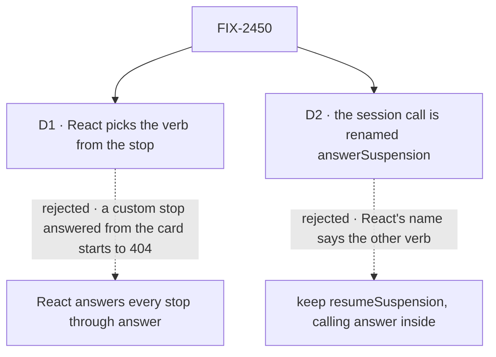

# FIX-2450 · Decisions

[Spec](SPEC.md) · **Decisions**

What was considered, what was chosen, and what each choice locks in. Two decisions are the
sign-off surface. The epic already decided the verb ([decided](../../epics/FIX-2447/DECISIONS.md#decided-not-asked)):
a user's stop is answered through `answer`, and `resume` stays for a developer's own `ctx.suspend`.

## The tree

Solid edges are what you're signing. Dashed edges lost, and the label says why.

## D1 · React picks the verb from the stop: a user's stop through `answer`, a developer's own `ctx.suspend` through `resume`

| | |
|---|---|
| **Instead of** | React answering every stop through `answer`, and a stop that isn't a user's showing no actions |
| **Because** | The default card is the fallback for any reason, so an app that raises its own `ctx.suspend` with a custom reason resolves it from that card today, through `resume`. The answer route answers only a user's stop and 404s the rest by design. Answering everything through `answer` would break that app at runtime with no compile error. The pick is one private function on `isUserSuspension`, the predicate the answer route itself reads, so the two can't disagree (tenet 2: refine, don't add) |
| **Locks in** | React reads a stop's reason to route it. A new user reason has to join `isUserSuspension` in `contracts`, or React resumes it, and in a task's run that 404s. The answer route has the same dependency today, so this adds no new place to update |

It comes down to a custom stop answered from the default card: answer-only 404s it, with no compile error.

**What would change my mind:** evidence that no adopter answers a custom-reason stop from a React
screen. Then React calls one verb, and the card shows such a stop without actions.

## D2 · React's session call is renamed `answerSuspension`, with no alias for the old name (Q1, answered break)

| | |
|---|---|
| **Instead of** | Keeping `session.resumeSuspension` and changing only what it calls |
| **Because** | The epic's *one path* row is about what an adopter reads: one verb for one job. An adopter wiring `SuspensionResolverProvider` copies `session.resumeSuspension` from the docs, then reads in the client README that `resume` is for their own `ctx.suspend`. The name would teach the wrong verb on the screen every approval inbox starts from |
| **Locks in** | `answerSuspension` is React's public name for answering a stop from a session. `resumeSuspension` goes with no alias ([ER-3](../../epics/FIX-2447/DECISIONS.md#who-owns-what); [Q1](../../epics/FIX-2447/DECISIONS.md#q1) answered break), and the changeset names `answerSuspension`. Five docs pages and two Kitchen Sink call sites change with it |

It comes down to the docs an adopter copies: `resumeSuspension` names the verb the client reserves for something else.

**What would change my mind:** the owner holding the epic's moved names to the root exports, so a
method on a returned object stays put. Then the name stays and its doc says it answers.

## Decided, not asked

- **From the epic, cited, not restated:** [ER-3](../../epics/FIX-2447/DECISIONS.md#who-owns-what), [ER-5](../../epics/FIX-2447/DECISIONS.md#who-owns-what), [ER-6](../../epics/FIX-2447/DECISIONS.md#who-owns-what) · **cells owned** in [FIX-2564's grid](../FIX-2564/SPEC.md#what-changes): `onepath.answer-task-stop`; contributes to `surface.root.react`.
- **One pick; every React caller passes through it.** The convergence point is the pick on
  `isUserSuspension`. Its writers: `useApproval` and `useSuspensionForm` on both paths (alone, and
  through the provider's resolver), `session.answerSuspension` (behind `useSuspensions` and the
  default card's provider), and the DevTool's resolve, which already depends on `react`.
- **`session.answerSuspension` keeps its arguments, less `resumedBy`.** It reads the stop's reason
  from the suspension item in its own `items`. A stop it can't see is answered as a user's; a
  custom one then fails loudly with the route's 404.
- **`answer` takes `{ stream: true }`** and returns the route's SSE `Response`, as `resume` and
  `continue` do; the answer route already streams. Without it the session's call loses live output
  on serverless.
- **`resumedBy` leaves the types, with nothing added for it** ([epic D4](../../epics/FIX-2447/DECISIONS.md#d4)).
  `@deprecated` since client 0.3.0, and no route has read it since; the server records who
  answered, before and after. An older React bundle that still sends it is unaffected, because
  no route reads it: no reader or refusal is added, and none removed. A refusal would 400 every
  approval from an app still serving a 0.4.0 bundle, and D4 rules one out anyway.
- **The routes don't change** ([FIX-2129 D2](../FIX-2129/DECISIONS.md#d2)).
- **Older tracker ids in these files** are FIX-2453's sweep, not this issue's.

## Considered and dropped

| Alternative | Why not |
|---|---|
| One client verb that picks its route from the reason (the issue's proposal) | The epic decided two verbs named for two jobs. The client holds only the stop's id, so it would need a read first, or a fallback on 404 |
| Call `answer`, and fall back to `resume` on a 404 | A second round trip for every custom stop, and the route's 404 deliberately means two things |
| Open the resume route to task runs | FIX-2129 D2 rejected it: caller gate data would re-enter a task's handler (BP-031) |
| Refuse a body `resumedBy` with a 400 | Breaks apps serving an older React bundle, to stop a field that already does nothing |

## Analysis

Not run on this spec alone: in spec-set member mode the epic-agent runs `analysis` and
`reuse-review` over the whole set.

## How it got here

- **Owner amendment (Nov 6)** — [epic Q1 answered, break](../../epics/FIX-2447/DECISIONS.md#q1), and [epic D4, no
  backward-compat code](../../epics/FIX-2447/DECISIONS.md#d4) ([owner's comment](https://github.com/fixpoint-labs/flow-state-dev/pull/4836#issuecomment-6689198303)). D2's old name `resumeSuspension` goes with no alias; the `resumedBy` note
  cites epic D4 in place of D3's refusal and dual-read cases. Direction unchanged.
- **Draft** (spec-set member, Nov 5) — framed as the epic's *one path* row for answering a stop;
  React routes a user's stop to the existing `answer` and keeps `resume` for custom stops; the
  session call renamed; `resumedBy` removed from the types with no wire change. Builds on FIX-2129 D2.

**Open: none.**
