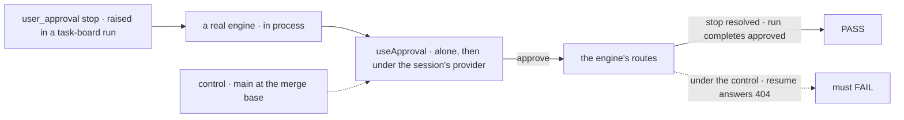
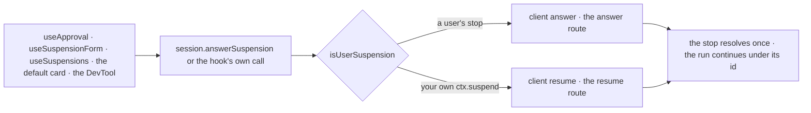

# FIX-2450 · One way to answer a user stop: React hooks use `answer`, and `resumedBy` is removed

**Spec** · [Decisions](DECISIONS.md)

## Five people, before and after

| Someone who… | Today | After |
|---|---|---|
| **builds an approval inbox over a task board** | Approve fails with a 404: every React hook calls `resume`, which refuses a task's (or a webhook's) run | The stop is answered; the run carries on, streamed into the view |
| **reads the React and client docs together** | Two verbs, one body, and a paragraph on which to pick | One verb: `answer`, and `answerSuspension` in React |
| **answers their own custom-reason `ctx.suspend` from the default card** | Works, through `resume` | Works, unchanged |
| **still passes `resumedBy`** | Compiles; ignored since 0.3.0 | A type error; still ignored on the wire |
| **approves from the DevTool's suspension panel** | Refused for a task's run | Answered |

Shift Manager and the Inbox client already use `answer`. React, where an adopter's first approval
screen comes from, lags.

## The goal, and how we'll know it's met

**A person who answers a stop from a React screen gets it answered, whatever started the run,
and an adopter sees one verb for answering a user's stop, in React and in the client.**

| Is it the right goal? | |
|---|---|
| **The real need** | The epic's *one path* row: React and the client answer a stop through one call ([epic](../../epics/FIX-2447/DECISIONS.md#decided-not-asked)) |
| **Smaller, and rejected** | "`useApproval` calls `answer`." Forms, the streaming session call and the DevTool would still 404 |
| **Bigger, and not this issue's** | One route for every stop; the routes stay ([FIX-2129 D2](../FIX-2129/DECISIONS.md#d2)). Output reads are FIX-2455's half of the row |
| **Not done if** | the test's run is one the user started · the client is mocked · only the non-streaming path is covered · a custom stop answered from the card breaks · `resumedBy` still type-checks anywhere |



The check reads what the engine recorded, not the URL the hook posted to. Under today's `main` the
same click reaches `resume` and is refused.

| How we verify | |
|---|---|
| **Goal check** | `goals/suspension/is-answered-from-react-in-a-task-run/` · model-free · the implementer, at completion · verdict in the implementation PR. On tarballs it is FIX-2564's leg c assertion *`useApproval` answers a `source: "task"` stop*, which this PR flips to `expect: pass` |
| **Signal** | The stop reads `approved` and the run completes approved: `useApproval` alone, and under the provider with `session.answerSuspension` (items show the continuation) · a `useSuspensionForm` `submit` resolves the same way · a custom-reason stop approved from the card still completes |
| **Input** | `ctx.suspendForUser({ kind: "approval" })` in a task-board run. A raw `user_approval` stop, or a webhook's run, must pass too |
| **Anti-game** | A real engine handler, no mocked client. Assert on the stop's record and the request's status, not the path posted to |
| **Control that must fail** | Today's `main`, on *the stop reads `approved`* (the resume route's 404), shown before the PASS |

## What changes


The middle row fails today. The bottom row is what React must not break ([D1](DECISIONS.md#d1)).

**An approval screen, as an adopter writes it:**

```diff
  const session = useSession(sessionId, { flowKind: "support" });
- <SuspensionResolverProvider resolve={session.resumeSuspension}>
+ <SuspensionResolverProvider resolve={session.answerSuspension}>
    <ItemsRenderer items={session.items} />
  </SuspensionResolverProvider>
```

**And by hand, through the client:**

```diff
- await fsd.flow("support").request(item.requestId).resume({ suspensionId, action: "approve", resumedBy: userId });
+ await fsd.flow("support").request(item.requestId).answer({ suspensionId, action: "approve" });
+ // live output: answer(body, { stream: true }) returns the SSE Response, as resume and continue do
```

**Docs:** update the React and client READMEs (the which-verb paragraph becomes one rule: a
user's stop is `answer`, your own `ctx.suspend` is `resume`), `api/react.md`, `client/react.md`,
`api/client.md` and the human-in-the-loop guide; drop `resumedBy` there and in
`advanced/durable-execution.md`. No new page.

## How an answer reaches the stop



Every React caller passes one pick, on the predicate `contracts` already owns. The routes are unchanged.

## What stays as it is

- Both routes and their checks ([FIX-2129 D2](../FIX-2129/DECISIONS.md#d2)); the client's `resume`.
- Who answered: server-set, and still on the suspension record and its `suspension_resume` item.
- `useSuspensions`' `resolve`, `approve`, `reject`, and the provider's `resolve` prop.
- A custom-reason stop in a task's run: no route answers it, today or after.

## What's already here, and the debt

| Already here | What this does with it |
|---|---|
| Ways to answer a user's stop (`suspension`, `inbox`): client `answer`, used by the Inbox client and Shift Manager; client `resume`, used by `useApproval`, `useSuspensionForm`, `session.resumeSuspension` and the DevTool. Searched `.resume(`, `.answer(`, `/answer`, `/resume`, `resumeSuspension` in `packages/`, `apps/` | **Replaces** the `resume` users with `answer`. Not a new way: it removes the second |
| `isUserSuspension` (`contracts`) | **Builds on.** React's pick reads it |
| The client's `StreamOption` on `resume` and `continue`; the answer route's SSE branch | **Extends.** `answer` takes the same option |
| [FIX-2129 D2](../FIX-2129/DECISIONS.md#d2): every screen answers a person's stop through the answer route | **Kept**, and completed for React and the DevTool |
| FIX-2195 (client 0.3.0 changelog): a body `resumedBy` is ignored | **Kept** on the wire; finished on the types |
| FIX-811: the continuation streams from the POST, under the same id | **Kept**, through `answer`'s stream option |
| Epic [D3](../../epics/FIX-2447/DECISIONS.md#d3), ER-3 | **Applied**; no refusal, as `resumedBy` changes no behaviour ([decided](DECISIONS.md#decided-not-asked)) |

| Adds | Existing piece considered | Why it doesn't fit / how composed |
|---|---|---|
| `answer(body, { stream: true })` | `client` · `StreamOption` on `resume`, `continue` | The same option on an existing call |
| `session.answerSuspension` | `session.resumeSuspension` | A rename ([D2](DECISIONS.md#d2)) |
| One private pick in React | `suspension` · `isUserSuspension` | Composed from it and the two existing calls; no public name |

| The debt | |
|---|---|
| **Removes** | React's and the DevTool's `resume` calls for a user's stop · `resumedBy` on five argument types and its plumbing · the which-verb paragraph |
| **Adds** | The stream option on `answer`, permanent by design. The old name `resumeSuspension`, for as long as [Q1](../../epics/FIX-2447/DECISIONS.md#q1)'s answer keeps moved names |
| **Leaves** | The resume route still answers a user's stop in a user's run; the epic keeps the routes, and nothing we ship calls it for one |

**Net: down.** One verb per job, five types lose a dead field; the addition is an option.

## Sign off

**[The goal](#the-goal-and-how-well-know-its-met), at that size:** every React caller, streaming or
not, answers a user's stop in any run, against a real engine. If wrong: an inbox over a task
board still 404s on an untested path.

**[The debt](#whats-already-here-and-the-debt), net down:** the second verb goes from React and the
DevTool; `answer` gains a stream option. If wrong: a dead field and a second verb ship again.

1. **[D1](DECISIONS.md#d1) · React picks the verb from the stop: a user's stop through `answer`, a
   developer's own `ctx.suspend` through `resume`.** If wrong: React keeps a second verb that
   only custom stops use.
2. **[D2](DECISIONS.md#d2) · React's session call is renamed `answerSuspension`, meeting adopters
   as Q1 decides.** If wrong: one more moved name and five docs pages, for a name nobody misread.

**Open: none.** D1 is the one to weigh. The moved names follow ER-3 and Q1's answer.

Improvement · `react` + `client` + `devtool` · small: 3 packages, 2 public names changed, 1 option added · epic FIX-2447
