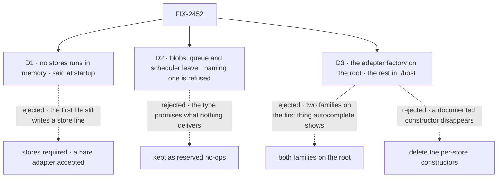

# FIX-2452 · Decisions

[Spec](SPEC.md) · **Decisions**

What was considered, what was chosen, and what each choice locks in. D1 to D3 are the sign-off
surface. Moves off a root follow ER-3 and Q1's answer; retired keys follow the epic's D3.

## The tree

Solid edges are what you're signing. Dashed edges lost, and the label says why.

## D1 · An app that names no store runs in memory and says so at startup; production warns

| | |
|---|---|
| **Instead of** | Keeping `stores` required and accepting a bare adapter, so the first file writes `stores: inMemoryStores()` |
| **Because** | The first file's job is a working chat, and a store the adopter didn't choose is ceremony. `createFlowApiRouter` and `testFlow` already default an omitted store to memory, silently, and LangGraph's checkpointer is optional the same way. The risk sits in production, so that is where the warning goes |
| **Locks in** | An app with no store config persists nothing, in every environment. Moving that default to a durable store later changes behaviour for every app that relied on it. The dev line extends today's `active profile` line; production gets a `console.warn` once per process naming `stores` as the fix, through a sibling of `warnOnceDev` in `core/src/helpers/deprecation.ts` that doesn't skip production |

It comes down to the first file: a required option keeps one line and an import in it.

**What would change my mind:** deploys shipping in memory despite the warning. Then omission
refuses when `NODE_ENV` is `production`, a one-line fix at boot.

## D2 · `blobs`, `queue` and `scheduler` leave the profile; naming one is refused

| | |
|---|---|
| **Instead of** | Keeping them as reserved slots that construct and do nothing |
| **Because** | Each is a promise nothing keeps. Queues come from a worker adapter and schedules from the schedule index, and three docs pages explain the gap. Old code that names one gets the epic's D3: a loud refusal naming the replacement and a removal version, through FIX-2454's `refuseRetired` |
| **Locks in** | A slot arrives with the store that backs it, never as a placeholder in the type. Kitchen Sink's `scheduler: pgStores` is the one repo caller, and goes with this change. `CapabilitySlot` is the map's keys, so Vercel's adapter drops `scheduler` from its `capabilities` and its test changes. At runtime an unknown name in an adapter's list, from an older adapter, is ignored, not refused |

It comes down to what a reader learns: reserved slots teach three things that don't exist.

## D3 · A store package's root carries its adapter factory and schedule index; the rest moves to `./host`, nothing deleted

| | |
|---|---|
| **Instead of** | Both families on the root, as today; or deleting the 21 per-store constructors no outside package imports |
| **Because** | The root is what autocomplete shows, and the docs teach one factory. The registry factories have real callers (the CLI, Vercel's adapter, a migration script, 14 goals), and the per-store constructors are documented in each README. Moving keeps every capability one import away. The entry is `./host` because its reader is `engine/host`'s: engine moves its own registry factory and per-store constructors there, and the store packages' callers are hosts and adapters. An adopter meeting both sees one rule |
| **Locks in** | `@flow-state-dev/store-sqlite/host` and `@flow-state-dev/store-postgres/host` are public, documented and semver-covered. Root names that move reach adopters per Q1's answer. Engine's registry factories and per-store constructors move under FIX-2449's `engine/host` |

It comes down to autocomplete: today's root shows two families before the one we teach.

**What would change my mind:** `./host`'s per-store constructors still unused a minor after
the move. Then delete them in the minor that removes Q1's aliases, if Q1 takes that option.

## Decided, not asked

- **From the epic, cited, not restated:** [ER-3](../../epics/FIX-2447/DECISIONS.md#who-owns-what), [ER-5](../../epics/FIX-2447/DECISIONS.md#who-owns-what), [ER-7](../../epics/FIX-2447/DECISIONS.md#who-owns-what) · **cells owned** in [FIX-2564's grid](../FIX-2564/SPEC.md#what-changes): `surface.root.store-sqlite`, `surface.root.store-postgres`; contributes to `surface.root.engine` and `surface.collisions`.
- **One normalisation point for `stores`.** The `createFlowState` constructor turns a bare
  adapter or nothing into `{ default: { primary } }` before anything reads it, replacing the raw options it keeps. Every reader goes
  through it: profile keys, the `defaultProfile` and `FSD_ENV` checks, `collectAdapters`,
  `meta.declaredSlots`, runtime resolution. The retired-slot refusal runs there too. An object
  with a `resolve` function and a `capabilities` array is an adapter; a slot map never has one.
- **Order and owners.** The engine half of D3 (its registry factories and per-store constructors to
  `engine/host`) is this issue's, per the epic's seam, and lands after FIX-2449 creates that subpath
  and its explicit root list; until then it waits as its own PR. The slot refusals call FIX-2454's
  `refuseRetired`, which carries the removal version, so their PR is blocked by FIX-2454; the rest
  of the change does not wait. Kitchen Sink's `fsdev.config.ts` edit (dropping `scheduler: pgStores`)
  is this issue's, on the epic's Kitchen Sink seam, and FIX-2461 lands after it. It edits the two
  stores' rows on FIX-2448's root page.
- **The bare form is exactly the one-profile map.** `FSD_ENV` naming another profile still
  refuses, and a primary that declares `bus` backs the bus.
- **The generator warning.** At flow-instance build, for each caller action (`actions`, not
  internal, task, webhook or schedule) whose block is a generator with no `itemVisibility`.
  Through `warnOnceDev`, keyed by flow kind and action, so dev only, once, and silenced by
  `FSD_QUIET_WARNINGS`. It names both fixes: `{ client: true, history: true }` to show in
  chat, or `{ client: false, history: false }` to stay headless on purpose, which then emits
  trace items for the DevTool. A warning, not a throw: a headless generator action is legitimate,
  and FIX-2455 reads its output by request id.
- **The empty `session` blocks go from the getting-started pages.** `session` is optional
  (`core/src/types/flow.ts`). The quick start's lands with its store-line edit, after FIX-2451.
- **Teaching files move to the shorthand; tests don't have to.** Docs, READMEs, guides and
  examples drop the store line or use the bare form. The 74 tests may keep the profile form.
- **`docs/mechanisms/mechanisms.yaml`'s `store` row anchors `createInMemoryStores`**, which
  leaves engine's root; the implementation re-anchors it on `inMemoryStores`.
- **Changesets:** engine, core, store-sqlite, store-postgres and vercel.

## Considered and dropped

| Alternative | Why not |
|---|---|
| Default to SQLite, as the CLI's no-config run does | Engine can't depend on a store package, and a serverless function can't keep a file |
| Refuse omitted `stores` in production | A boot failure on the first deploy for a demo that only needs memory. Held as D1's flip |
| Accept a bare slot map, `stores: { primary, bus }` | A third shape for a rare case; a profile name and a slot name could collide |
| Make `scheduler` back the schedule index | R-11, outside the epic. A real slot can come back with its store |
| Warn on any action whose graph has no emitting generator | A handler can emit, so silence can't be proved; false warnings teach adopters to ignore it |
| Name the stores' entry `./advanced` | `engine/host` holds the same kind of names for the same reader; two names would make an adopter learn two rules |
| Default `itemVisibility` for an action's generator | A position-inferred default, which `generator-identity.md` rules out |

## Settled

- **The census behind *What changes*, D3 and the people table** — **CONFIRMED** by
  [`poc/census/check.mjs`](poc/census/check.mjs) ([output](poc/census/output.txt)). It reads each
  root through `scripts/mechanism-exports.mjs`'s `packageExports` and classifies every export:
  store-sqlite 20 → 3 root and 17 `./host`, store-postgres 22 → 4 and 18, engine 26 store
  names → 6 root and 20 to `engine/host`. Per-store constructors imported outside their package:
  0 of 10 and 0 of 11. The stores line: 128 files, 74 tests. Totality: an export in neither list
  fails. Negative control: `--plant` adds an unclassified root export and the check FAILs; a first
  draft let it through, and the lists were made explicit.
- **A profile slot that backs nothing constructs silently today** — **CONFIRMED** by
  `engine/test/flowstate/resolve-slots.test.ts`, *treats blobs as forward-compatible*.

## Analysis

Not run here. In spec-set member mode `epic-agent` runs `analysis` and `reuse-review` over the
whole set.

## How it got here

- **Draft** — framed as defaults that leak into the first file; the `stores` entry widened and
  normalised at one point, the three no-op slots refused, each store root down to its adapter
  factory, and a dev warning on `warnOnceDev`.
- **Validation** — the goal's check tightened (persistence read from the app's file, negatives on
  every signal, a docs signal); Vercel's `scheduler` capability, the engine move's order behind
  FIX-2449, the FIX-2454 dependency and the two silent in-memory precedents written in.
- **Set review (Nov 5)** — the stores' entry renamed `./advanced` to `./host`, one rule with
  `engine/host`; D1's production warning listed as an Adds item, a `warnOnceDev` sibling; the slot
  refusals named as `refuseRetired` calls, blocked by FIX-2454; the stores' *Surface* cells, their
  root-page rows and the Kitchen Sink seam made this issue's.

**Open: none.**
