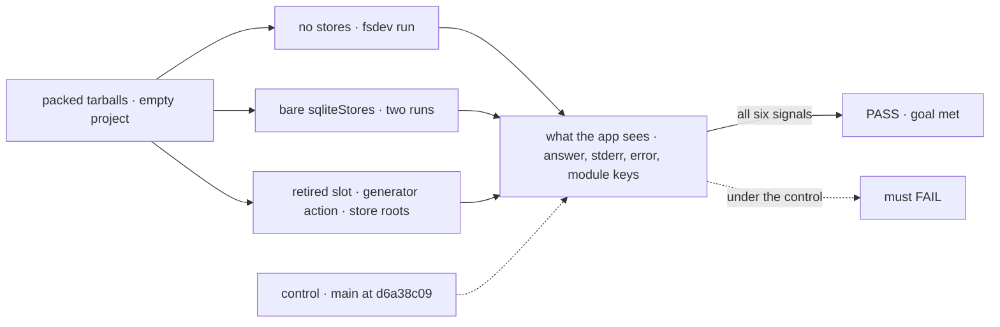
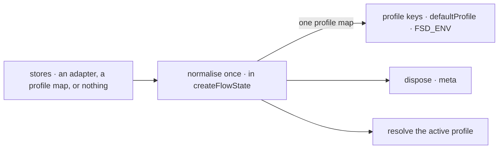

# FIX-2452 · Cut hello-world ceremony in the API: stores shorthand, no no-op slots, no silent generator, one store factory family

**Spec** · [Decisions](DECISIONS.md)

## Six people, before and after

| Someone who… | Today | After |
|---|---|---|
| **writes their first runtime file** | Writes `stores: { default: { primary: inMemoryStores() } }` and its import, for a store that keeps nothing | Writes no store line. Startup says the app runs in memory |
| **adds persistence** | Wraps one adapter in a profile and a slot | Writes `stores: sqliteStores({ filename })`. Named profiles stay, for an app that picks a store per environment |
| **names `scheduler` or `queue` in a profile** | Accepted, and nothing happens. Three docs pages explain the no-op | Fails to compile: the slot is gone from the type, and the changeset names where the job lives. No runtime refusal ([epic D4](../../epics/FIX-2447/DECISIONS.md#d4)). `blobs` stays reserved: FIX-824's attachments back it ([D2](DECISIONS.md#d2)) |
| **mounts a generator as a chat action and forgets `itemVisibility`** | The chat renders empty, with no error | One dev warning when the flow is built, naming the action and both fixes |
| **autocompletes a store package** | 20 names in store-sqlite, 22 in store-postgres: two factory families and 10 or 11 per-store constructors | The adapter factory and the schedule index. The rest is under `./host` |
| **copies the quick start's flow** | Copies an empty `session: { stateSchema: z.object({}) }` that nothing needs | No `session` block |

The ceremony comes from engine and core defaults, so the docs can't remove it alone. The
census ([`poc/census/`](poc/census/check.mjs)) counts the stores line in 54 docs, READMEs,
examples and fixtures, and 74 tests.

## The goal, and how we'll know it's met

**An adopter's first runtime file names no store until they want data kept, their first flow
declares no empty `session`, every store slot they can name does something or has its store on the way, a chat action that
would render empty says so when the flow is built, and a store package's root offers one
factory.**

| Is it the right goal? | |
|---|---|
| **The real need** | The epic's *first hour*: the quick start is the adopter's first judgement, and today it shows defaults, not their app ([epic](../../epics/FIX-2447/SPEC.md#the-goal-and-how-well-know-its-met)) |
| **Smaller, and rejected** | "`stores` accepts a bare adapter." The first file still writes a store line and an import, two slots still promise nothing, and the empty chat stays silent |
| **Bigger, and not this issue's** | A real scheduler store (review item R-11, outside the epic) and a durable default store. Engine's own store names move here too, but only once FIX-2449's `engine/host` exists ([decided](DECISIONS.md#decided-not-asked)) |
| **Not done if** | The quick start still writes a store line, or a getting-started page still declares an empty `session` · the in-memory notice fires when `stores` is set, or never fires · a profile with `scheduler` or `queue` constructs, or one with `primary`, `bus` or `blobs` stops constructing · a silent generator chat action builds with no warning in dev, or the warning doesn't name both fixes · the warning fires when `itemVisibility` is set, on an internal, task, webhook or schedule action, or in production · a store package's root lists a per-store constructor or `createXStores`, or a moved name doesn't resolve from `./host` · a docs page still lists `queue` or `scheduler` as a slot |



The check reads what an installed app sees: the answer, stderr, the thrown error and the
module's keys. Under the control, every signal fails.

| How we verify | |
|---|---|
| **Goal check** | `goals/first-hour/runs-without-store-ceremony/` · model-free · `node goals/first-hour/runs-without-store-ceremony/check.mjs [--control d6a38c09]`, printing PASS or FAIL per signal · packs engine, core, cli and the two store packages (at the control commit under `--control`) with `scripts/packed-install/run.mjs`'s pack step and installs them into an empty project · run by the implementer at completion · verdict in the implementation PR |
| **Signal** | (a) A runtime with no `stores` and a flow with no `session` block answers a handler action through `fsdev run`, and stderr says it runs in memory; with `stores` set, stderr says nothing about memory. (b) With `stores: sqliteStores({ filename })`, `fsdev run --session <id>` twice: the second reads the first run's state, and the session row is in `filename`; pointed at a fresh `filename`, the second run does not see it. (c) Each of `queue` and `scheduler` in a typed profile fails to typecheck, naming the slot: 2 of 2; a profile with `primary`, `bus` and `blobs` constructs. (d) A caller action on a generator with no `itemVisibility` gives exactly one warning naming the flow, the action and both fixes. Set `itemVisibility`, put it on an internal, task, webhook or schedule action, or set `NODE_ENV=production`: none. (e) The installed roots export only `sqliteStores` and `createSQLiteScheduleIndex`, or `postgresStores` and `createPostgresScheduleIndex`, as runtime values, and every runtime name removed from a root is exported from its `./host`. Importing the store-postgres module needs no database. (f) The census reports 0 store lines and 0 empty `session` blocks in teaching files, and 0 docs pages naming a retired slot (`queue` or `scheduler`; `blobs` is not retired and is not counted) |
| **Input** | A flow whose handler computes a value from the input. A different flow kind, action name or value must pass too; the warning names whatever it is on |
| **Anti-game** | Don't assert on the normalising helper, `meta.profileKeys` or workspace `src`, and don't let (b) pass through the CLI's own no-config SQLite store: the app has a config, and the row is read from `filename`. Assert on the answer, the stored row, stderr text, the error and the installed module's keys |
| **Control that must fail** | `main` at `d6a38c09`: (a) throws a `TypeError` at construction, (b) throws, since a bare adapter has no profile, (c) constructs, (d) warns nothing, (e) lists 20 and 22 names, (f) counts 54 store lines. The PR shows those FAILs before the PASS |

**Closure manifest.** This spec owns no whole *Not done if* row. In *Surface* it owns the
store-sqlite and store-postgres cells, and flips them to `expect: pass`. It contributes engine's
store names to engine's cell, which FIX-2449 owns: whichever of the two lands last flips that
cell, naming both. *First hour* is FIX-2451's. The quick-start edit here must keep its leg
passing.

## What changes


Each row is one thing an adopter types or reads, today on the left and after on the right. The
middle row's two red slots go and `blobs` stays reserved: [D2](DECISIONS.md#d2).

**The first runtime file:**

```diff
- import { createFlowState, inMemoryStores } from "@flow-state-dev/engine";
+ import { createFlowState } from "@flow-state-dev/engine";
  export const flowstate = createFlowState({
    flows: { chatFlow },
    models: { default: "openai/gpt-6-luna" },
-   stores: { default: { primary: inMemoryStores() } },
  });
```

**Persistence, and the per-environment form that stays:**

```diff
- stores: { default: { primary: sqliteStores({ filename: "./data/flowstate.db" }) } },
+ stores: sqliteStores({ filename: "./data/flowstate.db" }),

  stores: { prod: { primary: pgStores }, dev: { primary: localSqliteStores() } },  // unchanged
- stores: { prod: { primary: pgStores, scheduler: pgStores }, … },  // now a type error
```

**A store package's other half:**

```diff
- import { createSQLiteStores } from "@flow-state-dev/store-sqlite";
+ import { createSQLiteStores } from "@flow-state-dev/store-sqlite/host";
```

**Docs:** update the getting-started pages (the store line and the empty `session` blocks;
the quick start's snippet after FIX-2451 lands), `server/setup.md`,
`configuration/runtime.md`, `persistence/overview.md` and `api/server.md` (the bare form
first, `queue` and `scheduler` gone, `blobs` kept as reserved), `configuration/blocks.md` (the warning, beside its `itemVisibility` table), `server/schedule-index.md`
and `streaming/trace-channel.md` (the `./host` paths), and every guide that writes the store
line. Update the engine, store-sqlite, store-postgres, vercel and cli READMEs: the bare
form, and a *For host and adapter authors* section on `./host`. Edit the store-sqlite and
store-postgres rows of FIX-2448's *what each package root is for* page (FIX-2448 creates every
root's row): the root for app authors, `./host` for host and adapter authors, the rule
`engine/host` follows. No new page.

**Kitchen Sink:** drop `scheduler: pgStores` from `apps/kitchen-sink/fsdev.config.ts`'s `prod`
profile, the one repo caller of a retired slot. It is on the epic's Kitchen Sink seam;
FIX-2461 lands after it.

## How `stores` reaches the runtime



Every reader of `stores` reads the one normalised map, so the bare and omitted forms behave
exactly like `{ default: { primary } }`. The convergence point is in [decided, not
asked](DECISIONS.md#decided-not-asked).

## What stays as it is

- Named profiles, `defaultProfile`, `FSD_ENV`, and the `primary` and `bus` slots, unchanged.
- `StoreAdapter`, and the five adapters. Vercel's adapter keeps its `scheduleIndex` and drops
  `scheduler` from its `capabilities` ([D2](DECISIONS.md#d2)).
- Durability's default: on wherever the stores persist (FIX-2063 D2), so off in memory.
- Generator emission: no position-inferred `itemVisibility` default. The warning names the
  choice; it doesn't make it.
- The 74 tests that spell the profile form. It stays valid.

## What's already here, and the debt

| Already here | What this does with it |
|---|---|
| `store` · the `stores` profile map on `createFlowState` | **Extends**: one entry with two more accepted shapes. Searched `stores:`, `StoresConfig`, `profile` across `packages/`: no other entry configures `createFlowState`'s store. Two lower entries already default omitted stores to memory, silently: `createFlowApiRouter`'s `stores` (`http-handlers.ts`) and `testFlow`'s. D1 follows them and adds the notice. The CLI's no-config SQLite store (`cli/src/local-store.ts`) serves runs with no app config, and stays |
| `CapabilitySlotMap`, `FORWARD_COMPATIBLE_SLOTS` in `resolve-slots.ts` | **Removes** `queue` and `scheduler`. `blobs` and the skip branch stay until FIX-824 backs it |
| `refuseRetiredDispatcherOption` in `createFlowState` | **Leaves to FIX-2454**, which deletes it under [epic D4](../../epics/FIX-2447/DECISIONS.md#d4). The slot removal adds no refusal of its own (amended Nov 6; it once built on FIX-2454's `refuseRetired`) |
| `warnOnceDev` (`core/src/helpers/deprecation.ts`); defineFlow's definition-time checks | **Builds on** `warnOnceDev` for the generator warning. One more definition-time check, after `mergeActions` so instance-override actions are covered. `warnOnceDev` returns early in production by design, so D1's production warning can't use it |
| `xStores` beside `createXStores` in engine, store-sqlite and store-postgres | **Moves** the registry factory and the per-store constructors off each root ([D3](DECISIONS.md#d3)) |
| `docs/architecture/generator-identity.md` → *No position-inferred defaults* | **Kept.** The warning respects it |
| [FIX-2426 SPEC](../FIX-2426/SPEC.md) and [FIX-2367 D5](../../epics/FIX-2367/DECISIONS.md#d5): the `bus` slot | **Kept**; the bare form's primary backs the bus when it declares it |
| [FIX-2063 D2](../FIX-2063/DECISIONS.md#d2): durable by default where stores persist | **Kept** |

| Adds | Existing piece considered | Why it doesn't fit / how composed |
|---|---|---|
| A bare adapter, or nothing, for `stores` | `store` · the profile map | Composed: sugar normalised into a one-profile map at one point; no second resolution path |
| `./host` on store-sqlite and store-postgres | Each package's `exports` map; FIX-2449's `engine/host` | Extends the maps; one entry per package. Named as `engine/host` is, for the same reader: a name a host or adapter author needs and an app author doesn't lives on `<package>/host` ([D3](DECISIONS.md#d3)). No new engine entry |
| D1's startup notice | The `active profile` stderr line in `createFlowState` | Extends the line: with no `stores`, it says the app runs in memory. No new mechanism |
| D1's production warning: once per process, in every environment | `warnOnceDev`, which skips production | **Extends** `deprecation.ts` with a sibling that differs only in not skipping production (same keys, same `FSD_QUIET_WARNINGS` opt-out), exported beside `warnOnceDev` |
| A definition-time warning | `warnOnceDev`; defineFlow's checks | Composed from both |

| The debt | |
|---|---|
| **Removes** | Two no-op slots and the docs paragraphs about them; the store line from 54 teaching files; a second factory family on three roots; the empty `session` blocks |
| **Adds** | Two more accepted shapes for `stores`, a second way to say one thing: permanent by design, normalised at one point. Two `./host` entries to keep. One dev warning, one production warning and its helper |
| **Leaves** | `blobs` as a reserved no-op until FIX-824 backs it. A sequencer action whose generators are all silent isn't warned: a handler can emit, so silence can't be proved statically. A real scheduler store (R-11, unfiled, the epic's *bigger* row) |

**Net: down.** Two slots, a family on three roots and the line in 54 files go; two input
shapes, two subpaths and one warning helper come in.

## Sign off

**[The goal](#the-goal-and-how-well-know-its-met), at that size:** no store line until data
should be kept, no slot that does nothing, no silent chat, one factory per root. If wrong: the
first file still shows our defaults, or we hold the issue for a scheduler store it was never
meant to build.

**[The debt](#whats-already-here-and-the-debt), net down:** slots, a factory family and the
ceremony go, for two input shapes and two subpaths. If wrong: three spellings of `stores` that
drift apart.

1. **[D1](DECISIONS.md#d1) · An app that names no store runs in memory, and says so at startup;
   production warns.** If wrong: a deploy that forgot its store loses data on restart, with only
   a log line.
2. **[D2](DECISIONS.md#d2) · `queue` and `scheduler` leave the profile; naming one fails to
   compile (amended Nov 6: no runtime refusal). `blobs` stays reserved for FIX-824.** If wrong: Kitchen Sink's kind of `scheduler`
   line breaks an upgrade for a slot that did nothing.
3. **[D3](DECISIONS.md#d3) · A store package's root carries its adapter factory and schedule
   index; the rest moves to `./host`, nothing deleted.** If wrong: 21 unused constructors
   stay published, semver-covered.

**Open: none.** D1 is the one to weigh. Each move off a root reaches adopters with no alias
(ER-3; Q1 answered break).

Improvement · `engine`, `core`, `store-sqlite`, `store-postgres`, `vercel` · medium: one option
widened, two slots and two families off three roots, one warning · epic FIX-2447
