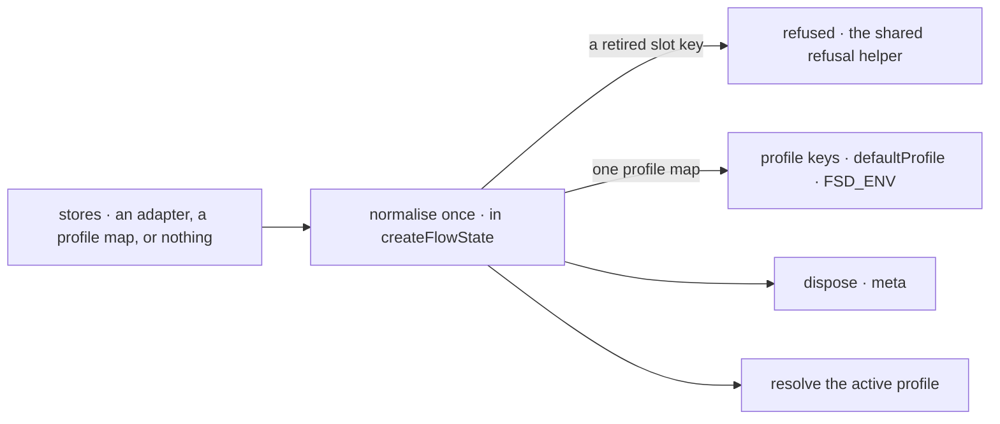

# FIX-2452 · Cut hello-world ceremony in the API: stores shorthand, no no-op slots, no silent generator, one store factory family

**Spec** · [Decisions](DECISIONS.md)

## Six people, before and after

| Someone who… | Today | After |
|---|---|---|
| **writes their first runtime file** | Writes `stores: { default: { primary: inMemoryStores() } }` and its import, for a store that keeps nothing | Writes no store line. Startup says the app runs in memory |
| **adds persistence** | Wraps one adapter in a profile and a slot | Writes `stores: sqliteStores({ filename })`. Named profiles stay, for an app that picks a store per environment |
| **names `scheduler`, `blobs` or `queue` in a profile** | Accepted, and nothing happens. Three docs pages explain the no-op | Refused at construction. The error names where the job lives and the version the refusal goes in |
| **mounts a generator as a chat action and forgets `itemVisibility`** | The chat renders empty, with no error | One dev warning when the flow is built, naming the action and both fixes |
| **autocompletes a store package** | 20 names in store-sqlite, 22 in store-postgres: two factory families and 10 or 11 per-store constructors | The adapter factory and the schedule index. The rest is under `./advanced` |
| **copies the quick start's flow** | Copies an empty `session: { stateSchema: z.object({}) }` that nothing needs | No `session` block |

The ceremony comes from engine and core defaults, so the docs can't remove it alone. The
census ([`poc/census/`](poc/census/check.mjs)) counts the stores line in 54 docs, READMEs,
examples and fixtures, and 74 tests.

## The goal, and how we'll know it's met

**An adopter's first runtime file names no store until they want data kept, every store slot
they can name does something, a chat action that would render empty says so when the flow is
built, and a store package's root offers one factory.**

| Is it the right goal? | |
|---|---|
| **The real need** | The epic's *first hour*: the quick start is the adopter's first judgement, and today it shows defaults, not their app ([epic](../../epics/FIX-2447/SPEC.md#the-goal-and-how-well-know-its-met)) |
| **Smaller, and rejected** | "`stores` accepts a bare adapter." The first file still writes a store line and an import, three slots still promise nothing, and the empty chat stays silent |
| **Bigger, and not this issue's** | A real scheduler store (review item R-11, outside the epic) and a durable default store |
| **Not done if** | The quick start still writes a store line · a profile with `scheduler`, `blobs` or `queue` constructs · a silent generator chat action builds with no warning in dev · the warning fires when `itemVisibility` is set, or on an internal, task, webhook or schedule action · a store package's root lists a per-store constructor or `createXStores` · a docs page still calls a slot forward-compatible |


The check reads what an installed app sees: the answer, stderr, the thrown error and the
module's keys. Under the control, four of the five signals fail.

| How we verify | |
|---|---|
| **Goal check** | `goals/first-hour/runs-without-store-ceremony/` · model-free · packs and installs engine, core, cli and the two store packages into an empty project with `scripts/packed-install/run.mjs`'s pack step · run by the implementer at completion · verdict in the implementation PR |
| **Signal** | (a) A runtime with no `stores` answers a handler action through `fsdev run`, and stderr says it runs in memory. (b) With `stores: sqliteStores({ filename })`, a second `fsdev run` on the same session reads the first run's state. (c) Each of `blobs`, `queue` and `scheduler` in a profile makes `createFlowState` throw, naming the replacement and a version: 3 of 3. (d) A caller action on a generator with no `itemVisibility` gives exactly one warning naming the flow and the action. With `itemVisibility` set, or as an internal action, it gives none. (e) The installed roots export only `sqliteStores` and `createSQLiteScheduleIndex`, or `postgresStores` and `createPostgresScheduleIndex`, as runtime values, and each `./advanced` resolves |
| **Input** | A flow whose handler computes a value from the input. A different flow kind, action name or value must pass too; the warning names whatever it is on |
| **Anti-game** | Don't assert on the normalising helper, `meta.profileKeys` or workspace `src`. Assert on the answer, the stored session, stderr text, the error and the installed module's keys |
| **Control that must fail** | `main` at `d6a38c09`: (a) throws a `TypeError` at construction, (c) constructs, (d) warns nothing, (e) lists 20 and 22 names. The PR shows those four FAILs before the PASS. (b) is new behaviour and fails there too |

**Closure manifest.** This spec owns no whole *Not done if* row. It owns the store packages'
slice of *Surface*: where FIX-2564's manifest carries assertions for the store-sqlite and
store-postgres roots or engine's store names, this PR flips them to `expect: pass`. *First
hour* is FIX-2451's. The quick-start edit here must keep its leg passing.

## What changes


Each row is one thing an adopter types or reads, today on the left and after on the right. The
middle row's three dashed slots are [D2](DECISIONS.md#d2).

**The first runtime file:**

```diff
- import { createFlowState, inMemoryStores } from "@flow-state-dev/engine";
+ import { createFlowState } from "@flow-state-dev/engine";
  export const flowstate = createFlowState({
    flows: { chatFlow },
    models: { default: "openai/gpt-6-luna" },
-   stores: { default: { primary: inMemoryStores() } },
  });
```

**Persistence, and the per-environment form that stays:**

```diff
- stores: { default: { primary: sqliteStores({ filename: "./data/flowstate.db" }) } },
+ stores: sqliteStores({ filename: "./data/flowstate.db" }),

  stores: { prod: { primary: pgStores }, dev: { primary: localSqliteStores() } },  // unchanged
- stores: { prod: { primary: pgStores, scheduler: pgStores }, … },  // now refused
```

**A store package's other half:**

```diff
- import { createSQLiteStores } from "@flow-state-dev/store-sqlite";
+ import { createSQLiteStores } from "@flow-state-dev/store-sqlite/advanced";
```

**Docs:** update the getting-started pages (the store line and the empty `session` blocks;
the quick start's snippet after FIX-2451 lands), `server/setup.md`,
`configuration/runtime.md`, `persistence/overview.md` and `api/server.md` (the bare form
first, three slots gone), the block-options page (the warning), and every guide that writes the
store line. Update the engine, store-sqlite, store-postgres, vercel and cli READMEs: the bare
form, and an *Advanced* section on `./advanced`. Add the store packages' rows to FIX-2448's
*what each package root is for* page. No new page.

## How `stores` reaches the runtime



Every reader of `stores` reads the one normalised map, so the bare and omitted forms behave
exactly like `{ default: { primary } }`. The convergence point is in [decided, not
asked](DECISIONS.md#decided-not-asked).

## What stays as it is

- Named profiles, `defaultProfile`, `FSD_ENV`, and the `primary` and `bus` slots, unchanged.
- `StoreAdapter`, and the five adapters. Vercel's adapter keeps its `scheduleIndex`.
- Durability's default: on wherever the stores persist (FIX-2063 D2), so off in memory.
- Generator emission: no position-inferred `itemVisibility` default. The warning names the
  choice; it doesn't make it.
- The 74 tests that spell the profile form. It stays valid.

## What's already here, and the debt

| Already here | What this does with it |
|---|---|
| `store` · the `stores` profile map on `createFlowState` | **Extends**: one entry with two more accepted shapes. Searched `stores:`, `StoresConfig`, `profile` across `packages/`: no other entry configures the runtime's store. The CLI's no-config SQLite store (`cli/src/local-store.ts`) serves runs with no app config, and stays |
| `CapabilitySlotMap`, `FORWARD_COMPATIBLE_SLOTS` in `resolve-slots.ts` | **Removes** `blobs`, `queue`, `scheduler` and the skip branch |
| `refuseRetiredDispatcherOption` in `createFlowState`; FIX-2454's refusal helper | **Builds on** the helper for the slot refusals ([D3 of the epic](../../epics/FIX-2447/DECISIONS.md#d3)) |
| `warnOnceDev` (`core/src/helpers/deprecation.ts`); defineFlow's definition-time checks | **Builds on** `warnOnceDev` for the generator warning. The 2nd definition-time check on an action's block, after the description check |
| `xStores` beside `createXStores` in engine, store-sqlite and store-postgres | **Moves** the registry factory and the per-store constructors off each root ([D3](DECISIONS.md#d3)) |
| `docs/architecture/generator-identity.md` → *No position-inferred defaults* | **Kept.** The warning respects it |
| [FIX-2426 SPEC](../FIX-2426/SPEC.md) and [FIX-2367 D5](../../epics/FIX-2367/DECISIONS.md#d5): the `bus` slot | **Kept**; the bare form's primary backs the bus when it declares it |
| [FIX-2063 D2](../FIX-2063/DECISIONS.md#d2): durable by default where stores persist | **Kept** |

| Adds | Existing piece considered | Why it doesn't fit / how composed |
|---|---|---|
| A bare adapter, or nothing, for `stores` | `store` · the profile map | Composed: sugar normalised into a one-profile map at one point; no second resolution path |
| `./advanced` on store-sqlite and store-postgres | Each package's `exports` map; the epic's store `./advanced` | Extends the maps; one entry per package. Engine's store names go to FIX-2449's `engine/host`, no new engine entry |
| A definition-time warning | `warnOnceDev`; defineFlow's checks | Composed from both |

| The debt | |
|---|---|
| **Removes** | Three no-op slots, their skip branch, and the three docs paragraphs about them; the store line from 54 teaching files; a second factory family on three roots; the empty `session` blocks |
| **Adds** | Two more accepted shapes for `stores`, a second way to say one thing: permanent by design, normalised at one point. Two `./advanced` entries to keep. Three refusals, until the version FIX-2454's expiry lint enforces. One dev warning |
| **Leaves** | A sequencer action whose generators are all silent isn't warned: a handler can emit, so silence can't be proved statically. A real scheduler store (R-11, unfiled, the epic's *bigger* row) |

**Net: down.** Three slots, a family on three roots and the line in 54 files go; two input
shapes and two subpaths come in.

## Sign off

**[The goal](#the-goal-and-how-well-know-its-met), at that size:** no store line until data
should be kept, no slot that does nothing, no silent chat, one factory per root. If wrong: the
first file still shows our defaults, or we hold the issue for a scheduler store it was never
meant to build.

**[The debt](#whats-already-here-and-the-debt), net down:** slots, a factory family and the
ceremony go, for two input shapes and two subpaths. If wrong: three spellings of `stores` that
drift apart.

1. **[D1](DECISIONS.md#d1) · An app that names no store runs in memory, and says so at startup;
   production warns.** If wrong: a deploy that forgot its store loses data on restart, with only
   a log line.
2. **[D2](DECISIONS.md#d2) · `blobs`, `queue` and `scheduler` leave the profile; naming one is
   refused.** If wrong: Kitchen Sink's kind of `scheduler` line breaks an upgrade for a slot that
   did nothing.
3. **[D3](DECISIONS.md#d3) · A store package's root carries its adapter factory and schedule
   index; the rest moves to `./advanced`, nothing deleted.** If wrong: 21 unused constructors
   stay published, semver-covered.

**Open: none.** D1 is the one to weigh. Each move off a root reaches adopters per ER-3 and
Q1's answer.

Improvement · `engine`, `core`, `store-sqlite`, `store-postgres`, `vercel` · medium: one option
widened, three slots and two families off three roots, one warning · epic FIX-2447
