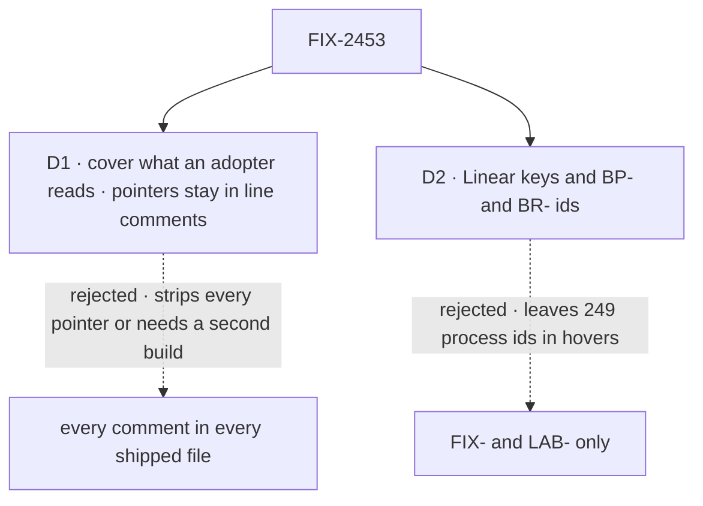

# FIX-2453 · Decisions

[Spec](SPEC.md) · **Decisions**

What was considered, what was chosen, and what each choice locks in. D1 and D2 are the sign-off;
everything else here is context for them, or the implementer's.

## The tree

Solid edges are what you're signing. Dashed edges lost, and the label says why.

## D1 · The rule covers what an adopter reads: hovers, runtime text, and files they copy whole

| | |
|---|---|
| **Instead of** | ER-5 read literally: no id in any byte that ships, `//` comments in compiled `.js` included |
| **Because** | tsc copies JSDoc, and only JSDoc, into a `.d.ts` ([settled](#settled)), so a JSDoc block is exactly a hover. A `//` pointer reaches only compiled `.js`. Clearing those means deleting about 1,060 BP-006 pointers in six packages, or a second build, since tsc's `removeComments` strips the hovers too. Copied files land in the adopter's repo, so every comment counts there |
| **Locks in** | A pointer's one home is a `//` or `/* */` comment, for every contributor and agent from the day the rule lands. ER-5 reads as *what an adopter reads*; the epic may want its wording to match |

It comes down to BP-006's pointers: the literal reading deletes 1,060 of them or adds a build.

**What would change my mind:** adopters reading compiled `.js` as documentation. Then strip
`.js` comments at build and keep the `.d.ts`.

## D2 · The pattern is our Linear keys and our process ids: `FIX`, `LAB`, `FLC`, `TL`, `BP`, `BR`

| | |
|---|---|
| **Instead of** | `FIX-` and `LAB-` only, the epic's *Leakage* row |
| **Because** | The epic's goal is *no internal process vocabulary*. *"Per BP-030"* in a hover points at a file an adopter can't open: 249 of 1,670 hover ids in six packages. `FLC` and `TL`, the workspace's other Linear keys, are at zero; listing them stops a first one |
| **Locks in** | One pattern that a new id family joins. A public example key, such as harness-manager's, is neutral (`ENG-142`). Bare decision ids (`D1`, `ER-8`) stay out: too short to match safely, and nearly always beside a `FIX-` id |

It comes down to a hover that reads *"per BP-030"*: FIX-and-LAB-only leaves 249 of them.

**What would change my mind:** a published best-practices page adopters are pointed at.

## Decided, not asked

- **One lexical rule over every JSDoc block in shipped source**, not the issue's "JSDoc
  attached to an export", which needs a walk over export lists, overloads and members. The
  cost is JSDoc on non-exported helpers, swept the same way.
- **It lands as a ratchet.** The first PR adds the rule and `eslint-suppressions.json`
  (`--suppress-rule fsd/no-tracker-ids`); sweep PRs `--prune-suppressions`; the last deletes the
  file and flips the manifest row. No PR adds a suppression for this rule.
- **The convergence point is the rule's one pattern constant.** Every writer reaches it: hand
  edits, codemods, and generated files under `src`. FIX-2564's tarball assertion imports it
  rather than copying it, so the lint and the scan can't drift.
- **The file set is derived, not listed**: every `packages/*/src` except
  `validate-publish-set.mjs`'s `neverPublish`, plus `packages/ui/registry/**` and `examples/**`
  with `comments: "all"`. A package that starts publishing is covered with no config edit.
- **No allow-list option.** A real exception (none found) takes a reasoned
  `eslint-disable-next-line`; the tarball scan still reads it.
- **An error names the fix**, and links a docs page only where one explains it (none does for
  FIX-735's case). A retired-value refusal (*"which was removed (FIX-918)"*) takes its text from
  FIX-2454's helper: a removal version, never an issue.
- **The rule is `fsd/no-tracker-ids`**, its file `scripts/eslint-rules/no-tracker-ids.mjs`
  beside the other repo checks, its tests run by `node --test` in the existing lint job.

## Considered and dropped

| Alternative | Why not |
|---|---|
| Add the ids to `check-retired-terms.mjs` | Line-based: it can't keep a `//` pointer and refuse a JSDoc or a string on the same line, and it is Workforce's vocabulary guard |
| `no-restricted-syntax` for literals, a custom rule for comments | Two places carrying one pattern; ER-4 already budgets the one custom rule |
| Scan only the built `.d.ts` and `.js` | Catches a leak after the PR that wrote it merged, with no line to point at. Kept as the closure's leg-b assertion, not as the gate |
| Sweep first, then add the rule | Two thousand sites take several PRs; the siblings would re-add ids meanwhile |

## Settled

- **A published `.d.ts` carries JSDoc and no other comment** — **CONFIRMED** on the 0.4.0 and
  0.5.0 tarballs of core, engine, client, react, orchestration and workforce: every id in their
  `.d.ts` files is in a `/**` block, and the `.js` files carry the `//` ones
  ([`poc/rule/tarball-scan.mjs`](poc/rule/tarball-scan.mjs)). D1 rests on it.
- **The draft rule reports exactly the leaks** — **CONFIRMED**: `run.mjs --control` reports a
  JSDoc id, a string id and a template id, keeps a `//` and a `/* */` pointer in shipped source,
  reports both in a copied file, and ignores an adopter key (`ENG-106`).
- **Every in-scope file is linted** — **CONFIRMED**: 1,562 tracked files, 1,562 linted. The
  check caught its own first bug, a git pathspec that crossed folders into test fixtures.
- **Bulk suppressions hold a ratchet** — **CONFIRMED** by `ratchet.sh` on engine and
  orchestration: 1,001 sites suppressed, the tree green, a new JSDoc id in a suppressed file
  fails, and fixing one site then pruning moves that file's count from 15 to 14.

## Analysis

Not run on this spec alone: as a member of FIX-2447's spec set, the epic-agent runs `analysis`
and `reuse-review` over the whole set.

## How it got here

- **Draft** — framed as what an adopter reads, measured on the published tarballs rather than
  the workspace; one lexical ESLint rule over JSDoc and literals, landed as a bulk-suppression
  ratchet, building on the existing lint step and the publish set.

**Open: none.**
