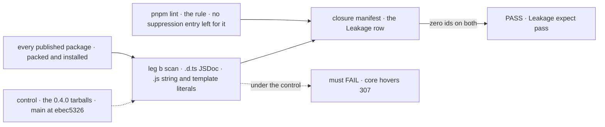
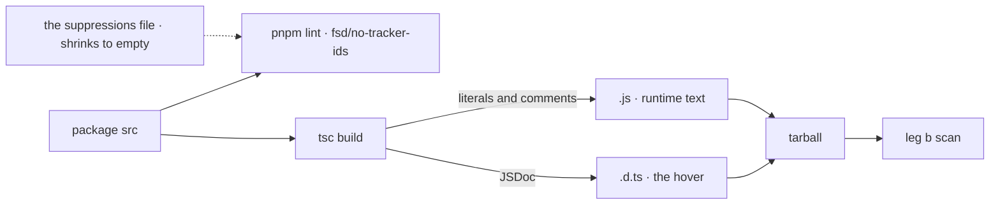

# FIX-2453 · Keep tracker ids out of everything that ships: lint JSDoc on exports, error strings and conformance titles

**Spec** · [Decisions](DECISIONS.md)

## Six people, before and after

| Someone who… | Today | After |
|---|---|---|
| **hovers a core export in their editor** | Reads *"(FIX-2133 D2, the epic FIX-2058's ER-8)"*. Core 0.4.0's type files carry 272 `FIX-`/`LAB-` ids, 307 with `BP-`/`BR-` | Reads what the export does. No tracker or process id in any published hover |
| **hits a thrown error** | *"…matching isolation (FIX-735)."*, *"which was removed (FIX-918)"* | The message names the fix, and links a docs page where one explains it |
| **runs the store conformance suite on their adapter** | Test titles end in *"(FIX-2426)"* | Titles say the behaviour under test |
| **copies a UI registry component or an example** | Pastes our ticket pointers into their own repo | Gets files with none, comments included |
| **writes new code in this repo, by hand or as an agent** | Nothing stops a JSDoc ending in *"(FIX-123)"*; 16 sibling specs are writing new code right now | `pnpm lint` fails on that line and says to keep the pointer in a `//` comment |
| **follows a pointer to see why code is the way it is** | `//` pointers and JSDoc pointers, mixed | `//` pointers, unchanged. BP-006's provenance stays |

0.4.0 is on npm with these ids in its hovers, and sixteen sibling specs are adding JSDoc,
errors and test titles in parallel ([ER-5](../../epics/FIX-2447/DECISIONS.md#who-owns-what)).

## The goal, and how we'll know it's met

**An adopter reads no tracker or process id anywhere the framework speaks to them: an editor
hover, an error, a log line, a conformance test title, or a file they copy. A new one can't
come back.**

| Is it the right goal? | |
|---|---|
| **The real need** | The epic's *Leakage* row: no `FIX-`/`LAB-` id in a published `.d.ts` JSDoc, a thrown error or a conformance test title ([FIX-2447](../../epics/FIX-2447/SPEC.md#the-goal-and-how-well-know-its-met)), and ER-5: nothing that ships carries one, siblings' new code included |
| **Smaller, and rejected** | "Sweep today's ids." Without a gate the siblings re-add them in the same weeks, and the row fails again at the closure |
| **Bigger, and not this issue's** | Kitchen Sink's 145 sites (unpublished; FIX-2461 owns what it says). Shift Manager's placeholder UI (FIX-2418) |
| **Not done if** | The lint passes because a suppression or a disable still covers a site · the workspace is clean and a tarball isn't (core's `dist` ships 4 test files today) · hovers are clean and an error still names an issue · a copied registry file still carries one in a `//` comment |



The lint gates every PR. The scan reads what an adopter installs, so a disabled line or a test
compiled into `dist` still fails the row.

| How we verify | |
|---|---|
| **Goal check** | FIX-2564's closure manifest, *Leakage* row. This issue's last PR flips it to `expect: pass`. Two assertions, which FIX-2564 owns and names: the lint (`pnpm lint` green with no `fsd/no-tracker-ids` entry in the suppressions file) and a leg-b tarball scan ([`poc/rule/tarball-scan.mjs`](poc/rule/tarball-scan.mjs) is the reference) |
| **Signal** | Zero matches of the rule's pattern in every published tarball's `.d.ts` JSDoc and `.js` string and template literals, and in the registry and example files, comments included |
| **Input** | The whole published set, packed. Any sibling's new file must fail the lint on its own PR |
| **Anti-game** | The rule has no allow-list option. The file set is derived from the publish set, not written by the same diff. The tarball scan, not the lint, is what the row reads, so a disable directive can't pass it |
| **Control that must fail** | The published 0.4.0 tarballs and `main` at `ebec5326`, failing on *zero ids in hovers* (core alone: 307). The rule's tests plant a JSDoc id and a string id that must be reported, and a `//` id that must not |

## What changes


Left of the fence goes to zero and stays there; right of it is where a pointer lives now
([D1](DECISIONS.md#d1)).

**The rule, as `eslint.config.mjs` gains it:**

```diff
+ import trackerIds from "./scripts/eslint-rules/no-tracker-ids.mjs";
  …
+ { files: shippedSource, plugins: { fsd: trackerIds }, rules: { "fsd/no-tracker-ids": "error" } },
+ { files: ["packages/ui/registry/**", "examples/**"],
+   rules: { "fsd/no-tracker-ids": ["error", { comments: "all" }] } },
```

**And what a person types when it fires:**

```diff
- /** Holds the slot until the row settles (FIX-2133 D2, the epic FIX-2058's ER-8). */
+ // FIX-2133 D2; FIX-2058 ER-8.
+ /** Holds the slot until the row settles. */

-   `give them distinct static prefixes or matching ${flagName} (FIX-735).`
+   `give them distinct static prefixes or matching ${flagName}.`
```

**Docs:** update BP-006 (`docs/contributing/best-practices/process.md`, and its `CLAUDE.md`
line): a pointer lives in a `//` comment, never JSDoc, a string or a copied file. The two
adopter examples using `FIX-2165` as a sample key (harness-manager's README and
`apps/docs/docs/orchestration/harness-manager.md`) move to a neutral key. No new page.

## How it reaches the adopter



The rule lands first, ESLint's bulk suppressions holding today's 2,192 sites, so a sibling's
new id fails from day one. The sweep empties the file ([decided](DECISIONS.md#decided-not-asked)).

## What stays as it is

- `//` and `/* */` pointers, tests outside `src`, changelogs, `.changeset/`, `specs/`,
  `docs/internal/`, Kitchen Sink and `goals/`.
- What an error *means*: wording changes, never a code or a behaviour. A retired-value
  refusal's text is FIX-2454's helper's.

## What's already here, and the debt

| Already here | What this does with it |
|---|---|
| Term guards: `check-retired-terms.mjs`, the one-word-per-thing sweep, `validate-reserved-names.mjs`, the docs site's `lint:brand` | **Leaves alone.** This is the fifth. All four read lines or words, and none can tell a `//` pointer from a JSDoc block or a string, which is the whole distinction here. No `mechanisms.yaml` row: it lists runtime mechanisms |
| `eslint.config.mjs`, syntactic rules, no custom rule yet; the CI *Lint* step and the pre-push hook | **Extends**, per [ER-4](../../epics/FIX-2447/DECISIONS.md#who-owns-what): the one custom rule. Same step, same hook |
| ESLint's bulk suppressions (9.24+; the repo runs 9.39.5) | **Builds on**, as the ratchet. Proved in [`poc/rule/ratchet.sh`](poc/rule/ratchet.sh) |
| `scripts/validate-publish-set.mjs` → `findPublishable` | **Builds on**: the rule's file set is the publish set's `src` |
| [BP-006](../../../docs/contributing/best-practices/process.md): a ticket pointer is fine in a comment | **Amended**: a `//` or `/* */` comment, not JSDoc ([D1](DECISIONS.md#d1)) |
| [FIX-2418](https://linear.app/fixpoint-labs/issue/FIX-2418): hide Shift Manager's placeholders and ids by default | **Overlaps** `packages/shift-manager/src/gaps.ts`. Its draft keeps ids in a `data-gap` attribute, a string this rule refuses; the gap keys by name instead |

| Adds | Existing piece considered | Why it doesn't fit / how composed |
|---|---|---|
| `fsd/no-tracker-ids`, one ESLint rule with one option (`comments: "all"`) | `no-restricted-syntax`; `check-retired-terms.mjs` | `no-restricted-syntax` selects nodes, and a JSDoc block isn't one. The retired-terms guard is line-based and Workforce-scoped. Composed into the existing config and CI step |
| A temporary `eslint-suppressions.json` | A hand-kept baseline | ESLint's own format, pruned by `--prune-suppressions`; deleted by this issue's last PR |

| The debt | |
|---|---|
| **Removes** | 2,192 id sites in 25 published packages, the registry and the examples (2,128 JSDoc, 56 literals, 8 copied comments) |
| **Adds** | One custom rule, permanent by design (ER-4). A suppressions file, paid by this issue |
| **Leaves** | Core's `dist` ships four compiled test files, a surface leak routed to the epic-agent (FIX-2448's area). No markdown guard. Kitchen Sink's 145 sites, FIX-2461's |

**Net: down.** Two thousand sites go; one rule stays, and its suppressions file is gone by the end.

## Sign off

**[The goal](#the-goal-and-how-well-know-its-met):** zero ids in what an adopter reads, measured
on installed tarballs, and gated on every PR. If wrong: the closure finds ids the workspace
lint never saw.

**[The debt](#whats-already-here-and-the-debt):** net down; one permanent rule, a suppressions
file that ends empty. If wrong: a fifth term guard nobody folds.

1. [D1](DECISIONS.md#d1) · **The rule covers what an adopter reads: hovers, runtime text, and
   copied files whole. `//` pointers stay, in compiled `.js` too.** If wrong: `node_modules`
   still shows about 1,060 pointers. The one to weigh: it reads ER-5 narrower than its words.
2. [D2](DECISIONS.md#d2) · **The pattern is our Linear keys and our process ids:
   `FIX`, `LAB`, `FLC`, `TL`, `BP`, `BR`.** If wrong: an 18% bigger sweep for ids adopters
   didn't mind.

**Open: none.**

Improvement · repo lint + every published package's `src` · large sweep, small rule · epic FIX-2447
