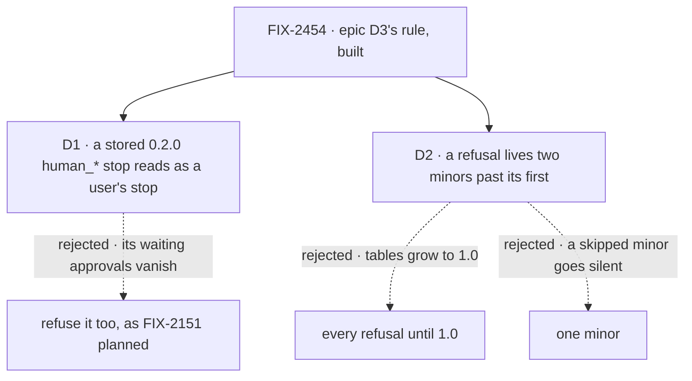

# FIX-2454 · Decisions

[Spec](SPEC.md) · **Decisions**

The epic decided the rule ([FIX-2447 D3](../../epics/FIX-2447/DECISIONS.md#d3)). Two calls it
left open are the sign-off; everything else here is context for them.

## The tree

Solid edges are what you're signing. Dashed edges lost, and the label says why.

## D1 · A stored `human_*` suspension from 0.2.0 reads as a user's stop; a new `human_*` value is refused

| | |
|---|---|
| **Instead of** | Refusing both, which is FIX-2151's "no dual-read: the owner is resetting all stored data" |
| **Because** | That reset was our stores. Core 0.2.0 was on npm for five weeks and stored suspensions durably, so an adopter's store can hold a `human_approval` stop that was waiting when they upgraded. D3 dual-reads exactly what a published version wrote. Read once, at the one predicate every reader keys on (`isUserSuspension`) |
| **Locks in** | Two old strings stay in contracts' table until the removal version, and only stored records reach them: a new `ctx.suspend` or `useSuspensions({ reasons })` with one throws first |

It comes down to the approval waiting in the store: refusing it strands a person's answer.

**What would change my mind:** 0.2.0 suspensions that can't resume on the next minor anyway.
Then reading them buys nothing, and both are refused. That premise is unchecked; the implementer
checks it first (below).

## D2 · A refusal names a removal version at least two minors past the first version that refuses it

| | |
|---|---|
| **Instead of** | Every refusal until 1.0; or one minor |
| **Because** | Pre-1.0 minors are breaking and came three days apart (0.3.0 to 0.4.0), so adopters skip them. One minor means a skip lands on the bare failure, and for an open-string value like `human_approval` that is silence again. Until 1.0 grows every table for the whole run-up and moves the cleanup into one big minor. Two minors covers one skip, and the author may name a later version with a reason |
| **Locks in** | A version in every refusal message, which adopters read and plan by. Removing an entry is a breaking change in the minor its version names, written in that minor's changeset |

It comes down to the adopter who skips a minor: one minor hands them silence.

**What would change my mind:** a cadence of one minor a month or slower. Then one minor is a
month of warning, and the floor drops to one.

## Decided, not asked

- **The test is "a published version accepted or wrote it,"** read off npm tarballs. Six
  refusals (`middleware`, `work`, `expectAttempt`, `dispatch: { mode }`,
  `detachedDrainTimeoutMs`, `maxWorkstreamListLimit`) refused already in their package's first
  published version, so no adopter wrote them. The census lists all 19 that go.
- **Convergence point:** each package's one table. `human_*` has three entry points:
  `ctx.suspend` in `createExecutionContext.ts` (the one writer), `useSuspensions`'s `reasons`
  filter, and `isUserSuspension`/`suspendForUserKindOf` (the readers).
- **The helper lives on `@flow-state-dev/contracts/internal`**, epic D2's published hidden
  kind: contracts is zero-dependency and owns `SuspensionReason`. Refusing packages add it as a
  direct dependency.
- **One message, one error class** (`RetiredNameError`), no tracker id (ER-5): `<where>:
  "<old>" was retired. Use <new>. This refusal is removed in <package> <version>.`
- **The check gates CI** beside the vocabulary sweep: reads every table and its package's
  version, fails at or past `removeIn` and on any refusal-shaped `src` line no table owns, and
  runs a planted control. Not ESLint (ER-4).
- **`agents` and `catalog`** lose their literal types and are refused at runtime.
- **Our dev stores** holding a never-published shape are not read; they are reset, as before.
- **Published changelogs stay**; the next changeset says those shapes no longer read.
- **BP-030, rewritten:** dual-read only what a published version wrote; refuse a retired value
  or key through the helper, with replacement and a removal version at least two minors out;
  delete what no published version accepted. `removeIn` replaces its `TODO(FIX-NNN)` pointer.
- **BP-034, amended to the epic's Q1.** *Alias:* the old path stays a `@deprecated` alias
  naming the new path and removal minor, and the check reads those tags. *Hold* or *break as
  each lands:* re-export from every path the docs name after the move; the old root path goes;
  the changeset names the new home.
- **ER-7 supersedes "one fragment per logical change"** (`release-notes-workflow.md`): one
  fragment per published package touched, one line for its reader, naming each moved name's new
  home. Core's features leave fsdev's changelog. Checked at implementation review.
- **The title's "before 0.4.0 publishes"** is moot: 0.4.0 shipped on Nov 3. It still builds early.

## Considered and dropped

| Alternative | Why not |
|---|---|
| Delete only the three shims the issue named | The census found 16 more of the same kind; the *Shims* row fails on any |
| Keep each package's own helper, add `removeIn` to each | Ten wordings stay, and the check would read ten shapes |
| Close `SuspensionReason`'s open arm | Breaks every flow's custom reason, which the arm exists for |
| An ESLint rule for expiry | ER-4 allows one custom rule; a version comparison needs `package.json`, not an AST |

## Settled

- **Which retired names a published version accepted** — settled by
  [`poc/retired-census/`](poc/retired-census/NOTES.md) over every published tarball: 29
  entries, 10 published, 19 never; 75 refusal-shaped `src` lines, none unowned; `--control`
  fails as it must. It widened the issue's three task-row shims to six, plus core's
  `waitForUser` resume map.

- **Unchecked: a 0.2.0 suspension resumes on the next minor at all.** D1 rests on it. The
  implementer runs a 0.2.0-written suspension record through the next minor's answer path before
  building D1's read. If it can't resume for another reason, D1 flips and `human_*` is refused
  everywhere.

## Analysis

Skipped in this spec: the epic-agent runs `analysis` and `reuse-review` over the whole spec set.

## How it got here

- **Draft** — framed as epic D3's rule built once; one helper and table per package over the
  engine helper and `retired-shapes`' table; the census, run on npm tarballs, decides what goes.

**Open: none.**
