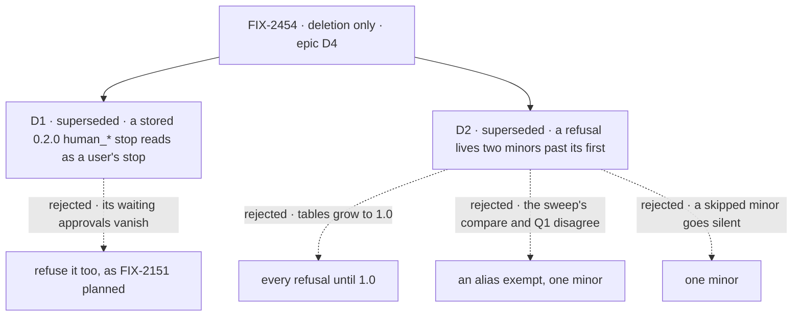

# FIX-2454 · Decisions

[Spec](SPEC.md) · **Decisions**

The epic decided the rule ([FIX-2447 D3](../../epics/FIX-2447/DECISIONS.md#d3)), and on Nov 6 the owner replaced it:
[D4](../../epics/FIX-2447/DECISIONS.md#d4), no backward-compat code, and [Q1](../../epics/FIX-2447/DECISIONS.md#q1) answered break. **D1 and D2 below are
superseded** and kept as the history of what was signed on Nov 5. This issue has no sign-off
decision of its own now; it deletes.

## The tree

Solid edges were what was signed on Nov 5; both are superseded by epic D4. Dashed edges lost, and the label says why.

## D1 · A stored `human_*` suspension from 0.2.0 reads as a user's stop; a new `human_*` value is refused

> **Amended (Nov 6): superseded by [epic D4](../../epics/FIX-2447/DECISIONS.md#d4).** Neither half is built. A stored `human_*`
> stop is not read as a user's stop, and a new `human_*` value is not refused: it runs as a custom
> reason, as on 0.4.0. FIX-2151's "no dual-read" stands. The card below is the history.

| | |
|---|---|
| **Instead of** | Refusing both, which is FIX-2151's "no dual-read: the owner is resetting all stored data" |
| **Because** | That reset was our stores. Core 0.2.0 was on npm for five weeks and stored suspensions durably, so an adopter's store can hold a `human_approval` stop that was waiting when they upgraded. D3 dual-reads exactly what a published version wrote. Read once, at the one predicate every reader keys on (`isUserSuspension`) |
| **Locks in** | Two old strings stay in contracts' table until the removal version, and only stored records reach them: a new `ctx.suspend` or `useSuspensions({ reasons })` with one throws first |

It comes down to the approval waiting in the store: refusing it strands a person's answer.

**What would change my mind:** 0.2.0 suspensions that can't resume on the next minor anyway.
Then reading them buys nothing, and both are refused. That premise is unchecked; the implementer
checks it first (below).

## D2 · A refusal names a removal version at least two minors past the first version that refuses it

> **Amended (Nov 6): superseded by [epic D4](../../epics/FIX-2447/DECISIONS.md#d4).** There are no refusals to version and no
> aliases ([Q1](../../epics/FIX-2447/DECISIONS.md#q1) answered break), so there is no window. The card below is the history.

| | |
|---|---|
| **Instead of** | Every refusal until 1.0; or one minor; or a looser rule for a Q1 `@deprecated` alias |
| **Because** | Pre-1.0 minors are breaking and came three days apart (0.3.0 to 0.4.0), so adopters skip them. One minor means a skip lands on the bare failure, and for an open-string value like `human_approval` that is silence again. Until 1.0 grows every table for the whole run-up and moves the cleanup into one big minor. Two minors covers one skip, and the author may name a later version with a reason |
| **Applies to** | Refusals. Whether it also bounds a Q1 `@deprecated` alias is one of [Q1](../../epics/FIX-2447/DECISIONS.md#q1)'s open sub-questions, the owner's. If Q1 takes the alias and applies the floor, an alias that goes the next minor fails the same skip, and the sweep checks its tag like a table entry; otherwise the sweep reads only the alias's named removal minor |
| **Locks in** | A version in every refusal message and alias tag, which adopters read and plan by. Removing an entry is a breaking change in the minor its version names, written in that minor's changeset |

It comes down to the adopter who skips a minor: one minor hands them silence.

**What would change my mind:** a cadence of one minor a month or slower. Then one minor is a
month of warning, and the floor drops to one.

## Decided, not asked

As amended on Nov 6. The bullets this amendment removed (the helper and its home on
`contracts/internal`, the one message and error class, the sweep's table and expiry pass, the
BP-030 and BP-034 rewrites) are in the retained Nov 5 revision of this file, merged with #4772.

- **From the epic, cited, not restated:** [ER-3](../../epics/FIX-2447/DECISIONS.md#who-owns-what), [ER-5](../../epics/FIX-2447/DECISIONS.md#who-owns-what), [ER-7](../../epics/FIX-2447/DECISIONS.md#who-owns-what), [D4](../../epics/FIX-2447/DECISIONS.md#d4) · **cells owned** in [FIX-2564's grid](../FIX-2564/SPEC.md#what-changes): `shims.never-published`.
- **The test is "a published version accepted or wrote it,"** read off npm tarballs. Six
  refusals (`middleware`, `work`, `expectAttempt`, `dispatch: { mode }`,
  `detachedDrainTimeoutMs`, `maxWorkstreamListLimit`) refused already in their package's first
  published version, so no adopter wrote them. The census lists all 19 that go.
- **The ten published names go too, under epic D4.** Their refusals are deleted with the names,
  and `refuseRetiredDispatcherOption` and `rejectRemovedMiddleware` with them. A typed caller
  fails to compile; the changeset names the replacement (ER-7). `human_approval` has no refusal
  today and gets none.
- **The guard.** A reader of a stored record whose absence would *silently corrupt data*, not
  merely fail, is raised to the coordinator before it is removed. The census's one published
  stored shape is `blocked` read as `held` (`retired-shapes.ts`); the implementer checks what a
  stored `blocked` row does with no reader, and raises it before deleting.
- **`agents` and `catalog`** lose their literal types; the workforce refusal goes with them.
- **The census's 19 are `shims.never-published`'s scope.**
- **Blocks nothing.** With no helper, FIX-2452's slot PR and FIX-2459's claim-order PR no longer
  wait on this issue ([the epic's seams](../../epics/FIX-2447/DECISIONS.md#coordination-seams)). FIX-2535, outside the set,
  planned to call the helper; the coordinator tells it.
- **Our dev stores** holding a never-published shape are not read; they are reset, as before.
- **Published changelogs stay**; the next changeset says those shapes no longer read.
- **ER-7 supersedes "one fragment per logical change"** (`release-notes-workflow.md`): one
  fragment per published package touched, one line for its reader, naming each moved name's new
  home. Core's features leave fsdev's changelog. Checked at implementation review.
- **The title's "before 0.4.0 publishes"** is moot: 0.4.0 shipped on Nov 3. So is its "expiry"
  and "one rename policy": the policy is epic D4.

## Considered and dropped

| Alternative | Why not |
|---|---|
| Delete only the three shims the issue named | The census found 16 more of the same kind; `shims.unpublished-shapes` fails on any |
| Keep each package's own helper, add `removeIn` to each | Ten wordings stay, and the sweep would read ten shapes |
| Close `SuspensionReason`'s open arm | Breaks every flow's custom reason, which the arm exists for |
| A retired-name check of its own: the census promoted as a scanner | The vocabulary sweep already owns the marker, `human-reasons` and the plants; a third source scanner splits one job |
| An ESLint rule for expiry | ER-4 allows one custom rule; a version comparison needs `package.json`, not an AST |

## Settled

- **Which retired names a published version accepted** — settled by
  [`poc/retired-census/`](poc/retired-census/NOTES.md) over every published tarball: 29
  entries, 10 published, 19 never; 75 refusal-shaped `src` lines, none unowned; `--control`
  fails as it must. It widened the issue's three task-row shims to six, plus core's
  `waitForUser` resume map.

- **Unchecked, and no longer needed: a 0.2.0 suspension resumes on the next minor at all.** D1
  rested on it; with D1 superseded, nothing does.

## Analysis

Skipped in this spec: the epic-agent runs `analysis` and `reuse-review` over the whole spec set.

## How it got here

- **Owner amendment (Nov 6)** — [epic Q1 answered, break](../../epics/FIX-2447/DECISIONS.md#q1), and [epic D4, no
  backward-compat code](../../epics/FIX-2447/DECISIONS.md#d4) ([owner's comment](https://github.com/fixpoint-labs/flow-state-dev/pull/4836#issuecomment-6689198303)). The direction shrinks to deletion: D1
  (the stored `human_*` read) and D2 (the removal window) are superseded; the helper, the
  per-package tables, `contracts/internal`, the refusals, the sweep's table and expiry pass and
  its two plants, and the BP-030 and BP-034 rewrites are dropped. Kept: deleting the census's 19.
  Added under D4: the ten published names' refusals go too, with the one stored-shape reader
  raised under the guard. FIX-2564 drops two of this issue's three cells; FIX-2452 and FIX-2459
  no longer wait on it. On review (Gitar), the goal check widened to match: a census `--after`
  pass over the 19, the published names' refusal sites and both helpers, failing on today's `main`.
- **Set review (Nov 5)** — ownership and expiry extend the vocabulary sweep, not a new
  scanner; `contracts/internal` listed with call 6's completions line; D2's floor covers a Q1
  alias, and BP-034 says so; leg b's three cells and the 19 as their scope; blocks only
  FIX-2452's and FIX-2459's calling PRs; FIX-2535 named; contracts' package-roots row.
- **Spec-set review round 1 (Nov 5)** — D2's floor for a Q1 alias made conditional on Q1, which
  is open; the completions line dropped (epic D2 settled); a table's export renamed `REFUSALS`,
  so it doesn't share the vocabulary sweep's `RETIRED` name; cells cited from FIX-2564's grid.
- **Draft** — framed as epic D3's rule built once; one helper and table per package over the
  engine helper and `retired-shapes`' table; the census, run on npm tarballs, decides what goes.

**Open: none.**
