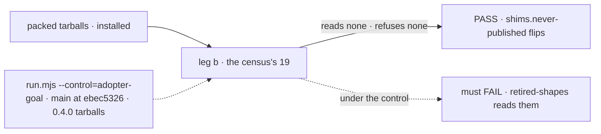

# FIX-2454 · Delete never-published shims, give rename refusals an expiry, and adopt one rename policy (fixing the silent suspension-reason rename)

**Spec** · [Decisions](DECISIONS.md)

> **Amended 2026-11-06** by the owner's two calls on the epic: [Q1 answered, break](../../epics/FIX-2447/DECISIONS.md#q1),
> and [D4, no backward-compat code](../../epics/FIX-2447/DECISIONS.md#d4)
> ([comment](https://github.com/fixpoint-labs/flow-state-dev/pull/4836#issuecomment-6689198303)).
> The direction shrinks to deletion. This issue now builds no refusal helper, no retired tables, no
> removal versions and no expiry pass. It does not read stored `human_*` stops, and it does not
> refuse `human_approval`. The title is Linear's and stays. What changed, and what it costs, is
> in [DECISIONS.md → How it got here](DECISIONS.md#how-it-got-here).

## Five people, before and after

| Someone who… | Today | After |
|---|---|---|
| **upgrades 0.2 code that calls `ctx.suspend({ reason: "human_approval" })`** | It runs as a custom reason: no Inbox item; `human_input` offers approve/reject, not submit | Unchanged. The owner's no-compat call accepts this ([epic D4](../../epics/FIX-2447/DECISIONS.md#d4)) |
| **upgrades with a 0.2.0 `human_approval` stop waiting in the store** | Nobody can answer it as a user's stop | Unchanged: it is not read as one |
| **passes a retired option** (`dispatcher`, `onReview`, workforce's `agents`) | Each package words its own error; `agents` autocompletes | The option is gone from the types, so a typed caller fails to compile. The package's own refusal goes with it |
| **reads the 0.4.0 notes**, *a row stored with `questions` still reads* | 19 readers and refusals cover names no npm version accepted | Gone, and the next notes say so |
| **retires a name in a PR** | Three policies; nothing removes a refusal | One rule, epic D4: delete it, and let the changeset name the replacement |

## The goal, and how we'll know it's met

**The packages carry no code for retired names: none for names no adopter could have used, and,
under the owner's no-compat call, none for the names a published version did accept. The
changeset names each replacement.**

| Is it the right goal? | |
|---|---|
| **The real need** | The epic's *Shims* row, and the owner's call that this epic carries no backward-compat code ([D4](../../epics/FIX-2447/DECISIONS.md#d4)) |
| **Smaller, and rejected** | "Delete the issue's three shims." The census found 16 more of the same kind |
| **Bigger, and not this issue's** | Code elsewhere that supports older versions: each child streamlines its own under D4 |
| **Not done if** | An installed tarball reads or refuses one of the census's 19 · this issue adds a retired table, a refusal, a removal version or a reader of an old shape · a reader of a stored record is deleted without the guard below asked first |



The leg proves it in an adopter's install, where the shims would ship.

| How we verify | |
|---|---|
| **Goal check** | FIX-2564's `shims.never-published` cell (leg b), scoped to the [census](poc/retired-census/census.mjs)'s 19, flipped to `expect: pass`. The implementer runs `run.mjs --goal` at completion |
| **Signal** | On installed tarballs, none of the 19 reads or refuses, e.g. `questions`, `keptOpenBy: "wait"`/`"queued"`. The census, re-run, finds none of the 19 in source |
| **Anti-game** | Leg b reads installed tarballs, never `src`. The census sized the 19 from published `dist/`, not changelogs |
| **Control that must fail** | `run.mjs --control=adopter-goal` (`main` at `ebec5326`, the 0.4.0 tarballs, orchestration 0.5.0): its `retired-shapes` still reads them |

## What changes


The left column is deleted whole. The right column carries no helper: its refusals are
deleted, and the stored `blocked` reader is checked against the guard first.

**Deleting a retired name, as a contributor writes it:**

```diff
- if ("hopLimit" in given) {
-   throw new Error("hireWorkforce: messages.hopLimit was renamed messages.budget; …");
- }
```

```md
<!-- .changeset/…md -->
`hireWorkforce`: `messages.hopLimit` is now `messages.budget`.
```

**The one guard.** Code whose absence would *silently corrupt data*, not merely fail, is raised
to the coordinator before it is removed. Here that is a reader of a stored record: the census's
one published stored shape, `blocked` read as `held` in `retired-shapes.ts`.

**Docs:** `release-notes-workflow.md` → "Multi-package PRs" (ER-7). Orchestration's README drops
*a row stored with the old names still reads*. No BP is rewritten: BP-030 is waived for this
epic, not changed.

## What stays as it is

- `ctx.suspend({ reason: "human_approval" })` runs as a custom reason, as on 0.4.0.
- The vocabulary sweep's `RETIRED` list and its `human-reasons` rule. `retired-name-refusal`
  markers in `src` go with the code they mark.
- Published `CHANGELOG.md` entries.
- `normalize-resource-state.ts`'s idempotent-schema guard, which no change here touches.

## What's already here, and the debt

| Already here | What this does with it |
|---|---|
| Job: refuse or read a retired name. Today 29 sites in six packages, each in its own words ([census](poc/retired-census/census.mjs)), two helpers among them: `refuseRetiredDispatcherOption` (`engine/src/transports/runner.ts`), `rejectRemovedMiddleware` (`core/src/flow/defineFlow.ts`) | **Removes** them: the 19 never-published sites, and the refusals for the published keys and values, with both helpers. A stored-shape reader is raised under the guard first |
| `retired-shapes.ts`, orchestration's task-row reader | **Removes** six of its seven entries. The seventh, `blocked`, is raised under the guard before it goes |
| `RESUMED_UNDER_FORMER_NAME` (`core/src/blocks/generator.ts`) | **Removes.** Core 0.3.0 already named the tool `suspendForUser` |
| The vocabulary sweep (`sweep.mjs`, `rules.mjs`) | **Leaves alone.** No table pass, no expiry compare, no new plants |
| [FIX-2151](https://linear.app/fixpoint-labs/issue/FIX-2151)'s "no dual-read of `human_*`" | **Kept**, as it was before this spec: the owner resets stored data |
| BP-030, BP-034 | **Unchanged.** BP-030 is waived for this epic ([D4](../../epics/FIX-2447/DECISIONS.md#d4)); BP-034's re-export rule reads the paths documented after a move |
| Release notes' multi-package rule | **Amended** to ER-7 ([decided](DECISIONS.md#decided-not-asked)) |

No Adds: the `contracts/internal` entry, the helper and the sweep pass are not built.

| The debt | |
|---|---|
| **Removes** | 19 never-published readers and refusals; the published keys' and values' own refusals and two ad-hoc helpers; `agents`/`catalog` literal types; `src` markers |
| **Adds** | Nothing |
| **Leaves** | `human_approval` still runs silently as a custom reason; a stored 0.2.0 `human_*` stop is not a user's stop |

**Net: down.** 19 shims, the published names' refusals and two helpers go. Nothing replaces them.

## Sign off

**[The goal](#the-goal-and-how-well-know-its-met):** no code for retired names, proved on
installed tarballs. If wrong: a shim ships that nobody can reach.

**[The debt](#whats-already-here-and-the-debt), net down:** deletion only. If wrong: a caller
passing a retired key meets a compile error or nothing, not a named replacement.

No decisions of its own. [D1](DECISIONS.md#d1) and [D2](DECISIONS.md#d2) are superseded by epic
D4 and kept as history.

**Open: none.** The price, `human_approval` staying silent, is the owner's call, recorded in epic D4.

Improvement · core, engine, orchestration, workforce, scheduled, harness-manager · small · epic FIX-2447
