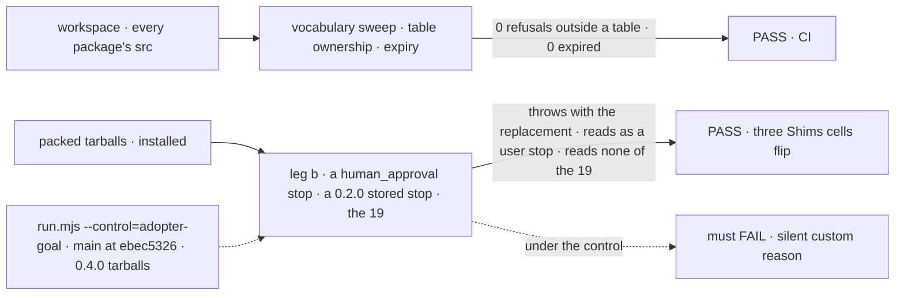
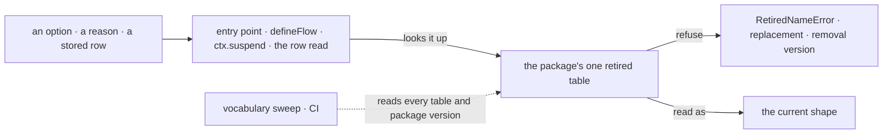

# FIX-2454 · Delete never-published shims, give rename refusals an expiry, and adopt one rename policy (fixing the silent suspension-reason rename)

**Spec** · [Decisions](DECISIONS.md)

## Five people, before and after

| Someone who… | Today | After |
|---|---|---|
| **upgrades 0.2 code that calls `ctx.suspend({ reason: "human_approval" })`** | It runs as a custom reason: no Inbox item; `human_input` offers approve/reject, not submit | It throws, naming `user_approval` and the removal version |
| **upgrades with a 0.2.0 `human_approval` stop waiting in the store** | Nobody can answer it as a user's stop | It reads as one |
| **passes a retired option** (`dispatcher`, `onReview`, workforce's `agents`) | Each package words its own error; `agents` autocompletes | One error: old name, replacement, removal version |
| **reads the 0.4.0 notes**, *a row stored with `questions` still reads* | 19 readers and refusals cover names no npm version accepted | Gone, and the next notes say so |
| **retires a name in a PR** | Three policies; nothing removes a refusal | One rule, one helper, a check that fails an expired refusal |

## The goal, and how we'll know it's met

**An adopter who upgrades across a rename either keeps working or is stopped with the new name
and the version that removes the stop. Nothing changes behaviour silently, and the packages carry
no code for names no adopter could have used.**

| Is it the right goal? | |
|---|---|
| **The real need** | The epic's *upgrades across a rename* row: "a deprecation or a loud refusal names the new home, never silence" ([FIX-2447](../../epics/FIX-2447/SPEC.md)), and its *Shims* row |
| **Smaller, and rejected** | "Refuse `human_approval`, delete the issue's three shims." 16 more stay, and the next rename picks a fourth policy |
| **Bigger, and not this issue's** | How a moved *export* reaches adopters: the epic's open [Q1](../../epics/FIX-2447/DECISIONS.md#q1) |
| **Not done if** | A retired value runs silently · the next minor ships a shim no published version needed · a refusal sits outside the helper · an expired refusal passes CI · the stored 0.2.0 stop is refused |



The workspace check proves the rule in source; the leg proves it in an adopter's install.

| How we verify | |
|---|---|
| **Goal check** | (1) The vocabulary sweep (`goals/vocabulary/one-word-per-thing/sweep.mjs`), extended with table ownership and the version compare, in CI's existing step. (2) FIX-2564's three *Shims* cells, all leg b, flipped to `expect: pass`: `human_approval` refused on installed tarballs; a stored `human_approval` stop reads as a user's; `shims.unpublished-shapes`, scoped to the [census](poc/retired-census/census.mjs)'s 19. The implementer runs `run.mjs --goal` and the sweep at completion |
| **Signal** | (1) Every refusal-shaped `packages/*/src` line sits in its package's table; no entry at or past its version. (2) On installed tarballs, `human_approval` throws naming `user_approval`; a stored one is a user's stop; none of the 19 reads or refuses, e.g. `questions`, `keptOpenBy: "wait"`/`"queued"` |
| **Input** | Today's 29 sites. A new entry one minor out must pass, then fail once that minor ships |
| **Anti-game** | Leg b reads installed tarballs, never `src`. The census sized the 19 from published `dist/`, not changelogs. The sweep reads the code's tables, never a list beside them |
| **Control that must fail** | (1) The sweep's `--control` gains two plants, each caught by its own rule: an unowned refusal and an expired entry. (2) `run.mjs --control=adopter-goal` (`main` at `ebec5326`, the 0.4.0 tarballs), failing on *throws naming `user_approval`* |

## What changes


The left column is deleted whole; the right keeps its ten names, each through the helper. The
solid red cell is the bug.

**A retirement, as a contributor writes it:**

```diff
- if ("hopLimit" in given) {
-   throw new Error("hireWorkforce: messages.hopLimit was renamed messages.budget; …");
- }
+ // packages/workforce/src/retired.ts: the package's one table
+ export const REFUSALS = retiredNames("@flow-state-dev/workforce", {
+   agents: { replacement: "roster and inventory", removeIn: "0.7.0" },
+ });
+ refuseRetired(REFUSALS, options, "workforceCapability");
```

**What an adopter sees:**

```diff
- // compiles, runs, and the stop never reaches the Inbox
+ Error: ctx.suspend: reason "human_approval" was retired. Use "user_approval".
+ This refusal is removed in @flow-state-dev/core 0.7.0.
```

**Docs:** BP-030 rewritten, BP-034 amended, with `CLAUDE.md`'s mirror lines; contracts' row
on FIX-2448's *What each package root is for* (`apps/docs/docs/api/package-roots.md`): the root
is the zero-dependency shared layer core re-exports, and `contracts/internal` holds the
retired-name helper, for our packages only;
`release-notes-workflow.md` → "Multi-package PRs" (ER-7); one line beside the reasons in
`apps/docs/docs/advanced/durable-execution.md`; orchestration's README drops *a row stored with
the old names still reads*.

## How a retired name reaches the helper



The sweep reads the same tables the code refuses from, so an expiry can't drift.

Beyond this issue, three retirements call the helper: FIX-2452's slot refusals, FIX-2459's
`"topological"` claim order (orchestration's table), and FIX-2535's GitHub webhooks `sessionId`,
outside the epic. Their PRs land after the helper; nothing else waits on it.

## What stays as it is

- Moved *exports*: the epic's Q1.
- The vocabulary sweep's `RETIRED` list. Only its per-line markers in `src` give way to tables.
- Published `CHANGELOG.md` entries.
- `blocked` still reads as `held`.

## What's already here, and the debt

| Already here | What this does with it |
|---|---|
| Job: refuse or read a retired name. Today 29 sites in six packages, each in its own words ([census](poc/retired-census/census.mjs)), two helpers among them: `refuseRetiredDispatcherOption` (`engine/src/transports/runner.ts`), `rejectRemovedMiddleware` (`core/src/flow/defineFlow.ts`). No `mechanisms.yaml` row; this adds one | **Replaces** them: one helper, one table per package |
| `retired-shapes.ts`, orchestration's task-row reader | **Removes** six of its seven entries; `blocked` moves to the table, `owner` ids become `removeIn` versions |
| `RESUMED_UNDER_FORMER_NAME` (`core/src/blocks/generator.ts`) | **Removes.** Core 0.3.0 already named the tool `suspendForUser` |
| The vocabulary sweep (`sweep.mjs`, `rules.mjs`): the `retired-name-refusal` marker, the `human-reasons` rule, `--control` plants, CI's step | **Extends**: table ownership and the version compare join it, with two plants. The marker leaves `packages/*/src` for the tables; tests and docs keep it |
| `normalize-resource-state.ts`'s idempotent-schema guard | **Leaves alone**: a schema coercing a published enum is D3's dual-read |
| [FIX-2151](https://linear.app/fixpoint-labs/issue/FIX-2151)'s "no dual-read of `human_*`" | **Superseded** by [D1](DECISIONS.md#d1) for stored records |
| BP-030, BP-034, release-notes' multi-package rule | **Amended** (BP-034 per Q1; [decided](DECISIONS.md#decided-not-asked)) |

| Adds | Existing piece considered | Why it doesn't fit / how composed |
|---|---|---|
| `@flow-state-dev/contracts/internal`, a new hidden entry | `client/./internal`, epic D2's published hidden kind | Same kind: a plain published subpath, with no completions fix ([D2, settled](../../epics/FIX-2447/DECISIONS.md#d2-completions)) |
| `retiredNames`, `refuseRetired`, `RetiredNameError` on it | `refuseRetiredDispatcherOption`; `retired-shapes.ts`'s table | Extends the engine helper with that table's form |
| Table ownership and expiry | The vocabulary sweep; the census's totality scan | **Extends the sweep**: the census's refusal shape moves into `rules.mjs`, a pass reads the tables. Not a third scanner; not ESLint (ER-4) |

| The debt | |
|---|---|
| **Removes** | 19 never-published readers and refusals; the other ten's own wordings; two ad-hoc helpers; `agents`/`catalog` literal types; `src` markers |
| **Adds** | Tables holding ten published names, each removed at its version by design; one hidden entry; a pass and two plants in the existing sweep |
| **Leaves** | Moved exports, until Q1 |

**Net: down.** 19 shims and the per-site wordings go; one helper, ten dated entries and a sweep pass stay.

## Sign off

**[The goal](#the-goal-and-how-well-know-its-met):** never silent across a rename, no code for
names nobody could use, proved on installed tarballs. If wrong: `human_approval` stays silent,
or a shim ships that nobody can reach.

**[The debt](#whats-already-here-and-the-debt), net down:** 19 shims and the per-site wordings go for one
helper and a pass in the existing sweep. If wrong: a helper every package imports for a handful of names.

1. [D1](DECISIONS.md#d1) · A stored 0.2.0 `human_*` stop reads as a user's stop; a new one is
   refused. If wrong: adopters' waiting approvals vanish on upgrade.
2. [D2](DECISIONS.md#d2) · A refusal lives at least two minors past the first version that
   carries it; whether a Q1 `@deprecated` alias does too is Q1's, open with the owner. If wrong: an
   adopter who skips minors meets the silent case again.

**Open: none.** D2 is the one to weigh. BP-034 is written so the sweep and Q1 agree under each answer.

Improvement · contracts, core, engine, react, orchestration, workforce, scheduled, harness-manager · medium · epic FIX-2447
