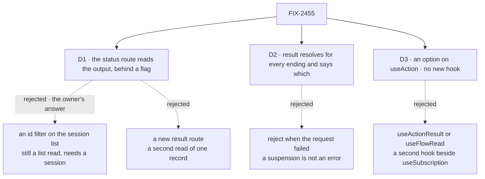

# FIX-2455 · Decisions

[Spec](SPEC.md) · **Decisions**

What was considered, what was chosen, and what each choice locks in. The owner answered the
direction before drafting: an app reads one request's output **by its id**, not by listing the
session and searching. The three cards are the shape of that answer.

## The tree

Solid edges are what you're signing. Dashed edges lost, and the label says why.

## D1 · The output is read from the route that already reads one request: the status route answers with the stored result on `include_result_output=true`

| | |
|---|---|
| **Instead of** | An id filter on the session request list (FIX-2043's proposal, and the epic's first draft, which reused `withListedResult`), or a new route that returns one request's result |
| **Because** | The status route already loads the one record by id and checks the caller reaches it and the addressed flow owns it. The flag reuses the list's name and the result's wire shape, so one request reads the same in both places. The list filter keeps a session-scoped read with paging and needs the session id; a new route repeats the reach check for the same record, which [FIX-1661 D1](../FIX-1661/DECISIONS.md#d1) rejected as a second read for one fact (tenet 5) |
| **Locks in** | `include_result_output` on `GET …/requests/:requestId/status`, and an optional `result` on `RequestStatusSnapshot`, are public HTTP and type surface. Without the flag the snapshot stays as it is, so `wait()`'s polls stay small. FIX-2460's `testFlow` answer helper settles through the same read, in process, so the flag and field are its seam as well |

![D1: where one request's output is read. Chosen: the status route, behind a flag. Instead of: an id filter on the session list, or a new result route. It comes down to the reach check: the status route already loads the one record and checks the caller; the list read is scoped by session and paged, and a new route repeats the check. Price: the status probe has an optional payload. A request found by id is a tie for the route and the new route. Locks in a flag and a field on the status route. Flips if the status route had to stay a cacheable probe](figures/d1-by-id-read.svg)

It comes down to the reach check: only the status route already holds it for one record.

> **Amended (Nov 10).** `result()` sends `include_result_output` on every poll, so the read that
> settles the request is the one returned: one wait, not `wait()` plus a second read, which a
> resumed run could slip in front of. A running request has no stored result yet, so those polls
> stay small; `wait()` and `status()` still poll without the flag. Built in [#4896](https://github.com/fixpoint-labs/flow-state-dev/pull/4896);
> the figure on SPEC's *What changes* shows the earlier wait-then-read.

**What would change my mind:** a host that caches or proxies the status route as a liveness
probe. Then the output needs its own route, and FIX-1661 D1 is reopened on purpose.

## D2 · `result()` resolves for every way a request settles and says which; it rejects only on a timeout or a transport error

| | |
|---|---|
| **Instead of** | Rejecting when the request failed, as Temporal's `handle.result()` does |
| **Because** | A run that stops for a person settles at `suspended` (`wait()`'s rule), and that is a normal stop, not an error. The six copies each word an ending their own way: the board's own words, `ActionRefused`, *ended aborted*. Resolving keeps that wording in each caller, as FIX-2043 asked. Trigger.dev's `runs.poll` and OpenAI's `runs.poll` resolve with the status too |
| **Locks in** | The resolved shape is public: the snapshot's `status`, plus `output`, `outputNotRecorded` and `error` as the record stored them. Every caller branches on `status`, and `output` is `undefined` on anything but an answer. A timeout rejects as `wait()` does, a `ClientHttpError` of status 0, and stopping the wait never stops the run |

It comes down to a suspension: rejecting makes every approval step a catch block.

**What would change my mind:** the six call sites, rewritten, all rethrowing on anything but
`completed`. Then a rejecting `result()` is the shorter contract.

## D3 · React reads an output through an option on `useAction`; flow reads stay on `useSubscription`; no new hook

| | |
|---|---|
| **Instead of** | A `useActionResult` hook, and the issue's `useFlowRead` |
| **Because** | `useAction` is the hook that sends one action, and its `execute` can only hand back the acceptance, so a React app builds a second client to read the answer; the provider's client is not public. Flow reads already have their React path: `client/react.md` runs `fsd.flow(…).read(…)` through `useSubscription`, FIX-2428's hook. A `useFlowRead` beside it would be the second hook watching one scope that FIX-2367's *not done if* bans |
| **Locks in** | One option name on `useAction`, public; with it `execute` resolves to `result()`'s shape and `loading` spans the run; without it, today's behaviour. An unmount stops the wait through `signal`. `useReadFence` leaves the root for `react/internal`, with no alias ([ER-3; Q1 answered break](../../epics/FIX-2447/DECISIONS.md#q1)), a plain published subpath (epic D2, settled) |

It comes down to FIX-2367's rule: a read hook beside `useSubscription` is a second watcher.

## Decided, not asked

- **From the epic, cited, not restated:** [ER-3](../../epics/FIX-2447/DECISIONS.md#who-owns-what), [ER-6](../../epics/FIX-2447/DECISIONS.md#who-owns-what), [ER-7](../../epics/FIX-2447/DECISIONS.md#who-owns-what) · **cells owned** in [FIX-2564's grid](../FIX-2564/SPEC.md#what-changes): `onepath.output-read`; contributes to `surface.root.react`.
- **`result()` is the one wait, with the flag on.** One polling loop on the handle; `result()`
  never polls on its own, and returns the flagged read that settled it ([amended Nov 10](#d1)). The convergence point for "settled" is `wait()`'s predicate (not
  `in_progress`, no live heartbeat), and every copy that waits goes through it.
- **`result()` is on every request handle**, not only `SentRequest`: orchestration waits on
  `flow.request(id)`.
- **No session id is needed.** The by-id read doesn't take one, so FIX-2043's second gap, the
  202 that omits a server-made session, no longer blocks anything.
- **`outputNotRecorded` and an empty `{}` stay distinct**, as the record stores them: an
  answer JSON couldn't hold is not an action that returned nothing.
- **The labs migrate too.** They are private, but the census counts them, and a lab left
  listing is the copy the next app copies.
- **The status route's flag sends the list's projection**: the output when asked, `hasOutput`
  always. The shared helper is a projection, not the list read; the list path is not used.
- **Changesets:** client, engine and react. The labs are private and get none (BP-022).

## Considered and dropped

| Alternative | Why not |
|---|---|
| `wait({ includeOutput: true })` instead of `result()` | Differs by a flag, but the flag changes the return type, and the epic and the owner's answer name `result()` |
| `result()` over the session list (`withListedResult`) | The owner's answer: by id. It also keeps the page miss inside the client |
| A final `result` event on the request stream | Rejected by FIX-1661 D1: the stream is not the record |
| Leave the copies and add only `result()` | The smaller goal; the *One path* row fails |
| Move `useReadFence` into the DevTool | React's own collection hooks use it; a copy would be a duplicate |

## Settled

- **The adopter path is read-by-request-id** (the owner's answer to the epic review's
  implementer note, Nov 5). The primary path an app is shown, in docs, READMEs and the
  migrated copies, is `result()` over the status route by id. List-and-find through
  `withListedResult` is not an adopter path: the session list keeps its flag for list views
  only. D1 already encodes this; it is recorded here so the implementer does not re-derive it.
- **The counts** — **CONFIRMED** by [`poc/output-read-census/`](poc/output-read-census/census.mjs)
  on `main` at d6a38c09: 6 output reads by list-and-find (four packages, two labs), 1 list view
  (the DevTool's rows), 5 files with a hand-rolled status loop. Every site is classified, and
  `--plant` (an unlisted output read under `labs/`) exits 1, as it must.

## Analysis

Not run on this spec alone: in spec-set member mode `epic-agent` runs `analysis` and
`reuse-review` over the whole set.

## How it got here

- **Owner amendment (Nov 6)** — [epic Q1 answered, break](../../epics/FIX-2447/DECISIONS.md#q1), and [epic D4, no
  backward-compat code](../../epics/FIX-2447/DECISIONS.md#d4) ([owner's comment](https://github.com/fixpoint-labs/flow-state-dev/pull/4836#issuecomment-6689198303)). `useReadFence` leaves react's root with no alias; nothing here waits on
  Q1 any more. Direction unchanged.
- **Draft** — framed as the epic's *One path* output row; the owner's answer (read by id)
  turned into a flag on the status route, `result()` on `wait()`, and an option on `useAction`;
  built on FIX-1661's stored result and FIX-2162's request handle; a census of the copies.
- **Set review (Nov 5)** — consumed FIX-2513 (its DevTool copy left in *Leaves*); the goal is
  cell `onepath.output-read` with its two cases; FIX-2460's settle reads the status-route flag;
  FIX-2551 is a rebase seam; `react/internal` ships its completions fix if one exists and joins
  the package-roots page.

**Open: none.**
