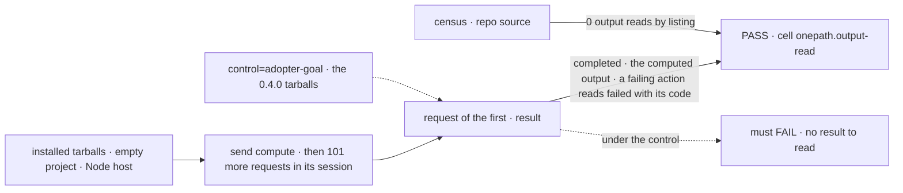
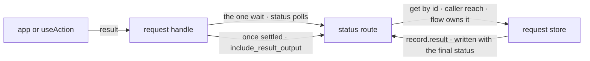

# FIX-2455 · One client call that returns an action's output, and a real React read path

**Spec** · [Decisions](DECISIONS.md)

## Six people, before and after

| Someone who… | Today | After |
|---|---|---|
| **sends an action from the client and needs its answer** | Calls `sent.wait()`, gets a status with no output, then lists the session's requests and searches the pages for its own id | `const { status, output } = await sent.result()` |
| **works in a session with a long history** | Workforce reads one page of 100 and says *finished, but its answer could not be read*; the harness line reads 20 and says the steer was *not taken* | The read is by request id, so the session's length changes nothing |
| **sends an action that fails, or stops for a person** | Each copy words the ending its own way, after the same search | `result()` resolves with `status: "failed"` and its `error`, or `"suspended"`; the app words it |
| **sends an action from React** | `useAction`'s `execute` resolves when the server accepts, so the app builds a second client to read the answer | `useAction({ action, result: true })`: `execute` resolves to the result, and `loading` holds until it settles |
| **closes a screen while it waits** | Shift Manager's loops each roll their own stop; some keep reading | `wait` and `result` take an `AbortSignal`. Stopping the wait never stops the run |
| **autocompletes `@flow-state-dev/react`** | Sees `useReadFence`, which only the DevTool uses and no page documents | It is not on the root, and no alias is left there ([Q1, answered break](../../epics/FIX-2447/DECISIONS.md#q1)) |

## The goal, and how we'll know it's met

**An app reads what an action answered with one call, by the request's id, from the client or
from React, whatever the session's length; nothing in the repository reads an output by listing
requests.**

| Is it the right goal? | |
|---|---|
| **The real need** | The epic's *One path* row: no app "reads an action's output by listing requests" ([FIX-2447](../../epics/FIX-2447/SPEC.md#the-goal-and-how-well-know-its-met)). The issue: "a request outside the page reads as 'not taken'" |
| **Smaller, and rejected** | "`sent.result()` exists." Met by a `result()` that lists and searches, which keeps the page miss inside the client, and met with the six copies still in place |
| **Bigger, and not this issue's** | The answer arriving by push instead of a poll: FIX-2367's notices say *when*, never *what*. A final stream event: rejected by [FIX-1661 D1](../FIX-1661/DECISIONS.md#d1) |
| **Not done if** | A copy still lists to find its own output · `result()` passes only when the request is on the first page · it rejects on `failed` or `suspended`, or reads `outputNotRecorded` as no output · stopping the wait aborts the run · a new read hook sits beside `useSubscription` · the check reads workspace `src` |



The check reads what the installed client hands back for a request buried under 101 newer
ones; the 0.4.0 tarballs have no such call and must fail.

| How we verify | |
|---|---|
| **Goal check** | FIX-2564's leg c, `scripts/packed-install/run.mjs --goal`, on the manifest cell `onepath.output-read` with its two cases: the request read under 101 newer ones, and a failing action. This issue flips it to `expect: pass`; react's *Surface* cell is flipped by whichever of FIX-2449, FIX-2450, this issue and FIX-2456 lands last. Run by the implementer at completion, verdict in the implementation PR. Plus [`poc/output-read-census/`](poc/output-read-census/census.mjs) `--end-state`, run on the PR head (the plain run checks the baseline counts) |
| **Signal** | `result()` resolves `{ status: "completed", output }` equal to what the action computed; a failing action resolves `failed` with its `error.code`. The census `--end-state` prints *0 output reads by list-and-find* and *0 files* of hand-rolled waits, and exits 0 |
| **Input** | An action that returns a value computed from its input, so a stub can't pass. Any other input, or 500 newer requests, must pass too |
| **Anti-game** | Assert on what the installed client returns, never on the route handler, a mocked transport or workspace `src` (ER-9). The census's `--end-state --plant` run must fail |
| **Control that must fail** | `run.mjs --control=adopter-goal`, the 0.4.0 tarballs: both cases of `onepath.output-read` fail, on *`result()` resolves the output*. Today's `main` fails the census `--end-state`: 6 output reads, 5 hand-rolled waits |

## What changes


Same send, two reads. Today's path searches a session; the new one reads the request, so its
last step can't miss.

**The client, as an app writes it:**

```diff
  const sent = await fsd.flow("support").send("summarize", { ticketId });
- const { status } = await sent.wait();
- const listed = await fsd.sessions.requests(sessionId, { includeResultOutput: true, limit: 100 });
- const found = listed.find((request) => request.id === sent.id);
- if (status !== "completed") throw new Error(found?.result?.error?.message ?? status);
- return found?.result?.output;
+ const { status, output, error } = await sent.result({ timeoutMs: 30_000 });
+ if (status !== "completed") throw new Error(error?.message ?? status);
+ return output;
```

**In React:**

```diff
- const { execute } = useAction({ action: "summarize" });
- const { request } = await execute({ ticketId }, sessionId); // accepted, nothing more
+ const { execute, loading } = useAction({ action: "summarize", result: true });
+ const { status, output } = await execute({ ticketId }, sessionId);
```

**Over HTTP**, the route that already reads one request:

```diff
  GET /api/flows/:flow/requests/:requestId/status
+ GET /api/flows/:flow/requests/:requestId/status?include_result_output=true
+ // → the same snapshot, plus result: { output?, outputNotRecorded?, error?, hasOutput }
```

**Docs:** update `client/overview.md` (*Sending an action* and the *Requests* table),
`fundamentals/actions.md` (*From the client SDK*), `api/client.md` (`result`, `wait`'s
`signal`), `client/react.md` and `api/react.md` (`useAction`'s option), and
`fundamentals/flows.md` → *Reads*, one line pointing at the `useSubscription` recipe in
`client/react.md`. Update `docs/architecture/server-and-client.md` and the client, react and
engine READMEs. No new page: on FIX-2448's *What each package root is for*
(`api/package-roots.md`), react's row gains `react/internal`, our packages' entry and not for apps.

## How it reaches the record



`result()` is `wait()` plus one more read of the same route. The route already loads the one
record and checks the caller reaches it; the flag only stops it dropping the stored result.

## What stays as it is

- `wait()` and `status()`: the same snapshot, byte for byte, without the flag.
- The session request list and its `include_result_output`, which list views keep using (the
  DevTool's request rows).
- Where results are written: the engine's one result builder, in the final status write.
- Flow `reads`. A React screen runs one through `useSubscription`, as `client/react.md` shows.
- The answer verb on the same handle, FIX-2450's (the epic's `client.ts` seam).
- React's notice coalescer. FIX-2551 lifts it out of react's internals into the client while
  this adds `react/internal`; whichever lands second rebases.

## What's already here, and the debt

| Already here | What this does with it |
|---|---|
| **Reading an action's output from outside the process.** `client` · `sessions.requests({ includeResultOutput })`, the only HTTP read of it: a session list, searched by six copies. `client` · `request.status()` / `wait()`: one request by id, no output (**the closest entry**). `streaming` · `request.stream()`: items, not the stored result. The engine's in-process `runAction`: server only. `flow.read`: a different job, it stores nothing | **Extends the closest entry.** Not a new way: the by-id read gains the output behind a flag, and `result()` composes `wait()`. Searched `result`, `output`, `includeResultOutput`, `wait(`, `.status()` across `packages/`, `labs/`, `apps/` |
| Six list-and-find output reads: orchestration's `sendBoardAction`, the client's `steerRunningTurn`, Shift Manager's `runAction`, Workforce's `runIn`, and the claude-code-style and teammates labs | **Removes.** Each calls `result()` and keeps its own wording. Counted by the [census](poc/output-read-census/census.mjs) |
| Five hand-rolled status loops: Shift Manager's `runAction`, `sendTurn`, `interruptRun` and `settled`, and `runIn` | **Moved onto `wait()`.** `sendTurn` keeps its read of whether the session holds the line |
| `useReadFence` on the react root; the DevTool its one outside caller | **Moves** to `@flow-state-dev/react/internal`, [D2](../../epics/FIX-2447/DECISIONS.md#d2)'s kind; the root export goes with no alias ([ER-3; Q1 answered break](../../epics/FIX-2447/DECISIONS.md#q1)) |
| [FIX-1661 D1](../FIX-1661/DECISIONS.md#d1): the result on the record; the list carries the output on request; no result route | **Amended in part.** The status route carries the same stored result on the same flag. Still no new route and no stream event |
| [FIX-2162 D2](../FIX-2162/DECISIONS.md#d2): a request is an object and its lifecycle lives on it | **Builds on.** `result()` is on every request handle |
| FIX-2043 (Linear only): read a result by request id, through an id filter on the session list | **Consumed, not re-parented** (ER-8). Its need and *done when* are met here; its list filter is not taken ([D1](DECISIONS.md#d1)) |
| FIX-2513 (Linear only): `handle.result()` by id, and the Inbox's, Shift Manager's and the harness line's loops moved onto it | **Consumed, not re-parented** (ER-8): same job, files and call, all in the census. Its extra, the DevTool's `taskToolSuffix` copy, is in *Leaves*. The coordinator closes or re-parents it on merge |
| FIX-2460's `testFlow` answer helper | **Consumer.** It settles by reading this status route with `include_result_output`, in process, not its own wait loop: the flag is its seam ([D1](DECISIONS.md#d1)) |
| [FIX-2367](../../epics/FIX-2367/SPEC.md#the-goal-and-how-well-know-its-met)'s *not done if*: no two hooks for watching one scope; [FIX-2428](../FIX-2428/SPEC.md)'s `useSubscription` | **Kept.** No new hook; React flow reads stay `useSubscription`'s ([D3](DECISIONS.md#d3)) |
| [FIX-2466 → Decided, not asked](../FIX-2466/DECISIONS.md#decided-not-asked): the three Shift Manager waits are this issue's | **Kept.** They move onto `wait()` |

| Adds | Existing piece considered | Why it doesn't fit / how composed |
|---|---|---|
| `result()` on the request handle | `client` · `RequestHandle.wait()` | Composed: the one wait, then one read. A flag on `wait()` would change its return type ([dropped](DECISIONS.md#considered-and-dropped)) |
| `include_result_output` on the status route; an optional `result` on its snapshot | The status route's by-id read; the session list's flag and its result projection | Extends: the list's flag name and wire shape, on the read that already loads the one record |
| `signal` on `wait()` and `result()` | Each copy's own stop | One option on the one wait |
| An option on `useAction` | `react` · `useAction`; `useSubscription` | Extends the hook that already sends one action |
| `@flow-state-dev/react/internal` | `client/./internal`, [D2](../../epics/FIX-2447/DECISIONS.md#d2) | Reuse of that kind: react's one hidden entry, a plain published subpath with no completions fix ([D2, settled](../../epics/FIX-2447/DECISIONS.md#d2-completions)) |

| The debt | |
|---|---|
| **Removes** | Six list-and-find output reads and their page constants; five hand-rolled status loops; `useReadFence` from the react root |
| **Adds** | One method, one query flag, one optional field, one option on `wait()`, one on `useAction`, one hidden subpath. Each extends the closest entry; none is a second way to do a job |
| **Leaves** | `useSession().sendAction` still resolves on acceptance, a second React send with no output. Not this job's: a session view reads its answer off the stream. The devtool's list views keep listing, which is a list's job. The DevTool's copy of `taskToolSuffix` (FIX-2513's extra) stays: a tool-name rule, not an output read, and removing it reopens which packages the DevTool may depend on |

**Net: down.** Six copies of one read and five of one wait become one call each.

## Sign off

**[The goal](#the-goal-and-how-well-know-its-met):** one call reads an action's output by id,
from the client and React, and no copy lists to find one. If wrong: the copies come back the
next time a page fills, or `result()` ships with the miss inside it.

**[The debt](#whats-already-here-and-the-debt), net down:** six reads and five waits go; one
method, a flag and two options are added. If wrong: `result()` and `wait()` drift into two
waits someone keeps in step.

1. **[D1](DECISIONS.md#d1) · The output is read from the route that already reads one
   request, behind `include_result_output`; no new route, no list search.** If wrong: the
   status probe grows a payload, or a result route returns a second read for one fact.
2. **[D2](DECISIONS.md#d2) · `result()` resolves for every way a request settles and says
   which; it rejects only on a timeout or a transport error.** If wrong: adopters read
   `output` off a failure as `undefined`.
3. **[D3](DECISIONS.md#d3) · React reads an output through an option on `useAction`; flow
   reads stay on `useSubscription`; no new hook.** If wrong: a React screen that wants the
   output as state hand-rolls one.

**Open: none.** D2 is the one to weigh. `useReadFence` leaves the root with no alias: the
epic's Q1 was answered break on Nov 6.

Improvement · `client` + `engine` + `react`, one optional field on `core/types`' `RequestStatusSnapshot`, with `orchestration`, `workforce`, `shift-manager`, `devtool` and two labs migrating · medium: 3 public surfaces extended, 11 copies removed · epic FIX-2447
