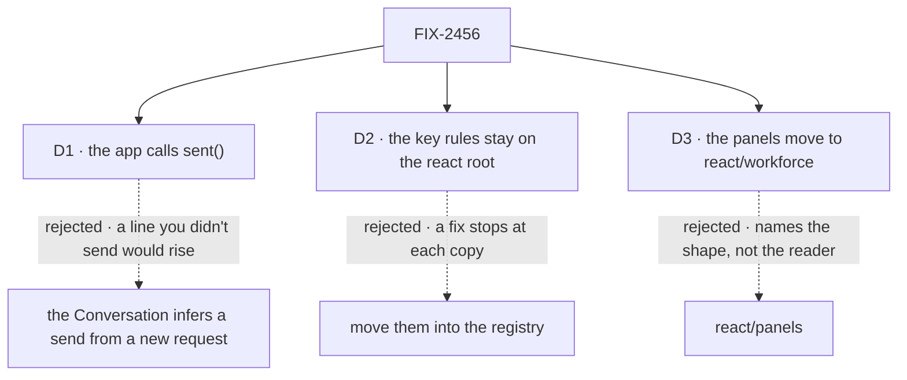

# FIX-2456 · Decisions

[Spec](SPEC.md) · **Decisions**

The scroll rule itself is settled ([FIX-2360 D1](../FIX-2360/DECISIONS.md#d1)), and so is where the
shared button comes from (the epic's ER-6: the registry's `ConversationScrollButton`). These cards
cover how the registry meets the rule and where the root's names go.

## The tree

Solid edges are what you're signing. Dashed edges lost, and the label says why.

## D1 · The app tells the registry Conversation that the person sent, with `feed.sent()`; the Conversation never infers a send from new items

| | |
|---|---|
| **Instead of** | The Conversation calling `sent()` itself when a new request appears in `items`, the input `ScrollOnNewRequest` takes today, so an adopter writes nothing |
| **Because** | A new request is not always this reader's send: another tab, a teammate, a scheduled run. Inferred, each of those rises and moves the view the reader is reading, which is the rule-2 breach FIX-2360 exists to end. FIX-2360 E2 already decided the hook never guesses. Items carry a role, not which person sent them, so the Conversation can't tell |
| **Locks in** | Every adopter who sends from a registry Conversation creates the feed and calls `sent()` as the line goes out: two lines, in the docs page's first example. Leaving `sent()` out is safe: the line stays where it lands and nothing else moves. The `feed` prop on `Conversation` and `ConversationScrollButton` is the registry's public shape |

It comes down to a line the reader didn't send: inferred, it rises and takes the view with it.

- **What would change my mind:** items that carry the sending person's identity. Then the
  Conversation can tell this reader's request from anyone else's, and `sent()` becomes optional.
- **What being wrong costs:** a default added later; the prop stays.

## D2 · `isSendKey` and `isTypingTarget` stay on the react root; the registry's composer uses `isSendKey`

| | |
|---|---|
| **Instead of** | The issue's proposal: move them into the registry (or a react subpath) |
| **Because** | They are rules with no markup, so they are not chrome. Each has outside consumers and a README entry, so ER-1 holds. Copied into the registry, a fix such as the Safari composition guard stops at every installed copy. FIX-2413 D1 and FIX-2401 E9 put key rules in `react` for that reason. The registry composer can import it: four registry items already depend on `react`, and today the composer carries its own Enter rule without that guard |
| **Locks in** | Both stay root API under semver. The registry composer gains the Safari composition guard (`keyCode` 229); every other key behaves as today (`enterSends: true`) |

It comes down to a fix to the send rule: copied, it stops at each install.

- **What would change my mind:** the registry shipping as an installed package. Then key rules
  have a home that upgrades, as FIX-1477 D1's own flip names.

## D3 · The workforce panels move to `@flow-state-dev/react/workforce`

| | |
|---|---|
| **Instead of** | `@flow-state-dev/react/panels`, the issue's name. The registry was ruled out by FIX-1477 D1, and still is: the panels read through react's fenced, coalesced reads, which don't leave the package |
| **Because** | The epic's root rule is that a subpath says who it is for. `workforce` tells a chat-app author to skip it. `panels` names a shape, and `FlowNavigator` has that shape and stays on the root, so the path would be half true |
| **Locks in** | A documented, semver-covered public subpath. Only components that draw workforce records join it. How old root imports reach adopters is Q1's answer, per ER-3 |

It comes down to what the path says: who it's for, which is the epic's rule.

## Decided, not asked

- **From the epic, cited, not restated:** [ER-1](../../epics/FIX-2447/DECISIONS.md#who-owns-what), [ER-3](../../epics/FIX-2447/DECISIONS.md#who-owns-what), [ER-6](../../epics/FIX-2447/DECISIONS.md#who-owns-what), [ER-7](../../epics/FIX-2447/DECISIONS.md#who-owns-what) · **cells owned** in [FIX-2564's grid](../FIX-2564/SPEC.md#what-changes): contributes to `surface.root.react`.
- **E1 · The convergence point is `useJumpToLatest`.** Every conversation in the repo and the
  registry goes through it: the registry `Conversation` (and so Kitchen Sink's two pages), Shift
  Manager's `Conversation` and `TaskSession`, DevTool's stream view, and the labs' views. No
  component keeps an at-the-bottom check of its own. The census's `--after` mode is the check.
- **E2 · The registry marks the person's line by that item's id**, in `RequestGroupRenderer`, from
  the Conversation's context: the segment holding the user item, never the request id, since one
  request can own several segments and two marks with one key would size the kept room for the
  wrong one. Outside a Conversation it marks nothing. FIX-2360 E2 holds.
- **E3 · `RequestGroupRenderer`'s 70dvh last group goes.** It is a second kept room; by FIX-2360
  E6 the hook's room is not content, and the group's is.
- **E4 · One button, the registry's `ConversationScrollButton`**, taking an optional `feed`
  (inside a Conversation it reads the context's). It takes no height, as the copies do, so showing
  it never moves the feed. Shift Manager and both labs install `conversation` and style the button
  by `className`. **DevTool keeps its own button**: it is a published package built by `tsc`, with
  no `@/` alias and `fs-`-prefixed tokens so a host's never collide, and FIX-1477 D1 keeps copy-in
  chrome out of it. Its button already wraps `useJumpToLatest`, so the rule is still one. The
  `aria-label` is *Jump to latest* everywhere.
- **E4b · A `Conversation` without `feed` takes `resetKey`**, which it passes to the hook it
  makes. Kitchen Sink's picked-session view stays mounted across picks; without the key it would
  stop reopening at its end (FIX-2346).
- **E5 · `useJumpToLatest` stays on the root.** The FIX-2360 docs publish it, and the registry
  imports it from there. The issue left this open; it is derivable.
- **E6 · The subpath carries what has a consumer or a README entry.** The `Panel*Source` types go
  there (the ui stories' fixtures import them). The three `*PropNames` lists have neither, so they
  leave public surface (ER-1). They shipped in 0.4.0, so their removal reaches adopters the way
  Q1's answer says, like the moved names. The implementer settles each against the export check.
- **E7 · Changesets:** `minor` for react, `patch` for Shift Manager and DevTool. The registry is private.
- **E8 · Kitchen Sink:** its two pages move to the new Conversation API and its copies of
  `conversation.tsx`, `request-group.tsx` and `prompt-input.tsx` stay byte-equal to the registry,
  gated by `test/registry-drift.test.ts`; those edits are this issue's. No other Kitchen Sink file is
  touched. The copies stay; FIX-2461 adds a refresh command in place of the hand sync.
- **E9 · The labs' new copies get a test.** Shift Manager's copies are already byte-equal by
  `test/static.test.ts`; neither lab has one. Each lab gains a byte-equal test over the copies this
  issue installs; its older copies are left as they are.

## Considered and dropped

| Option | Why it lost |
|---|---|
| Keep `ScrollOnNewRequest` and swap its body for the hook | The simplest change. The 70dvh group would still fight the kept room, and a request from someone else would still rise (D1) |
| A new `jump-to-latest` registry item beside `conversation` | ER-6 names the existing button; a second item is a second name for one control |
| A headless `JumpToLatestButton` in `@flow-state-dev/react` | Puts markup on the root this issue clears |
| Move every component off the react root | The package is *hooks and renderers*; the renderers and `FlowNavigator` serve every app |

## Settled

- **The four hand copies and the 25 names**: counted by [`poc/census/census.mjs`](poc/census/census.mjs).
  It classifies every source file that mentions a scroll marker, or exits 1. Negative control run:
  `--plant` adds a hand-rolled at-the-bottom check and exits 1, `UNCLASSIFIED (1)`. A first plant,
  a button wired to `feed.jump`, was absorbed by the button rule; the plant now uses a marker no
  rule claims. `--after` on `main` d6a38c09 exits 1 with 46 items: three hand-written buttons (DevTool's is allowed), two `ScrollOnNewRequest` sites, the registry's own rule and its missing hook, 13 doc, story and fixture imports, 25 plain root exports, the composer. The premise held.

## Analysis

Not run here: in spec-set member mode the epic-agent runs `analysis` and `reuse-review` over the
whole set.

## How it got here

- **Draft** — framed as bringing the registry to FIX-2360's rule through the hook, with the app
  saying when it sent; the registry's existing button extended and the four copies removed; the
  panels to a `workforce` subpath, and the key rules kept on the root against the issue's proposal.
- **Validation** — DevTool carved out of the shared button (a published package takes no copy-in);
  the line marked by its item id, not the request id; `resetKey` on a feedless Conversation; the
  census widened to the root's exports, the composer and Kitchen Sink's copies, with the control's
  reds declared up front.
- **Set review (Nov 5)** — Kitchen Sink's copies stay (a refresh command comes separately, not a
  replacement); the drift claim corrected, with a byte-equal test added for the labs' new copies
  (E9); the react row on the package-roots page confirmed as this issue's; the hook edge-case seam
  noted; this issue may flip react's *Surface* cell if it lands last of the four.

**Open: none.**
