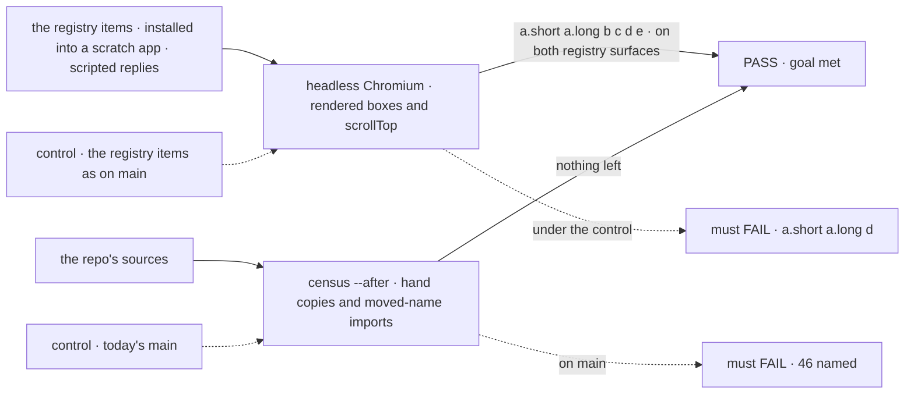
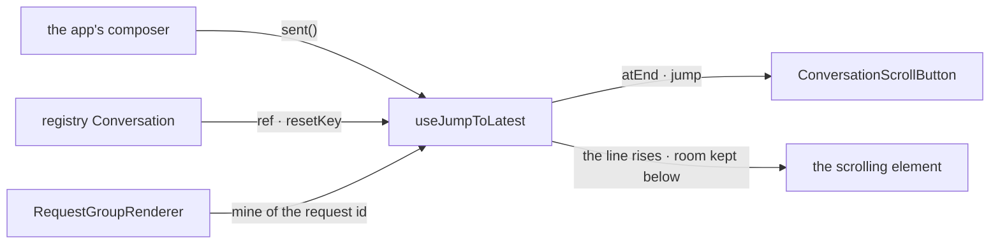

# FIX-2456 · One conversation scroll rule: the registry Conversation on useJumpToLatest, plus a shared jump button; move UI chrome out of the hooks root

**Spec** · [Decisions](DECISIONS.md)

## Six people, before and after

| Someone who… | Today | After |
|---|---|---|
| **installs the registry `Conversation` and sends a line** | The view goes to the bottom. Under a short reply the line sits about a third of the way down, over a 70dvh blank | The line rises near the top and the reply streams below it, as in DevTool, Shift Manager and both labs |
| **reads back in Kitchen Sink while a request they didn't send lands** (another tab, a scheduled run) | `ScrollOnNewRequest` takes them to the bottom | The view stays. The arrow shows |
| **adds a jump-to-latest button to an app** | Copies one of four hand-written buttons, or uses the registry's, which reads its own 50px rule and takes height when it shows | Installs the registry's `ConversationScrollButton` and passes it the feed. The look is theirs, through `className` |
| **types Japanese in the registry's composer, on Safari** | The Enter that confirms a word sends the half-typed message | It confirms the word, as the labs' composers already do through `isSendKey` |
| **builds a chat app on `@flow-state-dev/react` and autocompletes the root** | Sees `Roster`, `BoardColumns`, `BoardList`, `WorkerDetail` and 21 more workforce names | Sees none of them. The documented ones live on `/workforce` |
| **builds a workforce screen** | Imports the panels from the root | Imports them from `@flow-state-dev/react/workforce` |

[FIX-2360](../FIX-2360/DECISIONS.md#d1) set the rule for the four apps and left the registry and
Kitchen Sink to this issue ([its D2](../FIX-2360/DECISIONS.md#d2)). Until this ships, every app
an adopter builds from the registry scrolls by the old rule.

## The goal, and how we'll know it's met

**Every conversation an adopter installs or sees in this repo scrolls by one rule, every app that
takes registry components shows the registry's one jump button, and a chat app's view of the react
root shows no workforce panels.**

| Is it the right goal? | |
|---|---|
| **The real need** | The epic's *one way to do each thing* and a root that shows *only what an app author needs* ([FIX-2447](../../epics/FIX-2447/SPEC.md#the-goal-and-how-well-know-its-met)); the issue: registry users don't get the FIX-2360 rule |
| **Smaller, and rejected** | "Delete `ScrollOnNewRequest` and call the hook." The registry's 70dvh last group would still fight the hook's kept room, and the four button copies stay |
| **Bigger, and not this issue's** | Every component off the react root. Renderers and `FlowNavigator` are the package's job ([What stays](#what-stays-as-it-is)). A refresh command for Kitchen Sink's registry copies, which stay, is FIX-2461's |
| **Not done if** | A fresh registry install or Kitchen Sink still goes to the bottom on a send · a line the reader didn't send rises · a send with no marked line moves the view · a jump button is still written by hand anywhere but DevTool · `ScrollOnNewRequest` or the 50px rule survives as dead code · a panel name is still a react root export, a `@deprecated` alias included · the registry composer keeps its own Enter rule · a copy this issue installs in a lab has no byte-equal test · happy-dom tests pass and the browser check never ran on the registry surfaces |



The browser leg reads where the sent line lands in a real layout; the census reads what is left
in the source: hand copies, the old rule, the root's exports, the composer and Kitchen Sink's copies. Each
control must fail, on its named signals, before a PASS counts.

| How we verify | |
|---|---|
| **Goal check** | Two new surfaces in `goals/conversation-scroll/sent-line-rises-reply-stays/`, n/a model, run by the implementer at completion, verdict in the implementation PR: `registry/send` (a `Conversation` with a feed, the registry composer calling `sent()`) and `registry/read-only` (no feed). Plus [`poc/census/census.mjs`](poc/census/census.mjs)` --after` |
| **Signal** | The goal's existing signals, unchanged: a.short and a.long (the line 0–48px below the feed's top), b, c, d, e; and, for the unmarked send, `scrollTop` moves no more than 1px. Read-only has b, d, e. The census exits 0 |
| **Input** | `fsdev ui add tokens conversation request-group prompt-input message` into a scratch Vite app, from the registry `pnpm --filter @flow-state-dev/ui build` writes, and the goal's script. `registry/send` also sends once with the line unmarked. Kitchen Sink's copies of the three items must be byte-equal to the registry (census), so they pass when it does. Its unkeyed picked-session view is a third surface for e |
| **Anti-game** | No assertion on the hook's return or on `scrollTo` calls; the line is found by its text. The registry items come from the registry, not from a page written for the check |
| **Control that must fail** | `GOAL_CONTROL=main-registry` installs the registry items as on `main`: a.short and a.long red on `registry/send` (the line lands about a third down, over the 70dvh group); d red on both (`ScrollOnNewRequest` scrolls for any new request). b and c stay green: today's registry never follows a stream. Any other red is `WRONG:`. The existing `no-reserve` control also runs on `registry/send` and must fail a.short and a.long. Census `--after` on `main`: exit 1, 46 items |

The closure manifest has no row for one scroll rule; the closure runs this check as a child goal
check the manifest doesn't cover. This issue does contribute to react's *Surface* cell (the 25 panel
names), which the last of the four react contributors to land flips; if that is this issue, it flips it.

## What changes


Red is what goes. Each lane ends with one thing where there were two or five, except DevTool's button, which stays its own by design ([E4](DECISIONS.md#decided-not-asked)).

**An adopter's chat page:**

```diff
+ const feed = useJumpToLatest({ resetKey: sessionId });
- <Conversation>
-   <ScrollOnNewRequest items={session.items} />
+ <Conversation feed={feed}>
    <ConversationContent>
      <RequestGroupRenderer items={session.items} isStreaming={isStreaming} />
    </ConversationContent>
    <ConversationScrollButton />
  </Conversation>
- <PromptInput onSubmit={send}>
+ <PromptInput onSubmit={(message) => { feed.sent(); send(message); }}>
```

**An app with its own feed, such as Shift Manager:**

```diff
- import { JumpToLatestButton } from "./ui";
+ import { ConversationScrollButton } from "./flow-state/conversation";
- <JumpToLatestButton feed={feed} />
+ <ConversationScrollButton feed={feed} className="rounded-none" />
```

**A workforce screen:**

```diff
- import { Roster, BoardColumns } from "@flow-state-dev/react";
+ import { Roster, BoardColumns } from "@flow-state-dev/react/workforce";
```

**Docs:** update *Common components* → Conversation (the feed, `sent()`, the button, no
`ScrollOnNewRequest`); point *Workforce components*, the React API page's panels paragraph,
*Writing UI stories* and the react README's panels section at `/workforce`; point the
`useJumpToLatest` examples (React API page, react README) at the registry's button; add react's
row, naming `@flow-state-dev/react/workforce`, to the epic's *what each package root is for* page
once FIX-2448 publishes it; the row is this issue's. No new page.

## How a send reaches the line



The Conversation carries the hook's return to its children, so the request group marks the
person's line by that item's id and the button reads the same feed. With no `feed` prop the
Conversation makes its own from a `resetKey` prop: a view that never sends keeps rules 2 to 5, and
still reopens at its end on a switch.

## What stays as it is

- `useJumpToLatest`'s behaviour and its place on the react root. The registry now imports it. The
  hook's own edge-case fixes are FIX-2540's, outside the epic; whichever of the two lands second
  rebases.
- The renderers and `FlowNavigator` on the root: the package is *hooks and renderers*, and the
  navigator draws flows and sessions, which every app has. `isSendKey` and `isTypingTarget` stay
  too ([D2](DECISIONS.md#d2)).
- Shift Manager, DevTool and the labs keep their own feeds. Shift Manager's and the labs' buttons
  go; DevTool's stays (E4).
- Kitchen Sink's other registry copies and their drift test. The copies stay; FIX-2461 adds the
  refresh command that ends the hand sync.

## What's already here, and the debt

| Already here | What this does with it |
|---|---|
| Whatever keeps a conversation's scroll: `useJumpToLatest`; the registry `Conversation` with `ScrollOnNewRequest`; `RequestGroupRenderer`'s 70dvh last group. No `mechanisms.yaml` row (searched `scroll`, `jump`, `stick`) | **One kept, two removed.** This would otherwise stay the second and third way |
| Whatever jumps to the latest: the registry's `ConversationScrollButton`; hand copies in Shift Manager, DevTool and both labs ([census](poc/census/census.mjs)) | **Extends** the registry's (epic ER-6); three copies go, DevTool's stays ([E4](DECISIONS.md#decided-not-asked)) |
| [FIX-2360 D1](../FIX-2360/DECISIONS.md#d1), the scroll rule, and its E2 (the app marks its line) and E6 (kept room is not *more below*) | **Kept**, and applied to the registry. E6 is why the 70dvh group goes |
| [FIX-2360 D2](../FIX-2360/DECISIONS.md#d2): the registry and Kitchen Sink are this issue's | **Kept**; this is that follow-through |
| FIX-2346 (#4229): a conversation opens at its end, before paint | **Kept.** `ScrollOnNewRequest`'s instant open is the hook's opening rule now |
| [FIX-1477 D1](../FIX-1477/DECISIONS.md#d1): the workforce chrome ships from `react`, not the registry; a copy drifts | **Amended** for the path: a subpath, not the root ([D3](DECISIONS.md#d3)). **Kept** for DevTool's chrome, which takes no registry copy (E4) |
| [FIX-2413 D1](../FIX-2413/DECISIONS.md#d1) and FIX-2401 E9: key rules live in `react`, beside `isSendKey` | **Kept** ([D2](DECISIONS.md#d2)) |

| Adds | Existing piece considered | Why it doesn't fit / how composed |
|---|---|---|
| `@flow-state-dev/react/workforce` | react's exports map (`.` only); core's subpaths | Extends the map; a documented public subpath of epic D2's kind |
| A `feed` prop on `Conversation` and `ConversationScrollButton` | `useJumpToLatest`; the registry's scroll context | Composed: the context carries the hook's return. No second rule |
| `conversation` and `prompt-input` depend on `@flow-state-dev/react`; `request-group` on `conversation` | Four registry items already depend on `react` | Reuse |
| Installed copies of `conversation` in Shift Manager and both labs | Their hand-written buttons; their existing registry copies (Shift Manager's byte-equal by `test/static.test.ts`; the labs' untested) | The registry's install path those apps already use. Each lab gains a byte-equal test over the copies this issue installs |

| The debt | |
|---|---|
| **Removes** | `ScrollOnNewRequest`, the 50px rule and their context; the 70dvh last group; three hand-written jump buttons; the registry composer's own Enter rule; 25 workforce names from react's root (the undocumented `*PropNames` lists leave public surface entirely) |
| **Adds** | A subpath to keep. Three more installed copies of `conversation.tsx` in place of three 20-line buttons: Shift Manager's held by its existing byte-equal test, each lab's by a new one over the copies this issue installs (the labs' older copies stay untested). No deprecated root names (Q1 answered break) |
| **Leaves** | Kitchen Sink's registry copies, drift-tested (FIX-2461 adds their refresh command). DevTool's own button, permanent by design: a published package can't take a copy-in (FIX-1477 D1) |

**Net: down.** Two scroll rules become one and five buttons two; the root sheds 25 names for one
subpath. The added copies are the registry's own path, not a second mechanism.

## Sign off

**[The goal](#the-goal-and-how-well-know-its-met):** one scroll rule and one button for every
conversation, the registry's included, checked in a browser on a fresh install. If wrong: adopters
keep the rule we retired, or we hold the issue for components it doesn't own.

**[The debt](#whats-already-here-and-the-debt), net down:** two scroll rules, three button copies
and 25 root names go; one subpath is added. If wrong: a subpath nobody needed.

1. **[D1](DECISIONS.md#d1) · The app calls `feed.sent()`; the Conversation never infers a send.**
   If wrong: every adopter wires a line they didn't need. **The one to weigh.**
2. **[D2](DECISIONS.md#d2) · `isSendKey` and `isTypingTarget` stay on the react root, and the
   registry composer uses `isSendKey`.** If wrong: two key helpers stay in autocomplete.
3. **[D3](DECISIONS.md#d3) · The panels move to `@flow-state-dev/react/workforce`.** If wrong: a
   public path named for one family.

**Open: none.** Old root imports reach adopters with no alias: the epic's
[Q1](../../epics/FIX-2447/DECISIONS.md#q1) was answered break (ER-3).

Improvement · `react`, `ui` registry, Shift Manager, DevTool, both labs, Kitchen Sink · medium, 6
packages and apps, 3 public surfaces, 5 removals · epic FIX-2447
