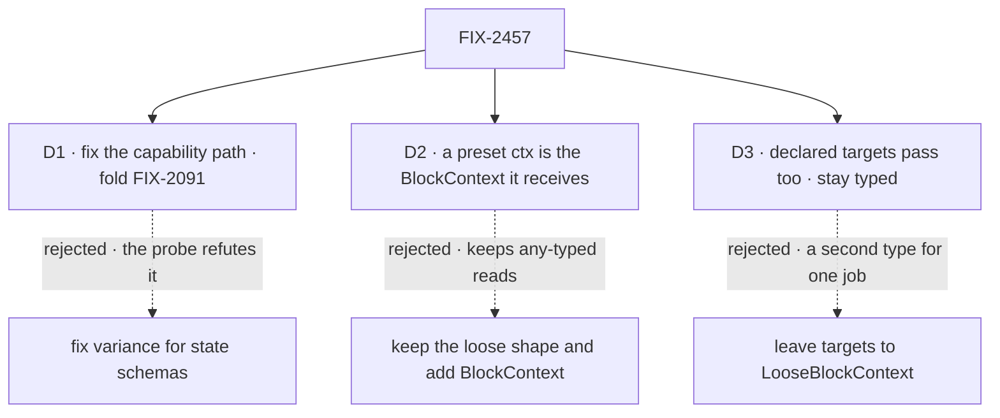

# FIX-2457 · Decisions

[Spec](SPEC.md) · **Decisions**

What was considered, what was chosen, and what each choice locks in. Three decisions are the
sign-off. The probe and the census under `poc/` are the evidence they rest on.

## The tree

## D1 · The cause is the capability path, not state schemas, and FIX-2091 folds in

| | |
|---|---|
| **Instead of** | The issue's proposal: fix `BlockContext`'s variance for request, session and user state schemas, and leave FIX-2091 standalone |
| **Because** | The probe compiled every state-schema case on today's `main`. With every `ctx as never` stripped, 182 of 196 casts compile; the 14 that don't are preset callbacks and three local narrow types. FIX-2091's `targets` bug is what breaks an adopter's `uses: [cap]` handler, and it is a three-token fix in `InferCapabilityTargetSchemasEntry`: a target-less capability's open default schema map is read as "no targets" |
| **Locks in** | FIX-2091 closes with this issue: it joins the epic's ER-8 consumed list, and the coordinator moves and closes it in Linear when this merges. Its five `@ts-expect-error` lines go with it |

It comes down to the probe: state schemas already pass, so fixing them changes nothing.

## D2 · A capability preset's callback gets the `BlockContext` it receives

| | |
|---|---|
| **Instead of** | Keeping `CapabilityPresetCtx`'s loose shape (`[key: string]: any`) and intersecting it with `BlockContext`, so old reads of untyped keys still compile |
| **Because** | The runtime always passes the block's full context (`collectOwnPresets`). The loose shape is why 12 workforce preset sites cast, and why `tools`' MCP filter casts to reach `request`. Its index signature types a typo as `any`, which is the thing the epic's *Types* row exists to stop |
| **Locks in** | `CapabilityPresetCtx<S>` becomes an alias of `BlockContext` with session state `S`, in a published package. A preset callback that reads a key `BlockContext` doesn't declare, or a test that builds a partial preset context, stops compiling. It is a type tightening, not a moved name, so the epic's Q1 does not govern it; the changeset (ER-7) names it |

It comes down to a typo: the loose shape types it as `any`, the alias refuses it.

## D3 · A block that declares its own targets passes as `BlockContext`, and keeps them typed

| | |
|---|---|
| **Instead of** | Leaving declared targets to `LooseBlockContext`, as the type-system page teaches today |
| **Because** | The goal is one helper type for any block. Two types for one job is the debt the epic clears, and `LooseBlockContext` drops every slot but scopes and resources, so a helper typed with it can't reach `ctx.response` or `ctx.signal` |
| **Locks in** | A helper's `BlockContext` parameter accepts any target map, while a block's own `ctx.targets` stays exactly what it declared, `Record<string, never>` when it declared none. That needs the block factories to say "no targets" explicitly rather than lean on `BlockContext`'s default. `LooseBlockContext` loses its documented job and stays exported |

It comes down to one helper type: the alternative teaches a second one forever.

## Decided, not asked

- **The ban is one `no-restricted-syntax` entry** (ER-4), over `packages/*/src`, with three
  selectors: `ctx as never`, `ctx as BlockContext`, `ctx as unknown as BlockContext`. One
  spelling alone would move the casts. Tests are out: their mocks are partial on purpose.
- **The seven casts the lint would still catch are retyped, not kept**: core's
  `pull-request-recorder.ts:131` (a narrow type meeting the request-end seam), workforce's
  `project-coordinator.ts:251`, `workstream-writes.ts:596`, `plan.ts:395,400`,
  `run-project.ts:85`, and harness-manager's `manager.ts:1915`: local types narrower than what
  they are passed.
- **The convergence points** are `BlockContext`'s `targets` slot, which every block factory
  passes through, and `CapabilityPresetCtx`, which every preset callback (`tools`,
  `controlTools`, `context`, `model`, `providerOptions`, `caching`) passes through.
- **The leg c helper is `resolveResourceCollection`, on `orchestration/tasks`.** `payBoardDebts`
  and `settlePassWake` move to `orchestration/internal`, which an adopter can't import. This one
  takes `BlockContext` first and has a docs-site example, so it stays public.
- **No runtime change**, so `pnpm typecheck` is the evidence, not `fsdev run`.

## Considered and dropped

| Option | Why it lost |
|---|---|
| Widen `BlockContext`'s `TTargets` default only | Tried: t1 passes, but a block with no targets then reads an open `ctx.targets`, and `sequencer.ts:2128` stops compiling. Precision has to come from the factories (D3) |
| Sweep the casts and add the lint, no type change | Meets the smaller goal. An adopter's capability handler still needs a cast |
| A custom ESLint rule for the cast | ER-4: the tracker-id rule is the one custom rule |

## Open / settled

**Settled · the cause.** State schemas pass; the capability `targets` default and the preset ctx
type fail. Evidence: [`poc/assignability`](poc/assignability/README.md), at `d6a38c09`.

**Settled · the count.** 196 `ctx as never` in `packages/*/src` (workforce 176, harness-manager
9, orchestration 8, integration-tests 2, core 1), 19 `ctx as BlockContext`, 10 `ctx as unknown
as BlockContext`. The issue's "about 185" predates the latest workforce merges. Evidence:
[`poc/cast-census/census.mjs`](poc/cast-census/census.mjs), with its totality check and planted
control both run.

**Partly settled · D3's mechanism.** Assignability through a wider default is shown; keeping a
no-target block's `ctx.targets` precise through the factories is not built. It is the
implementer's first test.

**Open: none.**

## Analysis

Skipped in spec-set member mode: the epic-agent runs `analysis` and `reuse-review` over the
whole set.

## How it got here

- **Draft** — the issue blamed state schemas; the probe showed they pass and found the
  capability `targets` default and the loose preset ctx instead, so FIX-2091 folds in and the
  sweep rests on two core type changes, plus declared targets so one helper type serves every block.
- **Goal validation (blind)** — the check now names its test path and the three spellings, forbids
  loosening a helper's parameter, counts `@ts-ignore`, and runs the planted cast through ESLint.
- **Set review (Nov 5)** — leg c's helper and the parameter assertion move from `payBoardDebts`
  (going internal) to `resolveResourceCollection` on `./tasks`, as cell `types.typed-handler`;
  FIX-2091 joins ER-8's consumed list; `eslint.config.mjs` is a seam with the tracker-id rule.
