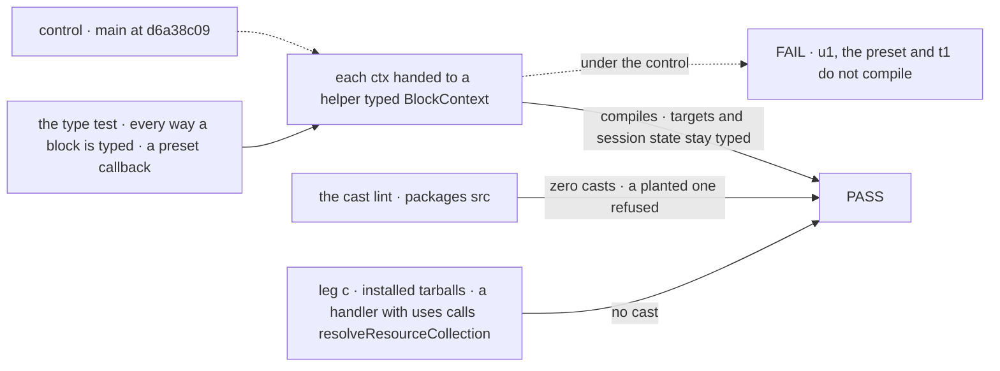
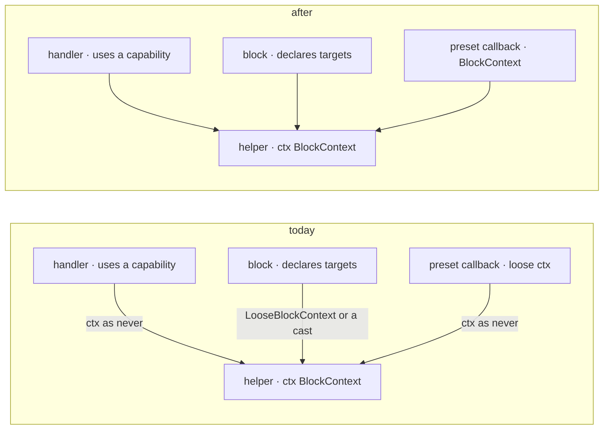

# FIX-2457 · Make typed handler ctx assignable to BlockContext and sweep about 185 `ctx as never` casts

**Spec** · [Decisions](DECISIONS.md)

## Six people, before and after

| Someone who… | Today | After |
|---|---|---|
| **writes a handler with `uses: [someCapability]` and calls `resolveResourceCollection(ctx, key)`** | A compile error on `ctx.targets`, so they write `ctx as never` | It compiles |
| **declares `targetStateSchemas` and calls a helper typed `BlockContext`** | A compile error; the docs say type the helper `LooseBlockContext` | It compiles; `ctx.targets` stays typed in the block |
| **writes a capability preset, `tools: (ctx) => …`, and calls a helper** | `ctx` is a loose shape: any key reads as `any`, and a `BlockContext` helper rejects it | `ctx` is the block's `BlockContext`, session state typed from the capability |
| **declares request, session or user state schemas and calls a helper** | Already compiles; the issue suspected this case wrongly | The same, now under a type test |
| **reads framework source to learn the pattern** | 196 `ctx as never` in `packages/*/src` teach the cast | None, and a lint refuses a new one |
| **unit-tests a preset callback with a hand-built partial `ctx`** | Compiles | A compile error; they build it with the testing package |

The last row is the price. A preset callback always ran with a full `BlockContext`
(`core/src/blocks/generator.ts:155`); only the type was lying.

## The goal, and how we'll know it's met

**A block author passes their block's own `ctx`, however the block is typed, to any exported
helper that takes a `BlockContext`, with no cast. The framework's own source carries none, so no
one learns the cast from it.**

| Is it the right goal? | |
|---|---|
| **The real need** | The epic's *Types* row: "a typed handler needs a cast to call an exported helper" must stop being true, for adopters on installed packages ([epic](../../epics/FIX-2447/SPEC.md#the-goal-and-how-well-know-its-met)) |
| **Smaller, and rejected** | "Delete the casts and add the lint." 182 of the 196 delete today with no type change, so the sweep alone looks done while an adopter's `uses: [cap]` handler still fails |
| **Bigger, and not this issue's** | FIX-2197's `ctx.suspend!`, prompt, preset-override and component-data typing (consumed by the epic). About 206 mock casts in `packages/*/test` |
| **Not done if** | A handler with `uses` or `targetStateSchemas`, or a preset callback, needs a cast · the casts moved to another spelling, `@ts-expect-error` or `@ts-ignore` · `ctx.targets` or a preset's session state went untyped to pass · a helper's parameter or `BlockContext`'s defaults were loosened to `any` so anything fits · leg c's fixture uses only state schemas, which pass on today's control |



The type test reads the compiler, the lint the source, leg c an adopter's project; today's
`main` fails all three.

| How we verify | |
|---|---|
| **Goal check** | `packages/core/test/block-context-resources.test-d.ts` extended (core's `typecheck` runs `tsconfig.test-d.json`, which compiles every `test/*.test-d.ts`) with the [probe](poc/assignability/probe.test-d.ts)'s cases, request, session and user state schemas named among them, plus precision assertions; the `no-restricted-syntax` entry in `eslint.config.mjs`; the [census](poc/cast-census/census.mjs) at zero over `packages/*/src`, shift-manager included (it has none today); the epic's leg c cell `types.typed-handler` flipped to `expect: pass`: a handler with `uses: [cap]` imports `resolveResourceCollection` from `@flow-state-dev/orchestration/tasks`, a public entry with a docs-site example, and passes its `ctx` |
| **Signal** | `pnpm typecheck` passes in core; the census reports 0 for `ctx as never`, `ctx as BlockContext` and `ctx as unknown as BlockContext`; leg c compiles against the tarballs |
| **Anti-game** | Precision is asserted, not just assignability: a no-target block's `ctx.targets.typo` is an error, a preset's `ctx.session.state.count` is a `number`, and `resolveResourceCollection`'s first parameter is still `BlockContext` with its defaults (`expectTypeOf(...).parameter(0)`), read from the installed `orchestration/tasks` `.d.ts`. Leg c's fixture uses a capability, or it passes today, and imports only public entries, so the helper is one `orchestration/internal` won't take |
| **Control that must fail** | `main` at `d6a38c09` (this issue's; the epic's manifest control is `ebec5326`): u1, `pre` and t1 fail to compile, the census reports 196. A `ctx as never` planted in a `packages/*/src` file must make `eslint` exit non-zero, run through ESLint itself, not the census |

## What changes



Three ways a block is typed reach one helper. Today each needs a cast or a second type; after,
the arrow carries nothing.

**What an author writes:**

```diff
 const settle = handler({
   name: "settle",
   uses: [boardTools],
   sessionStateSchema: SettleState,
   execute: async (input, ctx) => {
-    const ledger = resolveResourceCollection(ctx as never, "work");
+    const ledger = resolveResourceCollection(ctx, "work");
   },
 });

 const notes = defineCapability({
   name: "notes",
   sessionStateSchema: NotesState,
   presets: { tools: {
-    tools: (ctx) => notesTools(ctx as never),
+    tools: (ctx) => notesTools(ctx), // the block's BlockContext, session state typed as NotesState
   } },
 });
```

**And in `eslint.config.mjs`, for `packages/*/src`:**

```diff
+ "no-restricted-syntax": ["error",
+   { selector: "TSAsExpression[expression.name='ctx'] > TSNeverKeyword", message: "Pass ctx as it is; it is a BlockContext." },
+   { selector: "TSAsExpression[expression.name='ctx'][typeAnnotation.typeName.name='BlockContext']", message: "…" },
+   { selector: "TSAsExpression[expression.expression.name='ctx'][typeAnnotation.typeName.name='BlockContext']", message: "…" }],
```

The same file gains the epic's one custom rule, the tracker-id rule; the two edits are a seam
in the epic's table, and the second to land rebases.

**Docs:** update `fundamentals/type-system.md` → *When to reach for `LooseBlockContext`*,
`fundamentals/capabilities.md` (a preset's `ctx`), and core's README entries for both types. No
new page.

## What stays as it is

- `BlockContext`'s members and every block's own view of its `ctx`.
- The runtime: only types change.
- `LooseBlockContext` stays exported. Retiring it is a moved-name question ([below](#whats-already-here-and-the-debt)).
- Test mocks: their casts build partial contexts on purpose; the lint covers `src` only.

## What's already here, and the debt

| Already here | What this does with it |
|---|---|
| `BlockContext` as a helper's parameter type, the convention every exported helper uses (`resolveResourceCollection` and `cancelAndResume` on `./tasks`, `waitOnTask` on `./task-board`) | **Builds on.** The job is "a helper accepts any block's ctx"; this makes the convention true |
| `LooseBlockContext`, 25 uses in `src`, documented as the workaround for typed targets | **The second way to do this job.** Kept; docs stop sending people to it |
| Mechanism rows | **None fits.** Searched `mechanisms.yaml`; the capability row is bundling, not typing |
| FIX-2060: declared `resources` keep a `ctx` assignable | **Kept.** The same fix, for the `targets` slot and the preset ctx; its type test is extended |
| FIX-2091: `uses: [cap]` breaks assignability on `targets` | **Folded in** by [D1](DECISIONS.md#d1), which says how it leaves the backlog. The cause the probe found for u1 |
| FIX-2197 (consumed, ER-8) | **Beside it.** It scopes this gap out; this takes none of its four cases. Both edit `capability/types.ts`; the second to land rebases |

| Adds | Existing piece considered | Why it doesn't fit / how composed |
|---|---|---|
| One `no-restricted-syntax` entry, three selectors | ESLint's `no-restricted-syntax`, no rule of our own ([ER-4](../../epics/FIX-2447/DECISIONS.md#who-owns-what)) | Config on the existing rule, beside the tracker-id rule in the same file. Three selectors so a cast can't change spelling |
| A wider type test | `block-context-resources.test-d.ts` | Extends it, or sits beside it under the same `tsconfig.test-d.json` |

| The debt | |
|---|---|
| **Removes** | 196 `ctx as never` and about 25 `ctx as [unknown as] BlockContext` casts in `packages/*/src`; five `@ts-expect-error` lines in harness-manager's tests; the MCP filter's `request` casts in `tools` |
| **Adds** | One lint entry. A breaking type change to a published name, `CapabilityPresetCtx` ([D2](DECISIONS.md#d2)), with a changeset (ER-7) |
| **Leaves** | `LooseBlockContext`, whose job this absorbs. Removing a published name follows the epic's Q1; the epic-agent files it or not |

**Net: down.** About 220 casts and a documented workaround go; a lint entry and a stricter type arrive.

## Sign off

**[The goal](#the-goal-and-how-well-know-its-met):** any typed block's `ctx` reaches a
`BlockContext` helper with no cast, on the compiler, the source and installed tarballs. If
wrong: an adopter's capability handler still needs a cast.

**[The debt](#whats-already-here-and-the-debt), net down:** about 220 casts go; a lint entry and
a stricter `CapabilityPresetCtx` arrive. If wrong: a breaking type for a cleanup.

1. [D1](DECISIONS.md#d1) · The cause is the capability path, not state schemas; FIX-2091 folds
   in. If wrong: two issues edit one type and each lands half a fix.
2. [D2](DECISIONS.md#d2) · A preset callback's `ctx` is the `BlockContext` it receives. If
   wrong: presets reading untyped keys, and hand-built test contexts, stop compiling.
3. [D3](DECISIONS.md#d3) · A block with its own targets passes too, and keeps them typed. If
   wrong: a factory change the sweep didn't need.

**Open: none.** D2 is the one to weigh.

Improvement · `core` (types, one lint entry), casts removed in `workforce`, `orchestration`,
`harness-manager`, `core`, `integration-tests`, `patterns`, `engine`, `claude-code` · medium ·
epic FIX-2447
