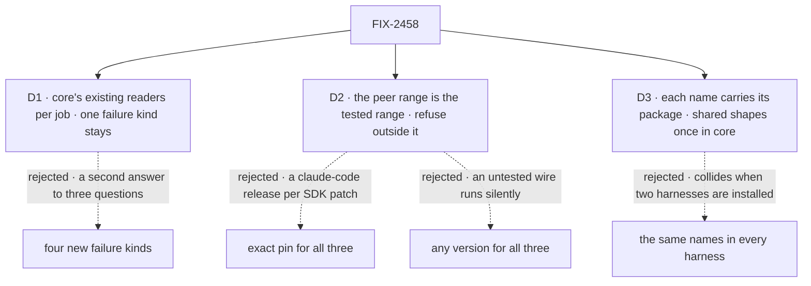

# FIX-2458 · Decisions

[Spec](SPEC.md) · **Decisions**

What was considered, what was chosen, and what each choice locks in. Three decisions are the
sign-off. D1 narrows the issue's proposal; D2 and D3 pick between shapes it left open.

## The tree

Solid edges are what you're signing. Dashed edges lost, and the label says why.

## D1 · A stop, an unusable SDK and a bad config use the readers core already has; `HarnessFailureKind` stays one kind

| | |
|---|---|
| **Instead of** | The issue's proposal: add `aborted`, `sdk-not-installed`, `sdk-version-mismatch` and `config` to `HarnessFailureKind`, set by every harness |
| **Because** | Each of the three questions already has its reader. A stop is `isAbortLike`, which the generator and the discovery tools act on; Codex's and Cursor's stop errors fail it today ([evidence](poc/facts/check.mjs)). "Can it run here" is the readiness check, the `harness-readiness` mechanism harness-manager serves; it misses only the version. A config error is thrown when the block is built, before any host can branch on it. A kind for each would be a second answer that can disagree with the first |
| **Locks in** | Every harness's stop error carries the signal's reason as its `cause`, so it is abort-like and keeps its resumable session id. Every readiness check reports an absent SDK and one outside the tested range, with a remedy. A host with only the thrown error gets `null` for an unusable SDK and reads the message. Adding a kind later stays a one-member widening |

It comes down to one answer per question: a kind would answer "was it stopped" a second way.

**What would change my mind:** a host that meets an unusable SDK only as a thrown error, with
no readiness check in its path. Then `sdk-not-installed` earns its kind.

## D2 · One SDK policy: the peer range is the tested range, and outside it the harness refuses

| | |
|---|---|
| **Instead of** | Exact pins for all three, which claude-code would join · or any version for all three, which Codex and Cursor would leave |
| **Because** | Each package translates its vendor's wire, so an untested version produces malformed items, not an error; that is why Codex and Cursor gate. But claude-code's comments were measured on SDK 0.3.234 while Kitchen Sink runs ^0.3.316: an exact pin would need a claude-code release for each patch. A range covers both: one version wide for Codex and Cursor, a tested span for Claude |
| **Locks in** | Each package's `peerDependencies` range is what it tested, and the readiness check and the block refuse outside it, naming both. claude-code moves from `*` to a range: an adopter on an untested SDK gets a refusal with a remedy at build time. Widening a range is a release |

It comes down to a gate and a cadence: an exact pin loses claude-code's cadence, any version
loses the gate.

**What would change my mind:** the Claude Agent SDK changing its message shape inside a patch.
Then claude-code's range is one version wide, under the same policy.

## D3 · Every harness name carries its package's name; shared shapes live once in core

| | |
|---|---|
| **Instead of** | The issue's same-named `listModels()` in all three packages |
| **Because** | Three declarations named `listModels` collide when one app installs two harnesses, which leg b refuses and Kitchen Sink would alias at every import. Today 8 names already collide this way. A shape that is the same everywhere belongs once in core, and a function that runs one vendor says which |
| **Locks in** | Public names: `HarnessModelInfo`, `HarnessModelList` and `HARNESS_BASE_PASS` on `core/harness`; `listCursorModels`. claude-code spells every name `ClaudeCode`/`claudeCode`/`CLAUDE_CODE_`, as Codex and Cursor already use their package names, and its one entry is the package root. Old names reach adopters per ER-3 and Q1's answer |

It comes down to an app with two harnesses: shared names collide, and Kitchen Sink has three.

## Decided, not asked

- **The shared model type is the shape both lists already have:** `id`, `label`,
  `description?`, `isDefault`, and `{ status: "models" | "failed" }`. Cursor's variants (Grok's
  effort) ride a Cursor-only extension, not the shared type.
- **`listCursorModels` asks the Cursor SDK's `Cursor.models.list()`**, under the same never-throws
  contract as the other two. Kitchen Sink maps Grok's effort from the variants it returns.
- **`HARNESS_BASE_PASS` is the 13 names the three lists share** (`PATH`, `HOME`, `USER`, `SHELL`,
  `TMPDIR` and the proxy variables). Each harness's list is the base plus its own credentials and
  certificates. A value for `harnessEnv`, not a second builder.
- **Translate and emit leave the public entries of all three.** Nothing outside the packages
  imports them. The version helpers leave too, once Kitchen Sink reads readiness instead.
- **Error classes stay, one set per package, renamed under D3** (`ClaudeAgentRunError` becomes
  `ClaudeCode…`). claude-code gains a version-mismatch class for D2. Docs branch on core's readers.
- **The convergence point for "a stop is abort-like"** is each stop error's constructor, not
  its throw sites: Codex builds its in four places and Cursor in five (`abortRace`, the pre-run
  signal check, the session-id rewrap, and Cursor's mid-run check). Claude Code's `rejectOnAbort`
  already rejects with the signal's reason.
- **No retired runtime value.** Nothing here retires a value or config key, so FIX-2454's refusal
  helper is not used. Every change is a moved or removed export, under Q1.
- **The goal check extends Kitchen Sink's parity suite**, the one place the three harnesses
  already share a table. These are Kitchen Sink's harness files, edited only by this issue.

## Considered and dropped

| Alternative | Why not |
|---|---|
| One set of error classes in core for all three | Sound, and LAB-156's. The classes carry vendor detail, and nothing branches on them once the readers do |
| A shared emitter | The issue already defers it; LAB-156 |
| A new harness-lines guide page | Already written: *Steering a running turn* in `coding-agents.md` |
| Keep `./sdk` beside a new root | Two doors to one module; with `./cli` gone, the root is the only door |

## Settled

- **Codex's and Cursor's stop errors are not abort-like; Claude Code's is** — **CONFIRMED** by
  [`poc/facts/check.mjs`](poc/facts/check.mjs), which runs core's `isAbortLike` on each.
- **The factual base** (88 claude-code names in five spellings, 8 cross-package names, 5/5/2
  error classes, 13 shared environment names, no `./cli` consumer) — re-derived by the same
  checker; `--control` plants an unclassified name and it fails. It corrected one count in the
  draft: the shared base is 13 names, not 15.

## Analysis

Skipped in member mode: the epic-agent runs `analysis` and `reuse-review` over the spec set.

## How it got here

- **Draft** — framed as one reader per job across three harnesses; narrowed the issue's four
  failure kinds to core's existing readers (Step 3.5: *refine the substrate*), a tested-range
  version policy, and package-named exports with shared shapes in `core/harness`.

**Open: none.**
